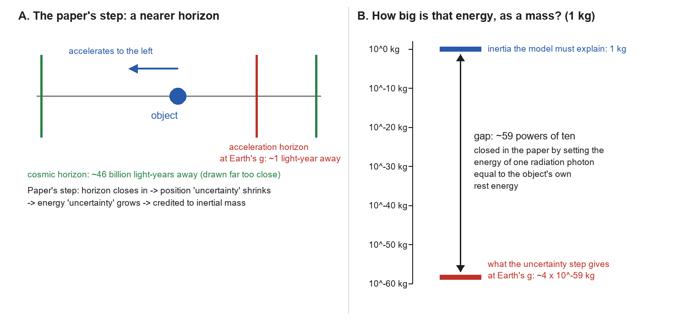

v3.16
Analyzing | Framework v3.16 | journal-published (EPL) but a single-author program in a contested area; the Claim Check finds load-bearing errors

> **Access Status** — Full paper: read directly from the local arXiv PDF (arXiv:1610.06787v1, the only version listed on the arXiv abs page, submitted 13 Oct 2016; 9 pages, all read, including the reference list) · Abstract: from the PDF and the arXiv abs page · Journal version: the arXiv comments say "Accepted for publication in EPL" and the abs page lists the related DOI 10.1209/0295-5075/115/69001 (EPL 115, 69001, 2016); I did not read the typeset journal version, so small editorial differences from v1 are possible · Supplementary material: none exists; no appendices · Figures: the paper has no figures (the manifest reports no figure files and no captioned pages; I confirmed by viewing all nine pages). The one picture below is analyst-built with Python/Pillow · Comparison papers: checked on their arXiv abs pages where they exist (versions cited in place); two cited works have no arXiv version I could find and are cited from journal metadata only · Analysis basis: full text.

---

## 1. Punchy Title & One-Sentence Hook

**Booking an Error Bar as Cash: Can the Uncertainty Principle Pay for Inertia?**

A short EPL paper claims that if nature conserves "mass-energy plus quantum uncertainty", the horizons created by acceleration release exactly the energy needed for the author's dark-matter-free model of inertia; recomputing it shows the books only balance after a substitution that closes a gap of about fifty-nine powers of ten, and two of its key steps have the wrong sign.

## 2. Big-Picture Context

Why does a pushed object resist being pushed? Newton took inertial mass as a given; Ernst Mach suspected it came from the rest of the universe; Einstein built general relativity partly around the fact that inertial mass and gravitational mass are always equal. In the standard picture today, most of the mass of ordinary matter comes from the strong-force binding energy inside protons and neutrons, the electron's mass comes from its coupling to the Higgs field, and inertia is simply what that energy content does when you try to change its motion. Nobody in mainstream physics thinks inertia needs a separate explanation tied to the size of the cosmos.

A small, persistent line of work disagrees. It starts from two observations. First, galaxies spin too fast at their edges for their visible matter, and the trouble always appears at roughly the same tiny acceleration, about a ten-billionth of a metre per second per second. Second, that acceleration is suspiciously close to the speed of light times the expansion rate of the universe. Mordehai Milgrom's Modified Newtonian Dynamics (MOND) turned that coincidence into an empirical rule; others tried to explain it physically, as an effect of the quantum vacuum on inertia. M. E. McCulloch's "quantised inertia" (he also calls it MiHsC, Modified inertia by a Hubble-scale Casimir effect) is one such attempt, developed in a long series of single-author papers since 2007. It says inertia comes from radiation that only accelerating objects see, and that this inertia weakens at tiny accelerations because the universe is too small to hold the longest waves.

The earlier papers simply posited the quantised-inertia formula and then compared it with data. This paper tries to derive it. The proposal is that what nature conserves is not mass-energy alone but mass-energy plus the "energy uncertainty" from Heisenberg's principle. When an object accelerates, a horizon appears behind it; the paper reads this as shrinking the object's position uncertainty, which raises its energy uncertainty, and that energy is booked as inertial mass. The same bookkeeping is used to re-derive Newton's law of gravity (extending a 2014 paper by the same author) and to "predict" the electron, proton, and Planck masses.

**Paper Type & Stakes:** this is a short, single-author theoretical paper in the general-physics category that offers a heuristic derivation of an existing alternative-gravity model. If the derivation held, it would give quantised inertia a first-principles footing it otherwise lacks; if it fails, the model stays where it was, a posited formula judged on its fits to data.

**Prior Belief Check:** the paper contradicts mainstream physics on two levels. It treats the spread of a quantum measurement as a real, conserved store of energy, which is not how quantum mechanics works in any standard formulation; and it supports a model that replaces dark matter and dark energy, against the consensus cosmological model. Experts are not surprised by the paper, because they do not engage with it much; the quantised-inertia program has drawn a published critique of its earlier derivation and little uptake. Within that program the paper is an incremental step: it reuses the author's existing formula and his 2014 gravity argument. My own recomputation (Section 4) finds that the derivation does not do what it claims, which matters more for calibration than the paper's venue.

**Replication & Convergence Note:** this is a single-author result with no independent derivation or confirmation that I could find; the only independent technical engagement I located is a critique of the *earlier* derivation of the same formula (Renda, arXiv:1908.01589v1, the only listed version, whose abs page lists a related MNRAS DOI; I saw only its abs page and abstract, not its full text). Independent confirmation would mean another theorist reproducing the step from the conservation law to the quantised-inertia formula without the substitution flagged below, or a laboratory showing an inertia anomaly at tiny accelerations that the standard picture cannot explain.

## 3. Necessary Background Crash-Course

### The uncertainty principle: a tolerance, not a fuel tank

Heisenberg's principle says a quantum object cannot have both a sharply defined position and a sharply defined momentum: squeeze the spread of one and the spread of the other must grow, with Planck's constant setting the exchange rate. For a photon, momentum and energy are tied together by the speed of light, so the same rule can be read as "confine light to a smaller region and the spread of its energy grows". That is why confining a photon to a box of a given size gives it a minimum energy, and it is the one move the whole paper is built on.

The key subtlety is what the "spread" is. In standard quantum mechanics it is the width of a probability distribution over possible measured values. It is not an extra amount of energy that sits alongside the object's other energy. When a particle is confined, its *average* energy can rise (that is real, and measurable as zero-point energy), but the paper goes further: it adds the spread itself to the conserved total, as if it were a separate account.

**Analogy:** think of a machined part's spec sheet. Tighten the tolerance on one dimension and, for this part, the tolerance on a linked dimension must loosen. The tolerance band tells you how precisely the part is defined; it is not a quantity of steel.

**Breaks when:** you treat quantum spread as manufacturing sloppiness. In quantum mechanics the spread is intrinsic, not ignorance about a definite hidden value, and confinement really does raise the average energy. The spec-sheet picture is right that a tolerance is not material; it is wrong if it suggests the spread can be reduced by better tooling.

### Horizons made by acceleration

An object that accelerates steadily forever outruns some light. Light emitted far enough behind it, beyond a certain distance, never catches up. That boundary is called a Rindler horizon (named for Wolfgang Rindler), and its distance is the speed of light squared divided by the acceleration: about one light-year for an object accelerating at Earth's gravity, and farther the gentler the acceleration. The universe has a far larger horizon of its own, set by the age and expansion of the cosmos, tens of billions of light-years away.

**Analogy:** a replica server that keeps speeding up its own clock and moving its consistency window forward. Updates from nodes that lag beyond a certain distance can never arrive in time, so for that replica they effectively do not exist, while nodes inside the window stay in sync.

**Breaks when:** you ask whether anything is lost. The Rindler horizon belongs to the accelerating observer only. A non-accelerating observer sees no horizon, and the region beyond it is not deleted or measured; it is just out of causal reach for one worldline. The paper reads the horizon as reducing the object's *position uncertainty*, a step that the replica picture already makes look shaky: being out of contact with distant nodes does not make the replica's own location more precise.

### Unruh radiation: heat that only an accelerating observer feels

In 1976 Bill Unruh (building on Stephen Fulling and Paul Davies) showed that a detector accelerating through empty space registers a faint thermal glow, with a temperature proportional to its acceleration. It is the accelerating cousin of Hawking radiation from black holes, and the horizon is what makes it thermal. The effect is extraordinarily weak: at Earth's gravity the temperature is about ten to the minus twenty kelvin, and no one has unambiguously measured it.

Like any thermal glow, Unruh radiation peaks at a wavelength set by its temperature (Wien's displacement law, the same rule that makes hotter stars bluer). At Earth's gravity that peak wavelength is light-years long; at the tiny accelerations at galaxy edges it is comparable to the size of the universe.

**Analogy:** fan noise that only a moving microphone picks up, louder the harder it speeds up, with the pitch dropping as it slows.

**Breaks when:** you look for a source. There is no fan; the glow is the same vacuum described in a different frame, and whether an accelerating object feels a net *push* from it is exactly the contested step quantised inertia relies on.

### Quantised inertia in one paragraph

Quantised inertia claims that an object's inertia is the pressure imbalance of its own Unruh radiation: the horizon behind an accelerating object damps the radiation on that side, the front side pushes harder, and this push opposes the acceleration, which looks like inertial mass. At very low accelerations the Unruh waves become longer than the universe allows and are cut off evenly in all directions (the "Hubble-scale Casimir effect", by analogy with the force between two plates that exclude some vacuum waves). Fewer allowed waves means less inertia, so at galaxy edges stars respond more strongly to the same pull, mimicking extra mass.

The model's whole content is one formula, which this paper tries to derive:

$$m_i = m\left(1 - \frac{2c^2}{|a|\,\Theta}\right)$$

**Symbol definitions:**
$m_i$ : the modified inertial mass (kg)
$m$ : the ordinary inertial mass (kg)
$c$ : the speed of light (m/s)
$|a|$ : the size of the object's acceleration relative to surrounding matter (m/s²)
$\Theta$ : the diameter of the observable universe (m)

**What this actually means:** the bracket is a "discount factor" on inertia. For everyday accelerations the subtracted term is a few parts in a hundred billion, so inertia is normal; as the acceleration falls toward a threshold set by the speed of light and the size of the cosmos (close to MOND's empirical acceleration scale), the discount grows, and at the threshold inertia would vanish. It is like a cache whose effective capacity is total size minus a fixed overhead: invisible for big workloads, dominant for tiny ones.

### Origins & Big Picture: where inertia comes from, and where this idea sits

The "system" this paper studies is inertia itself, so the origin story is the history of how physicists have tried to explain it.

Newton defined inertial mass operationally, as the resistance to a change in motion, and noticed it always equals the "heaviness" that gravity acts on. He also used a spinning bucket of water to argue that rotation is absolute: the water's surface curves even with nothing else around to rotate relative to. Ernst Mach replied in the 1880s that the water might be rotating relative to the distant stars, and that inertia might be produced by all the matter in the universe. Einstein found Mach's idea inspiring, and general relativity made the equality of inertial and gravitational mass a cornerstone (the equivalence principle), but it did not, in the end, derive inertia from distant matter.

Modern particle physics answers the question differently. Most of the mass of a proton is the energy of the quarks and gluons confined inside it (confinement raises energy, much as the uncertainty argument suggests, but through the strong force's dynamics, not bookkeeping). The electron and quarks get their own masses from the Higgs field. In that picture inertia is just energy content resisting a change of motion; nothing cosmic is needed, and the equivalence principle is tested to about one part in a million billion by torsion balances and the MICROSCOPE satellite.

The alternative line started from astronomy. Through the 1970s, rotation curves showed spiral galaxies spinning too fast at their edges. The mainstream answer became dark matter, now part of the standard cosmological model along with dark energy. In 1983 Milgrom proposed MOND instead: below a fixed tiny acceleration, the relation between force and acceleration changes. MOND predicts the rotation curves of individual galaxies remarkably well from visible matter alone, but struggles with galaxy clusters and the cosmic microwave background, where dark matter does well. The MOND acceleration also happens to be close to the speed of light times the Hubble expansion rate, which tempted many to look for a cosmic origin.

In parallel, physicists asked whether the quantum vacuum could produce inertia. Haisch, Rueda and Puthoff argued in 1994 that inertia might be a drag force from the vacuum's zero-point field, but their result needed an arbitrary cutoff frequency. Milgrom suggested in 1999 that MOND might be a vacuum effect tied to Unruh radiation and the cosmic horizon, though he doubted Unruh radiation could produce inertia because it is the same in all directions. McCulloch's quantised inertia, starting in 2007 with the Pioneer spacecraft anomaly, adds the missing direction: the Rindler horizon damps radiation on one side. Over the next decade he applied the same formula to galaxy rotation, cosmic acceleration, spacecraft flyby anomalies, and proposed thrusters.

This paper sits at the point where that program tries to stop being a posited formula and become a derivation from deeper principles: quantum uncertainty plus relativistic horizons. That is a reasonable thing to want. Where it fits in the big picture, though, is as a heuristic within a minority program, not as a contender inside mainstream gravitational physics; and two of the observational anchors have moved since the program began (the Pioneer anomaly is now explained by heat radiating from the spacecraft, Section 6).

**Central analogy for this paper:** an error bar booked as cash.

## 4. Core Technical Explanation

The paper is short and its logic is a single chain, so this section follows it in order, then checks it.

```
Analyst-built concept diagram (not from the paper)

 Heisenberg: smaller position spread -> larger energy spread
                       |
                       v
 NEW POSTULATE: mass-energy + energy spread is conserved
                       |
        +--------------+---------------+
        |                              |
        v                              v
 two clumps of Planck masses    one accelerating object
 (spread = their separation)    (spread = cosmic radius,
        |                        then Rindler distance)
        v                              |
 inverse-square force law              v
 (needs G as input)            tiny mass change, ~1e-59 kg
                                       |   swap a photon's energy
                                       v   for the object's own
                               "same as" quantised-inertia formula
                                       |
                                       v
 particle masses from confinement lengths (electron, proton, Planck)
```

*How to read it:* one postulate at the top feeds three applications; the arrows marked with a substitution are where the Claim Check finds the derivation does its real work.

### Step 1: Newton's gravity from uncertainty (recap and extension of the 2014 paper)

**The gap it fills:** without some mechanism, the uncertainty principle says nothing about forces between distant bodies. **What the author does:** he pictures each body as a collection of Planck-mass units, the heaviest masses still treated as quantum. For every pair of units across the two bodies he writes an uncertainty relation, with the "position uncertainty" taken to be the distance between the bodies, and adds up all the pairs. He then postulates that kinetic energy plus this summed "energy uncertainty" stays constant, differentiates, and identifies the result as a force falling off with the square of the distance. **What it buys:** an inverse-square law with the right dependence on both masses.

Two things limit what this shows. The author himself states that getting the right strength of gravity needs the Planck mass, which is defined using Newton's constant, so the constant goes in rather than coming out; he calls this "circular reasoning". And the paper claims, as its advance on the 2014 version, to show that the force must be attractive. The Claim Check finds the opposite: the energy law as written describes bodies that push apart.

### Step 2: The new conservation law

**The gap it fills:** quantised inertia had a formula but no derivation. **What the author does:** he applies the same postulate to a single object, written as a before-and-after balance:

$$m_1 c^2 + \frac{\hbar c}{\Delta x_1} = m_2 c^2 + \frac{\hbar c}{\Delta x_2}$$

**Symbol definitions:**
$m_1, m_2$ : the object's inertial mass before and after it starts accelerating (kg)
$\Delta x_1, \Delta x_2$ : its "position uncertainty" before and after (m)
$\hbar$ : the reduced Planck constant (J s)
$c$ : the speed of light (m/s)

**What this actually means:** a ledger with two columns, rest energy and "uncertainty energy", whose total must not change. If the second column grows, the first must shrink by the same amount. It is the central analogy made literal: the width of an error bar is posted to the ledger as if it were a balance.

**What it buys:** a rule that converts any change in a length scale into a change of mass. The paper notes correctly that the uncertainty column is normally many orders of magnitude smaller than the rest-energy column, a point that becomes decisive in Step 4.

### Step 3: Horizons set the two lengths

**The gap it fills:** the ledger needs a "before" and "after" length. **What the author does:** before acceleration, the position uncertainty is the radius of the observable universe (the paper argues there is no truly zero acceleration in this model); after, it is the distance to the Rindler horizon. Plugging these in and rearranging gives (the paper's own sign convention):

$$dm = \frac{\hbar a}{c^3}\left(1 - \frac{2c^2}{a\,\Theta}\right)$$

**Symbol definitions:**
$dm$ : the change in inertial mass (kg)
$a$ : the object's acceleration (m/s²)
$\Theta$ : the diameter of the observable universe (m)
$\hbar, c$ : as above

**What this actually means:** the bracket is exactly the discount factor of the quantised-inertia formula, which is the paper's real result: horizons in the cosmic and Rindler roles naturally produce that particular bracket. But the factor in front is not the object's mass. It is a fixed tiny quantity, Planck's constant times the acceleration divided by the cube of the speed of light, the same for a feather and a planet.

**What it buys:** the *shape* of the formula, but not its *size*. For a one-kilogram object at Earth's gravity, the factor in front is about fifty-nine powers of ten smaller than one kilogram.



*Analyst-built illustration (not from the paper):* left, the step the paper takes (acceleration brings a horizon from cosmic distance to about a light-year); right, the size of the resulting mass change for a one-kilogram object at Earth's gravity, on a log scale, against the mass the model needs to explain.
**What to look at:** the arrow in the right panel; the whole derivation's agreement with quantised inertia depends on how that gap is closed in Step 4.

### Step 4: Turning the tiny factor into the object's mass

**The gap it fills:** Step 3 gives the right bracket with a negligible prefactor. **What the author does:** he replaces the acceleration in the prefactor using two textbook rules: Unruh's link between acceleration and temperature, and Wien's law linking temperature to the peak wavelength of thermal radiation. That turns the prefactor into the energy of a single photon at the Unruh peak, divided by the speed of light squared. Then he invokes mass-energy equivalence and sets that photon's energy equal to the object's own rest energy. The result is a mass change equal to the object's mass times the discount bracket times a constant from Wien's law of about 1.26, which the paper calls "the same as" the quantised-inertia formula, with the leftover factor blamed on treating the horizon as a sphere.

**What it buys, and what it costs:** this is the step that makes the derivation appear to work, and it is not a derivation step. The photon in question is a single quantum of the Unruh glow, with an energy set purely by the acceleration; the object's rest energy is set by what the object is made of. Equating them is an independent assumption, true only at one special acceleration for each mass (for an electron, an acceleration with about twenty-nine zeros; for a kilogram, about fifty-nine), and nowhere near galaxy-edge accelerations. Two further slips sit on top: the result is a *change* of mass, but it is compared with a formula for the *total* inertial mass; and Step 2's ledger, followed literally, makes the mass go down, not up (Claim Check).

### Step 5: Particle masses from confinement lengths

**The gap it fills:** the paper wants evidence beyond galaxies. **What the author does:** he treats an electron as a photon confined from cosmic size down to the electron's Compton wavelength, a proton as confined to the nucleus, and a "Planck particle" as confined to the Planck length, and computes the mass each confinement would release. **What it buys:** numbers close to the known masses, shown below as the paper quotes them and as the paper's own formulas actually give them.

| Particle | Confinement length used | Paper's quoted mass | Paper's formula as written (reduced Planck constant) | Measured mass |
| --- | --- | --- | --- | --- |
| Electron | Compton wavelength, 2.426 × 10⁻¹² m | 9.1 × 10⁻³¹ kg | 1.45 × 10⁻³¹ kg | 9.11 × 10⁻³¹ kg |
| Proton/neutron | 1.75 × 10⁻¹⁵ m | 1.3 × 10⁻²⁷ kg | 2.0 × 10⁻²⁸ kg | 1.67 × 10⁻²⁷ kg |
| Planck mass | Planck length | 1.4 × 10⁻⁷ kg | 2.18 × 10⁻⁸ kg | 2.18 × 10⁻⁸ kg |
| Planck mass | 6.28 × Planck length | 2.2 × 10⁻⁸ kg | 3.5 × 10⁻⁹ kg | 2.18 × 10⁻⁸ kg |

*Table (analyst-built from the paper's Eqs. 23–26; fourth column recomputed in Python).* **What to look at:** the second and fourth columns. Every quoted number matches the formula with the full Planck constant, not the reduced one the paper writes, so each quoted mass is off by a factor of about six from the paper's own equation; and the electron and Planck rows only reproduce the definitions of the Compton wavelength and Planck length, which are built from those very masses.

### Claim check

Checks were run in Python (`claimcheck_qi.py` in the work directory); the explainer picture was made with `make_explainer.py`.

**Headline 1: the uncertainty energy "is close to that needed" for quantised inertia — Not reproduced.** Following the paper's own Steps 2–3, the mass change for a one-kilogram object at Earth's gravity is about four times ten to the minus fifty-nine kilograms, and smaller still at galactic accelerations. The match to quantised inertia appears only after setting the energy of one Unruh-peak photon equal to the object's rest energy, an assumption that would need an acceleration around ten to the fifty-nine metres per second squared to hold for a kilogram. The abstract's central claim therefore rests on that substitution, not on the uncertainty argument.

**Headline 2: the sign and meaning of the mass change — Not reproduced (significant finding).** Rearranging the paper's conservation law (its Eq. 13) gives the final mass *minus* the uncertainty gain: a horizon that shrinks the position spread lowers the inertial mass. The paper's Eq. 14 flips the sign. Separately, Eq. 20 is a *change* of mass, roughly 1.26 times the mass times the discount bracket, but is declared "the same as" Eq. 1, which gives the *total* inertial mass. Taken at face value, Eq. 20 says every accelerating object more than doubles its mass, whatever the acceleration, so standard inertia is not recovered. This changes the paper's main conclusion: even granting the substitution, the derived expression is not the quantised-inertia formula.

**Headline 3: gravity "implies attraction rather than repulsion" — Not reproduced (significant finding).** The paper's energy law for two bodies (Eq. 6) adds kinetic energy to a term that grows as they approach; for the total to stay fixed, they must slow down as they approach, which is a repulsive force. A short numerical integration of that law, started at rest, sends the bodies apart. The paper's later claim that energy is "released" as bodies move together contradicts its own equation; the force in Eq. 8 has its sign dropped. The 2014 gravity result therefore still carries the sign ambiguity this paper says it resolves.

**Headline 4: particle masses — Partly reproduced, as identities.** As the table shows, all four quoted values use the full Planck constant while the formulas use the reduced one, a factor of about six. With the formulas as printed, the electron comes out six times too light and the proton about eight times too light, and the Planck-length case already gives the Planck mass exactly, so the paper's "very close" result with the Planck length multiplied by two pi improvement is an artifact. The electron and Planck results are the definitions of the Compton wavelength and Planck length read backwards, so they predict nothing.

**Sensitivity check.** The single assumption that controls the conclusion is the identification of a photon's energy with the object's rest energy. Remove it and the derived inertia falls short by tens of orders of magnitude at every acceleration where the model is applied; the conclusion survives only if that identity holds, which in standard physics happens at no realistic acceleration.

**Robustness test (theory: limiting cases).** The obvious limit is high acceleration, where the model must give back ordinary inertia. Eq. 1 does (the bracket goes to one and the mass is unchanged). The paper's derived Eq. 20 does not: it gives a mass *change* of about 1.26 times the mass. Dimensions are consistent throughout, so the problem is the logic, not the units.

**Internal consistency (significant findings only).**
- *Reduced vs. ordinary Planck mass (Section 2, Eq. 5 vs. Eq. 25).* The text calls the unit "the reduced Planck mass"; with that unit the gravity derivation would come out about 25 times too strong. The value later quoted is (with a digit slip) the ordinary Planck mass, which gives Newton's constant exactly, because the ordinary Planck mass is defined from it.
- *Universe size.* The paper uses a diameter of about ten to the twenty-six metres for order-of-magnitude estimates; the quantised-inertia literature usually uses about nine times that, which moves the model's threshold acceleration by the same factor. This does not affect the arguments above.
- Minor: reference 12 gives the wrong year and journal for Smolyaninov's nanotip paper (it duplicates the citation details of Unruh's reference 10).

### Assumption Audit

> **Watch:** reader likely assumes the paper derives quantised inertia from quantum uncertainty and horizons. The paper actually derives only the *bracket* of the formula; the factor that turns a negligible quantity into the object's full mass enters through mass-energy equivalence applied to a photon's energy, an extra postulate that carries essentially all of the result. Even then, the result is a mass change compared against a total mass, with the sign reversed relative to the paper's own conservation law.

> **Watch:** reader likely assumes "energy uncertainty" is a kind of energy that physics already conserves. The paper actually introduces that as its new postulate, stated and not derived. In standard quantum mechanics the spread of a distribution is not added to the conserved total; confinement raises the *average* energy (zero-point energy), which is a different and already-accounted-for effect. The whole paper is a consequence of that postulate, so it should be read as "what follows if this were true", not as a consequence of relativity plus quantum mechanics.

> **Watch:** reader likely assumes "predicts the mass of the electron" means an independent prediction. The paper actually feeds in the electron's Compton wavelength, which is defined as Planck's constant divided by the electron's mass times the speed of light, so the "prediction" is that definition reversed (and the printed formula is off by a factor of about six). Only the proton row uses an independent length, and it misses by a factor of about eight with the formula as written.

> **Watch:** reader likely assumes the gravity result yields Newton's constant. The author is explicit that it does not: the constant enters through the Planck mass. This is honestly flagged in the paper's Discussion, which is to its credit.

## 5. What's Genuinely New or Clever

The one genuinely interesting observation in the paper is structural: if you pair the cosmic horizon with the Rindler horizon as the "before" and "after" length scales of any rule that goes as one over length, you get exactly the bracket that quantised inertia uses, the "one minus a cosmic threshold over the acceleration" discount. That is a compact way to see where the formula's shape comes from in the author's own picture: the threshold acceleration is the one at which the Rindler horizon would sit at the edge of the universe. It is new to the field in the sense that the earlier quantised-inertia papers motivated the same bracket through wavelength cut-offs of Unruh radiation rather than through a length-ledger; it is not new physics, because the shape follows from the choice of the two lengths, whatever the bookkeeping rule.

The second idea, a single conservation postulate generating both gravity and inertia, is ambitious and economical on paper. In practice the two applications use the postulate differently: for gravity the "position uncertainty" is the separation between bodies; for inertia it is a horizon distance; for particle masses it is a confinement length. A rule that changes what its key variable means from case to case is closer to a template than to a law.

New to the reader, perhaps, is how quickly heuristic "uncertainty energy" arguments can produce plausible-looking particle masses: any rule that says "mass equals Planck's constant over the speed of light times a length" will return a particle's mass when handed that particle's own Compton wavelength.

### Predictive Content Check

1. **Falsifiable handle:** the paper itself makes no new prediction. It relabels an existing formula (quantised inertia, from earlier papers) as derived, and it relabels known masses as predicted (two of them by definition). The falsifiable content lives in the inherited formula: inertia should start to fall measurably when an object's acceleration relative to surrounding matter approaches roughly a ten-billionth of a metre per second per second, with no free parameter, and the galaxy-rotation anomaly should grow at higher redshift as the observable universe was smaller (a claim McCulloch's later SPARC paper makes, arXiv:1709.04918v1, the only listed version). Those predictions stand or fall independently of this paper's derivation.

2. **Formalism load (fires here):** the derivation could be deleted without changing any prediction, because the formula it targets was already posited; and within the derivation, the uncertainty algebra produces a negligible number, while the decisive step is a one-line substitution. The math here is decorative with respect to the size of the effect and load-bearing only for its shape.

## 6. Limitations & Open Questions

**The uncertainty principle is treated as a store of conserved energy.** Standard quantum mechanics does not add the spread of a measurement distribution to the conserved energy, and the paper offers no argument beyond the postulate itself. **(A) Consensus** — every textbook formulation conserves the expectation value of energy, not its spread, so this is a departure from established theory rather than a contested reading. **(broader literature)**

**The match to quantised inertia depends on equating a photon's energy with the object's rest energy.** Without that step the derived mass change is about fifty-nine orders of magnitude too small for a kilogram at Earth's gravity, and smaller at galactic accelerations. **(C) Speculative** — this comes from my recomputation of the paper's Eqs. 17–20 from its own inputs; the algebra is short and I believe it is unambiguous, but I found no published discussion of this specific step to confirm it independently. **(analyst inference)**

**Sign errors in both main derivations.** The inertia ledger, followed literally, lowers the mass; the gravity energy law describes repulsion. **(C) Speculative** — from recomputation of Eqs. 6–8 and 13–14 plus a numerical integration; checkable in a few lines, but not, to my knowledge, discussed in the literature. **(analyst inference)**

**Newton's constant is an input, not an output.** **(A) Consensus** — the author states this himself, calling it circular. **(paper §5)**

**The Rindler horizon is treated as a sphere, leaving a factor of about 1.26 unexplained.** **(A) Consensus** — acknowledged by the author as the model's crudeness. **(paper §3)**

**The particle-mass "predictions" are identities or misses.** **(C) Speculative** — from my recomputation; the circularity of using the Compton wavelength is standard knowledge, but the factor-of-six arithmetic mismatch is my finding. **(analyst inference)**

**The derivation of the quantised-inertia formula was already disputed before this paper.** Renda's critique (arXiv:1908.01589v1, whose abs page lists a related MNRAS DOI) reports two major flaws in the 2007 and 2013 derivations and derives a different force law from a discrete black-body spectrum. **(B) Contested** — the critique is published, and McCulloch's program continues to use the original formula; I read only the critique's abstract, not its full text. **(broader literature)**

**Some of the model's original observational anchors have gone away.** The paper cites solar-system probe anomalies as support; the Pioneer anomaly has since been explained by anisotropic heat radiation from the spacecraft (Turyshev et al., arXiv:1204.2507v1, the only listed version, published in PRL 2012), leaving no anomalous acceleration to explain. **(A) Consensus** — the thermal explanation is broadly accepted in the spacecraft-navigation community. **(broader literature)**

**Galaxy rotation and cosmic acceleration "without dark matter or dark energy" are claims from the author's other papers, not tested here.** Rotation-curve fits by MOND-like formulas are good for individual galaxies, but cluster dynamics and the cosmic microwave background favour dark matter. **(B) Contested** — MOND-type phenomenology is a live minority position; the particular quantised-inertia fits have not been independently reproduced that I know of. **(broader literature)**

**Laboratory tests at tiny accelerations.** A torsion-pendulum test (Gundlach et al., PRL 98, 150801, 2007; I found no arXiv version, so this is from journal metadata and a search summary) found force and acceleration proportional down to accelerations thousands of times below the quantised-inertia threshold. Quantised inertia sidesteps this by defining acceleration relative to surrounding matter, which on Earth is never small. **(B) Contested** — whether such tests constrain the model depends on that definition, which its critics see as making it hard to test. **(analyst inference)**

**Equivalence principle.** The model changes inertial mass but not gravitational mass, so it breaks the equivalence principle at low accelerations by construction. **(C) Speculative** — current equivalence-principle tests compare different materials at the same acceleration, which a composition-independent correction would not violate; a test that probes this regime has not, to my knowledge, been done. **(analyst inference)**

**Open questions for the next 12–24 months of such work:** a derivation of the quantised-inertia prefactor that does not equate unrelated energies; a resolution of the sign of the ledger; and a clean laboratory or astrophysical test in which the acceleration relative to all surrounding matter is genuinely near the threshold.

## 7. Detailed Summary & Explanation

The paper asks whether the author's model of inertia, quantised inertia, can be derived from two ingredients everyone accepts: Heisenberg's uncertainty principle and relativistic horizons. Its key move is a new conservation law: nature conserves rest energy plus the "energy uncertainty" that comes with a position uncertainty. When an object accelerates, a horizon forms behind it at a distance set by the acceleration, and the paper reads this as shrinking the object's position uncertainty from cosmic size to horizon size. The energy uncertainty rises, the conservation law moves that energy into the inertial mass, and after some substitutions the result looks like the quantised-inertia formula, in which inertia is normal at ordinary accelerations and falls away near a tiny cosmic threshold. The paper also recaps and extends the author's earlier derivation of Newton's inverse-square law from the same principle (admitting it needs Newton's constant as input), and uses the same rule to "predict" the electron, proton, and Planck masses.

Read carefully, the result is weaker than claimed. The horizon step does produce the right *shape*: pairing the cosmic and Rindler horizons gives precisely the "one minus threshold over acceleration" bracket the model uses. But the *size* comes out absurdly small, about fifty-nine orders of magnitude below a kilogram for a kilogram object at Earth's gravity. The paper closes that gap by setting the energy of one photon of the acceleration radiation equal to the object's own rest energy, an assumption with no justification that holds only at enormous accelerations. Beyond that, the conservation law as written makes mass go down, not up, and the final expression is a change in mass equated with a total mass. The gravity energy law, despite the paper's claim, describes repulsion. The particle masses use the full Planck constant while the printed formulas use the reduced one, and two of the three "predictions" just reverse the definitions of the lengths fed in.

The framing choices in this analysis follow from that. I treated the paper as a heuristic derivation and asked whether each step does work; the Claim Check showed that the step carrying the result is a substitution, not the physics announced in the title. The venue is peer-reviewed, so I started from an explanatory posture, but under the framework a failed headline number weighs heavily, and here all four headline items fail or reduce to identities. The reader should take away that quantised inertia's standing rests entirely on its posited formula and the data fits made elsewhere, not on this derivation.

**Where I'm least confident in this analysis:** the sign of the "uncertainty" term. The paper is loose about whether shrinking the position spread should *add* energy to the object or *draw* it from the object, and a sympathetic reader could argue that the ledger should be written the other way round, which would rescue the sign of Eq. 14 (though not the size gap, the change-versus-total conflation, or the gravity sign); I am confident about the algebra as printed, less about which ledger the author intended.

**Revision notes:** the referee pass added the limiting-case robustness test, the table column showing the formula-as-written masses, the reduced-Planck-mass inconsistency, the arXiv version checks for comparison papers, and removed inline symbols and extra numbers from Sections 3–4.

## 8. Three Crystallized Takeaways

1. The paper tries to explain why things resist being pushed by treating quantum "fuzziness" as real energy that a horizon squeezes out of empty space; but the fuzziness it computes is about fifty-nine powers of ten too small, and the gap is closed by a one-line substitution, not by physics.

2. The neat part is real but modest: putting the cosmic horizon and the acceleration horizon into a one-over-length rule naturally produces the "inertia fades at tiny accelerations" shape that this alternative to dark matter needs, so the formula's shape is easy to motivate while its size is not.

3. "Predicting the electron mass" from the electron's Compton wavelength is a definition read backwards; whenever a model "predicts" a quantity from a length that was defined using that quantity, the prediction is free and tells you nothing.

## 9. Shorter Summary

McCulloch's "quantised inertia" is an alternative to dark matter: it says an object's inertia comes from a faint radiation that only accelerating objects feel, and that inertia weakens at extremely small accelerations because the universe is too small to hold the longest waves. That would make stars at galaxy edges respond more strongly to gravity, mimicking unseen mass. Earlier papers posited the formula; this short EPL paper tries to derive it.

The proposal is a new conservation law: nature conserves rest energy plus the "energy uncertainty" from Heisenberg's principle. When an object accelerates, a horizon forms behind it, which the paper reads as shrinking the object's position uncertainty from the size of the universe to the horizon distance. The energy uncertainty grows, and the law credits it to the object's inertia. The same rule is used to rederive Newton's gravity (with Newton's constant as an admitted input) and to estimate particle masses.

Recomputing the paper's own steps tells a different story. The two horizons do give the right shape of the formula. But the energy produced is about fifty-nine powers of ten too small for a kilogram object; the match appears only after the paper equates one radiation photon's energy with the object's entire rest energy, an unjustified step. The conservation law as printed actually lowers the mass, and the final result is a change in mass compared with a total mass. The gravity version, despite the paper's claim, describes repulsion. The particle-mass numbers use a different constant from the printed formulas, and the electron and Planck "predictions" are just their defining lengths read backwards.

This is a single-author result in a minority research program; one published critique already disputed the earlier derivation of the same formula, and one of the model's original anchors (the Pioneer spacecraft anomaly) has since been explained by heat. The model may still be tested on its own predictions, but this paper does not give it a first-principles foundation.

---
*Analysis generated 2026-10-10 for the Physics-Wiki pipeline (headless Claude Code), Framework v3.16; journal-published paper, explanatory posture shifted by Claim Check findings.*
