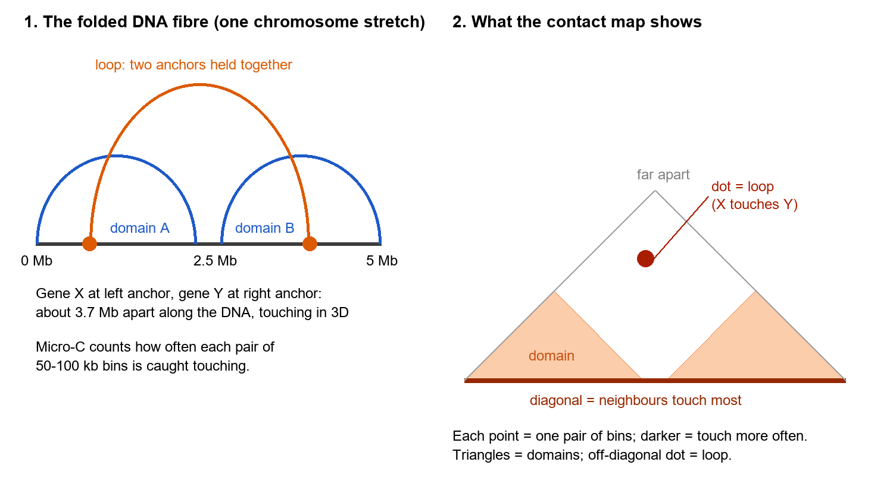
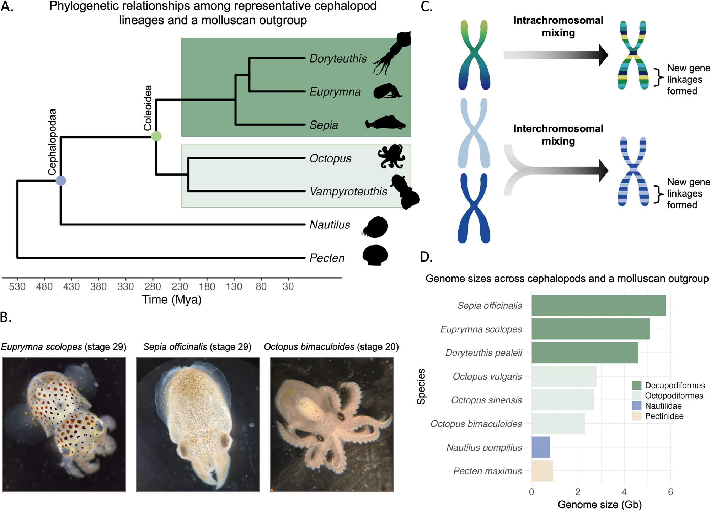
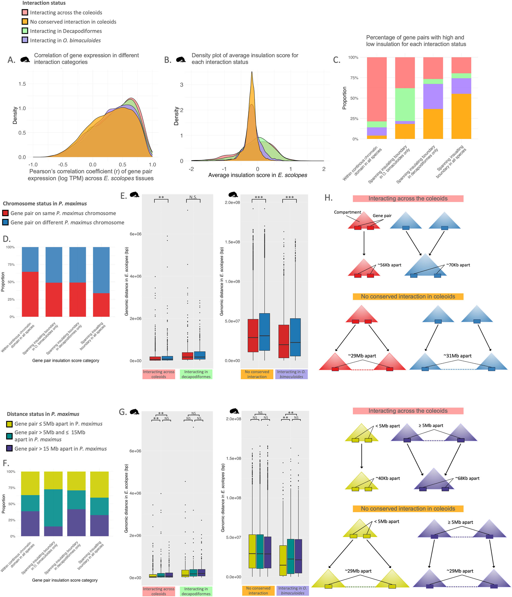
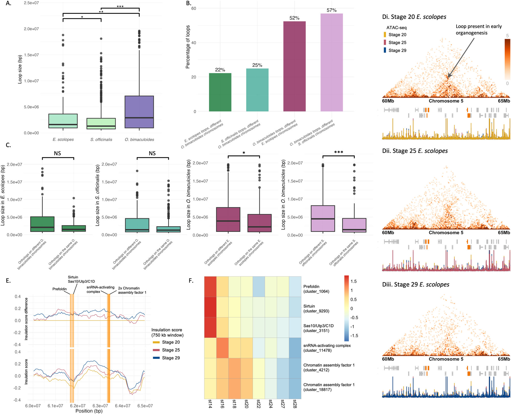
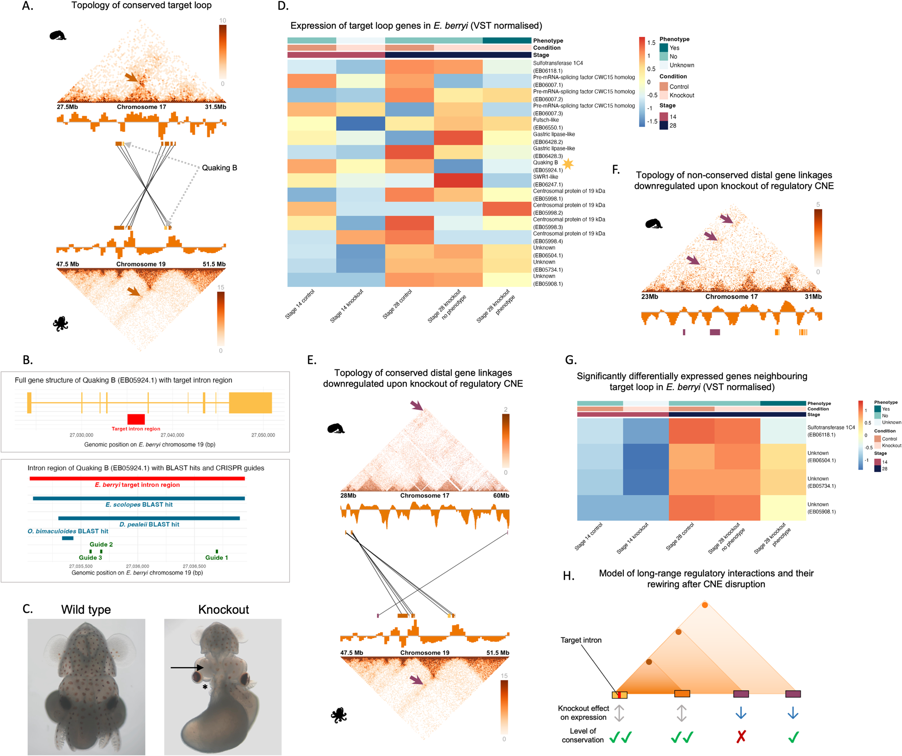
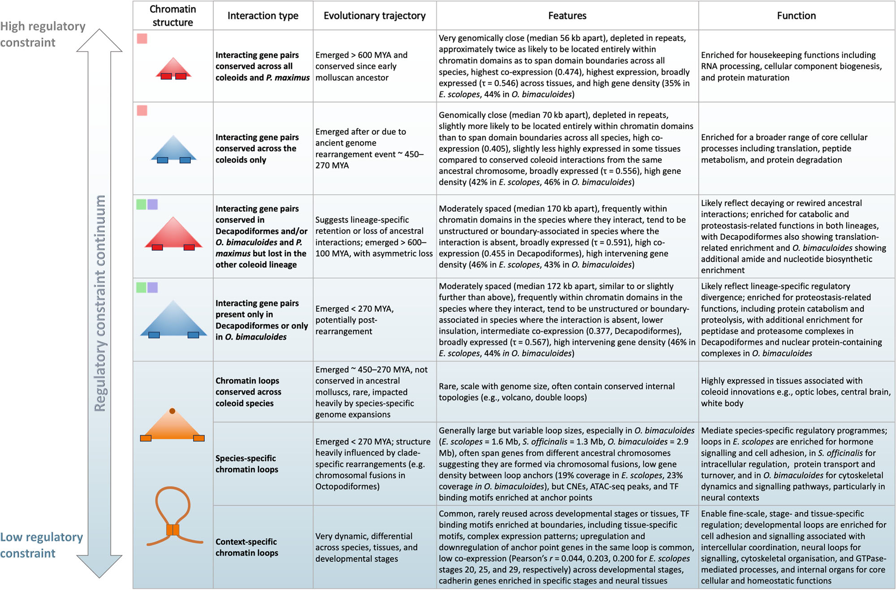

v3.16
Analyzing | Framework v3.16 | evolutionary genomics paper (outside the physics core); supplement not read

> **Access Status** — Full paper: retrieved from the local PDF supplied by the pipeline (Nature Communications 17:10319, published 9 October 2026, open access; all 22 pages read, including Methods, Data/Code availability and reference list) · Abstract: from the same PDF · Supplementary material: **not available locally** (Supplementary Notes 1–5, Figs. S1–S30 and Supplementary Data 1–12 are cited throughout but were not read; the peer-review file was not read) · Figures: no arXiv source exists; the six main figures were taken from the images embedded in the PDF (pdfimages) and checked against the page renders and captions; Figs. 1, 3, 4, 5 and 6 are shown below, Fig. 2 was viewed but is described in words · Prior work: the two closest companion papers (Schultz et al. 2026, *Science Advances*, preprinted on bioRxiv in 2024; Kim et al. 2025, *Nature*) are biology papers with no arXiv versions, so no arXiv version history exists to check; I saw only search-result summaries of them, not their full text · Analysis basis: full main text plus figures; claims that rest on supplementary items are flagged as such.

## 1. Punchy Title & One-Sentence Hook

**Shuffled Chromosomes, Tangled Wiring: How Squid and Octopus Genomes Folded Themselves Into New Control Circuits**

After an ancient event scrambled the chromosomes of the ancestor of squid, cuttlefish and octopus, the broad 3D neighbourhoods of their DNA stayed surprisingly stable, while the fine-grained point-to-point contacts (loops) turned over fast. In octopus, chromosome fusions seem to have stitched together long-range contacts that have no counterpart in squid. Deleting one small non-coding stretch inside such a conserved loop shrank squid embryos' brains and switched off genes millions of letters away.

## 2. Big-Picture Context

DNA is not a straight string inside the nucleus. Each chromosome folds into a hierarchy: large neighbourhoods whose parts touch each other often, and tighter point-to-point contacts that pull two distant sites together. These contacts matter because many genes are switched on by short control sequences (enhancers) that can sit far away along the DNA and act only when folding brings them close. Over the past fifteen years, chromosome-capture methods have mapped this folding in humans, mice and flies. A big open question is evolutionary: when genomes are rearranged over hundreds of millions of years, does the folding (and the control wiring it supports) get destroyed, preserved, or rebuilt?

Most model animals have fairly tidy genome histories, which makes the question hard to study. Coleoid cephalopods (squid, cuttlefish, octopus) are the exception: their ancestor broke and remixed the ancient gene blocks that most animals still keep, and the two main branches then diverged, squid and cuttlefish by swelling their genomes with repeats, octopuses by fusing chromosomes. With the largest invertebrate brains, camouflage skin and new organs, coleoids offer a natural experiment linking genome scrambling, 3D folding and new biology.

This paper, from the Simakov lab in Vienna with collaborators at the Marine Biological Laboratory and the University of Chicago, measures 3D folding (with Micro-C, a high-resolution chromosome-capture method) in a bobtail squid, a cuttlefish and an octopus, across embryo stages and tissues dissected from late embryos. They combine it with gene activity, open-chromatin maps, conserved non-coding sequences and a scallop as the "ancestral reference". Then they test one prediction with a CRISPR deletion in a second bobtail squid species.

**Paper Type & Stakes:** this is a comparative and functional genomics paper (data-heavy, mostly descriptive, with one targeted knockout experiment). It asks whether genome rearrangement leaves a readable signature in 3D folding, and whether the newly formed long-range contacts carry real regulatory function, which would tie chromosome shuffling to the evolution of cephalopod novelties.

**Prior Belief Check:** the broad picture aligns with the mainstream. Large folding domains are thought to be more stable than individual loops, and breakpoints of rearrangement are known to coincide with domain boundaries in vertebrates and flies. The fast turnover of loops matches recent cross-animal surveys. The less expected parts are lineage-specific: octopus, despite the smallest genome of the three, has the largest loops, and the paper ties this to chromosome fusions rather than to repeat-driven genome growth. Experts in 3D genomics would likely find the knockout's long-range effects interesting but would want direct folding data from the knockout embryos before calling them loop-mediated. The "regulatory entanglement" framework is the authors' own interpretive lens, developed in earlier papers from the same group; it is a hypothesis being given evidence, not a consensus idea. Overall: a solid, incremental-to-moderately-novel dataset with a provocative interpretation.

**Replication & Convergence Note:** this is a single-consortium study, and the one functional test rests on one deletion in one species with a handful of RNA-seq replicates. Earlier cephalopod folding data (bobtail squid domains with insulator-protein motifs at their edges, from 2022) agree with the domain-level picture, but no independent group has compared 3D folding across coleoid lineages. Independent confirmation would mean Micro-C in other octopuses and squids showing the same "octopus loops span former squid chromosomes" pattern, and a second regulatory deletion, ideally with folding maps of the knockout embryos, reproducing a distant gene-expression effect.

## 3. Necessary Background Crash-Course

### Synteny: which genes share a chromosome

Two genes are "syntenic" if they sit on the same chromosome. Comparing species, researchers find matching genes (orthologs) and ask whether chromosome partners stay partners. Across most animals, about two dozen ancestral gene blocks have stayed recognisable for more than half a billion years, even when gene order inside each block got shuffled. This conservation is the baseline the paper measures coleoid scrambling against.

**Analogy:** think of genes as functions and chromosomes as source files in a large codebase that has been forked many times. Synteny means that the same functions keep living in the same file across forks, even if their order inside the file changes.

**Breaks when:** you ask why file membership should matter. In software it has no runtime effect; in a genome, sharing a chromosome means genes are inherited together and can physically touch inside the nucleus, which is exactly why rearrangements can rewire regulation.

### The 3D genome: domains, loops and how to read a contact map

Micro-C chops chromosomes in their folded state, glues together DNA pieces that were touching, and sequences the joined pairs. Counting how often each pair of genome windows (here 50 to 100 thousand letters wide) is caught touching produces a contact map. On the triangular maps in the figures below, the bottom edge is the chromosome; contacts between neighbours pile up along that edge; dense triangles are **chromatin domains** (neighbourhoods whose parts touch each other more than they touch outsiders); and isolated dots far from the edge are **loops**, where two specific distant sites are held together. An **insulation score** measures how much contact crosses a given point: a low score marks a boundary between domains.



*Analyst-built illustration (not from the paper):* left, a stretch of chromosome folded into two neighbourhoods plus one long-range loop; right, the same folding as it appears in a triangular contact map.

**What to look at:** the loop is a single dark dot high above the baseline. It is how two genes millions of letters apart show up as touching, the pattern the paper hunts for.

> **Concept:** a contact map is an average over millions of cells. Domains are regions with elevated internal contact frequency bounded by insulating boundaries; loops are point-to-point contacts between two anchors, often formed when a motor protein reels DNA through a ring until it hits a stop signal (loop extrusion, with the insulator protein CTCF as the classic stop). Both are probabilities, not fixed wires; any single cell shows only a fraction of them at a time.

> **Vehicle:** a server cluster's traffic log. Machines in the same rack talk to each other constantly; traffic between racks passes through a top-of-rack switch and is much rarer; and a few dedicated point-to-point links connect specific machines in distant racks. Summing a day of logs into a matrix of "who talked to whom" shows racks as bright blocks and dedicated links as isolated bright cells.

> **Analogy:** genome window ↔ machine; chromatin domain ↔ rack; insulation boundary ↔ top-of-rack switch that throttles cross-rack traffic; loop ↔ dedicated point-to-point link; contact map ↔ the summed traffic matrix.

> **Breaks when:** you treat the links as permanent cabling. A loop is a transient, motor-built contact that forms and dissolves continuously, and the map averages over a population of cells that may each be wired differently. The cluster picture has no slot for a "link" that exists in only some fraction of machines at any moment, yet that is what a loop dot really reports.

### Conserved non-coding elements and open chromatin

Most control sequences do not code for protein. When a non-coding stretch stays nearly unchanged across species separated by hundreds of millions of years, selection is probably keeping it for a job; these are **conserved non-coding elements (CNEs)**, the paper's proxy for regulatory switches. Open-chromatin maps (ATAC-seq) mark DNA that is unpacked and accessible to regulatory proteins, another sign of active control sites.

**Analogy:** CNEs are configuration lines that every fork of a project has left untouched for years; nobody documents them, but deleting them breaks something.

**Breaks when:** you assume a conserved line always does the same job. A CNE can be repurposed into a new circuit after rearrangement; conservation of sequence does not guarantee conservation of target.

### Fusion-with-mixing and "regulatory entanglement"

When two chromosomes fuse end to end, their genes stay in two clean halves at first. Over time, internal rearrangements (inversions, transpositions) interleave the two gene sets. Earlier work from the same group showed that this mixing is effectively one-way: once interleaved, the original blocks never separate cleanly again.

> **Concept:** "regulatory entanglement" is the authors' term for the gradual accumulation of interdependencies among genes, control elements and 3D contacts after rearrangement brings formerly separate regions together. The more a region is mixed and wired into nested contacts, the more any further rearrangement risks breaking something, so the region becomes evolutionarily constrained. It has no relation to quantum entanglement; it is a metaphor for coupling and constraint, measured indirectly (mixing entropy of gene positions, loop sizes, cross-chromosome loop anchors).

> **Vehicle:** two independent libraries merged into one repository. At first each library's files stay in their own folder. Over years of refactoring, functions migrate, call each other across the old boundary, and share configuration. Eventually nobody can split the repository back into the two original libraries without breaking builds; every change needs more regression testing; the code base becomes harder to restructure.

> **Analogy:** chromosome fusion ↔ merging the two repositories; mixing ↔ refactoring that interleaves files; new long-range loops ↔ new cross-library calls; regulatory entanglement ↔ the dependency web that makes the merged code base hard to split; evolutionary constraint ↔ the rising cost of further refactoring.

> **Breaks when:** you imagine a designer adding the dependencies on purpose. In the genome nobody writes the new calls; random rearrangements create proximity, and selection keeps only the contacts that happen to become useful. The vehicle also lacks a population: a genome's "build" is tested across billions of individuals, and harmful rearrangements are removed rather than debugged.

### Origins & Big Picture: how coleoid genomes came to be

Start with the deep baseline. Comparative genomics over the past decade showed that the common ancestor of animals had about two dozen to thirty gene linkage groups, and that these blocks survive almost intact in many living animals, scallops among them. The scallop's chromosomes therefore act like a slowly changing reference copy of the ancestral mollusc genome. Nautilus, the shelled cephalopod that split off from the coleoid line long ago, shows a similar ancestral pattern, which the paper uses to check that the scallop is a fair reference.

Then comes the coleoid event. Somewhere between the split from nautilus and the radiation of modern coleoids (the paper's summary figure brackets it roughly between 450 and 270 million years ago), the coleoid ancestor's chromosomes were broken and remixed on a massive scale, both within chromosomes and between them. Hundreds of new gene neighbourhoods formed that exist in no other mollusc. Earlier work by members of this team found that some of these new neighbourhoods are active together in coleoid-specific tissues, which raised the idea that genome scrambling supplied raw material for new regulation.

After the scramble, the lineages diverged. Squid and cuttlefish (the ten-armed branch) kept a chromosome count close to the post-scramble ancestor but inflated their genomes with long repeated elements; the cuttlefish and bobtail squid genomes run around five to six billion letters, nearly twice the human genome. Octopuses (the eight-armed branch, with the vampire squid as an early-branching relative) grew too, through different repeat families, to roughly two and a half billion letters, but also fused many chromosomes. The vampire squid genome, published in 2025, showed that it sits partway along this fusion path, consistent with fusions accumulating along the octopus line.

Those histories set up a natural experiment. If 3D folding is mostly a passive consequence of DNA length, bigger genomes should simply have bigger domains and loops. If folding is shaped by which genes have been neighbours for how long, the age of a gene pair's partnership (ancient mollusc linkage, post-scramble linkage, or post-fusion linkage) should predict how tightly it is folded and how strongly it is conserved. The scallop lets the authors timestamp each pair: two genes that already share a scallop chromosome have probably been partners since before the coleoid scramble; two genes on different scallop chromosomes were probably joined by it.

Finally, the biology at stake: camera eyes, a brain of hundreds of millions of neurons, colour-changing skin, and new organs such as the white body (a blood-cell and immune organ). Linking those novelties to specific rearrangements is the long-term goal; this paper supplies the middle layer, how rearrangement shows up in folding and wiring.

**Analogy:** the scallop genome is the last stable release before a major merge; coleoid genomes are the post-merge branches, one bloated with vendored libraries (squid and cuttlefish repeats), one consolidated by merging more files (octopus fusions).

**Breaks when:** you treat the scallop as the literal ancestor. It is a living species with its own half-billion years of change; it is a good reference only because its chromosomes changed slowly, and the paper checks that against nautilus rather than assuming it.

> **Central analogy for this paper:** merged codebases accumulate tangled cross-module dependencies.

```
Analyst-built concept diagram (not from the paper)

 Scallop chromosomes (ancestral reference)
        |  timestamp each gene pair: same vs different
        v
 Coleoid ancestor: massive scramble
        |                        |
        v                        v
 Squid/cuttlefish:          Octopus:
 repeat expansion           extra fusions + mixing
        |                        |
        +-----------+------------+
                    v
 Micro-C in 3 species -> gene-pair contacts, loops
                    |
                    v
 Classify contacts by age and lineage
   ancient pairs: close, insulated, co-expressed
   loops: rare to conserve, enriched for switches
   octopus loops: large, span old chromosomes
                    |
                    v
 CRISPR test: delete 1 kb switch in a conserved loop
   -> smaller brains, distant genes switched down
```

Read it top to bottom: the scallop timestamps each gene partnership, the two lineages diverge in how they changed, and the folding data are sorted by partnership age before the single knockout tests whether a conserved loop element matters.

## 4. Core Technical Explanation

### Step 1 — Measuring how scrambled each lineage is

**Failure it prevents:** without a quantitative scramble measure, "octopus is more fused" would be an impression from dot plots. **What they do:** they match orthologous genes and long alignments between the bobtail squid and the other two species, chop genomes into windows, and count how often one window matches one, two or more windows in the other species. They also measure "dispersion", the share of aligned sequence that lands on a non-matching chromosome. **What it buys:** a clear signature. On average one octopus region matches two or three squid regions, with no duplicated genes on the squid side, which points to fusion in the octopus line rather than duplication in squid. And non-coding conserved sequence scatters far more than genes do: roughly nine in ten non-coding alignments sit on non-matching chromosomes, versus under half of all alignments.



*Figure 1 (from the paper): A, the cephalopod family tree with scallop as outgroup; B, embryos of the three study species; C, mixing within versus between chromosomes; D, genome sizes.*

**What to look at:** panel D. The ten-armed species (dark green) carry roughly twice the DNA of the octopuses (light green), the size gap the later loop results play against.

Figure 2 (not shown) gives dot plots of matching genes: squid against cuttlefish lines up nearly one-to-one, while several squid chromosomes feed into single octopus chromosomes. Its contact maps show similar domain patterns on matching chromosomes in all three species. A genome-topology analysis across fourteen cephalopods (in the supplement) finds octopus gene maps more interconnected, which the authors take as a first sign of a more "entangled" octopus genome.

### Step 2 — Sidestepping unreliable domain calling with gene-pair contacts

**Failure it prevents:** automated domain-calling software gives different answers depending on window size and settings, so cross-species domain comparisons can be artefacts. **What they do:** they skip domain calling. They take every pair of genes that sit on the same chromosome in all three coleoids and in scallop, and read the contact strength between them directly from each species' normalised contact map. A pair counts as "interacting" if it passes a fixed contact threshold, chosen because contacts beyond roughly twenty million letters almost never pass it. That yields four bins: interacting in all three species, only in the two ten-armed species, only in octopus, or nowhere. **What it buys:** a like-for-like comparison anchored to genes. Of roughly sixty thousand candidate pairs, about sixteen hundred interact in all three species and most of the rest interact nowhere.

### Step 3 — What conserved contacts look like

**Failure it prevents:** a list of conserved contacts says nothing about whether they matter. **What they do:** they compare the four bins on co-expression across nineteen squid tissues, insulation, gene density and repeat content. **What it buys:** a consistent gradient. Pairs that touch in all three species are the most co-expressed, sit inside domains rather than across boundaries, live in gene-dense stretches and are depleted of long repeats; pairs that touch nowhere sit near boundaries. Conserved pairs also lean toward housekeeping functions (RNA processing, protein maturation).



*Figure 3 (from the paper): A, co-expression of gene pairs by contact category; B–C, insulation; D–G, how ancestral chromosome origin and distance in scallop shape the pattern; H, cartoon summary.*

**What to look at:** compare panels A and C. In A the four curves overlap heavily and differ only in their upper shoulder, so the co-expression effect is real but modest. In C, nearly four in five pairs sitting inside a domain in every species are conserved contacts (pink).

### Step 4 — Using the scallop as a clock

**Failure it prevents:** without an outgroup, you cannot tell an old partnership from one created by the coleoid scramble. **What they do:** for each pair they ask whether the two genes share a scallop chromosome, and how far apart they sit there. **What it buys:** an age-stratified view. Conserved pairs that already shared a scallop chromosome are significantly closer together in squid (tens of thousands of letters apart, per the summary figure) than conserved pairs whose genes came from different scallop chromosomes. Ancestral closeness only helps up to roughly five million letters in scallop; beyond that, the authors argue, the coleoid contacts are new partnerships formed after the scramble. Pairs that interact nowhere sit tens of millions of letters apart regardless of origin. The authors' reading: contacts inherited from the mollusc ancestor are the most constrained; contacts created by the scramble are kept, but more loosely.

### Step 5 — Loops: rare to conserve, rich in control signals

**Failure it prevents:** domain-level stability could hide churn at finer scales. **What they do:** they call loops in whole-embryo maps of each species, keep those with genes at both anchors, and call a loop conserved if the same orthologous gene sits at each anchor in another species. **What it buys:** a striking contrast with Step 3. Each species has a few hundred gene-anchored loops, but only three are shared by all three species, and a few dozen by the two ten-armed species. Loop anchors are enriched for conserved non-coding elements, open chromatin, binding motifs of developmental regulators, and insulator-like motifs. Genes in the three deeply conserved loops are highly active in neural tissue and the white body. The picture: loops churn quickly, but when they form they recruit old control sequences.

### Step 6 — Octopus loops are bigger despite a smaller genome

**Failure it prevents:** if loop size simply tracked DNA length, there would be nothing lineage-specific to explain. **What they do:** first, for the few loops conserved between species, they regress loop size on genome size and find a positive trend: conserved loops stretch as genomes inflate. Then, for all gene-anchored loops, they compare sizes across species and ask whether anchor genes come from different chromosomes in the other lineage. **What it buys:** the opposite trend for loops overall. The octopus, with the smallest genome, has the largest typical loop (about three million letters versus one to one and a half in the ten-armed species). More than half of octopus loops join genes that sit on different chromosomes in squid, and those cross-chromosome loops are significantly larger. Loop size does not track the ancestral spacing of the genes. The authors conclude that octopus fusions created new, long-range loops.



*Figure 4 (from the paper): A, loop sizes in the three species; B, share of loops linking genes on different chromosomes in the other lineage; C, loop sizes split by that status; D–F, one squid loop present early in organ formation and lost later, with insulation and gene activity.*

**What to look at:** panel A's purple octopus box sits well above the two green boxes, and panel C's two octopus panels (right) show the only significant gaps. In D, the dot marked by the arrow fades in the two later maps.

### Step 7 — Loops change with developmental stage and tissue

**Failure it prevents:** whole-embryo maps average over tissues and could hide context-specific wiring. **What they do:** they compare loops across three squid embryo stages and across tissues (brain, eyes, arms, internal organs) dissected from late cuttlefish and octopus embryos. **What it buys:** loops are highly context-specific; overlaps between stages or tissues are no larger than chance. One showcase loop in early organ formation joins six genes for chromatin assembly, splicing and ribosome building; it coincides with open chromatin and peak expression and disappears along with that expression (Fig. 4D–F). Most of its genes sit on different scallop chromosomes, so the partnership is a coleoid invention. Octopus neural tissues carry about three times as many loops as internal organs; in cuttlefish the eyes dominate. Oddly, genes inside stage-specific loops are only weakly co-expressed, since loops often hold up- and down-regulated genes together.

### Step 8 — Breaking a switch inside a conserved loop

**Failure it prevents:** every preceding result is correlational; enrichment of control signals at loop anchors does not prove the anchors control anything. **What they do:** they pick a loop conserved between squid and octopus that contains the gene Quaking B, a known player in nervous-system development. Inside a Quaking B intron sits a non-coding stretch conserved among the ten-armed species, with a related stretch nearby in octopus. They delete about one thousand letters of it with CRISPR in the hummingbird bobtail squid, which has established genetic tools, and profile whole embryos by RNA-seq at an early and a late stage. **What it buys:** a phenotype and a surprise. All injected embryos were delayed; about one in five had clearly smaller brains (especially the optic lobes) and another one in five were severely malformed. Genes inside the loop, Quaking B included, did not change significantly; the genes that dropped sat outside it, a few million letters downstream and one more than ten million upstream. In squid and octopus maps those distant genes appear to touch the loop region, which the authors read as a "meta-loop" reaching across domain boundaries. Most of the downstream genes look coleoid-specific.



*Figure 5 (from the paper): A, the conserved loop in squid (top) and octopus (bottom); B, the target intron and guide sites; C, a control and a knockout embryo; D, expression of genes inside the loop; E–G, distant genes that dropped; H, the authors' model.*

**What to look at:** panel C (smaller optic region and missing arm tissue in the knockout) and panel G, where the late-stage knockout-with-phenotype column is pale compared with controls. Then panel D, which shows no consistent pattern for genes inside the loop.

### Step 9 — The synthesis: a ladder of constraint

**Failure it prevents:** a dozen separate observations do not add up to a model. **What they do:** they rank contact types from most to least constrained. **What it buys:** a single table (Fig. 6). At the top are gene pairs that touch in all coleoids and already shared a scallop chromosome: close together, co-expressed, housekeeping. Below them come pairs created by the coleoid scramble, then lineage-specific pairs, then the few conserved loops, then species-specific loops (big in octopus), and finally stage- and tissue-specific loops, the most fluid layer. Rearrangement and genome growth act differently on each rung.



*Figure 6 (from the paper): contact classes ordered from high to low constraint, with age, features and functions.*

**What to look at:** the left arrow and the "Evolutionary trajectory" column. Constraint falls as contacts get younger and more lineage-specific; loops sit at the bottom.

### Claim check

Checks were run in Python (`claimcheck.py` in the work directory) on numbers quoted in the main text and figure captions; the supplement was not available.

**Dispersion (how often aligned sequence lands on the "wrong" chromosome) — Reproduced.** All four quoted percentages follow exactly from the quoted alignment counts. The key contrast holds: non-coding conserved sequence moves between chromosomes far more than sequence overall, in both lineage comparisons.

**"Almost every octopus region corresponds to two squid regions" — Reproduced.** From the window counts, the ratio is between two and three depending on the denominator. The fusion reading (rather than squid duplication) rests on the paper's statement that no duplicated genes were found, which I could not check.

**Loop size falls as genome size rises — Partly reproduced.** The medians are ordered as claimed, but this is a three-point comparison: three species in perfect inverse order would happen by chance one time in six. Species also differ in map resolution and in sample type. The within-octopus result (cross-chromosome loops are larger) is the stronger evidence. The genome-size "negative correlation" should be read as an observation, not a trend.

**Knockout phenotype rate — Partly reproduced.** Of 25 injected late-stage embryos, five had clearly reduced brains (one in five), five more were severely malformed, six were small with short arms, and nine looked normal. "One third to two thirds with brain-specific defects" holds only if severe malformations, and then small-with-short-arms embryos, are counted as brain-specific. The strictly brain-specific rate is one in five.

**Sensitivity — what if the contact threshold means different things in different species?** The same contact cut-off is applied to octopus maps read in finer windows and to ten-armed maps read in coarser windows, for genomes of very different size and sequencing depth. A rough count-scaling estimate suggests the same physical contact rate can yield counts differing by a factor of one to four between species, depending on read depth (listed only in the supplement). The "interacting in all three species" bin is robust because it needs all three to pass. The lineage-specific bins are not directly comparable: "octopus-only" needs one species to pass, "ten-armed-only" needs two. That alone can make the octopus-only bin larger (it is nearly four times larger), so its size should not be read as extra octopus wiring.

**Robustness test (experimental controls) — the knockout.** Test: injection controls. Contamination would show as delay and malformation in any injected embryo. Result: controls were uninjected embryos only, and every injected embryo was delayed, so injection or Cas9 toxicity cannot be separated from the deletion's effect. Test: tissue composition. Contamination would look like neural genes dropping in whole-body RNA because the brain is smaller, regardless of 3D contacts. Result: the distant genes that dropped are highly expressed in squid neural tissue (and in mantle and gills), and the drop is clearest in late embryos with a phenotype, so a composition effect is a live alternative. Test: folding in the knockout. Contamination would look like distant expression changes with unchanged contacts. Result: no Micro-C was done on knockout embryos, so the meta-loop interpretation is untested.

**Internal consistency — one moderate finding.** In Figure 4, panel B's axis says "percentage of loops", while the caption says "loop anchor genes". Its values (about one in five for squid relative to octopus) do not match the loop counts in panel C's caption (nearly half of squid loops in the cross-chromosome group). The octopus-highest ranking survives either way, but readers should not quote panel B as a share of loops.

### Assumption Audit

> **Watch:** a physics reader likely assumes "regulatory entanglement" names a measured, quantitative property, perhaps by analogy with quantum entanglement. The paper actually uses it as an interpretive framework for accumulated interdependence after fusion and mixing. It is supported indirectly (mixing entropy in the supplement, large cross-chromosome loops, buffered expression inside a conserved loop) and never measured as a single quantity.

> **Watch:** the reader likely assumes "chromatin domains are broadly conserved" describes the whole genome. The paper actually measures conservation only among gene pairs that share a chromosome in all three coleoids and in scallop, a pre-selected set where rearrangement already left partners together. Within it, only a few percent of pairs pass the contact threshold in all three species.

> **Watch:** the reader likely assumes the knockout "demonstrates the role of loops in neural development". The paper actually shows that deleting a one-thousand-letter intronic sequence causes developmental defects and lowers expression of some distant genes. It does not show that any loop was lost, and the genes inside the loop, including the host gene, did not change significantly.

> **Watch:** the reader likely assumes loops are the key regulatory unit because they are enriched for control signals. The paper's own introduction cites the alternative view that loop extrusion serves mainly general housekeeping roles (keeping DNA tidy and accessible) rather than targeted regulation. The enrichment results fit both views; only the single knockout speaks to function.

## 5. What's Genuinely New or Clever

The cleverest move is **timestamping 3D contacts with an outgroup's chromosomes.** Asking whether two coleoid genes share a scallop chromosome turns a static contact map into an age-sorted one: inherited partnerships, partnerships created by the coleoid scramble, and lineage-specific ones. That is what allows the paper to claim a *hierarchy* of constraint rather than just "some contacts are conserved". The method is cheap and portable to any clade with a slowly evolving outgroup, and as far as I know it is new to 3D-genome evolution (new to the field, not just to the reader).

The second contribution is **the first perturbation of a non-coding control element inside a conserved cephalopod loop with a transcriptome readout.** Repeats make CRISPR guide design in non-coding cephalopod DNA hard (the authors found exactly one usable guide set), so a deletion with a brain phenotype and distant expression changes is a real step for cephalopod functional genomics, despite the control caveats. Smaller but useful: the gene-pair framework compares domain-level and loop-level evolution without depending on domain-calling software.

What is less new: domain stability versus loop turnover, and breakpoints at domain boundaries, were known from vertebrates and flies. The paper extends them to a lineage with an unusually violent genome history.

### Predictive Content Check

1. **Falsifiable handle:** the paper makes three predictions that could fail. (a) If octopus fusions created large cross-chromosome loops, Micro-C in other octopuses (common or East Asian octopus, both with chromosome-level genomes) should show the same excess of large loops whose anchors map to different squid chromosomes. Ten-armed species should not, whatever their genome size. (b) If the Quaking B intron acts through a meta-loop, folding maps of knockout embryos should show weakened contacts between the loop region and the distant down-regulated genes. A properly injected control (non-targeting guide) should not reproduce the phenotype or the distant drop. (c) If entanglement constrains octopus genomes, octopodiform genomes should show fewer large new repeat insertions inside highly mixed, fusion-derived regions than ten-armed genomes show in comparable regions. Prediction (c) is the paper's hypothesis rather than a tested claim, and it is only loosely quantified.

2. **Formalism load (fires conditionally here):** "regulatory entanglement" is a conceptual framework, not mathematics, but it carries much of the paper's novelty claim. At present it mostly **relabels** observations (mixing, large loops, buffered expression) rather than predicting new ones. Its predictive content lies in handle (c) and in the claim that mixed regions resist reorganisation, which the authors' companion work tests at the chromosome level. Here it is interpretive scaffolding, not a demonstrated mechanism.

## 6. Limitations & Open Questions

**Three species, one octopus.** Every lineage contrast (octopus loops larger, more cross-chromosome) rests on a single octopodiform species against two ten-armed ones. **(A) Consensus** — the paper itself flags sparser octopodiform sampling for the non-coding analysis, and three-taxon comparisons are a standard limitation in comparative genomics. **(paper, Results: topology analysis and CNE mixing)**

**Mismatched samples across species.** The squid maps come from three whole-embryo stages; cuttlefish and octopus mostly from dissected late-embryo tissues plus a whole-embryo sample each. Map resolution also differs (finer windows for octopus). Species differences in loop number and size are therefore partly confounded with sample type and resolution. **(B) Contested** — the authors downsample and equalise coverage, and a referee could judge these steps adequate, but the main text never shows a resolution-matched loop comparison. **(paper Methods; analyst inference)**

**The contact threshold is not species-neutral.** One fixed count threshold is applied to maps of different window sizes, genome sizes and depths, and the lineage-specific bins need different numbers of species to pass. **(C) Speculative** — this comes from my count-scaling recomputation using the paper's window sizes and genome sizes; the read depths are in Supplementary Data 2, which I did not see, so the size of the bias is uncertain. **(analyst inference)**

**The knockout lacks injection controls and folding data.** Uninjected controls only, universal developmental delay in the injected embryos, mosaic first-generation animals, three or four RNA-seq replicates per group, whole-body tissue, and no contact maps of the mutants. Together these leave toxicity, tissue-composition and indirect effects as live alternatives to a direct meta-loop. **(B) Contested** — non-targeting or scrambled-guide injection controls are standard in CRISPR embryo work, but cephalopod embryos are hard to work with and some referees would accept the current design for a first experiment. **(broader literature; analyst inference)**

**Statistically significant, biologically modest.** With tens of thousands of gene pairs, small shifts in co-expression or insulation become highly significant; Figure 3A's distributions overlap heavily. **(B) Contested** — large-sample significance is routine in genomics, and the consistent direction across measures is itself informative, but effect sizes deserve more weight than they get in the text. **(analyst inference)**

**Assembly quality shapes loop sizes.** Repeat-rich genomes produce misassemblies that can masquerade as long loops or crossed orthology lines; the authors manually removed suspected artefacts. **(A) Consensus** — the paper states this explicitly in Methods and figure captions, and it is a known hazard of contact maps on repeat-heavy assemblies. **(paper Methods; Figs. 2 and 5 captions)**

**Correlation versus mechanism for loops.** Enrichment of control motifs, open chromatin and conserved sequence at loop anchors fits both "loops regulate genes" and "loops are general packaging that happens to sit near active DNA". **(B) Contested** — the field genuinely disagrees, and the paper's introduction cites both views. **(paper Introduction; broader literature)**

**Open questions for the next 12–24 months:** Micro-C on knockout and properly controlled injected embryos; a second octopus and the vampire squid profiled at matched resolution; single-cell or tissue-sorted contact maps to separate composition from wiring; deletion of the octopus counterpart of the Quaking B element; and a direct test of whether highly mixed regions resist repeat insertion.

## 7. Detailed Summary & Explanation

The paper asks how a violent genome history shapes the way DNA folds and is regulated. Coleoid cephalopods suit the question: their ancestor scrambled its chromosomes on a scale rare among animals, after which squid and cuttlefish inflated their genomes with repeats while octopuses fused chromosomes. The authors built high-resolution contact maps for a bobtail squid, a cuttlefish and an octopus, across embryo stages and embryonic tissues. They combined them with gene activity, open-chromatin data and conserved non-coding sequence, and used the slowly evolving scallop genome to timestamp which gene partnerships are ancient and which were created by the scramble.

The results form a ladder. At the top, gene pairs that already shared a chromosome in the mollusc ancestor and still touch in all three coleoids are close together, sit inside folding neighbourhoods, are co-expressed and do housekeeping jobs. Partnerships created by the coleoid scramble are also kept, more loosely. Point-to-point loops sit at the bottom: only three of hundreds are shared by all three species, and loops change between embryo stages and tissues. Yet their anchors are enriched for old conserved control sequence and open chromatin. Octopus, despite the smallest genome, has the largest loops, and over half of them join genes that lie on different chromosomes in squid, which the authors attribute to octopus-specific fusions.

The functional test deleted a short conserved stretch inside an intron of the neural gene Quaking B, within a loop conserved between squid and octopus. Injected embryos developed abnormally, a subset with clearly smaller brains. Expression of genes inside the loop did not change significantly, but several genes millions of letters away dropped. The authors interpret this as a long-range "meta-loop" network, and they wrap the whole picture in "regulatory entanglement": mixed, fused regions accumulate dependencies that make them both innovative and hard to rearrange further.

I framed the summary around the age-sorted hierarchy because it is the most defensible contribution, resting on thousands of gene pairs and an explicit outgroup. The knockout (one deletion, uninjected controls, no folding data) and the entanglement label (measured only through proxies) get more caution. The loop-size story sits in between: solid within octopus, but only a three-point observation against genome size. Take away a rich, consistent dataset, a plausible but not unique evolutionary reading, and a promising first functional experiment rather than a demonstration.

**Where I'm least confident in this analysis:** whether the species-specific contact categories and loop-size differences survive a resolution- and depth-matched reanalysis. My concern rests on a scaling argument plus the main-text Methods, without the read depths, the supplementary threshold figure or the supplementary mixing-entropy analysis. A 3D-genomics specialist with the supplement could show the bias is small or large. I am also working outside the physics core, so my sense of what counts as "surprising" in cephalopod evolutionary genomics is less calibrated than for a physics paper.

**Revision notes:** the referee pass added the threshold-asymmetry sensitivity check, the Figure 4B inconsistency, and the strict phenotype rate; it cut stage numbers and P values from Sections 3–4, and added the Origins subsection's scallop-as-clock framing and the loop-function counterview in the Assumption Audit.

## 8. Three Crystallized Takeaways

1. When the ancestor of squid and octopus scrambled its chromosomes, the large-scale folding of its DNA largely survived, but the fine point-to-point loops are reinvented constantly. Only three loops out of hundreds are shared by squid, cuttlefish and octopus.
2. Octopuses, with the smallest genomes of the three, have the biggest loops, and most of those loops join genes that sit on separate chromosomes in squid. Chromosome fusions seem to have handed octopuses new long-distance wiring.
3. Cutting out one small non-coding stretch inside a conserved squid loop shrank some embryos' brains and turned down genes millions of letters away. That hints that cephalopod control circuits reach far across the genome, but the experiment still needs better controls and direct folding measurements to prove it.

## 9. Shorter Summary

Squid, cuttlefish and octopus descend from an ancestor whose chromosomes were broken and remixed on a scale rare among animals. Afterwards, squid and cuttlefish bloated their genomes with repeated DNA, while octopuses fused chromosomes together. This study asks how that history shaped the 3D folding of DNA, which brings distant genes and their control switches into contact.

The authors mapped DNA contacts in a bobtail squid, a cuttlefish and an octopus, across embryo stages and tissues. They used the slowly changing scallop genome as a reference to tell ancient gene partnerships from new ones. Ancient partnerships are the most stable: such gene pairs stay close, sit inside the same folding neighbourhood, switch on together and do basic cellular jobs. Partnerships created by the ancestral scramble are kept more loosely. Fine-scale loops are the most fluid layer: almost none are shared by all three species, and they change between embryo stages and tissues. Still, their anchor points carry old, conserved control sequences.

Octopus loops are unusually large even though the octopus genome is the smallest. Most join genes that sit on separate chromosomes in squid, suggesting that fusions created new long-range wiring. The authors call the resulting web of dependencies "regulatory entanglement", a metaphor for coupling, not quantum physics.

To test function, they deleted a short conserved sequence inside a nervous-system gene in a conserved squid loop. Embryos developed abnormally, some with clearly smaller brains, and genes millions of letters away were turned down while genes inside the loop barely changed.

The descriptive dataset is rich and consistent. The weaker points are the comparison of only three species, a contact threshold that may not be equally sensitive across species, and a knockout without injected controls or folding maps of the mutants. Treat the long-range wiring story as a promising lead rather than settled fact.

*Claude headless analysis, 2026-10-10, Framework v3.16, explanatory posture (peer-reviewed journal article).*
