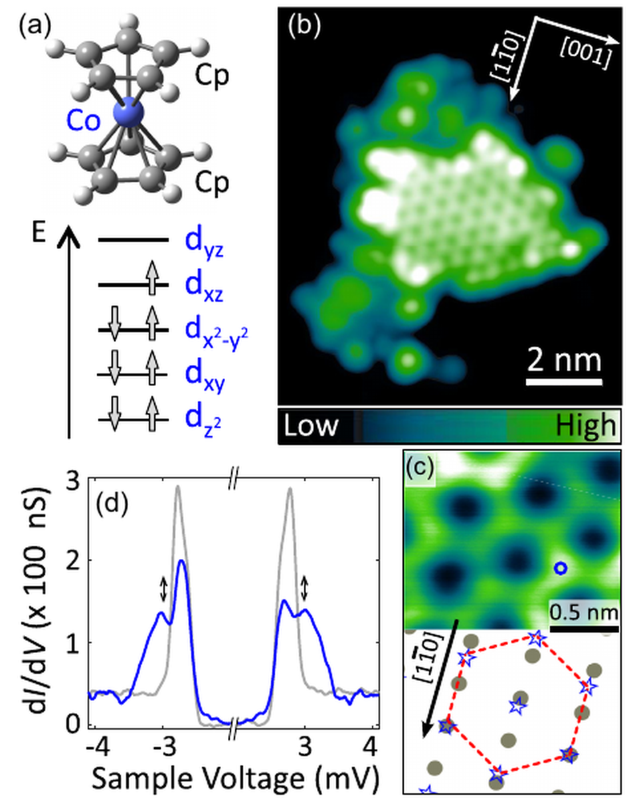
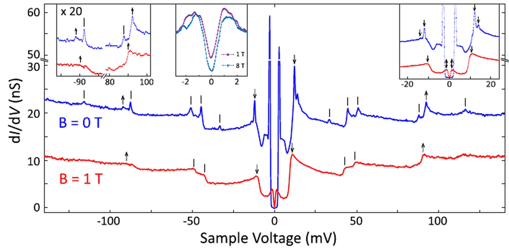
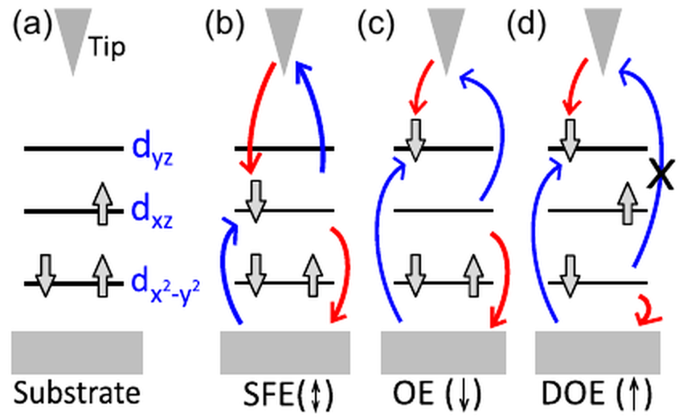
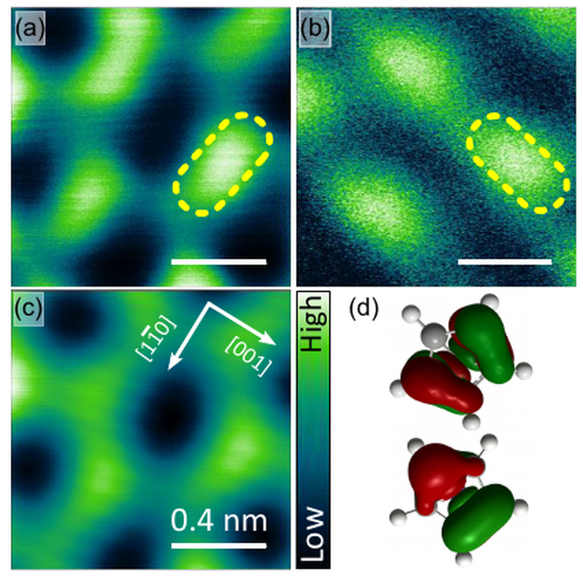

v3.16
Analyzing | Framework v3.16

> **Access Status** — Full paper: read in full from the local PDF supplied by the pipeline (Banerjee, Robles, Lorente, Berndt, Weismann, *Phys. Rev. Lett.* **137**, 116403 (2026), DOI 10.1103/mwl6-8nzl, Editors' Suggestion; 7 pages: main text, Table I, Figs. 1–4, references) · Abstract: from the same PDF · Supplementary material: **not available** — the Supplemental Material (Figs. S1–S10: superstructure model, isolated-molecule spectra, molecule-to-molecule variation, surface DFT, perturbation-theory fits, the antiferromagnetic spin model, vibrational-mode symmetry) was not supplied, and per the run instructions no other source was sought · Figures: all four viewed; no author source files existed, so each was cropped from the 150-dpi page renders (pages 2–5) and upscaled 2× with Pillow (`crop_figs.py`); Table I reproduced as Markdown · Context: arXiv abstract page / arXiv listing for prior work (versions in the footer), web search for related work · Analysis basis: full main text; supplement-dependent claims (spin-model fit, mode-by-mode vibrational assignment) checked only as far as the main text allows.

---

## 1. Punchy Title & One-Sentence Hook

**Three Kinds of Molecular Wiggle in One Trace — and a Tally of Entrances and Exits That Tells Them Apart**

A single cobalt sandwich molecule sitting on superconducting lead shows spin flips, bond vibrations, and electrons hopping between d orbitals all in one tunneling spectrum, and the authors sort the features by a simple trick: compare how tall each peak is when electrons go in versus when they come out.

---

## 2. Big-Picture Context

A scanning tunneling microscope (STM) does more than take pictures. Park the tip over one molecule, sweep the voltage, and record how easily current flows: every time the electrons have just enough energy to make the molecule do something (vibrate, flip its spin, rearrange its electrons), a new channel opens and the conductance jumps. The result is a spectrum of one molecule's internal "moves," a standard readout for magnetic atoms and molecules on surfaces since the 2000s.

The hard part is knowing what each feature *is*. A bump could be a vibration, a spin flip, or a change in which orbital holds an electron, and first-principles theory predicts neither the energies nor the strengths well. Density functional theory (DFT), the workhorse electronic-structure method, treats one electron at a time in an average field and so contains none of these excitations. With one or two features, people assign by context; with a dozen, assignment becomes guesswork.

Two recent developments set the stage. First, superconducting tip and sample sharpen features dramatically, because the superconducting gap gives a razor-edged energy reference that thermal smearing cannot blur. Second, the Kiel group (Berndt, Weismann and co-workers) showed that a magnetic molecule on superconducting lead hosts a sharp in-gap state that acts as an amplifier: vibrational signals routed through it grow far stronger, and they resolved dozens of vibrational peaks on one lead phthalocyanine molecule (Homberg et al. 2022; arXiv version checked, see the footer). Orbital excitations — an electron moving between two d orbitals without changing the electron count — had been seen in real space only rarely, for example as "isospin-flip" steps in Mn phthalocyanine (Kügel et al. 2018) and in AlCl phthalocyanine on copper (Li et al. 2024, same Kiel/Donostia team). X-ray scattering sees orbital excitations in bulk correlated oxides, but it averages over a whole crystal.

**Paper Type & Stakes:** this is a short experimental Letter in surface and molecular magnetism, backed by modest DFT and gas-phase excited-state calculations; the stakes are a practical, transferable rule for classifying features in crowded tunneling spectra, plus a demonstration that spin, vibrational and orbital excitations can be read out together in one molecule.

**Prior Belief Check.** Nothing here overturns consensus. Spin flips, vibrational replicas of in-gap states, and orbital excitations are each known individually; the novelty is their coexistence in one spectrum and the idea that the ratio of peak heights at the two voltage polarities works as a label. Two things will interest specialists. The spin-flip energy barely moves in a strong magnetic field, which a free spin-1/2 would never do; the authors attribute it to antiferromagnetic coupling between neighbouring molecules, and that explanation is plausible but leans on a supplement model. And one feature shows a peak-height ratio of about five, unusually large, which the authors explain with an electron leaving a filled orbital that the tip cannot reach. Experts will find the classification idea sensible and incremental-to-moderate in significance; the one surprising empirical point is the suppressed field response.

**Replication & Convergence Note.** This is a single-group result on a single molecule–substrate combination, with data available only on request. I found no independent study of orbital excitations in cobaltocene: a 2025 APS March Meeting abstract from the Ho group (UC Irvine) reports cobaltocene and nickelocene islands with in-gap states on a different lead face, but, at least in the abstract seen through a search summary, says nothing about orbital excitations. Independent confirmation would mean another group reproducing the same peak-height ratios — about 2 for the lowest orbital feature, about 5 for the high one — on cobaltocene islands, ideally on a second superconductor, and showing that a spin-polarized tip changes the spin-flip ratio but not the orbital ones.

---

## 3. Necessary Background Crash-Course

### Inelastic tunneling: paying a toll to open a lane

When the tip sits over a molecule, electrons tunnel through the vacuum gap. At low voltage they can only tunnel "elastically," keeping their energy. Once the voltage gives them enough energy to excite the molecule — set a bond vibrating, flip a spin — a second route opens: the electron tunnels, pays the excitation energy to the molecule, and arrives with less. More routes means more current, so the conductance steps up at that threshold voltage, and it does so at both positive and negative voltage, because electrons going either direction can pay the toll.

**Analogy:** a toll road beside a free road. Below a certain budget, all traffic takes the free road. Once drivers can afford the toll, an extra lane opens and total throughput rises in a step. The step height tells you how attractive the toll lane is (the excitation's "cross section"); the step position tells you the toll (the excitation energy).

**Breaks when:** you ask where the toll goes. In tunneling it stays in the molecule as a real excitation that later decays — and lives longer on a superconductor, which has no low-energy electrons to dump it into. A road toll is just gone.

### Superconducting electrodes and the in-gap state

A superconductor has an energy gap: a window around the Fermi level where no single-electron states exist, bordered by sharp "coherence peaks." Lead's gap is about 1.35 meV on each side. With superconducting tip *and* sample, the measured conductance shows peaks at the sum of the two gaps, and every inelastic feature turns from a soft step into a sharp peak. The sharpness is the point: thermal smearing is removed, and features a few tens of microvolts apart become distinguishable.

A magnetic molecule changes the picture. Its unpaired spin scatters the paired electrons of the superconductor and binds a single state *inside* the gap — a Yu-Shiba-Rusinov (YSR) state, named after its three 1960s discoverers. It shows up as a pair of sharp peaks, one at positive and one at negative voltage. Crucially, the two peaks have different heights, because the bound state is a mix of "electron-like" and "hole-like" character in unequal amounts. Here the positive-voltage peak is about four fifths the height of the negative-voltage one.

With superconducting electrodes, this in-gap state is also the main landing spot for any electron that has paid an excitation toll. So a vibrational feature appears as a "replica" of the YSR peak, shifted up by the vibration's energy, and it inherits the YSR state's height ratio. A feature with a *different* ratio must be using different routes. This is the logic the paper builds on.

**Analogy:** treat the gap as an address range the memory controller refuses to map. The magnetic molecule installs one mapped page inside it, with slightly asymmetric permissions — reads succeed a bit more often than writes. Every transaction that ends on that page carries its lopsided signature, whatever happened upstream; a transaction with a different signature took a different path.

**Breaks when:** you ask where the lopsidedness comes from. It reflects the quantum mix of adding and removing an electron, with no fixed "permission bit," and it changes continuously with how strongly the molecule's spin couples to the substrate.

### Counting entrances and exits

For excitations that are not vibrations, the paper uses a simple counting picture (Figure 3, shown in Section 4). Positive sample voltage means electrons are injected from the tip into the molecule; negative means they are pulled out by the tip. Each excitation is a short "relay": one electron enters from one side and a different electron leaves to the other side, leaving the molecule rearranged.

> **Concept:** for each excitation, count the distinct ways the relay can run when electrons are injected from the tip, and when they are extracted by the tip. If the counts are equal, the peaks at the two polarities are about equally tall. If injection has two ways and extraction one, the positive peak is about twice as tall. If extraction needs the tip to grab an electron from an orbital the tip barely overlaps, the negative peak almost disappears and the ratio becomes large. These counts are a heuristic; the paper does not compute tunneling amplitudes.

> **Vehicle:** a building with rooms on several floors. The street door (the tip) and the basement door (the substrate) are the only ways in and out. A "move" means one person enters through one door and a different person leaves through the other, so the occupancy pattern changes. Some rooms have a window onto the street; some are interior rooms with no street access at all.

> **Analogy:** street door ↔ tip; basement door ↔ substrate; rooms ↔ d orbitals; a person ↔ an electron (with a hat colour for spin); counting the ways the move can start at the street ↔ the injection pathway count; an interior room ↔ a compact orbital the tip cannot reach.

> **Breaks when:** you take "ways" literally. Quantum pathways through brief intermediate states add as amplitudes with phases and unequal strengths, so two open doors need not mean exactly twice the traffic, and a "closed" door is only a very weak one. The building has no slot for interference.

### Origins & Big Picture: where cobaltocene comes from and why its lone electron matters

Cobaltocene is a member of the metallocene family, the "sandwich" compounds that launched modern organometallic chemistry. The story starts with ferrocene, made by accident in 1951: an iron atom held between two flat, five-carbon cyclopentadienyl rings. Its startling stability and the sandwich geometry, worked out by Wilkinson, Woodward and Fischer, later earned Fischer and Wilkinson a Nobel Prize, and opened a whole class of compounds in which a metal ion is clamped between two aromatic rings. Swapping the metal gives a series — ferrocene, cobaltocene, nickelocene — that differ mainly in how many electrons sit in the metal's d shell.

The chemistry you already know predicts the key property. Ferrocene is the textbook 18-electron complex: every bonding and non-bonding level filled, nothing left over, chemically placid. Cobaltocene has one electron more, nineteen. That extra electron has nowhere comfortable to go and lands in a pair of antibonding orbitals that tilt toward the rings — the pair the paper calls dxz and dyz. Two consequences follow. Chemically, cobaltocene is a strong one-electron reducing agent: it gladly gives up that electron to become the stable 18-electron cobaltocenium cation. Physically, the molecule carries one unpaired electron, so it is a spin-1/2 magnet, and that single electron sits in an orbital pair that would be exactly degenerate in a perfectly symmetric sandwich.

Degeneracy with partial filling is unstable in the way any chemist recognizes from copper(II) complexes: the Jahn–Teller effect. The molecule distorts slightly, the two orbitals split, and the electron settles into the lower one. On a surface, contact with the metal adds its own push. The energy left between the now-filled lower orbital and the empty upper one sets the scale of the lowest "orbital excitation": moving the electron from one orbital of the pair to the other without adding or removing any charge. Because that splitting comes from a small distortion, it is soft and sensitive to surroundings, which is why the paper finds it varies between neighbouring molecules. Figure 1(a) shows the resulting level scheme: three filled d orbitals at the bottom, the half-filled one above, and its empty partner on top.

The surface is the other half of the story. Evaporated onto clean lead that is briefly held near room temperature (the authors say the exact temperature is unknown), cobaltocene molecules diffuse and pack into one-molecule-thick islands with a hexagonal pattern and a ragged, partly decomposed rim. Inside an island, each molecule's spin feels its neighbours through a weak exchange interaction, and DFT finds that the neighbours prefer opposite spins (antiferromagnetic order). That neighbourly coupling matters for the spin-flip result, and the paper notes that the features appear only in islands, never on isolated molecules.

Finally, the big picture. Magnetic molecules on superconductors serve two broader programmes: atomic-scale spin sensing and control, with spin excitations protected by the gap, and engineered chains and lattices of YSR states pursued for exotic superconducting phases. Cobaltocene adds an orbital degree of freedom alongside the spin, which is why the paper ends by speculating about spin and orbital as two coupled quantum bits in one molecule.

**Analogy:** the nineteenth electron is like one extra job on a perfectly balanced two-core scheduler: the cores were identical, but the extra job forces one to become "busy," and a tiny asymmetry (Jahn–Teller distortion) decides which.

**Breaks when:** you ask what happens to the *other* core. In the molecule, the distortion itself is caused by the electron's occupancy — the hardware reshapes itself around the job — so the split and the occupation are one self-consistent outcome, not a schedule imposed on fixed hardware.

**Central analogy for this paper:** *Counting entrances and exits for each move.*

```
Analyst-built concept diagram (not from the paper)

 Cobaltocene island on superconducting lead, superconducting tip
                         |
                         v
 Wide-range spectrum: ~14 sharp features + in-gap (YSR) peaks
                         |
                         v
 For each feature: height at +V  /  height at -V  = ratio
                         |
   +------------+--------+----------+------------------+
   |            |                   |                  |
 ratio ~0.8   ratio ~1, very tall,  ratio ~2           ratio ~5
 (= YSR's)    weak field shift      |                  |
   |            |                   |                  |
 vibration    spin flip          orbital move       move out of a
 (5 modes)    (~0.3 meV)         half-filled ->     filled, tip-shy
                                 empty (~9 meV)     orbital (~90 meV)
   |                                |
 control: kill superconductivity with 1 T field
   -> vibration ratio -> ~1;  orbital ratios stay ~2 and ~5
```

The diagram reads top to bottom: one spectrum, one measured ratio per feature, four bins, and a control that separates "inherited from the in-gap state" from "built into the excitation itself."

---

## 4. Core Technical Explanation

### Step 1 — Building a clean island and a clean reference

**Failure it prevents:** a messy surface or an uncharacterized tip makes every later peak ambiguous, since contaminants, fragments, or tip states all produce features.

**What the authors do:** they deposit less than a monolayer of cobaltocene onto a cleaned lead (110) crystal and find islands with an ordered hexagonal interior, molecules about 0.57 nm apart, and a disordered rim. They take spectra on interior molecules and record the bare lead with the same superconducting tip as a reference.

**What it buys:** a repeatable environment and a reference spectrum against which every molecular feature can be compared.



*Figure 1 (from the paper): (a) cobaltocene and its d-level filling, with one unpaired electron in the half-filled orbital and an empty partner above; (b) a monolayer island; (c) its hexagonal interior with the proposed registry; (d) narrow-range conductance on lead (grey) and on a molecule (blue).*

**What to look at:** in panel (d), the grey lead peaks split on the molecule into two pairs: the inner pair is the in-gap state (slightly lopsided), the outer shoulder pair is the spin flip (equal heights at both polarities).

### Step 2 — Identifying the in-gap state and defining the ratio

**Failure it prevents:** without a reference for "how lopsided a replica should be," peak-height ratios carry no meaning.

**What the authors do:** they identify the inner peaks as the YSR state of the unpaired electron; it sits just inside the gap edge, signalling weak coupling between the molecule's spin and the lead's electrons, and DFT confirms the level order survives adsorption. They then define one number per feature, the ratio of its positive- to negative-voltage peak height, each measured from the peak's onset to its maximum.

The single expression the whole paper rests on is that ratio:

$$\chi = \frac{A^{+}}{A^{-}}$$

**Symbol definitions:**
$\chi$ : the asymmetry ratio of one spectral feature (dimensionless)
$A^{+}$ : the feature's peak height at positive sample voltage, when electrons are injected from the tip into the molecule (nanosiemens)
$A^{-}$ : the same feature's height at negative sample voltage, when electrons are pulled out of the molecule by the tip (nanosiemens)

**What this actually means:** it is a read/write ratio for each excitation. A ratio near one means the excitation is equally easy to trigger by pushing electrons in or pulling them out. A ratio far above one means injection has more (or easier) routes than extraction — like a cache line that is cheap to write but expensive to read back.

**What it buys:** a single, background-referenced number per feature that can be compared to the in-gap state's own ratio of about 0.8.

### Step 3 — The wide spectrum: fourteen features to sort

**Failure it prevents:** classifying features one by one, by guesswork, leaves no way to check consistency across the set.

**What the authors do:** they record a wide-voltage spectrum with superconducting electrodes, then repeat it in a 1-tesla field that kills lead's weak superconductivity. The first shows sharp peaks, the second the textbook soft steps; a broad dip from lead's own lattice vibrations is set aside.



*Figure 2 (from the paper): wide-range conductance with superconducting electrodes (blue) and in the normal state at 1 T (red, offset down); vertical bars mark vibrations, single arrows orbital excitations, double arrows the spin flip; insets zoom on the high-energy orbital feature, the spin flip in two fields, and the low-energy region.*

**What to look at:** compare the two arrowed features near ±10 mV and ±90 mV with the bar-marked vibrations. The arrowed ones are much taller on the right (positive voltage) side in *both* blue and red curves; the bars are roughly symmetric in red.

**What it buys:** each feature now has two ratios — one with the in-gap amplifier, one without — which turns a single measurement into a controlled comparison.

### Step 4 — Sorting by the ratio

**Failure it prevents:** treating every peak as the same kind of excitation, or assigning them only from calculated energies that are known to be unreliable.

**What the authors do:** they tabulate the ratios. Five excitations have ratios close to the in-gap state's and drift toward one when superconductivity is switched off: vibrations, replicas of the in-gap state. The spin flip has a ratio of one and a height comparable to the in-gap peaks. Two features break the pattern, with ratios of about two and about five in both states.

| Energy (meV) | Ratio, superconducting | Ratio, normal (1 T) | Assignment |
| :-: | :-: | :-: | :-: |
| 0.3 | 1.01 | 0.99 | spin flip |
| 9.4 | 1.95 | 2.1 | orbital: half-filled → empty partner |
| 11.0 (neighbour molecule) | 2.21 | – | same orbital move |
| 30.7, 41.8, 48.1, 85.0, 113.4 | 0.61 – 0.98 | ≈ 1 where resolved | vibrations |
| 89.5 | 5.69 | 4.89 | orbital: out of a filled, compact orbital |

*Table (trimmed from the paper's Table I): energies and peak-height ratios; "–" means too weak to measure without the superconducting amplifier.*

**What to look at:** the last two columns. Vibration ratios drift toward one when the amplifier is removed; the orbital ratios do not, so their lopsidedness belongs to the excitation itself.

**What it buys:** a classification that does not depend on predicting energies, only on comparing heights.

### Step 5 — Why the spin flip barely responds to a magnet

**Failure it prevents:** calling the small, tall feature a spin flip on height alone, when other low-energy excitations could also be strong.

**What the authors do:** they track the feature in fields up to 8 tesla, a strong laboratory magnet. Over that range the measured shift is only about a tenth of what a lone spin-1/2 would show. They fit the curves with a standard perturbative model of spin excitations in tunneling and reproduce the weak shift with a spin model in which each molecule is coupled antiferromagnetically to its neighbours — the arrangement their DFT also favours.

**What it buys:** a magnetic origin for the feature (it moves, and its ratio of one fits a spin flip seen with a non-magnetic tip), plus a hint of collective magnetism. The intuition: when neighbours lock spins antiparallel, a modest field mostly cants the whole pattern, so the flip energy is set by the neighbours, not the magnet.

### Step 6 — The pathway picture for the lopsided features

**Failure it prevents:** leaving the ratios of two and five as unexplained curiosities.

**What the authors do:** they draw the relay diagrams in Figure 3. The spin flip has one route at each polarity, so its ratio is one. For the lowest orbital move, extraction has one route (the tip removes the half-filled orbital's electron, the substrate refills the empty partner), while injection has two (an electron of either spin enters the empty partner, then the original electron leaves to the substrate). Two against one gives a ratio near two, as measured. For the high feature, the leaving electron sits in a filled, compact orbital the tip barely overlaps, so extraction is nearly blocked while injection stays easy, and the ratio can be large.



*Figure 3 (from the paper): initial state (a) and final states for the spin flip (b), the orbital move from the half-filled to the empty orbital (c), and the move involving a filled orbital (d); red arrows are injection at positive voltage, blue arrows extraction at negative voltage, and the cross marks a tunneling step to the tip that is suppressed.*

**What to look at:** count the arrows. Panel (b) is symmetric; panel (c) has an extra red route; panel (d) has its blue exit to the tip crossed out.

**What it buys:** a mechanism that explains both the "two" and the "five" without fitting parameters, though it is explicitly heuristic.

### Step 7 — Calculations for orbital character, maps for spatial character

**Failure it prevents:** assigning orbital moves on a pathway diagram alone, without evidence about which orbitals are involved.

**What the authors do:** they run a gas-phase excited-state calculation (time-dependent DFT) on a free molecule. The lowest charge-neutral excitation moves the electron from the half-filled to the empty orbital, both strongly mixed with the rings' pi electrons and so visible to the tip. The next takes an electron out of a filled, compact d orbital with little ring character — tip-shy, as the large ratio requires. The calculated energies swing with geometry and land well above the measured ones (see the Claim check). They then map the conductance at the in-gap state and at the lowest orbital excitation: on each molecule the two maps show lobes at right angles, matching the two orbitals' shapes.



*Figure 4 (from the paper): conductance maps at the in-gap state voltage (a) and the lowest orbital excitation (b), topograph of the same area (c), and calculated shapes of the empty (top) and half-filled (bottom) orbitals (d).*

**What to look at:** the yellow-outlined molecule. Its bright lobe in (a) runs one way, in (b) the other; panel (d) shows the two orbitals with the same right-angle relation.

**What it buys:** independent, spatial evidence that the 9-meV feature involves the empty partner orbital, while the in-gap state comes from the half-filled one — the strongest support for the lowest orbital assignment.

### Claim check

Checks were run in Python (`claim_check.py`, in the work directory); peak positions were read by eye from the cropped Figure 2.

**Energy bookkeeping — Reproduced.** With a superconducting tip, a replica should sit at the vibration energy plus the in-gap peak position. Subtracting that offset from peak positions read off Figure 2 recovers every tabulated energy to within a few tenths of a millivolt, and the normal-state steps sit at the bare energies, as they should. The in-gap state's energy sits within about one percent of lead's gap edge, consistent with the "weak exchange" reading.

**Vibrations inherit the in-gap ratio — Reproduced on average, loosely per feature.** The five vibrational ratios average 0.81, matching the in-gap value of 0.8, but they range from 0.61 to 0.98. The two highest (0.92 and 0.98) are as close to the spin flip's 1.01 as to 0.8. So the ratio alone cannot separate vibrations from spin flips; that separation rests on intensity, field response, and the drift toward one in the normal state. The orbital features, at roughly two and five, sit far outside the vibrational spread, so their classification is robust.

**The "two routes versus one" count — Reproduced.** The pathway model predicts a ratio of two for the half-filled-to-empty orbital move; the measured 1.95 (superconducting) and 2.1 (normal) match. This is a heuristic count, not a computed cross section, so the agreement is suggestive rather than a test of a quantitative theory.

**Suppressed field shift — Partly reproduced.** A free spin-1/2 with the usual g-factor would shift about eleven times more between 1 and 8 tesla than observed. I could not access the supplement's spin model, so I built a toy: twelve antiferromagnetically coupled spin-1/2 sites on a triangular torus, coupling fixed so the zero-field flip energy is 0.3 meV, solved exactly. Its tip-weighted flip energy rises only about a seventh as fast as a free spin's, the same qualitative behaviour. The antiferromagnetic explanation is therefore physically sound, but the toy's shift (somewhat larger than measured) shows the quantitative match depends on lattice details I cannot check.

**Sensitivity — background subtraction for peak heights.** Heights are measured from each peak's onset, which the authors admit is hard next to other features. The orbital classification survives unless height errors reach roughly a factor of two — implausible for the high feature given its consistency across both states. The vibration-versus-spin distinction is already within that error band, so it should not lean on the ratio.

**Robustness — the built-in control.** Test: switch off superconductivity with a 1-tesla field. If the ratios were an artefact of the in-gap amplifier, all of them would collapse toward one. Result: the vibrations move toward one, while the orbital features keep ratios near two and five. A second null in the supplement (not seen) reportedly shows no such features on isolated molecules.

**Internal consistency — two findings worth stating.**
*Significant:* the time-dependent DFT energies do not support the energy assignments. They overshoot the lowest orbital excitation by a factor of about four to thirty and the high one by about four to twelve, depending on geometry (main text, page 4). The paper says these are "estimates," but readers should know the assignments rest on orbital *character*, ordering, maps and ratios, not on calculated energies.
*Moderate:* Table I lists the spin flip at 0.3 meV at zero field, while the text gives about 0.25 meV at 1 T rising to about 0.32 meV at 8 T. Taken at face value, that is a dip then a rise, and the 0.05-meV mismatch is comparable to the entire claimed field shift. The two numbers come from different measurement modes (offset from the in-gap peak versus fitted normal-state steps), which likely explains it, but it means the precise field dependence rests on the supplement fits.
One line on labels: the main text calls the arrangement "hexagonal" and Figure 1(c) shows a centred hexagon (a triangular lattice, which frustrates antiferromagnetism), while the supplement model is described as a "hexagonal lattice"; which lattice is modelled matters for the field response.

### Assumption Audit

> **Watch:** Reader likely assumes "orbital excitation at 9.4 meV" means theory predicted an excitation there and the experiment found it. The paper actually uses theory only for *which* orbitals are involved and how visible they are to the tip; its own gas-phase calculations put the energy several times higher and swing by almost a factor of ten with geometry. The energy assignment is experimental and pattern-based — the spectrum feature, its ratio of two, and the right-angle maps — with the calculation supplying orbital shapes, not numbers.

> **Watch:** Reader likely assumes the peak-height ratio is a universal classifier, as the abstract's phrase "useful indicator to determine the type of excitation" suggests. The paper actually shows it works cleanly for features whose ratio departs strongly from the in-gap value (the orbital ones). Between vibrations and the spin flip, the ratios overlap within the scatter, and the authors rely on peak strength and the magnetic-field response instead.

> **Watch:** Reader likely assumes the spin-flip and orbital features are properties of a single cobaltocene molecule. The paper actually finds them only inside islands, never on isolated molecules, and explains the spin flip's weak field response through coupling to neighbours; the lowest orbital energy also varies between neighbouring molecules. These are excitations of a molecule embedded in a coupled lattice, which matters for the closing "two qubits in one molecule" idea.

---

## 5. What's Genuinely New or Clever

**Turning a nuisance number into a label.** Peak-height asymmetry between the two voltage polarities is usually a detail people fit around. The authors turn it into a classification tool by recognizing that, on a superconductor, the in-gap state sets a reference ratio that every replica must inherit. Anything that deviates is, by construction, not a simple replica, and the size of the deviation encodes how many routes the excitation has for injection versus extraction. That move is new to the field in this explicit form, and it is attractive because it uses quantities the experiment measures directly, sidestepping the step that theory does worst: predicting excitation energies and strengths.

**Orbital excitations, read out alongside spin and vibration, with a spatial check.** Seeing a half-filled-to-empty orbital move at about 9 meV in the same trace as a sub-millivolt spin flip and five vibrations is itself new for a single molecule, and the right-angle conductance maps give a real-space signature that nothing else in the spectrum provides. The pairing of the ratio-of-two with the orthogonal maps is the paper's best evidence, because two independent observations point at the same orbital pair. The high-ratio feature from a filled, tip-shy orbital is a nice extension of the same counting logic, though it lacks a spatial map.

New to the reader: the in-gap state as amplifier and reference. New to the field: the systematic use of the ratio, and the coexistence demonstration.

### Predictive Content Check

**Falsifiable handle:** the pathway counts make concrete predictions that could fail. (1) A spin-polarized tip should push the spin flip's ratio away from one (one spin route becomes preferred) while leaving the orbital move's ratio near two, because that move accepts an electron of either spin. (2) Any excitation from a half-filled orbital into an empty partner, on any molecule with the same filling, should show a ratio near two in both normal and superconducting states. (3) The high feature should show a weak or absent signal in a conductance map at negative voltage over the molecule centre, since its exit to the tip is blocked. (4) The lowest orbital energy should track the local distortion: molecules at island edges or under strain should shift, as the neighbour at about 11 meV already hints. Most of these reinterpret features rather than predict new ones; prediction (1) is the cleanest new test.

The formalism-load half does not fire: the paper's math is light and the pathway model, while heuristic, makes the numbers it claims.

---

## 6. Limitations & Open Questions

> **The pathway model is a heuristic count, not a transport calculation.** The ratios of "about two" and "large" come from counting arrows, assuming independent, equal-strength routes; real amplitudes interfere and differ in strength, so the agreement at two could be partly fortunate. **(A) Consensus** — the paper itself calls Figure 3 "a heuristic model," and it is standard knowledge that cotunneling amplitudes need not add like independent channels. **(paper, p. 4)**

> **Calculated orbital-excitation energies miss the measured ones by large factors.** Gas-phase time-dependent DFT overshoots by roughly four to thirty times for the lowest move and four to twelve for the high one, and the spread with geometry is enormous. The assignment of the 89.5-meV feature in particular rests only on its ratio and the calculated orbital character, with no spatial map. **(A) Consensus** — the paper flags the energies as estimates and names the missing physics (surface screening, Jahn–Teller distortion on the surface); the size of the miss comes from my recomputation of the ratios of quoted numbers. **(paper, p. 4; magnitude: analyst inference)**

> **The weak field response of the spin flip relies on an unseen model, and the low-field numbers do not line up cleanly.** The zero-field 0.3 meV versus 0.25 meV at 1 T discrepancy is about as large as the claimed 1-to-8-tesla shift. My twelve-site toy model supports the antiferromagnetic explanation qualitatively but overshoots the shift somewhat, and whether the lattice is triangular or honeycomb changes the answer. **(B) Contested** — antiferromagnetic coupling is a reasonable and DFT-backed explanation, but alternatives (anisotropic g-factor, coupling to the substrate's own response, tip field effects) are not ruled out in the main text, and the decisive fits are in the supplement. **(analyst inference, from recomputation with the paper's quoted energies)**

> **The ratio separates vibrations from spin flips only weakly.** Vibrational ratios scatter from 0.61 to 0.98, overlapping the spin flip's 1.01, so the abstract's "useful indicator" holds mainly for strongly lopsided features. **(C) Speculative** — this is my reading of Table I; with more molecules and error bars (not given), the scatter might shrink. **(analyst inference)**

> **Statistics and variability are thin.** The spectra come from selected molecules, the lowest orbital energy shifts between neighbours, and no error bars are given for energies or ratios. **(B) Contested** — representative spectra are customary in single-molecule work, but for a paper whose tool is a ratio, scatter across molecules is what a referee would want. **(paper, Fig. S4 referenced; analyst inference on the missing statistics)**

> **The two-qubit outlook is a long extrapolation.** The paper measures excitation energies, not coherent control, lifetimes, or entanglement, and the features exist only in coupled islands. **(C) Speculative** — the closing sentence offers it as a possibility, and nothing in the data addresses coherence. **(analyst inference)**

> **Single group, data not public.** No independent replication, and data are available only on request. **(A) Consensus** — standard caveat for a first report; stated in the paper's data-availability note. **(paper, Data availability)**

**Open questions for the next 12–24 months:** a spin-polarized tip test of the spin-flip ratio; a map of the high feature at both polarities; excited-state calculations that include the surface, to see whether the measured energies can be reached; tip electric-field tuning of the orbital splitting; the orbital excitation's lifetime inside the gap, which decides whether an "orbital qubit" is conceivable; and the same ratio analysis on other metallocenes, where the counting rules predict different numbers.

---

## 7. Detailed Summary & Explanation

The authors put cobaltocene — a cobalt atom sandwiched between two five-carbon rings, carrying one unpaired electron — onto superconducting lead and measured, with a superconducting lead tip, how the tunneling conductance varies with voltage. The molecules form ordered, single-layer islands. In the interior of these islands each molecule shows an in-gap bound state (a Yu-Shiba-Rusinov state) created by its unpaired spin, plus about fourteen sharp features spread over a range of about one hundred millivolts on each side.

The key move is to measure, for every feature, the ratio of its peak height when electrons are pushed into the molecule to its height when they are pulled out. Because the in-gap state is the main landing spot for tunneling electrons in the superconducting state, ordinary vibrational features copy its slightly lopsided ratio of about four fifths; five vibrations do so, and their ratios move toward one when a magnetic field switches off superconductivity. A very strong, low-energy feature with a ratio of one is a spin flip; it shifts with a magnetic field, but only about a tenth as much as a lone spin would, which the authors explain by antiferromagnetic coupling between neighbouring molecules. Two features have ratios of about two and about five in both the superconducting and normal states. The authors explain them with a counting picture: the lowest orbital excitation, at about nine millivolts, moves the unpaired electron into its empty partner orbital, and injection has two routes against extraction's one; the high feature, at about ninety millivolts, involves an electron leaving a filled orbital the tip barely reaches, so extraction is nearly blocked. Conductance maps at the in-gap state and at the lowest orbital excitation show lobes at right angles, matching the two orbitals' shapes. Gas-phase calculations confirm which orbitals are involved, though they place the energies several to many times too high.

I framed the summary around the method rather than any one assignment, because the measured ratio is what transfers to other molecules: it sorts features without trusting calculated energies. My checks reproduce the bookkeeping and the ratio-of-two and support the antiferromagnetic explanation with a small model; they also show the ratio barely separates vibrations from the spin flip, and that the calculated energies do not support the assignments numerically. So I treat the lowest orbital assignment as well supported (ratio, maps and orbital character) and the high one as plausible (ratio and character only).

**Where I'm least confident in this analysis:** the spin-flip field dependence and its antiferromagnetic explanation, because the decisive fits and the spin model live in a supplement I could not read; my twelve-site toy model is a finite cluster with an assumed triangular lattice and an unpolarized-tip weighting, so its qualitative agreement shows plausibility, not that the authors' model is right. A second weak point is the pathway counting itself, which I have explained in the paper's own heuristic terms without an independent transport calculation. This was also a short, narrow Letter that would have been a reasonable lite-mode candidate; the full structure is applied here because headless runs always produce full analyses.

**Revision notes:** the referee pass merged the replica-fingerprint subsection into the in-gap-state subsection, moved journal citations out of Section 2 into the footer, removed number-dense sentences in the Figure 2 caption and Step 5, corrected the Nobel attribution and the deposition-temperature wording, and tightened Sections 2–7 by about 350 words.

---

## 8. Three Crystallized Takeaways

1. On a superconductor, a magnetic molecule's in-gap state acts as both amplifier and reference: every vibration copies its lopsidedness, so any feature that breaks the pattern must be a different kind of excitation.
2. Counting how many ways an excitation can be triggered by pushing electrons in versus pulling them out predicts its peak-height ratio — two-to-one for cobaltocene's lowest orbital move — and turns a crowded spectrum into a sortable list without trusting theory's poor energy predictions.
3. Cobaltocene's spin flip hardly notices an 8-tesla magnet because its neighbours lock it antiparallel, a reminder that a "single-molecule" spin in a packed island is really part of a small magnet.

---

## 9. Shorter Summary

Cobaltocene is a cobalt atom sandwiched between two carbon rings, with one more electron than the famously stable ferrocene. That extra electron makes the molecule a tiny magnet and leaves it with a nearly empty orbital right above the half-filled one.

The authors placed cobaltocene on superconducting lead and measured, with a lead tip, how easily current flows at different voltages. Each time the electrons carry just enough energy to make the molecule do something, a sharp peak appears. They found about fourteen: vibrations of the molecule, a flip of its spin, and electrons moving between d orbitals.

The trick was to compare each peak's height when electrons go into the molecule with its height when they come out. A magnetic molecule on a superconductor binds a special state inside the superconducting gap, and ordinary vibrations copy that state's slight lopsidedness. Peaks that do not copy it must be something else. The lowest orbital excitation is twice as tall for incoming electrons, which the authors explain by counting two ways in against one way out. Another feature is five times taller, because the electron that must leave sits in an orbital the tip can barely reach. Images taken at the orbital-excitation energy show a lobe at right angles to the one seen at the in-gap state, matching the two orbitals involved.

The spin flip barely shifts in a strong magnetic field, which the authors attribute to neighbouring molecules locking each other's spins in opposite directions; a simple model run for this analysis supports that idea qualitatively.

Caveats: the counting is a rule of thumb, not a full calculation; computed energies come out several times too high; the ratio cleanly separates only the strongly lopsided features; and the result comes from one group, with key modelling in a supplement not reviewed here. The authors' suggestion of a two-qubit molecule remains speculative.

---

*Analysis by Claude (headless Claude Code run), 2026-10-11, Framework v3.16, explanatory posture (peer-reviewed PRL, Editors' Suggestion). Prior-work versions consulted: Homberg et al., *Phys. Rev. Lett.* 129, 116801 (2022), arXiv:2202.08820 (v1, the only version, checked on the arXiv abstract page; the abstract itself came back as a tool summary, not verbatim); Heinrich et al., *Nat. Phys.* 9, 765 (2013), arXiv:1405.6984 (v1, the only version per the arXiv listing; background only, not otherwise read); Kügel et al., *Phys. Rev. Lett.* 121, 226402 (2018) and Li et al., *Phys. Rev. Lett.* 133, 126201 (2024): no arXiv version found in an arXiv title search, so they are known here only from published-record summaries in web-search results, not read directly; the Ho-group 2025 APS March Meeting abstract was seen only as a search summary.*
