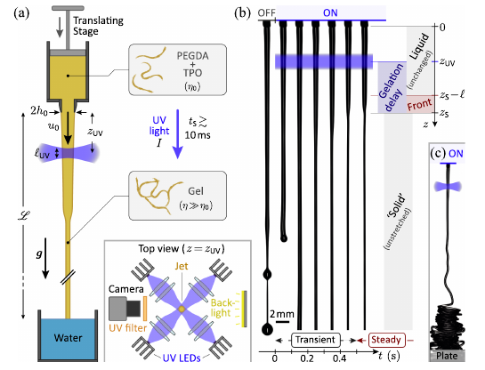
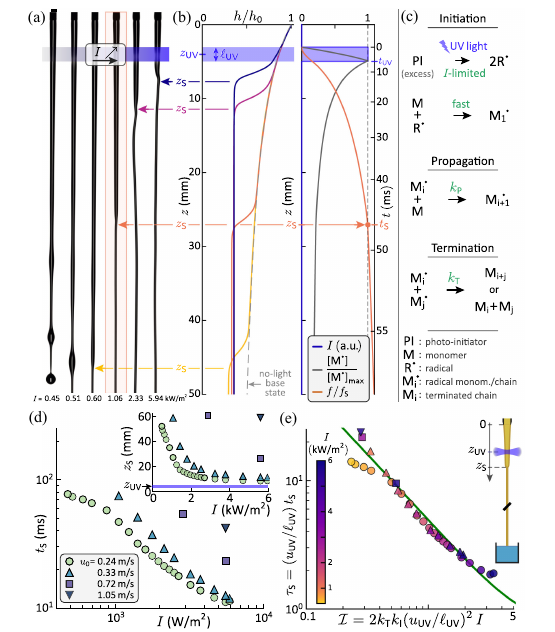
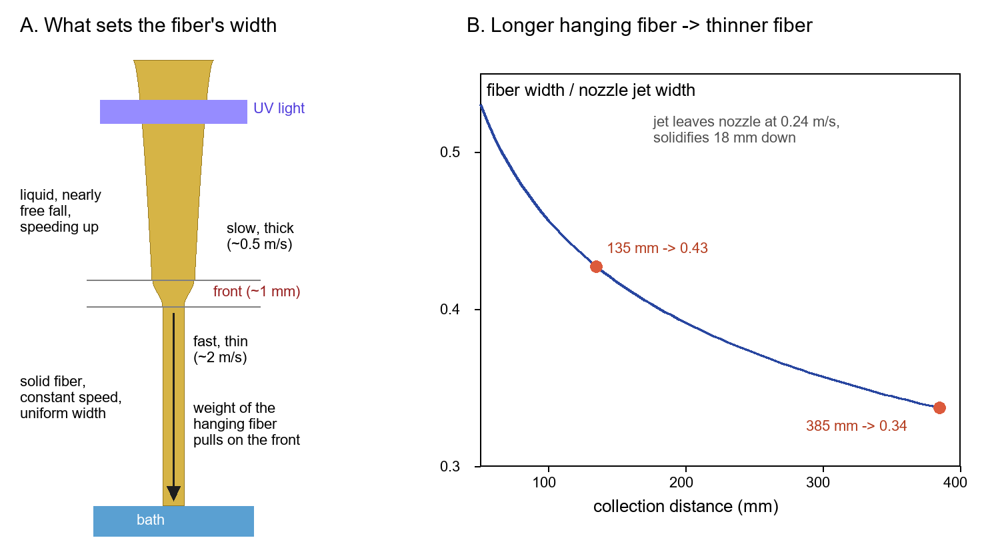
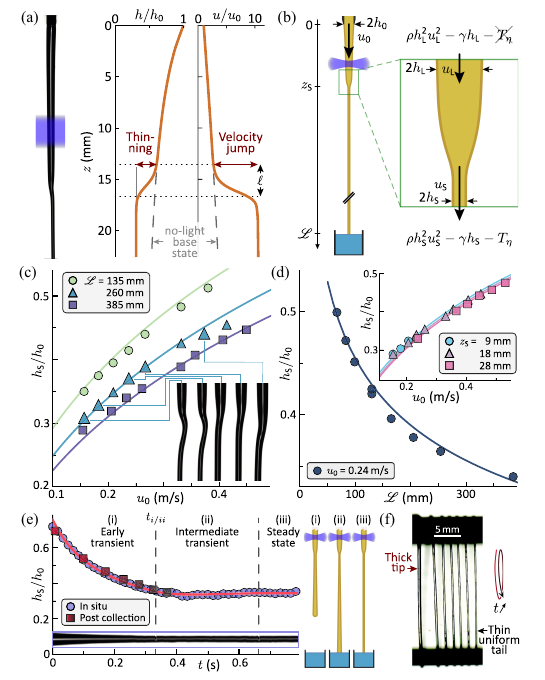
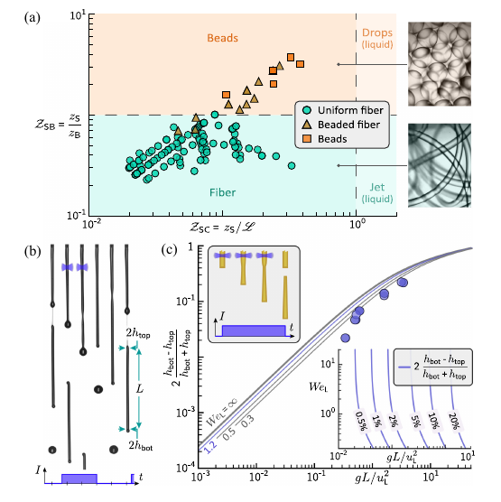

v3.16
Analyzing | Framework v3.16 | Supplemental Material not read (separate file, not provided)

> **Access Status** — Full paper: read in full from the local PDF (Physical Review Letters 137, 144004, published 2 October 2026, open access; all 7 pages), with the text extraction as backup · Abstract: same PDF · Supplemental Material: **not read** — the paper relies on it for setup details, derivations, the breakup model, drag and stability estimates, a core–shell generality test and movies; it is a separate APS file outside this run · Figures: all four viewed; no source figure files existed, so each was cropped from the page renders and checked · Context: a press summary (Lifeboat, October 2026) and one related arXiv abs page (Section 2) · Analysis basis: full main text; Supplemental-only material is taken on trust and flagged where it matters.

## 1. Let Gravity Hold the Thread: Light-Frozen Jets Spin Fibers You Can Predict

A falling stream of resin, frozen in place by ultraviolet light, becomes a solid fiber whose width the authors predict with no adjustable knobs — set only by the weight of the fiber hanging below the freezing point, pulling on the liquid above it.

## 2. Big-Picture Context

Most thin solid fibers began as a liquid drawn out while it hardened: glass wool, nylon and polyester, carbon-fiber precursors, sutures, tissue scaffolds, spider silk. The craft is called *spinning*. In its tidiest industrial form, a motorized roller winds the fiber at a fixed speed. Since the pump also fixes how much liquid enters per second, the width follows from bookkeeping: the same volume per second, moving faster, must squeeze into a thinner thread.

Many processes instead pull with a *force* — the fiber's weight, air drag, electric fields in electrospinning, centrifugal force in rotary spinning. Then the speed, and so the width, depends on where and how fast the liquid solidifies, which in turn depends on how much it was stretched. Chemistry and flow feed back on each other, and practitioners tune by trial and error.

Smink, Visser and Lhuissier strip this to its simplest force-driven form. A jet of light-curable resin falls freely under gravity. A ring of ultraviolet lamps a few millimetres below the nozzle starts a chain reaction, and farther down the liquid abruptly turns solid. Because the light switches in about a millisecond and its brightness is adjustable, the authors control *where* the jet freezes independently of how fast it moves and how far it falls. That separates chemistry (when the liquid freezes) from mechanics (what freezing does to the jet), so each can be modelled and tested on its own.

**Paper Type & Stakes:** An experimental fluid-mechanics Letter with compact theory on force-driven fiber spinning; the stakes are a predictive recipe for fiber width and shape in processes usually tuned empirically, and a possible new way to time fast light-driven reactions.

**Prior Belief Check:** The paper sits comfortably inside established physics. Falling jets, their breakup into drops, momentum balances across sharp changes in a thread's width, and the radical-polymerization scheme are all textbook. What is new is the *experiment* — a sharp, tunable, on-demand liquid-to-solid switch on a free jet — and the demonstration that, with the switch sharp, the coupling between chemistry and flow drops out and simple models predict fiber width, start-up history, and beads-versus-fiber outcome. Experts will not find the physics surprising; they will find the clean separation useful. The journal marked it an Editors' Suggestion and Featured in Physics, which rewards clarity rather than a paradigm shift. Read it as incremental but enabling.

**Replication & Convergence Note:** Single collaboration (Twente and Marseille), building on the Twente group's own earlier in-air light-curing work; no independent repetition yet. Confirmation would mean another lab, ideally with a different resin or a different fast-gelling route, reproducing the fiber-width-versus-fall-distance curve without retuning — the most portable test, since it needs no chemistry inputs.

For related work I checked the arXiv abs page of Rubio-Rubio, Sevilla and Gordillo on the thinnest steady gravity-stretched jets (arXiv:1912.10383, **v1, the only version**; published in J. Fluid Mech. in 2013), the liquid-only cousin of this paper's stability discussion. For Javadi and colleagues' PRL on delayed breakup of falling viscous jets, cited for the breakup length, I found no arXiv version and saw only a search-tool summary of the published paper, so I use it only for its general claim that viscosity delays breakup.

## 3. Necessary Background Crash-Course

### Speed-driven versus force-driven spinning

A spinning line has a fixed input: the pump pushes a set volume per second. Downstream, that volume per second cannot change, so the thread's cross-section times its speed stays constant all the way down. Know the final speed and you know the final width. In speed-driven spinning a motor sets that speed; in force-driven spinning the speed comes out of a force balance.

Here the pulling force is the weight of the already-solid fiber hanging below the freezing point. The bath carries whatever has landed, so only the length between freezing point and bath pulls. Longer hanging length means more pull, a faster fiber, and a thinner one.

> **Analogy:** A data stream with fixed bandwidth crossing between buses. Bandwidth (volume per second) is fixed upstream; downstream you trade lane count for clock rate. Fiber cross-section is the lane count, fiber speed the clock. In speed-driven spinning a clock generator (the winding roller) fixes the clock. Here nothing fixes it — the load hanging on the line negotiates it.

> **Breaks when:** you ask what raising the clock costs. A bus changes clock rate for free; a fluid thread cannot, because speeding up mass takes force. The fiber-width prediction comes precisely from paying that momentum bill at the freezing front, which has no counterpart in the bus picture.

### The falling liquid jet and why it breaks up

Before the light, the resin is a runny liquid — about fifty times as viscous as water, like a light syrup. Leaving the nozzle, it accelerates almost like a freely falling object and stretches thinner by the fixed-bandwidth rule. The authors check that the jet starts faster than the slow speed below which viscosity would dominate, so the liquid behaves like an inviscid falling stream, slightly slowed by surface tension acting as a tight skin.

That skin also destroys the jet. A long liquid cylinder lowers its surface area by pinching into drops, so tiny ripples grow until it breaks — the *Plateau–Rayleigh instability* that turns a thin faucet stream into drips. With the light off, the jet here breaks into drops a few centimetres down.

> **Analogy:** Freezing and breakup run a race, like two threads racing to commit to a shared variable. If solidification commits first, the jet locks in as a continuous fiber; if breakup commits first, the light freezes drops or beads; a near-tie gives beaded or wavy fibers.

> **Breaks when:** you treat the race as deterministic. Breakup grows from random disturbances, so the breakup point fluctuates and outcomes near the boundary are statistical. The paper's "breakup distance" is a calibrated average.

### Light-driven chain polymerization as a timer

The resin is an acrylate (PEGDA, common in light-cured printing and hydrogels) mixed with a *photoinitiator* that splits into radicals when it absorbs ultraviolet light. You know the chemistry: light makes radicals, each radical adds monomers in a chain, and two radicals that meet kill each other. The useful framing here is *time*.

The jet spends only a few milliseconds crossing the light. During that window, radicals are made. Afterward, none are made; existing ones keep converting monomer while annihilating in pairs. The liquid counts as solid once a fixed small fraction of monomer has reacted — the authors take about one percent. Because each monomer has reactive groups at both ends, even that little conversion stitches a network across the jet and the viscosity skyrockets. The time from entering the light to the threshold is the *solidification delay*: brighter light, more radicals, shorter delay, freezing point closer to the lamps.

> **Analogy:** A token bucket. Tokens are added only during a short fill window (transit through the light), at a rate set by light intensity. Tokens leak afterward (termination). Each token present does fixed work per second (propagation), and an alarm fires when total work passes a quota (the one-percent threshold). Alarm time is the solidification delay; alarm position down the jet is the freezing point.

> **Breaks when:** you assume a normal leak. An ordinary leaky bucket drains a fixed fraction per second. Termination needs two radicals to meet, so the drain grows with the *square* of the radical count — a full bucket empties fast, then lingers. That pairwise drain is why the paper's delay formula contains hyperbolic functions rather than simple exponentials, and why the delay scales with intensity in a non-obvious way.

### What happens at a sharp freezing front

When the liquid freezes within about a millimetre, everything below moves as one solid rod at a single speed. Above the front the liquid is slow and thick; below, the solid is fast and thin. Speeding up mass needs force, and the only force available is tension in the solid below, which must hold up the fiber's weight down to the bath. Balancing "momentum gained per second at the front" against "tension from the hanging fiber" fixes the fiber speed; the fixed-bandwidth rule converts speed to width. The chemistry enters only through *where* the front sits.

### Origins & Big Picture: how spinning came to be, and where this experiment sits

Drawing fibers from a liquid is old. Glassworkers pulled molten glass into threads in antiquity, and the practice became industrial glass and mineral wool, made by flinging molten rock off spinning wheels or blowing it with gas jets. The synthetic-fiber industry began around 1900 with rayon: dissolved cellulose squirted into a chemical bath where it solidifies — *wet spinning*. Nylon and polyester brought *melt spinning*: extrude molten polymer, cool it in air, wind it on a roller at controlled speed. Melt spinning is the archetype of speed-driven spinning, and its physics was worked out from the 1960s; Matovich and Pearson's steady viscous "threadline" solution, cited here, sits at its heart.

Three later families broke the speed-driven mold. *Electrospinning*, revived in the 1990s, uses electric fields to pull a charged jet into fibers far thinner than a hair, prized for filters and scaffolds; its jet whips chaotically and its final width is notoriously hard to predict. *Centrifugal* and *blow spinning* fling or blow liquid off a spinning head or nozzle, trading control for throughput. *In-air microfluidics*, developed partly by the Twente group behind this paper, shoots jets through air and solidifies them in flight — by mixing reactive streams or, in Jiang, Visser and colleagues' earlier work, by curing them with light — to make beads, particles and fibers continuously, without a mold. In all of these the draw is a force, and solidification (chemical, thermal or evaporative) is coupled to stretching.

Nature solved it first. Spiders and silkworms pull a concentrated protein solution from a gland; it converts to solid under chemistry changes in the duct plus stretching. A spider dropping on its dragline is literally performing gravity-driven spinning, with its body weight as the draw force.

Fluid mechanics supplies the other half. Savart, Plateau and Rayleigh studied how falling streams break into drops in the nineteenth century, and gravity-stretched viscous jets have a modern literature: how long a falling jet stays intact, why honey threads survive for metres while water breaks within centimetres, and when a stretched jet stops being steady and starts to oscillate.

This paper sits at the junction. It borrows the cleanest draw (free fall), the cleanest switch (light, on and off in a millisecond), and a solidification sharp enough that the liquid and solid parts interact only at one front. That makes it a *model system* — a stripped-down testbed — rather than a new production method. Its role is a validated baseline: once you know what gravity, inertia and surface tension alone do to a sharply freezing jet, deviations in electrospinning or blow spinning can be traced to drag, electric charge or gradual curing.

### Concept diagram

*Analyst-built concept diagram (not from the paper):*

```
 pump: fixed volume/second -> nozzle
               |
               v
 LIQUID JET: near free fall, thins as it speeds up
               |
               v
 UV LIGHT SPOT (few ms crossing) -> radicals created
               |
               v
 DELAY (10-100 ms): radicals convert monomer, pairs die
               |  brighter light -> shorter delay
               v
 THRESHOLD (~1% converted) -> FREEZING FRONT (~1 mm)
               |
               v
 MOMENTUM JUMP at front  <--- tension = weight of fiber
               |                down to the bath
               v
 SOLID FIBER: one speed, uniform width -> water bath
               |
               v
 OUTPUT: fiber width, start-up history, fiber vs beads
```

Read top to bottom: the chemistry branch decides *where* the front sits; the mechanics at the front decides *how thin* the fiber is.

> **Central analogy for this paper:** Fixed bandwidth; the hanging weight sets the clock.

## 4. Core Technical Explanation

### Step 1 — Making the jet freeze on command

**The failure it prevents:** In most spinning, solidification is smeared out and cannot be moved without changing the flow, so you cannot tell which effect does what.

**What the authors do:** They pump resin through a vertical nozzle at a fixed rate, let the jet fall a few tens of centimetres into a water bath, and hit it from four sides with focused ultraviolet LEDs a few millimetres below the nozzle. The light switches on within about a millisecond, and its intensity spans roughly a tenfold range. They film the jet and, in a separate test, catch it on a plate.

**What it buys:** An on-demand, sharply localized liquid-to-solid switch whose position can be dialed without touching the flow.



*Figure 1 (from the paper): (a) the setup — pump, nozzle, UV spot, fall distance and bath, with a top view of the four LEDs; (b) side-view snapshots before and after switch-on, showing the transient and the steady thinning front; (c) the jet below the front coiling on a plate.*

**What to look at:** In (b), the jet above the light is unchanged after switch-on, while a few millimetres below it narrows abruptly into a thin, uniform thread; in (c), that thread piles into coils like a rope instead of spreading into a puddle — the visual proof it is solid-like.

The quantitative case: the fiber stays uniform to about a percent over its whole hanging length while carrying its own weight. For a liquid, that would need a viscosity more than five orders of magnitude above the resin's, or the stiffness of a soft gel. The authors also separate three timescales: tens of milliseconds of delay before freezing, about a millisecond to cross the front, and about half a second for the hanging fiber to settle after switch-on.

### Step 2 — Describing the liquid part as a falling stream

**The failure it prevents:** Without a model of the jet *above* the front, a measured freezing position cannot be turned into a freezing time, and the liquid speed arriving at the front is unknown.

**What the authors do:** They treat the liquid jet as slender and steady, so the fixed-bandwidth rule ties width to speed, drop viscous stresses (the jet starts too fast for them to matter), and keep gravity plus a small surface-tension correction. That gives a "nearly free fall" formula for jet speed versus height (the paper's Eq. 1). The measured light-on profile follows the light-off curve right down to the front.

**What it buys:** A known liquid speed everywhere above the front — the only flow input the rest needs. The matching profiles also show the freezing is sharp: the liquid "does not know" it is about to freeze.

### Step 3 — How light intensity sets the freezing point

**The failure it prevents:** Fitting each freezing position separately would turn the chemistry into a lookup table with no predictive power.

**What the authors do:** They solve the three-step chain scheme along the jet's path and call the jet solid at a fixed converted fraction. The resulting closed-form delay, in units of the time spent crossing the light, depends on one combined variable — intensity times exposure time squared, times the initiation and termination rates — plus one chemistry constant that bundles the threshold with the termination-to-propagation ratio. The falling-stream model then turns delay into freezing position.

**What it buys:** Measurements at four nozzle speeds and a tenfold intensity range collapse onto one curve with two fitted constants. At low intensity the delay is inversely proportional to intensity: halve the brightness, double the wait.



*Figure 2 (from the paper): (a) steady jets at increasing intensity; (b) measured width versus height (left) and modelled light, radical concentration and converted fraction (right); (c) the reaction scheme; (d) freezing time and position versus intensity at four nozzle speeds; (e) the same data in dimensionless form against the model.*

**What to look at:** In (a), the freezing point (arrows) climbs toward the light as intensity rises, and at the lowest intensities the jet breaks into drops first. In (e), points from all four nozzle speeds fall on one green model curve, with a small drift at low intensity for the slowest jet, where breakup interferes.

Panel (b) carries a nice detail: the radical population peaks at the bottom of the light spot and then decays, yet the converted fraction keeps rising for tens of milliseconds. The freezing happens in the dark, driven by the radicals' afterglow. The two fitted constants resemble literature values for similar chemistry — the Claim check shows that one of those agreements is partly built in.

### Step 4 — The fiber's width from a momentum balance

**The failure it prevents:** In force-driven spinning the width is normally an empirical output, so processes are tuned by trial and error.

**What the authors do:** They draw a thin control box around the freezing front and balance force against momentum, using four observations: the liquid side carries negligible tension; the solid moves at constant speed, so its tension equals the weight of fiber between front and bath; the front itself weighs little; and curing barely changes density. With the fixed-bandwidth rule, this gives one equation for fiber speed. Without the small surface-tension terms it reads:

$$u_S - u_L = \frac{g\,(\mathcal{L} - z_S)}{u_S}$$

**Symbol definitions:**
$u_S$ : speed of the solid fiber below the front (m/s)
$u_L$ : speed of the liquid arriving at the front, from the falling-stream model (m/s)
$g$ : gravitational acceleration (m/s²)
$\mathcal{L}$ : distance from nozzle to bath (m)
$z_S$ : distance from nozzle to the freezing front (m)

**What this actually means:** The left side is how much the material speeds up crossing the front; the right side is the hanging fiber's weight divided by the mass passing per second. A longer hanging fiber pulls harder, so the fiber runs faster and, at fixed bandwidth, thinner — the hanging load sets the clock and the lane count follows. The paper's full Eq. 5 adds small surface-tension terms and has no fitted parameter.

**What it buys:** Fiber width predicted from nozzle speed, fall distance and freezing position alone, matching data across all three. A notable consequence: moving the front threefold farther down barely changes the width, because the liquid arrives faster but the hanging length shrinks, and the effects nearly cancel.



*Analyst-built illustration (not from the paper):* panel A sketches slow, thick liquid speeding up through the millimetre-long front into a fast, thin fiber whose hanging weight does the pulling; panel B is the paper's Eq. 5 solved in Python for a jet leaving the nozzle at about a quarter metre per second and freezing 18 mm down.

**What to look at:** In panel B, width falls steeply at short fall distances and flattens at long ones — about a fifth thinner from 135 to 385 mm — the same trend as the paper's Figure 3(d).



*Figure 3 (from the paper): (a) a steady jet with width and speed profiles — a sharp narrowing and matching speed jump at the front; (b) the momentum-balance control box; (c) fiber width versus nozzle speed for three fall distances; (d) width versus fall distance (main) and versus nozzle speed for three freezing positions (inset); (e) width below the front versus time after switch-on, with early, intermediate and steady phases; (f) a collected start-up fiber, thick tip to thin tail.*

**What to look at:** In (c) and (d), symbols are data and curves are the parameter-free model; they track each other across every fall distance, and the inset of (d) shows three freezing positions giving nearly the same width. In (e), the model line follows both in-flight measurements (circles) and widths measured later along the collected fiber (squares).

### Step 5 — What happens in the first half second

**The failure it prevents:** Steady theory says nothing about the start of a run or about short fibers from a pulsed light, where the hanging length — and the pull — changes with time.

**What the authors do:** They keep the momentum balance but let the hanging mass grow and the fiber accelerate. Before the tip reaches the bath, all solid made so far hangs and falls as one piece. Without surface tension the answer is neat: the fiber accelerates at exactly half of gravity, so its width shrinks steadily. Once the tip lands, the bath starts carrying the earliest, thickest segments, and the width settles over an "intermediate transient" to the steady value.

**What it buys:** The whole start-up history, including when the tip lands (about a third of a second in Figure 3(e)), matched both in flight and along the collected fiber — whose thick tip and thin tail literally record the run's history.

### Step 6 — Fiber or beads, steady or jittery: a design map

**The failure it prevents:** An engineer needs to know in advance whether a given flow, light level and fall distance gives a uniform fiber, beads, or a jet that lands unfrozen.

**What the authors do:** They compare two ratios: freezing distance over breakup distance (the race from Section 3) and freezing distance over fall distance (does it freeze before the bath?). Freezing distance comes from their model; breakup distance from a simplified model calibrated with light-off runs.

**What it buys:** The paper reports that the map captures the outcome of all its experiments, with the fiber/bead boundary where the two distances are equal. By eye, one or two beaded points sit just below that line — what a noise-driven boundary should look like, not a failure.



*Figure 4 (from the paper): (a) outcome map — freezing-to-breakup ratio (vertical) against freezing-to-fall ratio (horizontal), with uniform fibers, beaded fibers and beads; (b) short fibers from a pulsed light; (c) how much a short fiber tapers versus its dimensionless length, with model curves for several surface-tension strengths.*

**What to look at:** In (a), circles (uniform fibers) sit below the dashed line where freezing wins, triangles and squares (beaded fibers, beads) above it; all runs sit at the left, freezing well before the bath. In (c), measured taper rises with fiber length and sits close to, slightly below, the model curves.

Pulsed light makes short fibers thinner at the top than the bottom, because each fiber is drawn harder as it grows — the start-up transient in miniature. The authors also give a stability rule: below the front, a disturbance from the bath can climb the solid fiber as an elastic wave. It normally dies in the liquid, but if the liquid arrives too slowly it reaches the light spot and the freezing point jitters. The criterion is that the liquid must arrive faster than a capillary speed set by surface tension and jet width (details in the Supplemental Material). Finally, they argue the mechanics apply to any gravity-stretched jet that freezes sharply, citing a core–shell alginate jet in the Supplemental Material, and that the freezing point could time fast light-triggered reactions down to roughly a tenth of a millisecond.

### Claim check

Checks were run in Python (`claimcheck.py` in the work directory; the explainer curve uses `explainer.py`). The resin density is not given in the main text; I assumed about 1.1 g/cm³ (typical for PEGDA) and confirmed results do not depend on it.

**Fiber width from the momentum balance — Reproduced.** Solving Eqs. 1 and 5 gives widths of about 0.34 of the nozzle jet at the longest fall distance, 0.43 at 135 mm, and 0.27 at the slowest nozzle speed — on the plotted curves and data of Figures 3(c)–(d), read by eye. Moving the freezing point from 9 to 28 mm changes the width by about 4 percent, confirming the weak dependence. This is the paper's strongest result, and it holds.

**Reaction constants agree with the literature — Partly reproduced (agreement partly built in).** The arithmetic is right: the fitted combined constant and termination rate give the quoted propagation rate when the threshold is one percent. But the data constrain only the *combination* of threshold and rate ratio. The inferred propagation rate scales almost in proportion to the assumed threshold — half a percent would halve it, two percent double it — so its match to the literature tests whether one percent is plausible, not the kinetics model. The termination rate is fitted independently and agrees within about ten percent; that part is genuine support.

**Start-up transient — Reproduced.** The low-surface-tension solution (fiber speed rising at half of gravity) follows directly from Eq. 6, and the tip-landing time computed for the Figure 3(e) run is about 0.32 s (0.33 s with surface tension), on the paper's dashed line. The predicted width at that moment sits slightly above the steady value, consistent with the plotted dip-then-recovery.

**Solid-like evidence — Reproduced, conservatively stated.** The stated strain and stretching-rate limits plus the weight-driven stress imply a viscosity floor of several hundred thousand pascal-seconds at the longest fall distance — well above the paper's quoted floor.

**Sensitivity.** The width prediction's key assumption is a tension-free liquid side, which needs the jet to leave the nozzle faster than the speed where viscosity matters, about 8 cm/s for this resin. Experiments run at about twice that or more, so the prediction survives unless nozzle speed drops below about 0.1 m/s. Removing surface tension shifts width by about 3 percent; the nozzle-jet radius range shifts it under 1 percent. The width prediction is robust; the reaction-rate inference is not robust to the threshold.

**Robustness (limiting cases and approximations).** The delay formula recovers its stated low-intensity limit within a few percent across the data, and the data stay inside its validity range (it breaks down only above about 6 in dimensionless intensity, beyond the largest plotted value). The drag-to-weight ratio from the paper's own expression is about 1.5 percent, consistent with the quoted "about a percent" — negligible here, but it grows with fiber speed squared.

**Internal consistency.** Nothing significant. Minor slips, in one line: the quoted nozzle Weber-number range (0.3–10) misses the stated lowest nozzle speed (0.1 m/s gives about 0.1); the light's switch-on time is not shorter than the jet timescale at the fastest nozzle speeds; the low-intensity "distance grows as delay squared" scaling ignores the jet's initial speed (heuristic only; the fits use the full formula); and the text says the fiber "mildly thickens" after the tip lands, while Figure 3(e) shows a short dip first.

### Assumption Audit

> **Watch:** Reader likely assumes "fast solidification" means the fiber is fully cured. The paper actually says the jet is solid-like after about one percent conversion and that the stiffness may keep evolving below the front. What lands is a lightly crosslinked gel.

> **Watch:** Reader likely assumes the paper measured reaction rate constants. It actually fits a combination; the quoted propagation rate depends on the assumed one-percent threshold, so its literature agreement is a plausibility check on that threshold.

> **Watch:** Reader likely assumes the method already times reactions to a tenth of a millisecond. The paper actually proposes this; the measured delays are tens of milliseconds, the sub-millisecond figure reflects the front's sharpness, and sub-microsecond timing relies on hypothetical faster jets and sources.

> **Watch:** Reader likely assumes "parameter-free" means geometry alone. The width prediction has no *fitted* parameters, but it assumes a sharp front, negligible drag, negligible density change, a bath that carries the landed fiber, and the falling-stream model for the liquid.

## 5. What's Genuinely New or Clever

**The experiment is the contribution.** A light-curable resin on a free-falling jet turns solidification into a dial: its *position* set by intensity, its *timing* by the switch, both independent of the flow. That decouples three things spinning normally entangles — draw force, jet speed, and where the liquid turns solid. New to the field in this clean form, building on the group's earlier in-air light-curing work.

**Treating the freezing front as a momentum jump.** Rather than modelling the rheology inside the front, the authors treat it as a thin box in which slow liquid becomes fast solid, balanced by the hanging weight. Chemistry then drops out of the width prediction except through the front's position, and even that nearly cancels. The trick is standard for shocks and hydraulic jumps; applying it to a solidification front and showing it predicts both steady and start-up widths — including the fiber accelerating at half of gravity until it lands — is the clever move.

**The jet as a reaction stopwatch.** Since the jet's speed profile is known, distance maps onto time after exposure, so the freezing point reads out a reaction delay — the paper's most original idea, though its high-speed promise remains a proposal.

New to the reader versus new to the field: the momentum balance and polymerization scheme are textbook; what is new is validating them together, quantitatively, in a sharp, controllable experiment.

### Predictive Content Check

**Falsifiable handle:** The paper makes specific parameter-free predictions. For a given nozzle speed and fall distance, fiber width follows from the momentum balance — about a fifth thinner as the fall distance grows from 14 to 39 cm — and barely changes when the freezing point moves. Pulsed short fibers should taper by an amount fixed by their dimensionless length and surface-tension strength. The beads-versus-fiber boundary should sit where freezing and breakup distances are equal. Any lab with a light-curable resin, a nozzle and a UV lamp could test these, and a resin with known kinetics would test the delay formula without refitting. The reaction-stopwatch application is a proposal, not a tested prediction.

*(Formalism-load half skipped: the equations are short and each generates a tested prediction.)*

## 6. Limitations & Open Questions

**Air drag is neglected and will matter for thin, fast fibers.** The drag-to-weight ratio is about a percent here, but it grows with fiber speed squared, so electrospun or blow-spun fibers sit outside the model. **(A) Consensus** — the paper states the approximation, estimates it, and names drag-dominated spinning as open; recomputation confirms the small value here. **(paper, Eq. 5 discussion and Discussion)**

**Only sharp, complete solidification is treated.** Gradual hardening — melt cooling, solvent evaporation, most electrospinning — involves exactly the coupling this setup removes. **(A) Consensus** — the authors list it as open, and it is the known hard case in spinning. **(paper, Discussion)**

**The propagation rate is not independently measured.** It scales with the assumed one-percent threshold. **(C) Speculative** — this comes from my recomputation using the paper's fitted constants; the Supplemental Material, which I did not read, may constrain the threshold more tightly. **(analyst inference)**

**Chemistry approximations: uniform light absorption, no oxygen inhibition, constant temperature.** The paper justifies each — absorption length larger than the jet, degassed resin with shallow air penetration, heating under a degree — and they look sound for these jets, but they would need revisiting for thicker jets, strongly absorbing resins or non-degassed liquids. **(B) Contested** — the estimates are reasonable, yet oxygen inhibition and light gradients are notoriously important in photopolymerization practice, and the details live in material I did not read. **(paper, solidification section; analyst inference)**

**Interaction with fast capillary ripples is not captured.** Average thinning still matches, but crests and necks are not thinned in proportion; the front damps them. **(A) Consensus** — stated by the authors. **(paper, transient section)**

**The breakup side of the map is semi-empirical.** The breakup distance comes from a simplified, light-off-calibrated model, and breakup is noise-driven, so the boundary will shift with nozzle quality and environment. **(B) Contested** — breakup-length models for gravity-stretched jets remain an active area. **(paper, Discussion; broader literature)**

**One resin, one setup, one group.** Generality rests on a core–shell alginate test in the Supplemental Material. **(C) Speculative** — the mechanics are generic and probably transfer, but that is my judgment; independent replication with other chemistries would settle it. **(analyst inference)**

**The reaction stopwatch is untested at speed.** **(C) Speculative** — the paper presents it as a prospect; I flag the gap between that and the demonstrated tens-of-milliseconds delays, and faster, thinner jets would bring drag and heating back in. **(analyst inference)**

Open questions for the next one to two years: does the width prediction hold for other resins and gelation routes without refitting; can the freezing point resolve sub-millisecond kinetics in practice; and where exactly does drag take over as fibers thin?

## 7. Detailed Summary & Explanation

The paper builds a model experiment for force-driven spinning. Light-curable resin falls freely from a nozzle into a water bath a few tens of centimetres below, crossing a ring of ultraviolet LEDs just under the nozzle. With the light off, the jet thins and breaks into drops. With the light on, after a delay of tens of milliseconds, the jet freezes over a front about a millimetre long, below which it is a uniform, much thinner, solid-like fiber that coils like rope when caught.

Three questions get answered. Where does it freeze? A textbook chain-polymerization model — radicals made only while crossing the light, then annihilating in pairs while converting monomer — predicts the delay, and with a nearly-free-fall jet model predicts the position; all data collapse onto one curve with two fitted constants. How thick is the fiber? A momentum balance at the front, with the hanging fiber's weight doing all the pulling, predicts width with no fitted parameters and matches across nozzle speeds, fall distances and freezing positions. What happens in time? The same balance with a growing hanging mass predicts the start-up history and the taper of pulsed short fibers. Together these give a map of uniform fibers versus beads and a stability rule against jitter.

The summary is framed around the separation between chemistry and mechanics because that is the real achievement: with sharp freezing, chemistry decides only *where* the front sits, and mechanics decides the rest. My recomputation supports the mechanics strongly. The chemistry side is weaker than "agrees with literature" suggests: the termination rate agrees independently, but the propagation-rate agreement is partly built in by the assumed threshold. The stopwatch application is promising but undemonstrated.

**Where I'm least confident in this analysis:** The Supplemental Material — derivations of the four model equations, the solid-like estimate, the breakup model, the drag estimate, the core–shell test and the stability criterion — was not available, so I checked the main-text equations against each other and the figures but not their derivations; the threshold choice and stability criterion may be better justified there than the main text shows.

**Revision notes:** The referee pass added the threshold degeneracy to the Audit and Section 6, separated the stopwatch proposal from demonstrated results, softened "every experiment" on the outcome map, condensed minor slips into one line, and cut about a fifth of the length to meet the word ceiling.

## 8. Three Crystallized Takeaways

1. When a falling stream of resin is frozen sharply by light, the weight of the solid fiber hanging below pulls the liquid through the freezing point — and that weight, not the chemistry, decides how thin the fiber ends up.
2. Because the falling jet's speed is known, the distance at which it freezes works like a stopwatch for the light-triggered chemistry: brighter light, shorter delay, freezing point closer to the lamp.
3. A race between freezing and the jet breaking into drops decides whether you get a smooth fiber or a string of beads — and the authors can now call the winner in advance.

## 9. Shorter Summary

Many ways of making thin fibers — electrospinning, blow spinning, gravity-drawn threads — pull a liquid with a force instead of winding it at a fixed speed. That makes the final width hard to predict, because where and how the liquid hardens depends on how much it was stretched, and vice versa.

Smink, Visser and Lhuissier built a clean test case. A jet of light-curable resin falls freely into a water bath. Ultraviolet LEDs just below the nozzle trigger a chain reaction, and a few centimetres farther down the liquid suddenly becomes a solid-like fiber. Changing the light's brightness moves the freezing point without changing the flow.

They show three things. A standard light-driven polymerization model predicts how long the jet takes to freeze, with all measurements collapsing onto one curve. A simple momentum balance — the weight of the fiber hanging between freezing point and bath pulls slow liquid into a fast, thin solid — predicts fiber width with no adjustable parameters, matching experiments across speeds and fall distances. And the same balance explains how the fiber thins in the first half-second after switch-on and how short fibers from a pulsed light taper. A design map then predicts smooth fibers versus beads.

An independent recomputation reproduces the width and start-up predictions. One caution: the agreement of one fitted reaction rate with the literature partly follows from an assumed one-percent freezing threshold, so it is a plausibility check rather than a measurement. Using the jet as a stopwatch for very fast chemistry is promising but not yet demonstrated.

The result is a single-group, carefully validated baseline for force-driven spinning: once solidification is sharp, mechanics alone sets the fiber's width.
