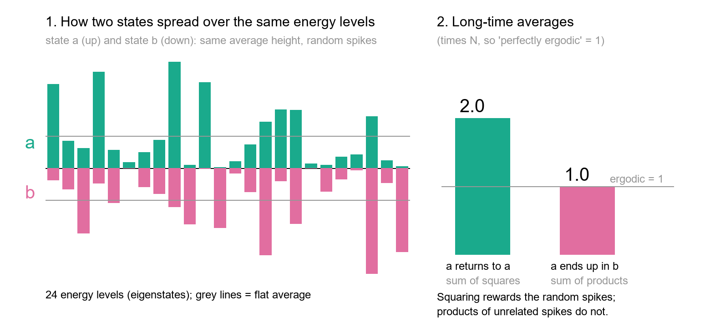
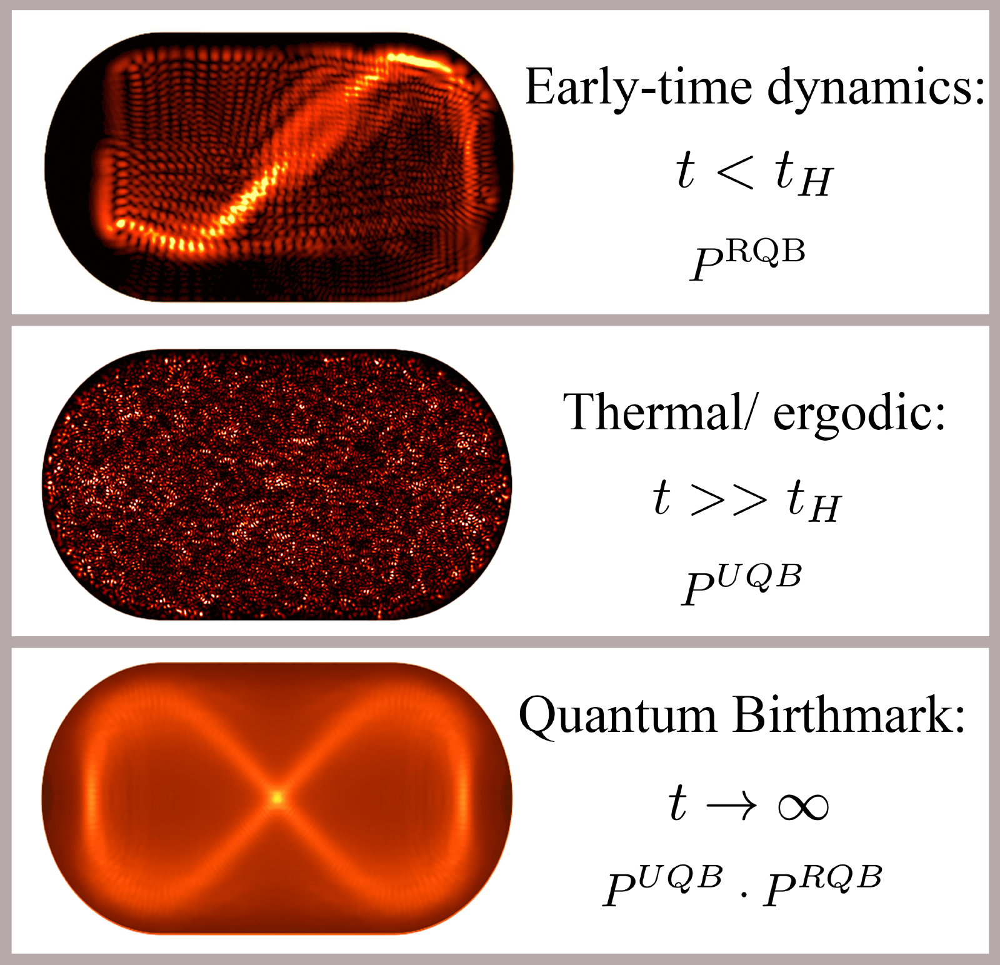
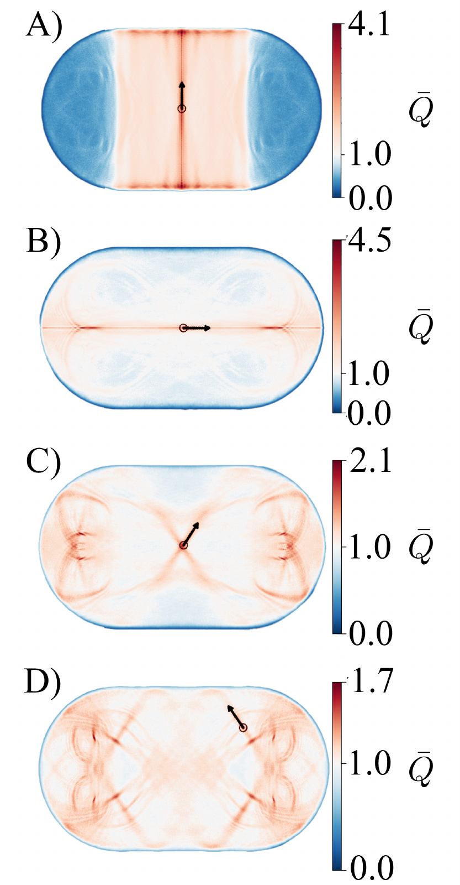
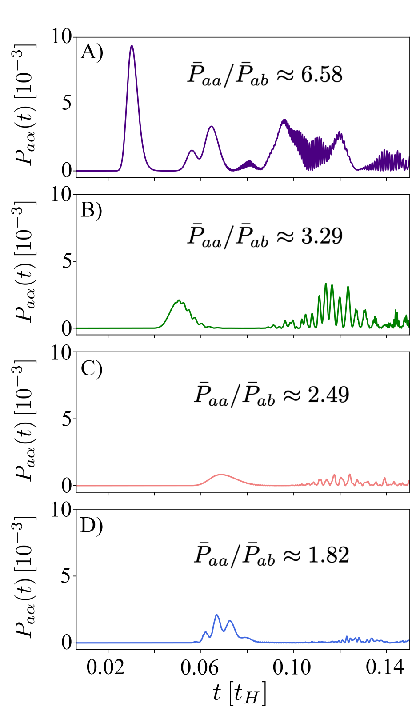
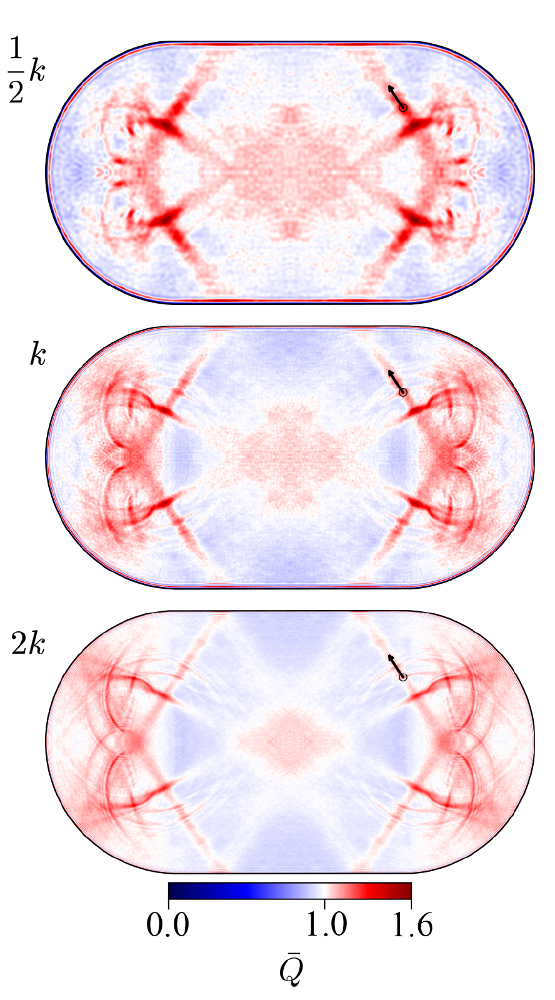

v3.16
Analyzing | Framework v3.16

**Paper:** Anton M. Graf, Saul Atwood, Mingxuan Xiao, Roland Ketzmerick, Eric J. Heller, and Joonas Keski-Rahkonen, "Quantum Birthmarks: Ergodicity Breaking Beyond Scarring," *Physical Review X* **16**, 031063 (2026). DOI: [10.1103/dhzb-28rb](https://doi.org/10.1103/dhzb-28rb). arXiv: [2412.02982](https://arxiv.org/abs/2412.02982) (v1 4 Dec 2024; v4, 10 Sep 2026, used here). Harvard, Peking University, TU Dresden, Tampere University.

> **Access Status** — Full paper: read in full from the local arXiv v4 PDF (36 pages: main text, Appendix A on the random-matrix derivation, Appendix B on the simulations, references), with the pdftotext extraction as backup · Abstract: checked against the arXiv abstract page, which lists v4 (10 Sep 2026) as current and gives the journal reference *Phys. Rev. X* 16, 031063 (2026) · Supplementary material: the paper points to animations "at [URL will be inserted by publisher]" (ref. 76); these were not available in the arXiv package and were not viewed · Figures: all 12 figures viewed from the authors' arXiv source files (pre-extracted); Figures 11, 5, 8 and 10 shown below; Tables I and II read from the PDF · Related work checked on arXiv abstract pages: Pizzi, arXiv:2412.04310 (v3, 8 Apr 2025, current; *Phys. Rev. Lett.* 134, 140402); Xiaoya, Graf, Heller, Keski-Rahkonen, arXiv:2602.00891 (v1, 31 Jan 2026, only version); Pilatowsky-Cameo et al., arXiv:2402.06720 (v2, Dec 2024, current; *Phys. Rev. X* 14, 041059); Smith and Kaplan, arXiv:0907.5037 (abstract page; the fetched summary did not show whether later versions exist). Heller's 1987 phase-space-exploration paper (*Phys. Rev. A* 35, 1360) is not on arXiv; I rely on how this paper cites it · Analysis basis: full text. Numerical checks run in Python (`claim_check.py`, `make_explainer.py` in the work directory).

## 1. A Wave That Never Forgets Where It Was Born

**Hook:** Put a quantum particle in a perfectly chaotic stadium-shaped box, wait forever, and it still turns up back at its starting point about twice as often as anywhere comparable. Classical chaos forgets its starting point completely; quantum chaos keeps a permanent "birthmark", and any early bouncing along a repeating path makes the mark deeper.

## 2. Big-Picture Context

Statistical mechanics runs on an assumption called ergodicity: given enough time, a system wanders through every configuration its energy allows, so a long-time average equals an average over all allowed states. In classical mechanics, chaos delivers this. A billiard ball in a stadium-shaped table, where nearby paths fly apart exponentially, ends up spending equal time everywhere on the table. Where it started stops mattering.

Quantum mechanics complicates the story. The textbook bridge, called quantum ergodicity, works at the level of the stationary standing-wave patterns (the energy eigenstates). Rigorous theorems say that almost all of those patterns spread evenly over the table at high energy, and the eigenstate thermalization hypothesis builds the modern theory of quantum thermalization on that idea. The known exceptions are "scars": a few standing waves pile up along short, unstable repeating paths. Scars are rare, and they become a vanishing minority as the energy goes up.

This paper changes the question from "what do the standing waves look like?" to "what does a moving wave packet do over infinite time?" The authors launch a localized packet, which is a mix of many standing waves, and ask how often it comes back to where it started compared with how often it lands in some other, equally reasonable, packet-shaped spot. They argue that the answer is never the classical "equally often". There is a minimum universal excess, set only by the system's symmetries, plus an extra excess earned by whatever the packet did early on, such as retracing a scar path. They call the combined, permanent excess a quantum birthmark.

**Paper Type & Stakes:** This is a theory-and-simulation paper. It proposes a conceptual framework, backs it with a random-matrix derivation and wave-packet simulations in the stadium billiard, and argues that the framework generalizes scarring to any initial state. What is at stake is how physicists should define and test "quantum ergodicity" in the time domain, and whether scarring is one instance of a broader memory effect.

**Prior Belief Check:** The numerical core will not surprise specialists. That a state's long-time return probability beats the flat "fully spread" value by a factor of two (or three with time-reversal symmetry) follows from the standard statistics of random wave amplitudes. Heller's late-1980s work on phase-space exploration already counted visited states from this return probability, and close relatives of the factor appear in the "elastic enhancement" of chaotic scattering and in coherent backscattering. What is new is the packaging: treating that excess as a permanent memory every state carries, splitting it into a universal part and an early-dynamics part, and showing it as real-space images. The "ergodicity breaking" claim complicates the folk picture that chaotic quantum systems fully forget their start, but it does not contradict mainstream thermalization theory, as the authors say. Experts will debate the framing (is a symmetry-fixed factor "ergodicity breaking" or simply the correct quantum baseline?) more than the math.

**Replication & Convergence Note:** This is a single-group theory result, but its parts have independent support of different strength. The universal factor is a standard random-matrix result that anyone can rederive; I reproduced it numerically here. The spatial memory effect in the stadium was found independently and almost at the same moment by Pizzi ("quantum trails", posted one day later and published in *Phys. Rev. Lett.* in 2025), with a different method. The authors dispute how far that work goes. No experiment has yet measured a birthmark directly. Independent confirmation would mean a quantum simulator or microwave billiard measuring the long-time return probability against matched control states and finding the factor of two switch to three when time-reversal symmetry is restored.

## 3. Necessary Background Crash-Course

### Classical ergodicity and the stadium billiard

A billiard is the cleanest laboratory for chaos: a particle moves in straight lines and bounces off walls. The shape decides everything. In a circle or rectangle, extra conserved quantities keep motion orderly forever. Bunimovich's stadium, two half-circles joined by straight sides, is provably fully chaotic: nearly every path eventually visits every region in every direction, and paths that start almost together separate exponentially.

Ergodicity in practice means time averages equal space averages. Record where the ball is over a long run and the histogram becomes flat over the table, whatever the start. The stadium's only exceptions are the "bouncing-ball" paths running straight up and down between the flat walls; they occupy zero volume and don't spoil the flat histogram.

> **Analogy:** Classical ergodicity is a well-designed hash function. Feed in any key (the starting position and direction) and, after enough rounds of mixing, the output lands uniformly across all buckets. No bucket remembers which key went in.
>
> **Breaks when:** you ask about short times. A hash is uniform after one call; a chaotic billiard needs many bounces, and along the way it can briefly retrace near-repeating paths. Those early detours are exactly where the quantum story will diverge.

### The quantum version: standing waves and dephasing

A quantum particle in the stadium is a wave. The box supports a discrete list of standing-wave patterns, each with a fixed energy, and each pattern on its own does nothing in time except rotate its phase. A localized wave packet is a weighted mix of many of these patterns. It moves because the patterns rotate at different rates, and their interference shifts the bright spot around.

The key timescale is the **Heisenberg time**, roughly the time for the phase difference between neighbouring energy levels to wrap around once. Before it, the packet behaves much like a cloud of classical particles. After it, all relative phases have scrambled. Averaged over infinite time, the interference between different patterns cancels, and only one thing survives: how much weight the initial packet put on each pattern. Those weights never change.

> **Analogy:** Picture a table whose rows (the standing waves) each hold a fixed value (the weight) and a timestamp field that churns constantly (the phase). Any long-run aggregate over the table can depend only on the fixed values, never on the timestamps.
>
> **Breaks when:** you imagine a write that updates the values. Nothing in the isolated quantum evolution can change the weights; they are fixed by the initial state for all time, and that permanence is the basis of the birthmark.

### Random-matrix statistics and why a state beats its neighbours

How are those weights distributed in a chaotic system? Random-matrix theory, the workhorse of quantum chaos, says that in a fully chaotic system each standing wave looks like a random vector, so the weights an arbitrary packet places on them fluctuate randomly around a smooth average. The amplitudes are Gaussian, and the weights are their squares. That makes the weights "spiky": many small, a few large. This shape is called the Porter–Thomas distribution, after its discovery in nuclear resonance widths.

Now compare two long-time averages. The chance of finding the packet back in its own starting state adds up its weights squared, so every large spike gets counted twice over. The chance of finding it in a different, equally matched packet adds up products of two unrelated sets of spikes, and their large values rarely line up, so you get only the flat-average value. The squaring makes the self-return larger by a fixed factor: two when the amplitudes are complex numbers, three when they are real. Real amplitudes require time-reversal symmetry in both the system and the initial state.



*Analyst-built illustration (not from the paper):* one random complex state spread over 24 levels (green, up) and an unrelated matched state (pink, down), with the two long-time averages, scaled so that perfect spreading equals one.
**What to look at:** the green and pink spikes have the same average height, but the squared green spikes add up to about twice what the products of green and pink spikes do. That factor is the universal birthmark.

> **Concept:** The infinite-time return probability equals the sum of the squared level weights. Porter–Thomas fluctuations make it exceed the transfer to any matched, unrelated state by two (complex amplitudes) or three (real amplitudes), for essentially every initial state and for all time. Classical long-time averages have no such spikes, so there is no classical counterpart.
>
> **Vehicle:** A cache is warmed by a workload whose accesses across cache sets are uneven: a few sets hot, most cold. Re-running the same workload hits the hot sets exactly, so its hit rate is high. An unrelated workload of the same size has its hot sets in random places, so its hit rate is merely average.
>
> **Analogy:** Cache sets ↔ energy levels. Warm-up histogram ↔ the initial state's level weights. Re-running the same workload ↔ returning to itself. The unrelated workload ↔ a matched other state. The hit-rate ratio of about two ↔ the universal birthmark factor.
>
> **Breaks when:** you ask why the histogram never cools, or why the factor can be three. A real cache evicts and drifts, while the quantum weights never change. And the two-versus-three switch comes from amplitudes being complex or real, which an access-count histogram has no way to represent.

### Quantum scars and revivals

A **scar** is a standing wave that is unusually bright along a short, unstable repeating classical path, such as the bow-tie or the straight horizontal bounce in the stadium. Heller predicted and explained scars in the mid-1980s by looking at time dynamics: a packet launched along such a path partly comes back after one lap before chaos tears it apart. These partial returns, called **revivals**, force structure into the packet's weights on the energy levels, and that structure is what scarred eigenstates are. Scars therefore come from time-domain revivals, but the field has mostly studied them as features of eigenstates.

> **Analogy:** A revival is a tight loop early in a program's run. Before the workload spreads out, it hammers the same few addresses a couple of times, and the cache's warm-up histogram gets lumpier than random. Any lumpiness skews later hits further toward the warm set.
>
> **Breaks when:** the loop is weak or never closes. A real program loop runs exactly; a chaotic orbit only approximately returns, losing amplitude every lap at a rate set by how unstable the path is.

### Origins & Big Picture: how quantum chaos learned to ask about memory

The puzzle at the heart of this paper is older than quantum mechanics as we know it. Einstein noticed in 1917 that the old quantization rules worked only for orderly motion with enough conserved quantities. For chaotic motion there was nothing to quantize. The question of what quantum mechanics does with classical chaos then lay mostly dormant for half a century.

It returned in two waves. The first was about energy levels. Studies of heavy-nucleus resonances showed that their spacings followed the statistics of random matrices, and in 1984 Bohigas, Giannoni and Schmit conjectured that every quantum system with chaotic classical dynamics shows the same statistics. Gutzwiller's trace formula gave the complementary system-specific view: the density of levels is a sum over the classical repeating orbits.

The second wave was about the standing waves themselves. Berry proposed in 1977 that a chaotic eigenstate looks locally like a random superposition of plane waves of fixed wavelength. Shnirelman, Colin de Verdière and Zelditch proved that almost all eigenstates spread evenly at high energy. Then Heller's 1984 scars showed that "almost all" leaves room for striking exceptions, and that those exceptions are born in the time domain, in the short-time returns of wave packets.

Heller followed this in 1987 with the idea closest to the present paper: measure how fast a quantum packet explores phase space, and count the number of distinct cells it has visited from its return probability. Any early return slows that exploration, a "maximum rate" principle this paper reuses. Smith and Kaplan showed in the late 2000s how to correct random-matrix predictions using only short-time dynamics. The present paper's revival factor is built directly on their estimator.

In parallel, condensed-matter physics moved thermalization of isolated quantum systems to centre stage. Deutsch and Srednicki proposed the eigenstate thermalization hypothesis in the early 1990s. A Rydberg-atom array experiment in 2017 found "many-body scars", special states that revive instead of thermalizing. More recently, groups have tried to define "Hilbert-space ergodicity", the idea that a quantum state wanders uniformly over all allowed states, as a direct quantum analogue of the classical concept.

That is the landscape this paper enters. The stadium billiard is the community's standard test bed: simple enough to simulate exactly with tens of thousands of levels, fully chaotic classically, and rich in scars. The physical realization the authors have in mind is a nanoscale stadium-shaped quantum dot, which is why their simulation uses an electron in a box a few tens of nanometres across with soft walls. The paper tries to unify the eigenstate story (scars, random-matrix statistics) and the time-domain story (revivals, exploration rates) under one memory measure. It also argues that the uniform-wandering ideal of Hilbert-space ergodicity cannot hold for a single initial state, because the state always favours itself.
**Central analogy for this paper:** a cache warmed by its own access pattern.

```
Analyst-built concept diagram (not from the paper)

 initial wave packet (position + direction)
        |
        v
 weights on energy levels  --- fixed forever
        |
        +--> random spikes (chaos)  --> universal factor
        |      2 if complex, 3 if real      (symmetry only)
        |
        +--> early revivals before   --> revival factor
               Heisenberg time (scars)      (>= 1, system-specific)
        |
        v
 infinite-time average:
 self-return / matched-transfer ~ universal x revival
        |
        v
 "birthmark": brighter at start + along early paths
```

Read it top to bottom: the initial state fixes its level weights once, chaos makes those weights spiky (the universal part), early returns make them lumpier still (the revival part), and the infinite-time average inherits both.

## 4. Core Technical Explanation

### The measure: return probability against a fair control

**The failure it prevents:** a "memory" claim is meaningless without a fair comparison state, because a packet trivially never reaches a state at a different energy.

**What the authors do:** they compare two infinite-time averages: the probability of finding the system in its own initial state (equivalently, in any state it evolves into), and the probability of finding it in a different packet that is "a priori matched", meaning the same average energy and energy spread but a different launch point or direction. The dynamics conserves energy and its spread, so fixing them is fair; in a fully ergodic world everything else would be forgotten.

**What it buys:** a clean ratio. If chaos erased all memory, the ratio would be one. The paper's headline is that it never is.

$$\frac{\bar P_{aa}}{\bar P_{ab}} \;\simeq\; P^{\mathrm{UQB}}\cdot P^{\mathrm{RQB}} \;\ge\; 2$$

**Symbol definitions:**
$\bar P_{aa}$ : infinite-time average probability of finding the system back in its initial state $a$ (or any state it evolves into)
$\bar P_{ab}$ : infinite-time average probability of finding it in a matched but unrelated state $b$
$P^{\mathrm{UQB}}$ : universal quantum birthmark factor, set by symmetry: 2 without time-reversal symmetry (or for a complex initial state), 3 with it and a real initial state, larger with extra symmetries
$P^{\mathrm{RQB}}$ : revival-enhanced birthmark factor, one or more, set by returns before the Heisenberg time

**What this actually means:** the system's preference for its own past is a product of two multipliers. One comes free with quantum mechanics and chaos; the other is earned by early dynamics. In the cache picture, the first is the hit-rate bonus any uneven warm-up gives, and the second is extra lumpiness from tight early loops. Note that the "at least 2" is an average over states. A single state can fall slightly below it, which matters for the claim check below.



*Figure 11 (from the paper): a packet in the stadium at early times (top), long after the Heisenberg time (middle), and averaged over infinite time (bottom), labelled with the factor each stage contributes.*
**What to look at:** the middle snapshot looks completely random, yet the bottom average still shows a bright bow-tie and a bright spot at the launch point. A single late snapshot hides the memory; the long-time average reveals it.

### Step 1: the universal factor from random-matrix statistics

**The failure it prevents:** without a baseline, every excess return would look like a system-specific quirk, and scars would seem to be the only source of memory.

**What the authors do:** they treat the standing waves as random vectors, so a packet's amplitudes on them are Gaussian random numbers, and compare the average of squared weights with the average of products. Appendix A does this twice, first assuming independent amplitudes, then exactly from the requirement that a random vector point anywhere with equal likelihood; the exact version sits slightly below two or three in small systems. Because the weights are conserved, every later state carries the same excess.

**What it buys:** a floor for any initial state, with or without scars, independent of any classical picture. A subtle corollary: a time-reversal-symmetric system is not enough for three; the initial state must also be real-valued. A moving packet carries a complex phase, so the stadium simulations show two.

### Step 2: the revival factor from early returns

**The failure it prevents:** pure random-matrix theory ignores everything a real system does before the Heisenberg time, such as early laps along a short orbit. Those laps are why scars exist.

**What the authors do:** a partial return before the Heisenberg time forces a smooth ripple into the packet's weights across energy, and by the normalization that ripple raises the sum of squared weights. Following Smith and Kaplan, they estimate the extra factor as the ratio of the actual early-time return signal, integrated up to a chosen cutoff time, to what pure random-matrix theory would give over the same window. The cutoff must exceed the time to spread over the box but stay well below the Heisenberg time. For a packet sitting on a scar orbit, earlier theory gives the extra factor roughly as a constant of about three divided by the orbit's instability (how fast nearby paths peel away per lap), so less unstable orbits leave deeper marks.

**What it buys:** scars become one special case of a general rule. Any early return, whether from a periodic orbit, a wall focus, or any slowdown in exploration, raises the birthmark, and the effect needs no classical limit. That is why the authors pitch it as covering many-body scars too.

### Step 3: putting it in real space

**The failure it prevents:** a ratio of two numbers is hard to see. The authors want a picture that shows where the memory sits.

**What the authors do:** they simulate an electron in a soft-walled stadium about 50 nanometres long for several Heisenberg times and average its probability density, scaled so that perfect spreading gives one everywhere. Four packets launch: three from the centre along scar-forming paths (vertical bouncing-ball, horizontal, bow-tie) and one off-centre in a generic chaotic direction. The averaged picture does not depend on when averaging starts, and a hard-walled stadium solved with exact eigenstates gives the same patterns.



*Figure 5 (from the paper): infinite-time-averaged probability density in the soft-wall stadium for launches along the bouncing-ball (A), horizontal (B), bow-tie (C) and a generic chaotic direction (D); one means uniform; arrows mark the launch.*
**What to look at:** none of the four panels is uniform white. Red marks the launch point and early paths, and blue marks compensating depletion. The colour-scale maximum drops from about four in A to under two in D, tracking how strongly each launch revisits itself early on.

**What it buys:** the paper's core visual claim. Even the generic launch (D) leaves bright streaks along focusing lines formed by its first bounces, and a close-up shows fringes from the second wall bounce lining up with features of the infinite-time average. Yet each instantaneous snapshot looks like a random wave within a tenth of the Heisenberg time: random-looking snapshots, non-random average.

### Step 4: early returns predict the depth of the mark

**The failure it prevents:** without a link between the early dynamics and the final ratio, the revival story would be a hand-wave.

**What the authors do:** they plot how much of the initial packet comes back in the first fraction of the Heisenberg time. They then compute the self-return ratio from the full simulation, dividing by a matched-state baseline estimated from the packet's energy spread and the box's density of levels.



*Figure 8 (from the paper): the probability of being back in the initial state during the first sixth or so of the Heisenberg time, for the four launches, labelled with each run's long-time self-return ratio.*
**What to look at:** the bouncing-ball launch (A) shows a tall early return peak and the largest ratio; the generic launch (D) shows only small bumps and a ratio just under two. Bigger early returns produce a bigger birthmark.

| Launch | What it follows | Self-return ratio, soft wall | Same, hard wall |
| --- | --- | --- | --- |
| A | vertical bouncing-ball path | 6.6 | 8.3 |
| B | horizontal path | 3.3 | 3.5 |
| C | bow-tie scar path | 2.5 | 2.7 |
| D | generic chaotic direction | 1.8 | 2.0 |

*Table I (from the paper, key rows): long-time self-return ratios against a matched baseline. A and B are counted inside the symmetry sector the packet occupies; without that reduction the paper says they would be twice as large.*
**What to look at:** the ordering A > B > C > D is the paper's evidence that early returns set the depth of the mark. Note that D sits slightly below the universal floor of two in the soft-wall case; see the claim check.

**What it buys:** a consistent story across three measures. The paper also counts how many quantum-sized cells of position and momentum each packet ever visits. All counts saturate soon after the Heisenberg time; even the generic packet covers only about half the available cells, the bouncing-ball packet far fewer. Exploration slows fastest for the packets with the biggest early returns, matching Heller's older principle that partial returns waste time on already-visited cells.

### Step 5: the semiclassical limit, where the picture fades but the number doesn't

**The failure it prevents:** a skeptic could say the birthmark is a low-energy, few-level artefact that disappears in the classical limit.

**What the authors do:** in the hard-walled stadium they repeat the generic launch at half and at double the original wavenumber, using exact eigenstates.



*Figure 10 (from the paper): infinite-time-averaged density for the generic launch at increasing wavenumber (top to bottom), same colour scale.*
**What to look at:** the streak pattern stays in the same places but becomes finer and paler as the energy rises. The spatial contrast fades, yet the paper's Table II shows the self-return ratio staying at about two at all three energies.

**What it buys:** a careful distinction. As a position map at fixed resolution, the birthmark fades toward the classical limit, because each pixel averages over more quantum cells. In terms of the states themselves it does not fade, since the universal factor never refers to Planck's constant. The same holds for very large systems: both probabilities shrink with the number of levels, but their ratio stays at two or more.

### What the authors say it means

The discussion makes three claims. The birthmark does not violate eigenstate thermalization, which concerns smooth observables; the birthmark lives in fine correlations between one state's weights and the observable. Every type of scar (periodic-orbit, perturbation-induced, many-body) produces revivals and so fits inside the framework. And the effect may already be visible in quantum-dot conductance fluctuations and in the coherent forward-scattering peak of disordered cold-atom gases, whose height matches a factor-of-three birthmark. They also sketch "birthplaces": a packet started in a small chamber joined to a large one through a bottleneck keeps a lasting bias toward the small chamber.

### Claim check

Checks were run in Python (the claim-check script named in the Access Status), recomputing from the paper's stated inputs (Eq. 36 and Appendix B).

**Universal factor of two or three — Reproduced.** A random-state Monte Carlo gives the paper's exact finite-size formulas, close to two for complex amplitudes and three for real ones. A time-reversal-symmetric random Hamiltonian with a complex initial state gives two, and with a real state gives three, confirming the paper's point that the state's phase matters, not just the Hamiltonian.

**Heisenberg time — Reproduced.** The box area, electron mass and density-of-states formula give about 830 femtoseconds, or about 8,300 time steps, matching Appendix B. The main text's "about 8,000 steps" is the same number rounded.

**Effective Hilbert-space size (the baseline for every ratio) — Not reproduced.** The paper divides the measured self-return by a baseline equal to one over an effective number of levels, quoted as 8,916 and said to follow from the area, wavenumber and packet width given in Appendix B. Putting exactly those values into the paper's own formula gives about 10,700, roughly 20% more. Table I's phase-space cell counts match 8,916 to within a few units, so the paper used 8,916 throughout: either an Appendix B input is misquoted or the baseline is off by about 20%. Using the packet's exact energy distribution and the soft wall's energy-dependent area instead of the paper's Gaussian approximation changes the count by under 1%, so the approximations the paper flags are not the source.

**Significant finding: the below-floor case D value is not explained by single-state scatter.** The paper explains case D's soft-wall ratio of 1.82, below the "universal" floor of two, by saying a single packet can fall below an average. My Monte Carlo shows that under random-matrix statistics at this size a single state's ratio scatters only about 2–4% around two, even with a Gaussian energy envelope, so a 9% shortfall is far outside normal scatter. Since the early-return factor is, by the paper's own argument, never below one, a value under two points to a baseline problem rather than physics. The two findings agree. With the baseline recomputed from Appendix B's inputs, every ratio in Table I rises by about 20%: case D to about 2.2, case C to about 3.0, case A to about 7.9. This changes the numbers a reader would quote, not the qualitative conclusions (every launch keeps a birthmark, A > B > C > D). But Table I's ratios carry an unstated normalization uncertainty of about 20%, and case D is not evidence that single states dip below the floor. The paper's highlighted box says the ratio is "≥ 2", which its own Table I appears to contradict; the recomputation suggests the box is right and the table's normalization is off.

**Sensitivity check.** The most influential input is that baseline, since the ratio is directly proportional to the effective number of levels. The qualitative birthmark survives unless the baseline is wrong by a factor near two, which nothing here suggests. The precise values, and whether any launch sits below two, depend on a 20% normalization choice.

**Robustness test (theory: limiting cases).** The framework recovers known results in each limit the authors name. Pure random-matrix theory gives the textbook two and three. The soft- and hard-wall stadiums agree within about 7–25% case by case. At higher energy, Table II shows the ratio stable near two while the spatial contrast fades, which is what the theory predicts when only the coordinate picture coarse-grains. A minor one-line note: footnote 64 admits the cutoff time for the revival estimator was not systematically optimized.

### Assumption Audit

> **Watch:** Reader likely assumes "ergodicity breaking" means a chaotic quantum system fails to thermalize. The paper actually says the birthmark coexists with eigenstate thermalization for smooth observables. The broken ergodicity is measured with a highly non-generic observable: the projection onto the initial state, or the position density at a resolution fine enough to see the launch point. For observables that average over many quantum cells, the mark fades (Figure 10). The claim concerns the right quantum baseline for "forgetting", not a failure of statistical mechanics.

> **Watch:** Reader likely assumes the factor of two is a new discovery. The paper actually derives it by standard random-matrix reasoning that predates this work (the sum of squared Porter–Thomas weights), and it builds on Heller's earlier exploration-rate work, which counted visited states from the same return probability. The paper's contribution is to name it, prove it holds for every state at all times, pair it with the revival factor, and show it in real space. "Every state remembers itself twice as well" is old arithmetic with a new interpretation.

> **Watch:** Reader likely assumes the revival factor is computed exactly. The paper actually gives an estimator, borrowed from Smith and Kaplan, that is exact only in limiting cases (no early dynamics, the classical limit, or the full evolution known) and depends on a cutoff time that the authors chose by rule of thumb. The Table I ratios are measured directly from full simulations, not from the estimator, so the decomposition into "universal times revival" is illustrated rather than quantitatively tested case by case.

> **Watch:** Reader likely assumes the many-body and experimental claims were demonstrated. The paper actually simulates only one particle in a two-dimensional billiard. Many-body scars, quantum dots, molecular spectra, coherent forward scattering and "birthplaces" are argued by analogy in the discussion, with no new calculation or data.

## 5. What's Genuinely New or Clever

The cleverest move is a change of viewpoint, not a new calculation. Quantum chaos has organized its exceptions to ergodicity around eigenstates: which standing waves are scarred, how rare they are, whether they survive at high energy. This paper asks a time-domain question, how often an evolving state revisits itself relative to a fair control, and finds a floor with no exceptions plus a system-specific bonus. Scarring stops being a property of a vanishing fraction of eigenstates and becomes one contribution to a property every initial state has. The sharpest contrast is the semiclassical limit: the fraction of scarred eigenstates goes to zero, but the birthmark ratio does not, because it never involved Planck's constant.

The second contribution is a bridge between three measures usually studied separately: the infinite-time density map, the early return signal, and the count of explored phase-space cells. The four-launch comparison makes "how much a packet returns early" visibly predict "how deep its permanent mark is" and "how much of phase space it ever explores". The reminder that time-reversal symmetry gives three only if the initial state is also real is a small, useful clarification.

New to the reader versus new to the field: the factor of two or three is textbook to specialists. The decomposition, the real-space images, and the claim that birthmarks generalize all scarring are new as framing.

**Predictive Content Check:**

1. **Falsifiable handle:** The paper makes one sharp prediction. In any quantum-chaotic system, the infinite-time probability of returning to the initial state is two times the probability of reaching a matched unrelated state for complex states or broken time-reversal symmetry, and three times for real states in time-reversal-symmetric systems, with early revivals only increasing it. This is testable in quantum simulators (superconducting circuits, cold atoms, microwave billiards) by measuring the long-time return probability against matched control states, and by switching time-reversal symmetry with a magnetic field to see two become three. A generic chaotic state with a well-measured ratio clearly below two would refute the universal floor. The paper's experimental examples (quantum-dot conductance, the coherent forward-scattering peak) are reinterpretations of existing observations: they relabel rather than predict. The "birthplace" chamber setup is a qualitative proposal with no number attached.

2. **Formalism load:** This half fires, because much of the novelty claim rests on the framework. The universal factor does real work (the two-versus-three rule, persistence in time, independence from Planck's constant), but that content was available from standard random-matrix theory, and the revival factor is an imported estimator. Removing the new vocabulary ("universal", "revival-enhanced", "birthplaces") would change no number in the paper, only how the numbers are grouped. That is a legitimate contribution for a conceptual paper, best weighed as unification rather than discovery.

## 6. Limitations & Open Questions

> The universal factor is established random-matrix physics (Porter–Thomas statistics, Heller's exploration-rate work, and close relatives such as the elastic enhancement of chaotic scattering), so the paper's novelty is mostly in framing. **(B) Contested** — the authors present the birthmark as a newly introduced concept, while specialists can reasonably read it as a renaming of known results; both readings are defensible. **(broader literature; analyst inference)**

> Calling a symmetry-fixed factor "ergodicity breaking" depends on taking one over the number of levels as the ergodic baseline, a value almost no quantum state can reach for its own return probability. One could instead define the factor of two as the correct quantum-ergodic value. **(B) Contested** — the paper argues for its definition in Section II and acknowledges that the effect sets a constraint on recent Hilbert-space-ergodicity proposals, but that community has its own definitions, and which baseline is "ergodic" is a convention. **(paper §II, §IV A; broader literature)**

> The effective-level baseline behind every ratio in Table I could not be reproduced from the paper's stated inputs (about 10,700 levels versus the 8,916 used, about 20% apart), and the below-floor case D value is far outside single-state scatter at this size. The quoted ratios therefore carry an unstated normalization uncertainty of about 20%. **(C) Speculative** — this comes from my recomputation of Eq. 36 with the Appendix B parameters and a random-state Monte Carlo; it may reflect a misquoted parameter rather than a wrong baseline, which only the authors can settle. **(analyst inference)**

> The revival factor is only estimated, with an approximation exact in limiting cases and a cutoff time chosen by rule of thumb; the paper does not test the "universal times revival" product quantitatively against the simulated ratios for each launch. **(A) Consensus** — the authors themselves call it an estimate and footnote that systematic cutoff selection remains open. **(paper §II C, ref. 64)**

> All demonstrations are single-particle, two-dimensional billiard simulations; many-body, open and mixed regular-chaotic systems are discussed without calculations. **(A) Consensus** — the paper itself presents these as outlook. **(paper §IV B–D)**

> The real-space birthmark fades at higher energy at fixed resolution, so an experiment on a large or warm system needs fine resolution or a state-resolved measurement. **(A) Consensus** — Table II and Figure 10 show this directly, and the authors explain it as coarse-graining. **(paper §III E)**

> Scope overlaps with Pizzi's independent "quantum trails" work, which the paper criticizes for restricting the effect to narrow packets along classical paths. **(C) Speculative** — I read only Pizzi's v3 abstract, not the full text, so I cannot weigh the disagreement. **(paper §IV A; analyst inference)**

Open questions the paper raises: birthmarks in quantum maps such as the Baker's map, where full phase-space images are possible; how the factor depends on the chosen observable; whether "birthplaces" with tunnelling bottlenecks give large biases; and whether purity decay in small qubit systems shows the universal factor directly. The cited supplementary animations were not in the arXiv package and were not checked.

## 7. Detailed Summary & Explanation

The paper starts from a simple question: if you launch a quantum wave packet in a fully chaotic box and wait forever, does it forget where it started? Classically, yes. A chaotic billiard ball spends equal time everywhere. Quantum mechanically, the authors show, never completely. Over infinite time, the probability of finding the system in its initial state, or any state it later passes through, beats the probability of finding it in a fair control state with the same energy profile.

The excess has two parts. The universal part follows from random-matrix statistics: a chaotic system's eigenstates act like random vectors, so any packet's weights on them are spiky, and squaring spiky weights (the self-return) beats multiplying two unrelated sets (the transfer). The factor is two for complex amplitudes and three when the system and the state are both time-reversal symmetric. It is fixed at launch and never changes. The revival part is extra, earned by partial returns before the Heisenberg time, for example along a scar orbit. Scars, in this view, are a special case of a memory every state carries.

The stadium simulations make it visible. Four launches, three along scar-forming paths and one generic, all leave non-uniform infinite-time maps with bright launch points, bright early paths and focusing lines, and compensating dark regions. The depth of each mark follows the strength of its early returns, and the mark survives even when every late snapshot looks like a featureless random wave. At higher energy the spatial pattern becomes finer and paler, while the state-level ratio stays put.

I framed the summary around old arithmetic versus new framing, because that is what calibrates the paper: the factor of two or three is standard to specialists, and the contributions are the decomposition, the unification of scarring, the statement that the excess is permanent for every state, and the images. I also put the normalization issue up front. It doesn't threaten the existence of birthmarks, but it shifts the main table's numbers by about 20% and removes the one apparent example of a state below the universal floor.

The reader should take away a sharpened definition. In quantum chaos, "forgetting the initial state" can only mean forgetting it down to a symmetry-fixed factor. Anything beyond that factor is information about the system's early dynamics, and it stays in the long-time statistics forever.

**Where I'm least confident in this analysis:** the cause of the 20% baseline discrepancy. I recomputed the effective number of levels from the paper's own formula and Appendix B parameters and got about 10,700 instead of 8,916, and the case D value below two fits a too-small baseline. But I cannot rule out that one Appendix B number (for example the packet width or the wavenumber) is misquoted while the simulations used parameters that do give 8,916, in which case the table is right and the appendix is wrong. I also had only Pizzi's abstract, not the paper, so the scope dispute is reported, not judged.

**Revision notes:** the referee pass added the revival-estimator caveat to the Assumption Audit, tied the case D finding to the paper's own "≥ 2" box, separated what the semiclassical test shows (state-level ratio stable) from what fades (spatial contrast), softened claims about what Heller's 1987 paper contained (not read in the original), and cut parameter values and repetition to stay under the length ceiling.

## 8. Three Crystallized Takeaways

1. **Quantum chaos never fully forgets.** In a perfectly chaotic quantum box, a state comes back to itself, on average over infinite time, at least twice as often as it reaches any comparable state, and three times as often when time-reversal symmetry holds and the state is real.
2. **Scars are one case of a bigger memory.** Any early partial return, along a scar orbit or just a lucky focusing bounce, deepens that permanent mark. The paper calls the combination a quantum birthmark and argues it covers every kind of scarring.
3. **The arithmetic is old and the framing is new, and one table needs a recount.** The factor of two comes from standard random-matrix statistics. The paper's contribution is to name it, show it in real space, and tie it to early dynamics. Its headline ratios appear to carry a roughly 20% normalization error.

## 9. Shorter Summary

Classical chaos is the textbook route to forgetting. A ball bouncing in a stadium-shaped table eventually spends equal time everywhere, regardless of where it started. This paper by Graf, Heller, Keski-Rahkonen and colleagues, published in *Physical Review X*, shows that the quantum version of the same table never fully forgets.

The authors launch a wave packet and compare, over infinite time, how often the system is found back in its starting state versus in an equally reasonable different state with the same energy profile. The answer is always "more often back home". A universal part follows from the randomness of chaotic quantum states: the packet's weights on the energy levels are spiky, and a state lines up its own spikes perfectly. That gives a factor of two, or three when time-reversal symmetry holds and the state is real. A second, system-specific part comes from early partial returns, such as laps along an unstable repeating orbit. These are the same returns that create the well-known "scars", so scarring becomes one case of a broader permanent memory the authors call a quantum birthmark.

Simulations of an electron in a nanoscale stadium make the effect visible. Long-time-averaged density maps stay bright at the launch point and along the first bounces, even though any single late snapshot looks random. Packets with stronger early returns leave deeper marks. At higher energies the pattern becomes finer and fainter, but the underlying ratio holds.

Specialists will recognize the factor of two as standard random-matrix physics, so the paper's value lies in unification and visualization rather than a new number. Calling it "ergodicity breaking" depends on which baseline one treats as ergodic. A recomputation also suggests the main table's ratios are underestimated by about 20%. No experiment has measured a birthmark directly yet. Quantum simulators that can switch time-reversal symmetry on and off are the natural test.

---
*Analysis by Claude (headless pipeline), 2026-10-12 · Framework v3.16 · Posture: explanatory (peer-reviewed, Phys. Rev. X) · Checks: claim_check.py, make_explainer.py*
