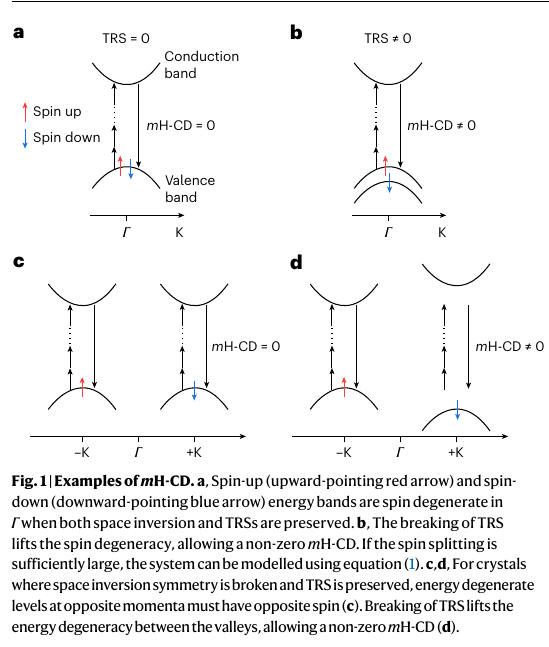
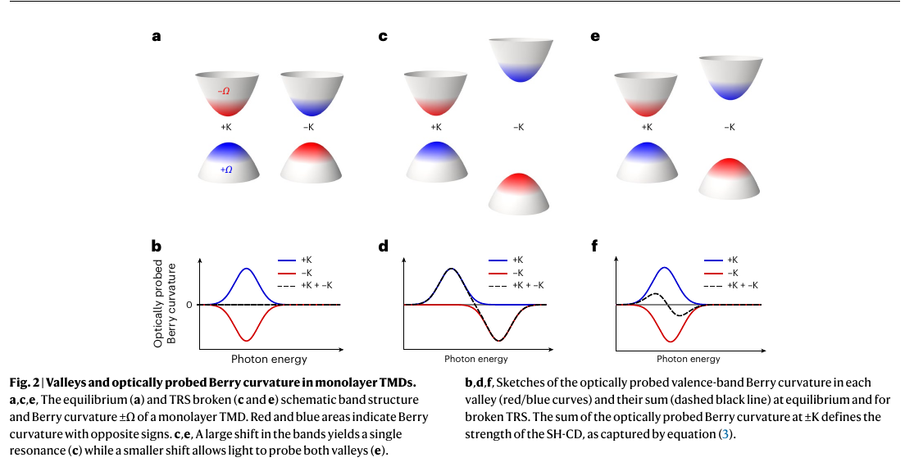
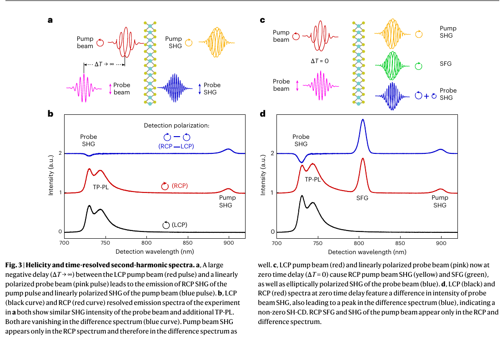
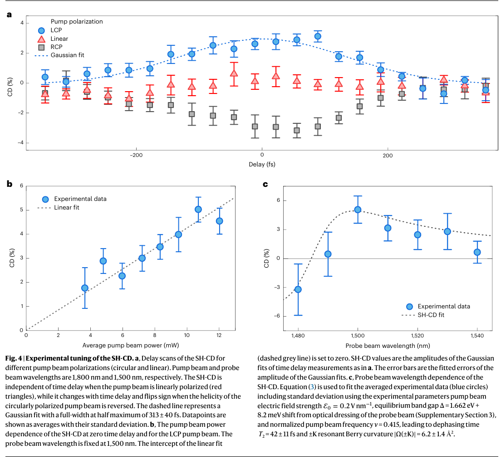

v3.16

Analyzing | Framework v3.16 | Supplementary Information not available

> **Access Status** — Full paper: local 7-page PDF of the published, open-access Nature Photonics Article (Tornow, Herrmann, Schneider, Evers, Wilhelm & Soavi; doi:10.1038/s41566-026-02025-8; accepted 4 Sep 2026, online 13 Oct 2026), read in full: main text, Figs. 1–4, Methods, references · Abstract: same PDF · Supplementary material: **not available** — Supplementary Sections 1–5 (derivations, two-valley Stark/Bloch–Siegert model, probe-dressing correction, fixed fit inputs, strain check) were not part of the source; statements about them rely on the main-text summary · Figures: no author files; Figs. 1–4 cropped by the analyst from the 150 dpi page renders (pages 2–5) and checked visually · Comparison papers (latest arXiv version checked on the abs page): Xiao et al. 2012, arXiv:1112.3144 **v3** (Table I read from the arXiv PDF); Cho et al. 2018, arXiv:1712.01520 v1 (only version); Soavi & Wilhelm, arXiv:2501.03684 **v2**; Schüler et al. 2020, arXiv:1905.09404 v1 (only version); Sie et al. 2017, arXiv:1703.07346 v1 (only version). For the group's earlier Nature Photonics papers (Herrmann et al. 2025; Friedrich et al. 2026) no arXiv listing was found, so I saw only search summaries of the journal versions · Analysis basis: full main text without supplement; checks in Python (`claimcheck.py`; crops via `crop.py`).

---

## 1. Punchy Title & One-Sentence Hook

**Light That Comes Out With a Twist: Reading a Crystal's Hidden Geometry From Its Doubled-Frequency Glow**

By nudging one of the two mirror-image "valleys" of an atom-thin semiconductor with an invisible infrared pulse, the authors make the crystal emit slightly more left-handed than right-handed doubled-frequency light — and they argue the size of that imbalance reads out, in absolute units, a quantum-geometric property of the electrons (the Berry curvature) that is normally only computed, not measured.

---

## 2. Big-Picture Context

Electrons in crystals carry more information than their energy bands. Two bands can have identical shapes and still differ in how the electron's internal quantum state twists as its momentum changes. That twist, the **Berry curvature**, acts like a magnetic field living in momentum space: it pushes electrons sideways when an electric field drives them, decides which handedness of light a crystal absorbs, and underlies the valley Hall, nonlinear Hall and bulk photovoltaic effects. Theorists compute it routinely; experimentalists almost never see it directly, only its consequences integrated over many electrons.

The main candidate for a direct, momentum-resolved readout has been photoemission with circularly polarized light. It maps a dichroic signal across momentum space, but how cleanly that signal reports Berry curvature, as opposed to orbital character and final-state effects, is debated in the literature the paper cites, and it needs ultrahigh vacuum. An all-optical tabletop alternative, working in air at room temperature with femtosecond resolution, would be useful even if it only works at a few special momenta.

This paper proposes such an alternative. It comes from a Jena–Regensburg collaboration that has built a toolbox for monolayer tungsten diselenide (WSe2): earlier they showed that second-harmonic light (light at twice the input frequency) can *detect* when a circularly polarized pump unbalances the crystal's two valleys, then extended the idea to the third harmonic. The new step is quantitative: a formula linking the handedness imbalance of the harmonic light to the Berry curvature at the resonant momentum, fitted to data, giving about six square ångströms at the valley centres.

**Paper Type & Stakes:** this is a combined theory-plus-experiment Article: an analytical light–matter model that ties nonlinear circular dichroism to local Berry curvature, followed by a single pump–probe experiment on one monolayer sample that tests the model's predicted dependences and extracts one number. At stake is whether a cheap, fast optical measurement can serve as a quantitative probe of quantum geometry in solids.

**Prior Belief Check.** The qualitative physics is not surprising to specialists. It has long been textbook that in gapped hexagonal materials the valley-selective absorption of circularly polarized light follows from the valley-contrasting Berry curvature, and the valley-exclusive light shifts that the pump exploits were demonstrated years ago in monolayer WS2. What is new is (i) the extension of the linear-optics link to any harmonic order, (ii) an analytical formula for the realistic two-valley case, and (iii) the claim that the fitted prefactor is an absolute Berry curvature in physical units. The first two are a clean, incremental theoretical consolidation. The third is the part experts should probe hardest, because, as Section 4 shows, the absolute scale comes from a model-predicted valley energy splitting rather than a measured one, and the fitted value sits below the cited first-principles numbers rather than on them. I would call the result *incremental-to-moderately-novel*: a useful new handle, not a paradigm shift.

**Replication & Convergence Note.** This is a single-group result on a single sample, building on the group's own earlier harmonic-generation work; no independent group has reported Berry-curvature extraction this way. Independent confirmation would mean another lab measuring the pump-induced valley splitting directly (for example by transient reflectance) and showing the dichroism tracks it with a slope matching first-principles Berry curvature, or the protocol giving the predicted *different* values in sister materials (MoS2, WS2, MoSe2).

---

## 3. Necessary Background Crash-Course

### What Berry curvature is

Every electron state in a crystal is labelled by a momentum, and each state has an internal "shape" (how it is split between atomic orbitals, with what relative phases). Move smoothly through momentum space and that internal shape changes. Berry curvature measures how much that internal state *rotates around itself* as you trace a tiny loop in momentum space: after going around the loop and returning to the start, the state comes back with an extra phase, and the extra phase per unit of enclosed area is the Berry curvature. Its unit is an area (square ångströms) because momentum has units of inverse length. Physically it acts like a magnetic field in momentum space: an electron pushed by an electric field drifts sideways in proportion to it, the so-called anomalous velocity, which the paper's opening paragraph names as its motivation.

**Analogy:** Computer graphics has a classic problem with camera or tube frames swept along a closed 3D path. If you update the frame each step with the smallest possible rotation (a "rotation-minimizing frame", no deliberate twisting), you still return to the start with the frame rotated relative to where it began, by an amount set by how the path curved through space. Berry curvature is that net leftover rotation per unit enclosed area, but for the quantum state's phase in momentum space rather than a camera's orientation in 3D.

**Breaks when:** you ask what the leftover rotation *does*. In graphics it is a cosmetic artefact you correct by hand; in a crystal it is physical and has dynamical consequences: electrons acquire sideways velocity and absorb left- and right-handed light differently. The frame analogy has no notion of "the twist pushes the camera sideways".

### Valleys, mirror images and handed light in monolayer WSe2

Monolayer WSe2 is a honeycomb of tungsten and selenium with no centre of inversion. Its band gap sits at two corners of the hexagonal Brillouin zone, labelled +K and −K. These "valleys" are mirror images: energies match, but the Berry curvature has opposite sign in the two. Time-reversal symmetry (the laws looking the same played backward) forces exactly this: equal energy, opposite twist. A practical consequence is the optical selection rule discovered around 2008–2012: left-circularly polarized light excites one valley, right-circularly polarized light the other. In linear optics, the degree of this valley selectivity at a given momentum equals the Berry curvature divided by the strength of the optical transition there (the interband dipole, in effect how strongly that transition "grabs" the light).

**Analogy:** Think of two identical worker pools in a cluster, each subscribed to only one of two message topics: one listens only to "left", the other only to "right". Send a mixed stream of both topics and the pools share the load equally; the cluster as a whole shows no preference.

**Breaks when:** you move away from the exact valley centres. The topic subscription is all-or-nothing, but in the crystal the selectivity is perfect only right at +K and −K and degrades gradually away from them, which is why the paper insists on a *single, well-defined resonant momentum*.



*Figure 1 (from the paper): band sketches for (a) spin-degenerate bands at the zone centre, (b) the same bands split by broken time-reversal symmetry, (c) two mirror valleys with opposite spins, and (d) those valleys shifted apart in energy.*

**What to look at:** only panels b and d carry a non-zero harmonic dichroism, because only there does the light see one resonance more than its mirror partner. Panel d is the situation the experiment creates.

### Second-harmonic generation and circular dichroism

Second-harmonic generation (SHG) is a nonlinear process: two photons at one frequency combine into one photon at twice the frequency. It requires a crystal without an inversion centre, which a WSe2 monolayer satisfies, and it becomes strong when twice the photon energy matches an electronic transition (a "two-photon resonance"). The handedness of the outgoing light is set by angular-momentum bookkeeping with the crystal's threefold rotational symmetry: a circularly polarized pump produces second harmonic of the *opposite* handedness, which is why the pump's own second harmonic appears in only one detection channel in the data. **Circular dichroism** here means the right-handed output minus the left-handed output, divided by their sum: zero for a perfectly linear output, plus or minus one for perfectly circular.

**Analogy:** The normalized difference is the same trick as reporting an A/B-test lift as the difference of the two arms over their total: overall traffic swings cancel, and only the imbalance survives.

**Breaks when:** the two arms are not measured simultaneously or contain an incoherent background. The paper benefits here: the large two-photon photoluminescence background is incoherent at room temperature, so it cancels in the difference, while the coherent second harmonic does not.

### Breaking the tie with light: optical Stark and Bloch–Siegert shifts

To get a net dichroism from a monolayer you must make the two valleys inequivalent. A magnetic field does this weakly (a fraction of a meV per tesla). The authors use a much stronger trick: an off-resonant, circularly polarized infrared pump whose photons are far below the gap and are not absorbed. While the pump is on, it "dresses" the electronic levels: the transition in one valley couples to the light in a way that pushes its levels apart (the optical Stark shift), while the other valley experiences a weaker counter-rotating version (the Bloch–Siegert shift). The upshot is a valley energy offset of order 10 meV that appears and vanishes with the pulse, leaves no real carriers behind, and flips direction when you flip the pump's handedness.

**Analogy:** This is level repulsion from basic chemistry. Two orbitals that mix push apart, the lower going down and the upper going up, by an amount set by their coupling squared over their energy separation. Here the "partner" of each band edge is the same level plus or minus one pump photon, and the circular pump couples strongly to the partner in one valley and weakly in the other.

**Breaks when:** you treat the shift as a permanent change in the material. Orbital mixing in a molecule persists; the light-induced mixing exists only while the field is present, so the valley offset lives exactly as long as the pump pulse, which is why the signal in Section 4 tracks the pulse overlap.

### Origins & Big Picture: how monolayer valley crystals came to be

Tungsten diselenide is a layered crystal: sheets three atoms thick (selenium–tungsten–selenium) stack and are held together by weak van der Waals forces, like a deck of cards with sticky but not glued faces. In the common bulk stacking, each sheet is rotated by 180° relative to its neighbour, so the stack as a whole has an inversion centre: every valley property of one layer is cancelled by its upside-down neighbour. The material was studied for decades as a lubricant-like semiconductor with an indirect band gap and nothing exotic about it.

Two things changed that around 2010. First, the graphene revolution taught people that mechanical exfoliation (peeling layers with sticky tape or a soft polymer stamp, exactly as this paper's sample was made) can isolate a single sheet. Second, when molybdenum disulfide and its cousins were thinned to one layer, two surprises appeared together: the band gap became *direct* (the lowest conduction and highest valence states line up at the same momentum, at the hexagon corners), making the monolayer glow brightly, and the inversion symmetry disappeared, because a single sheet has no upside-down partner to cancel it. The heavy tungsten atom adds strong spin–orbit coupling, which splits the top of the valence band by roughly half an electron-volt with opposite spin ordering in the two valleys. The result is "spin–valley locking": in WSe2 the valley index and the spin index of the highest hole state are tied together.

Theory had prepared the ground. Xiao, Yao and Niu showed in the late 2000s that a honeycomb lattice with inequivalent sublattices concentrates Berry curvature at the two valley centres with opposite signs, producing valley-contrasting circular dichroism. In 2012 that picture was worked out for the transition-metal dichalcogenides with first-principles parameters, and experiments showed circularly polarized light creating valley-polarized emission in monolayer MoS2. "Valleytronics" (using the valley index as a bit, the way spintronics uses spin) became a research programme. Later work added light-driven control: a valley-exclusive Bloch–Siegert shift in WS2, sub-cycle control of valleys with tailored optical fields, and this group's own nonlinear-optics read-outs of broken time-reversal symmetry.

Where does this paper sit? Most valley experiments use *real populations*: carriers pumped into one valley, watched as they glow or drift, scattering between valleys within picoseconds. The coherent, off-resonant route used here avoids real populations, so the imbalance switches on and off within the pulse. And instead of treating Berry curvature as a qualitative label ("this valley absorbs left-handed light"), the paper tries to make it a measured number. The monolayer is the cleanest example of "two mirror resonances at opposite momenta", and the group had already characterized how its second harmonic responds to a valley imbalance. It also brings complications: strong excitons (electron–hole pairs bound by a few hundred meV, pulling the optical gap well below the free-particle gap), strain and substrate screening, which enter the limitations below.

### Central analogy

**Central analogy for this paper:** *A tied tug-of-war between mirror valleys, tipped by the pump.*

Each valley pulls the second harmonic toward one handedness, with a strength set by its Berry curvature. With no pump the two teams are perfectly matched and the rope (the output polarization) stays linear. The pump moves one team slightly off its footing, and the net drift of the rope reveals how hard each team was pulling in the first place.

---

## 4. Core Technical Explanation

### Step 1 — A general rule for one resonance

**The failure it prevents:** without a microscopic link, harmonic circular dichroism is just a symmetry-allowed number, uninterpretable beyond "it exists in these crystal classes".

**What the authors do:** they take an independent-particle, two-band picture with a single vertical transition at one resonant momentum, tuned so that a whole number of input photons matches the gap there, and derive the dichroism of that harmonic. The result is strikingly simple and independent of harmonic order:

$$\text{mH-CD} = \frac{|P^{+}|^{2} - |P^{-}|^{2}}{|P^{+}|^{2} + |P^{-}|^{2}} = \frac{\Omega(\mathbf{k}_{\mathrm{res}})}{\lVert \mathbf{d}_{vc}(\mathbf{k}_{\mathrm{res}}) \rVert^{2}}$$

**Symbol definitions:**
- $P^{\pm}$ : the right- and left-circular components of the emitted harmonic light
- $\Omega(\mathbf{k}_{\mathrm{res}})$ : Berry curvature at the resonant momentum (square ångströms)
- $\mathbf{d}_{vc}$ : interband dipole matrix element, the "grip" of the transition on light (its squared length is also in square ångströms)

**What this actually means:** the handedness of the harmonic output is a *ratio*: the twist of the electron states divided by how strongly that transition couples to light. It is the same ratio already known from linear absorption, now shown to carry over to every harmonic, like a cache-hit ratio that turns out to be identical whether you measure it on single reads or on burst reads.

**What it buys:** a symmetry-agnostic statement. It needs only that the harmonic exists and that one resonance dominates, which the authors stress also covers indirect-gap materials with a resonant vertical transition.

### Step 2 — Why a pristine monolayer shows nothing

**The failure it prevents:** expecting a signal where symmetry guarantees a cancellation.

**What the authors do:** they point out that in the monolayer the resonance is not single: the +K and −K valleys are exactly degenerate and carry opposite Berry curvature, so a linearly polarized probe at the two-photon resonance hears both valleys equally and their handed contributions cancel. Output stays linear.



*Figure 2 (from the paper): top, schematic bands of the two valleys with Berry curvature coloured red/blue; bottom, the "optically probed Berry curvature" of each valley (blue, red) versus photon energy and their sum (dashed black), for (a,b) equilibrium, (c,d) a large valley splitting, and (e,f) a small splitting.*

**What to look at:** the dashed black sum. It is flat in panel b (perfect cancellation), equals a single valley's curve in panel d (one resonance, Step 1's formula applies), and becomes a small up-then-down wiggle in panel f, the regime the experiment actually sits in.

**What it buys:** the right mental model for the measurement. The signal is a *difference of two nearly cancelling resonance curves*, so it is largest just off resonance and changes sign across it.

### Step 3 — Tipping the balance with a pump and deriving the two-valley formula

**The failure it prevents:** the "large splitting" limit of panel d is not reachable in practice; realistic optical shifts are around 10 meV, far smaller than the resonance width, so Step 1's formula does not apply directly.

**What the authors do:** they insert the valley-dependent optical Stark and Bloch–Siegert shifts into a two-band model of the valley (a gapped, honeycomb-type Hamiltonian from their earlier work) and expand to lowest order in the pump field. The derivation lives in the unread supplement; the main text gives the result as a weighted sum over the two valleys that reduces to:

$$\text{SH-CD} \approx 2\,|\Omega(\pm K)|\;\sigma\,\mathcal{E}_0^{2}\;g(\nu)\,f(\omega)$$

**Symbol definitions:**
- $|\Omega(\pm K)|$ : magnitude of the Berry curvature at the valley centres (the number to be extracted)
- $\sigma$ : pump handedness, +1 or −1
- $\mathcal{E}_0$ : pump electric-field amplitude
- $g(\nu)$ : a factor set by the pump photon energy relative to the gap, $\nu/(\Delta^{2}(1-\nu^{2}))$, with $\nu$ the pump photon energy over the gap $\Delta$
- $f(\omega)$ : a resonance-shape factor, $2 + \mathrm{Re}\,\eta$, where $\eta = \Delta/(\Delta - 2\hbar\omega - i\hbar/T_2)$ encodes how far twice the probe photon energy sits from the gap, with $T_2$ the dephasing time that sets the resonance width

**What this actually means:** the dichroism grows with pump *intensity* (field squared), flips with pump handedness, and has a resonance-shaped dependence on probe colour, with Berry curvature as the overall multiplier. In the tug-of-war picture: the pump decides how far one team slips (intensity, direction), the probe colour decides where on the rope you look, and the Berry curvature sets how hard each team pulls.

**What it buys:** three independent, testable dependences plus one extractable number. One subtlety (developed in the Assumption Audit): the valley splitting itself is proportional to the transition's dipole strength times the pump intensity, and that dipole factor cancels the dipole in the Step 1 denominator. So the absolute scale of the extracted Berry curvature rests on the model's *prediction* of how big the pump-induced splitting is, not on a measurement of it.

### Step 4 — Symmetry bookkeeping: which crystals can do this

**The failure it prevents:** confusing "symmetry allows it" with "it will be non-zero".

**What the authors do:** they write the dichroism as the out-of-phase part of two second-order response components. Symmetry tables say when both components exist; the authors add that they must also be *out of phase*, which no macroscopic argument tells you, and trace that phase to the energy and Berry-curvature asymmetry between opposite momenta. They list the magnetic symmetry classes in which the signal can be non-zero once time reversal is broken; light-dressed monolayers fall into one.

**What it buys:** a bridge from the symmetry-table view of nonlinear optics to the band-structure view, the paper's most general conceptual contribution.

```
Analyst-built concept diagram (not from the paper):

 circular IR pump (below gap, ~0.7 eV)     linear probe (~0.83 eV)
          |                                          |
          v                                          |
 valley energy offset, ~10 meV                       |
 (Stark in one valley, Bloch-Siegert in other)       |
          |                                          v
          +--------> two-photon resonance near the A exciton
                     +K pulls output toward one hand  (Berry curv. +)
                     -K pulls toward the other        (Berry curv. -)
                                   |
                                   v
            slightly elliptical second harmonic (~750 nm)
                                   |
                                   v
       handed imbalance = a few %  -> fit model -> Berry curvature
         knobs: delay, pump hand, pump power, probe colour
```

Read it top to bottom: the pump only creates the imbalance; the probe's second harmonic reports it; the fit converts the size of the imbalance into a Berry curvature, using the model's prediction of how large the imbalance should be.

### Step 5 — The experiment and the raw spectra

**The failure it prevents:** mistaking another polarized emission (the pump's own harmonic, sum-frequency light, luminescence) for the probe's dichroism.

**What the authors do:** two synchronized optical parametric oscillators deliver a circularly polarized pump at 1,800 nm and a linearly polarized probe near 1,500 nm, focused together on an exfoliated WSe2 monolayer on fused silica at room temperature. A quarter-wave plate and a fixed polarizer select right- or left-handed output, and a spectrometer records both channels at long delay and at zero delay.



*Figure 3 (from the paper): left, pump and probe far apart in time; right, overlapping. Black = left-handed detection, red = right-handed, blue = their difference (offset vertically). The probe's second harmonic sits near 740 nm on top of two-photon photoluminescence.*

**What to look at:** the blue difference trace at the probe's second harmonic (left edge). With the pulses apart (b) it is essentially flat; with them overlapping (d) a clear dip appears, while the large luminescence hump cancels. The pump's own harmonic and the sum-frequency peak appear only in the right-handed channel, as angular-momentum bookkeeping demands, a built-in check that the polarization analysis works.

**What it buys:** direct visual evidence that the probe's harmonic acquires a handedness only while the pump is present.

### Step 6 — Four knobs and one number

**The failure it prevents:** a single dichroism value could come from many artefacts (residual probe ellipticity, heating, real valley populations); the model's specific dependences are what discriminate.

**What the authors do:** they switch to a photodiode with lock-in detection and scan the knobs the formula names: pump–probe delay, pump handedness, pump power and probe colour. Then they fit the Step 3 formula to the colour scan with only two free parameters, the Berry curvature and the dephasing time; the error bars come from refitting thousands of resampled versions of the data.

| Knob (Fig. 4 panel) | What the model predicts | What the data show |
| --- | --- | --- |
| Delay, pump handedness (a) | signal only during pulse overlap; sign set by pump hand; none for linear pump | about ±3% at overlap, mirror-imaged for the two hands, pulse-limited width of about 300 fs; flat for linear pump |
| Pump power (b) | linear in intensity | linear rise to about 5% |
| Probe colour (c) | resonance shape with a sign change just short of resonance | positive near 1,500 nm, one negative point at 1,480 nm |
| Fit to (c) | Berry curvature and dephasing time | **6.2 ± 1.4 square ångströms**, **42 ± 11 fs** |



*Figure 4 (from the paper): (a) dichroism versus pump–probe delay for left-handed (blue), linear (red) and right-handed (grey) pumps, with a Gaussian fit; (b) peak dichroism versus average pump power with a zero-intercept linear fit; (c) dichroism versus probe wavelength with the model fit (dashed) that yields the Berry curvature and dephasing time.*

**What to look at:** panel (a) is the cleanest evidence: sign flips with pump handedness and vanishes for linear pump. Panel (c) is the one the headline number comes from; notice it has only seven points, and the negative swing that pins the resonance shape rests on the single 1,480 nm point.

**What it buys:** all three model-predicted dependences (handedness flip, intensity scaling, resonance-shaped colour dependence) appear qualitatively, and the pulse-limited time response argues for a coherent, no-real-carriers mechanism rather than a slow population effect.

### Claim check

Checks were run in Python (`claimcheck.py`, work directory) using the paper's printed formula and fixed inputs, values eye-read from the Fig. 4c page render, and Table I of Xiao et al. 2012 (arXiv:1112.3144v3).

**The printed formula reproduces the printed fit — Reproduced.** Rebuilding the two-valley formula from the main text with the stated field, gap (including the probe-dressing correction), pump frequency ratio, 6.2 square ångströms and 42 fs reproduces the dashed curve in Fig. 4c: a peak of about 5% just below 1,500 nm and a sign change near 1,485 nm. The quoted pump frequency ratio also follows from the 1,800 nm pump within rounding. So the equation, the parameters and the plot are mutually consistent.

**The fitted Berry curvature from the data — Partly reproduced.** Refitting the seven eye-read points in Fig. 4c with the same two free parameters gives a lower best value, around 4.4 square ångströms (roughly 3–6 within one standard deviation) and a similar dephasing time. The paper's curve lies above six of the seven points (one only marginally). My value overlaps the paper's within its quoted error, so this is not a refutation, but the data mildly prefer a smaller number. The fit constrains mainly the *product* of Berry curvature and dephasing time (the peak height scales with both), so the two fitted values are strongly correlated.

**"Good agreement with tight-binding and DFT" — Not reproduced from the cited source (significant finding).** The paper cites Xiao et al. 2012 for its density-functional comparison. That paper's Table I lists Berry curvatures at the WSe2 valley centre of about **16.8** and **9.4 square ångströms** for its two spin species; the lower-gap transition (the one linked to the A exciton the probe is resonant with) carries the larger value. The paper's **6.2 ± 1.4** is about 2.3 quoted errors below the smaller entry and nearly eight below the larger. A simple gapped-honeycomb estimate with the same tight-binding parameters spans roughly 8–17 square ångströms depending on which gap one inserts (free-particle, optical, spin-split). The other cited source (Cho et al. 2018, arXiv v1) quotes no value I could read. A different convention (a factor of two, an exciton-weighted quantity, another gap) may be in the unread supplement; on the main text alone, "good agreement" is not supported. What this does not change: the order of magnitude is right, and every qualitative dependence holds.

**Sensitivity — the pump field.** The extracted Berry curvature scales as one over the pump field squared, because the dichroism grows with field squared times Berry curvature. The field (0.2 volts per nanometre) is stated as "experimentally measured and fixed", but the main text does not give the focal spot, pulse duration at the sample, the substrate local-field correction, or which pump power Fig. 4c used. My order-of-magnitude estimate from the stated powers and a micron-scale focus gives fields anywhere from about 0.15 to 0.45 V/nm. The conclusion "agrees with the cited first-principles value" would flip to agreement with the 9.4 entry if the true field were about 20% lower, and with the 16.8 entry if it were about 40% lower. Both are plausible for a tightly focused infrared beam. The quoted ±1.4 comes only from data scatter and omits this calibration error, which on its own plausibly exceeds it; **the true uncertainty on the absolute Berry curvature is likely a factor of about 1.5–2, not ±23%.**

**Robustness — nulls and controls.** *Linear pump:* if the signal came from residual probe ellipticity or heating, it would appear for any pump polarization; it does not (flat red triangles), and it flips sign with pump handedness. Passes. *Long delay:* real valley populations would leave a tail lasting picoseconds; the signal returns to a small constant offset within the pulse width. Passes, with the offset attributed to uncompensated probe helicity. *Sign reversal with colour:* this test, the only one that pins the dephasing time and the resonance shape, is the weakest: the negative swing rests on one point that is only about one error bar below zero, and the neighbouring point at 1,490 nm sits about three percentage points below the fit. One more negative point would make the resonance claim much firmer.

**Consistency (one line):** Fig. 4 mixes error-bar definitions (standard deviations in a and c, fit errors in b), and the "≤300 fs" pulse statement is not reconciled with the roughly 100 fs pump laser in Methods; neither changes a conclusion.

### Assumption Audit

> **Watch:** Reader likely assumes the experiment measures Berry curvature *directly*, independently of how strongly the transition couples to light. The paper's own general formula says the dichroism equals Berry curvature *divided by* the dipole strength. In the two-valley case the dipole strength drops out only because the pump-induced valley splitting is itself proportional to the dipole strength, and the authors take that splitting from their model rather than measuring it. Right at the valley centre of a two-band model, Berry curvature and dipole strength are the same number. So the absolute value reported is equally a statement about the size of the predicted optical Stark and Bloch–Siegert shifts; measuring that splitting independently would turn this into a much more direct test.

> **Watch:** Reader likely assumes "ultrafast control of the Berry curvature" means the pump changes the electrons' geometry. The paper actually controls the *optically probed* Berry curvature, its term for the resonance-weighted sum over the two valleys. The pump barely changes each valley's own Berry curvature; it changes how much each valley contributes to the probe signal. The control is over the read-out weighting, not over the quantum geometry itself.

> **Watch:** Reader likely assumes the independent-particle band picture describes the resonance the probe hits. The paper's gap is the measured optical resonance (about 1.66 eV), which in monolayer WSe2 is the A exciton, a bound electron–hole pair lying a few hundred meV below the free-particle gap. The model has no excitons. The extracted number is therefore an effective, exciton-dressed quantity mapped onto a two-band formula; how it relates to the band Berry curvature computed by DFT depends on excitonic corrections the paper does not treat in the main text.

---

## 5. What's Genuinely New or Clever

**1. A harmonic-order-independent link between nonlinear dichroism and local quantum geometry.** The general single-resonance rule, that the circular imbalance of the m-th harmonic equals the Berry curvature over the dipole strength at the resonant momentum, extends a linear-optics result to all harmonic orders. Paired with the observation that a non-zero signal also requires two second-order response components to be *out of phase*, a requirement invisible in standard symmetry tables, it gives a microscopic reading of what macroscopic nonlinear-optics symmetry only permits. That is new to the field, not just to the reader, though it is a consolidation of known two-band physics rather than a new mechanism.

**2. Turning a coherent, valley-exclusive light shift into a calibrated lever.** An off-resonant circular pump, with no real absorption, imposes a femtosecond-scale valley imbalance set by pump intensity, and the probe's second harmonic reads the resulting tilt. Because the imbalance is coherent, the readout is pulse-limited and incoherent luminescence cancels. The analytical formula makes the colour, intensity and handedness dependences explicit, so the experiment tests shapes, not just one number. New to the field as a *quantitative* readout; the ingredients (valley light shifts, SHG valley probes) come from the group's and others' earlier work.

### Predictive Content Check

**Falsifiable handle:** the formula makes concrete predictions that could fail. (1) At fixed probe colour, the dichroism must scale linearly with pump intensity and reverse exactly with pump handedness; the data pass this. (2) The colour dependence must follow the specific resonance shape, with a sign change a few nanometres short of the resonance and a peak of a few percent at the stated field; the data are compatible, but the negative side rests on one point. (3) The sharpest untested prediction is *material ordering*: repeated on MoS2, WS2 and MoSe2 at matched detuning and independently calibrated field, the extracted values should follow the first-principles Berry-curvature ordering, with WS2 and WSe2 largest. (4) If the pump-induced valley splitting is measured independently (transient reflectance) at the same field, the dichroism divided by that measured splitting should give Berry curvature over dipole strength, a ratio near one at the valley centre in the two-band model. Failure of (3) or (4) would show the extracted number is not tracking Berry curvature.

**Formalism load (conditional):** it fires mildly, because the headline claims an absolute geometric quantity from a model fit. The formalism is not decorative: it generates the intensity, handedness and colour dependences that the data test. But the step from "fit prefactor" to "Berry curvature in square ångströms" is where the model, not the data, does the lifting: drop the model's prediction of the splitting size and the experiment yields only a ratio. I would describe it as load-bearing for the shapes and partly relabelling for the absolute number.

---

## 6. Limitations & Open Questions

> **The absolute Berry curvature depends on a pump-field calibration whose uncertainty is not included in the quoted error.** The extracted value scales inversely with field squared; the stated ±1.4 reflects only fit scatter, while a plausible 20–40% field uncertainty moves the value by a factor of 1.5–2. **(B) Contested** — the authors state the field is measured and fixed and may have a careful calibration in the supplement I could not read, but the main text gives no spot size, local-field correction or power for Fig. 4c, and my recomputation from the stated inputs shows the result is highly sensitive to it. **(analyst inference)**

> **"Good agreement" with first-principles values is not supported by the cited DFT table.** The cited 2012 table lists roughly 9.4 and 16.8 square ångströms for WSe2, versus 6.2 measured. **(B) Contested** — the gap could close through a convention or gap choice documented in the supplement, or through the field calibration above; on the main-text evidence alone, the measured value sits below the cited numbers by more than its quoted error. **(analyst inference)**, from recomputation using the paper's fixed inputs and Table I of arXiv:1112.3144v3.

> **Independent-particle model applied at an excitonic resonance.** The probe's two-photon resonance is the A exciton, but the analytical model has only free electron and hole bands. **(A) Consensus** — excitons dominate monolayer TMD optics at room temperature, and it is well established that they renormalize transition strengths and optical shifts; how much they alter the mapping to band Berry curvature here is open. **(broader literature)**, with the specific consequence for this paper my inference.

> **The absolute value is only as good as the model's prediction of the valley splitting.** The splitting is not measured in this experiment; the paper uses "about 10 meV for typical conditions" from earlier work. **(C) Speculative** — this is my reading of how the dipole factor cancels in the two-valley formula; a specialist with the supplement may find the authors constrain the splitting in ways not visible in the main text. **(analyst inference)**

> **The resonance-shape fit rests on seven points, with the sign change carried by one.** The dephasing time and the curvature–time trade-off both depend on it. **(A) Consensus** — sparse, noisy data with correlated fit parameters is a standard limitation that any referee would flag; the paper's own error bars on the 1,480 nm point show it is about one standard deviation from zero. **(paper Fig. 4c)**

> **Only the valley centre is probed.** The method reports Berry curvature at the one momentum where the probe is resonant, not a map; the authors call this the "local" Berry curvature and note the need for well-separated resonances. **(A) Consensus** — this is explicit in the paper's assumptions (single resonance, no overlapping momentum points) and inherent to any resonant optical probe. **(paper, "SH-CD and Berry curvature" section)**

> **Single sample, single material, room temperature.** No temperature dependence, no second material, no second sample. **(A) Consensus** — standard for a first demonstration but limits how far the absolute number can be trusted. **(analyst inference)**, consistent with the paper's Methods.

**Open questions for the next 12–24 months:** Does an independently measured valley splitting make the extraction model-free? Does the extracted value follow the predicted ordering across sister materials, and change as predicted at the B-exciton resonance? Can an excitonic version of the formula be derived, so the number can be compared with exciton-aware calculations?

---

## 7. Detailed Summary & Explanation

The paper asks whether a crystal's Berry curvature, the momentum-space twist of electron states, can be read out with light alone and in absolute units. The theory half derives a compact rule: when one electronic transition at one momentum dominates harmonic generation, the circular imbalance of the emitted harmonic equals the Berry curvature there divided by the transition's dipole strength, for any harmonic order. Monolayer WSe2 violates the single-resonance condition, because its two mirror valleys carry opposite Berry curvature and cancel. The authors therefore model a circularly polarized, below-gap pump that makes the valleys slightly inequivalent through the optical Stark and Bloch–Siegert effects, obtaining a formula in which the second-harmonic dichroism grows with pump intensity, flips with pump handedness, changes sign as the probe colour crosses the resonance, and carries the valley Berry curvature as its multiplier. A symmetry analysis adds that the signal needs two response components to be out of phase, linking symmetry tables to band properties.

The experiment confirms the qualitative predictions on one monolayer at room temperature: a few-percent handedness appears only during pulse overlap, follows the pump's hand, vanishes for a linear pump, grows linearly with power, and varies with probe colour roughly as predicted. The fit gives a Berry curvature of about six square ångströms.

This analysis separates two layers. The *shapes* are solid, and the printed equation reproduces the printed fit. The *absolute number* is weaker than the headline suggests: it inherits the pump-field calibration squared, which the quoted error omits; it rests on a predicted rather than measured valley splitting; it uses a free-particle model at an excitonic resonance; and on the main text alone it falls below the cited first-principles values. My refit of the plotted points also leans lower. The paper establishes a promising *protocol* and an order-of-magnitude-consistent value, not yet a precision measurement of quantum geometry. The decisive next experiment measures the light-induced splitting directly and repeats the protocol across materials.

**Where I'm least confident in this analysis:** the "not reproduced" verdict on agreement with first-principles values, and the claim that the absolute scale is set by the model's predicted splitting, both rest on the main text alone; the Supplementary Information (which I could not read) may use a different Berry-curvature convention, gap or exciton correction that reconciles 6.2 with the 9–17 square ångström range, and my refit uses eye-read points from a 150 dpi render.

**Revision notes:** the referee pass added the dipole-cancellation point to the Assumption Audit and Section 5, moved the excitonic-resonance caveat from a limitation footnote into its own Watch item, added the material-ordering and independent-splitting tests as falsifiable handles, and trimmed per-paragraph numbers in Sections 3–4.

---

## 8. Three Crystallized Takeaways

1. **A crystal's two mirror valleys usually cancel each other's handedness; a below-gap circular pump tips the balance for a few hundred femtoseconds, and the doubled-frequency light comes out slightly twisted.**
2. **The size of that twist scales with the Berry curvature, the electrons' hidden momentum-space twist, which gives an all-optical, room-temperature, ultrafast handle on a quantity usually only computed.**
3. **The handle works qualitatively; the absolute number (about six square ångströms in WSe2) still depends on a model-predicted splitting and a field calibration, and sits below the cited theory values, so treat it as a promising protocol rather than a precision measurement.**

---

## 9. Shorter Summary

Electrons in crystals have a hidden geometric property, the Berry curvature, which acts like a magnetic field in momentum space. It decides which handedness of light a material prefers and drives sideways electron motion, but it is almost always calculated rather than measured.

This paper links it to an optical signal. The authors show theoretically that when a single electronic resonance dominates harmonic generation (two or more photons merging into one of higher frequency), the left–right imbalance of the emitted light equals the Berry curvature divided by how strongly that resonance couples to light. In monolayer tungsten diselenide the two "valleys" of the band structure carry opposite Berry curvature and cancel, so the authors break the tie with a circularly polarized infrared pump that shifts one valley's energy slightly while the pulse is present, without being absorbed.

The experiment shows the predicted behaviour: the probe's doubled-frequency light becomes a few percent handed only during the pump pulse, reverses with the pump's handedness, vanishes with a linearly polarized pump, grows with pump power, and changes with probe colour as the model predicts. A fit gives a Berry curvature of about six square ångströms.

The qualitative case is convincing. The absolute number is softer than presented: it depends on the square of a pump-field calibration not included in the error bar, on a model prediction of the valley shift rather than a measurement, and on a free-electron model applied to an excitonic resonance. Based on the main text alone, it sits below the first-principles values in the cited reference rather than agreeing with them. The decisive follow-ups are to measure the light-induced valley shift independently and to repeat the protocol on sister materials whose Berry curvatures are predicted to differ.

---

*Analysis by Claude (Opus 5.5), headless pipeline, 2026-10-13 · Framework v3.16 · explanatory posture (peer-reviewed Nature Photonics Article) · supplement not read.*
