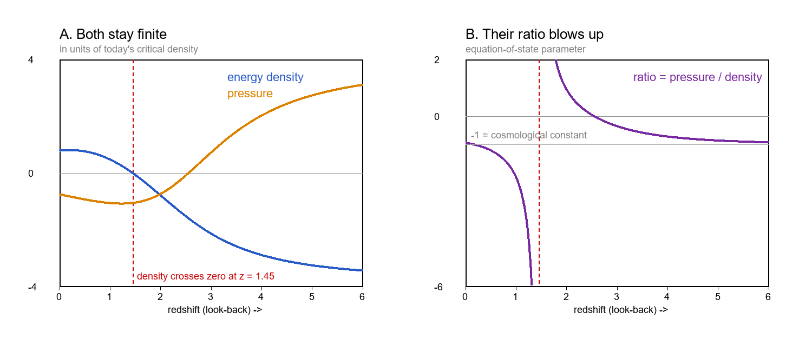
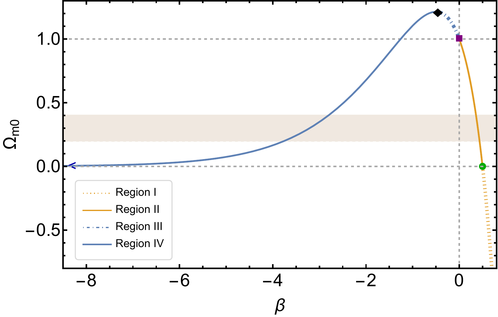
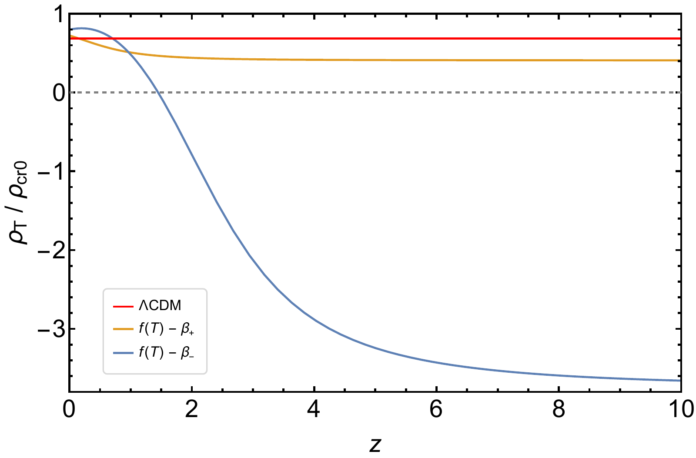
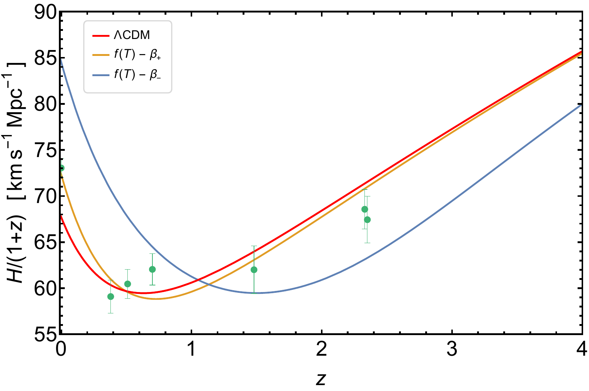
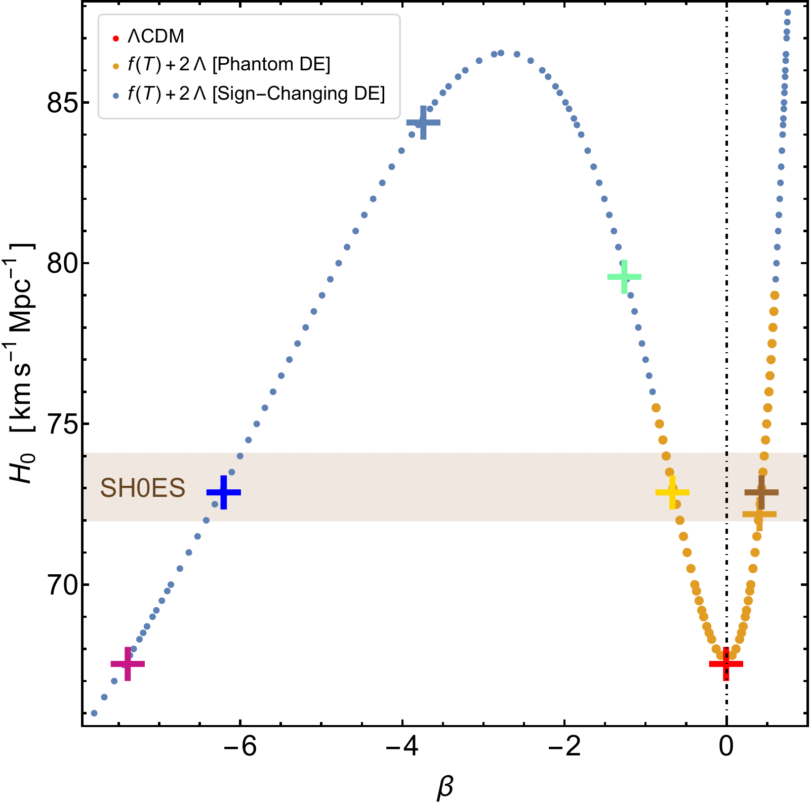
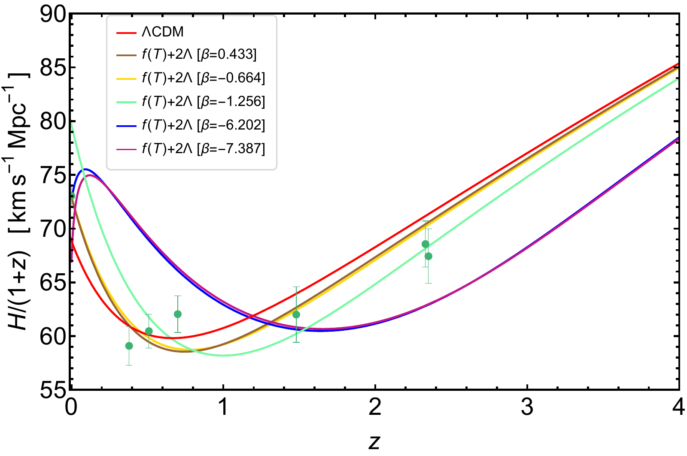

v3.16
Analyzing | Framework v3.16

# Unexplored regions in teleparallel f(T) gravity: Sign-changing dark energy density

**Paper:** Özgür Akarsu, Bilal Bulduk, Antonio De Felice, Nihan Katırcı, N. Merve Uzun, "Unexplored regions in teleparallel f(T) gravity: Sign-changing dark energy density," *Physical Review D* **112**, 083532 (2025). DOI: [10.1103/1xd4-k91h](https://doi.org/10.1103/1xd4-k91h). arXiv:[2410.23068](https://arxiv.org/abs/2410.23068) (v1 30 Oct 2024; v2 20 Oct 2025, which the arXiv comments say matches the published PRD version). Istanbul Technical University, Gebze Technical University, Yukawa Institute (Kyoto), Doğuş University.

> **Access Status** — Full paper: local arXiv v2 PDF (28 pages, latest version, stated to match the published *PRD* version), read in full including references; no appendices or supplement exist. · Abstract: from the PDF, cross-checked on the arXiv abs page · Figures: all nine inspected on page renders; Figs. 1, 5 (top left), 6 (top), 7 (top middle) and 9 (top) viewed as the authors' arXiv-source files and embedded · Comparison papers, checked on their arXiv abs pages (latest versions): DESI DR2 BAO arXiv:2503.14738 v3 (Oct 2025, *PRD* 112, 083515); Calderon et al. arXiv:2405.04216 v2 (Oct 2024, JCAP); Hashim et al. arXiv:2010.14964 v2 (Apr 2021, JCAP); Hashim, Di Valentino, Levi Said & El Hanafy arXiv:2606.31324 v1 (Jun 2026, unpublished). For the last two I saw **only a tool summary of the current abstract**, not the full text · Numeric checks: Python (`claimcheck.py`, `growthcheck.py`; explainer drawn with `explainer.py`) · Analysis basis: full text · Posture: peer-reviewed, so explanatory, with the Claim Check at full weight.

---

## 1. One Equation, Two Universes: Can Dark Energy Start Out Negative?

**Hook:** A long-studied torsion-based tweak to Einstein's gravity turns out to have a second, ignored family of solutions in which the "dark energy" it generates starts out negative and flips positive about nine billion years ago, with no extra knob to turn and no ghosts, but the same solutions, run through the paper's own structure-growth equation, make gravity at cosmological scales many times too strong.

---

## 2. Big-Picture Context

The standard cosmological model, Lambda-CDM, describes the late universe with a fixed, always-positive cosmological constant. It fits a huge body of data but carries two strains. The Hubble tension: the expansion rate measured locally with Cepheid-calibrated supernovae (the SH0ES team) sits about five standard deviations above the value the cosmic microwave background (CMB) implies under Lambda-CDM. And the Dark Energy Spectroscopic Instrument (DESI): its baryon acoustic oscillation (BAO) measurements, combined with the CMB and supernovae, prefer time-varying dark energy over a constant at the three-to-four-sigma level (DESI DR2, arXiv:2503.14738 v3).

One family of fixes lets the dark-energy density be **negative** in the past and positive late. The lead author's group has pushed this for years as "graduated dark energy" and the sign-switching cosmological constant model, in which the vacuum energy flips sign around a redshift of two. These models do well against several tensions at once, but an abrupt flip needs a physical mechanism, and in general relativity a negative-energy fluid is usually a red flag for instabilities. The paper's goal is a sign-changing dark energy that falls out of a well-defined gravitational theory rather than being put in by hand.

The theory it uses is **teleparallel f(T) gravity**: gravity written in terms of torsion rather than curvature, generalized by replacing the gravitational Lagrangian with a function of the torsion scalar. The specific "exponential infrared" model was introduced by Awad and colleagues and studied in detail by Hashim and colleagues (arXiv:2010.14964 v2), who found it statistically equivalent to Lambda-CDM, with a mildly phantom dark energy and some relief for the Hubble tension. That work used only the positive sign of the model's single parameter. This paper's point is that the parameter can also be negative, and that the negative branch behaves very differently.

**Paper Type & Stakes:** this is a theoretical and phenomenological background-cosmology paper: it maps the solution space of one existing modified-gravity model, classifies its branches, and illustrates them with hand-picked, CMB-anchored parameter values, without any statistical fit to data. At stake is whether a sign-changing dark energy, which several data-driven reconstructions seem to like, can arise naturally from a Lagrangian, and whether existing f(T) and background-equivalent f(Q) studies have been looking at only half of their models.

**Prior Belief Check:** the mathematical observation is not surprising to specialists once stated: the model's constraint equation is not one-to-one, so a second branch of solutions was always there, and the authors' own sign-switching program made them the natural people to look for it. The genuinely interesting part is that the second branch keeps the key no-ghost condition automatically, which modified-gravity theorists would not have guessed in advance. The observational picture the paper paints, however, complicates rather than supports the mainstream view only weakly: its headline sign-changing model with no cosmological constant predicts a local expansion rate far above even the SH0ES value, and the paper's "alignment with DESI" is a visual, qualitative resemblance. Overall the result is incremental-to-moderate as theory and **unproven, and in my checks strongly disfavoured,** as cosmology.

**Replication & Convergence Note:** the background algebra is easy to reproduce and I reproduced it (Section 4 Claim check). On the observational side there is now one independent follow-up: Hashim, Di Valentino, Levi Said and El Hanafy (arXiv:2606.31324 v1, not yet published) fit both branches of this model to Planck, ACT and SPT CMB data plus DESI BAO and Pantheon+ supernovae, and according to its abstract (seen only as a tool summary) the sign-changing branch is "decisively ruled out," while the positive branch eases the Hubble tension but is still disfavoured. Independent confirmation of the paper's *promise* would need a full likelihood analysis including growth-of-structure data in which the negative branch survives; the only such analysis so far points the other way.

---

## 3. Necessary Background Crash-Course

### Gravity written as twist instead of bend

Einstein's general relativity describes gravity as **curvature**: freely falling objects follow the straightest possible paths in a bent spacetime. There is a lesser-known but fully equivalent way to write the same physics. In **teleparallel gravity**, spacetime is kept flat in the curvature sense, and gravity is instead encoded in **torsion**: a measure of how small parallelograms of displacement fail to close when you carry local reference frames around. The "teleparallel equivalent of general relativity" reproduces every prediction of standard gravity exactly; the two theories differ only by a boundary term in their action.

**Analogy:** the same table stored as a row store and as a column store. Every query returns identical answers, so for read-only use the two are interchangeable. The difference appears when you start *modifying* the engine: an optimization that is natural on columns (say, compressing one field) has no simple counterpart on rows.

**Breaks when:** you modify gravity. Generalizing the curvature description (f(R) gravity) gives fourth-order equations and an extra scalar field; generalizing the torsion description (f(T) gravity) keeps second-order equations but breaks local Lorentz symmetry in its original form and carries a still-debated count of hidden degrees of freedom. The "modifications" are physically different theories, not two encodings of one.

### Booking the modification as a dark-energy fluid

In a smooth, expanding universe, Einstein's equations reduce to the **Friedmann equation**, which ties the expansion rate (the **Hubble parameter**, how fast distances grow per unit distance) to the total energy density. In f(T) gravity extra terms appear on the gravity side. The standard move, which this paper follows, is to move those terms to the matter side and call them an **effective torsional dark energy**, with its own density and pressure. The ratio of pressure to density is the **equation-of-state parameter**: minus one for a cosmological constant, above minus one ("quintessence") for a dark energy that thins out as the universe grows, and below minus one ("phantom") for one that grows denser.

**Analogy:** an accountant reconciling a budget against a model that is off. Rather than rewrite the model, they add a "reconciliation" line item that absorbs the difference. The line item obeys bookkeeping identities (it is conserved on its own), so it behaves like a fluid in the ledger.

**Breaks when:** you treat the line item as stuff. A real fluid of particles with positive energy cannot have a negative density without ghosts; a reconciliation entry has no such rule and can sit in the red for billions of years. That freedom is exactly what the paper exploits, and it is why "negative dark energy" here is not automatically unphysical. The physical health checks have to be made on the underlying gravity theory instead.

### The ghost test

The paper's health check is the slope of the gravitational function with respect to torsion. This slope sets the **effective gravitational constant** that structure formation feels: the cosmological strength of gravity equals Newton's constant divided by that slope. If the slope goes negative, gravity becomes repulsive for clustering matter and gravitational waves become **ghosts**: modes with negative energy that let the vacuum decay. So "positive slope throughout history" is a necessary condition for a sane theory. A crucial subtlety, which matters in the Claim check: a slope that stays positive but becomes *small* is ghost-free yet makes cosmological gravity *strong*.

### The hardest idea: a dark energy whose density crosses zero

When the effective dark-energy density passes through zero while its pressure stays finite, the ratio of the two must shoot to plus or minus infinity. Nothing physical blows up; the ratio simply divides by a number passing through zero. The picture below, computed from the paper's own sign-changing model, shows it.



*Analyst-built illustration (not from the paper):* effective torsional dark-energy density (blue) and pressure (orange), left, and their ratio, right, for the paper's negative-branch model without a cosmological constant, computed in Python from the paper's equations.

**What to look at:** on the left both curves are smooth and finite; the density crosses zero at a redshift of about 1.45. On the right the ratio flies off to minus infinity just after the crossing and returns from plus infinity just before it, which is the "pole" the paper describes.

### Origins & Big Picture: how dark energy came to be a problem, and why sign changes are on the table

The universe began hot and dense, dominated by radiation. As it expanded, radiation diluted faster than matter, and by about fifty thousand years after the Big Bang matter took over. During the long matter-dominated era, gravity braked the expansion and the cosmic web of galaxies, filaments and voids grew by gravitational instability from tiny seeds imprinted in the early universe. The CMB, released when the universe became transparent about 380,000 years after the Big Bang, is a snapshot of those seeds, and its pattern of hot and cold spots carries a ruler: the distance sound waves travelled in the early plasma before release. Seen later in the clustering of galaxies, the same ruler becomes the BAO signal.

In 1998, supernova surveys found that the expansion stopped decelerating and began accelerating several billion years ago. Lambda-CDM explains this with a cosmological constant whose density, fixed while matter thins out, overtook matter at a redshift of roughly 0.3 and has dominated since. The constant has two famous problems: its measured value is absurdly small compared with naive vacuum-energy estimates, and there is no reason it should become important just now, when observers happen to exist. These puzzles motivate two broad escape routes: give dark energy dynamics (a field that evolves), or modify gravity so that something that *looks* like dark energy emerges from geometry on cosmic scales.

Torsion-based modified gravity is in the second group. Its attraction is technical: f(T) theories keep second-order field equations, so they avoid the higher-derivative instabilities that plague many curvature-based modifications, and their cosmological background equations coincide exactly with those of the newer f(Q) "nonmetricity" theories, so any background result transfers directly. The exponential infrared model was designed so that at high torsion, which in cosmology means early times and high densities, it reverts to ordinary gravity, and at low torsion, today, it bends the expansion history away from the standard one. It needs no separate dark-energy parameter: the same number that sets the torsion scale also fixes how much matter today's universe must contain.

The sign-changing idea arrives from the data side. Through the 2010s, several analyses noticed that BAO measurements from the Lyman-alpha forest at a redshift of about 2.3 preferred a slightly lower expansion rate than Lambda-CDM predicts, which a fluid with negative energy density at that epoch would produce. Model-independent reconstructions sometimes returned negative dark-energy densities above redshift one-and-a-half to two, and the Akarsu group's sign-switching cosmological constant model, an abrupt flip from a negative to a positive vacuum energy near a redshift of two, turned the hint into a minimal model that eases the Hubble tension and the clustering (S8) tension together. The theoretical obstacle is that such a flip is hard to realize. In string-inspired language it resembles a transition from anti-de Sitter to de Sitter vacuum, which several conjectures disfavour, and recent proposals (Casimir forces in a dark dimension, a minimally modified gravity, a phantom scalar with a hyperbolic-tangent potential) each need extra structure.

This paper sits exactly at that seam. It asks whether an existing modified-gravity model, with no extra parameters and no exotic field, already contains a smooth version of the negative-to-positive switch. It then places that switch against the two observables the tensions are about: the present-day expansion rate and the shape of the expansion history probed by BAO.

### One key, two records

The model's single parameter, which the authors call beta (the torsion scale divided by today's torsion), is tied to today's matter fraction by a constraint equation. The mapping from parameter to matter fraction rises and then falls, so a given matter fraction, say the observed thirty percent, comes from **two** parameter values: a small positive one and a large negative one. The authors invert it with the two real branches of a special function (the Lambert W function: the inverse of "a number times its exponential"), which is exactly the textbook case of a function with two inverse branches.

**Analogy:** a hash table where two different keys collide on the same slot. Looking up "matter fraction thirty percent" returns two records, and past studies only ever read the first.

**Breaks when:** you assume the collision is harmless. In a hash table the two records are unrelated; here they are two complete expansion histories that agree today and differ dramatically in the past, so the choice between them is a physical prediction rather than an implementation detail.

> **Central analogy for this paper:** a correction booked as a ledger entry that can go negative.

---

## 4. Core Technical Explanation

The paper's logic, from model to claims:

*Analyst-built concept diagram (not from the paper):*

```
 exponential infrared f(T) gravity (one parameter, "beta")
                     |
                     v
 constraint: beta fixes today's matter fraction
 (non-monotonic -> two branches for the same matter)
          |                                |
          v                                v
 positive branch (studied before)   negative branch (new)
 dark energy stays positive,       dark energy negative early,
 phantom; ghost-free only if       positive late (z ~ 1.45);
 checked                           ghost-free automatically
          |                                |
          +---------------+----------------+
                          v
 anchor both to CMB distance + matter density -> Hubble constant
   positive ~72 (near SH0ES)   negative ~85 (overshoots)
                          |
                          v
 add a cosmological constant -> 2-parameter family:
 SH0ES-matching models, late-time slowdown of acceleration
```

Read it top to bottom: one functional form, split by a two-valued constraint into two branches, each anchored to the CMB to output a Hubble constant, and then widened by an added cosmological constant.

### Step 1 — Trading one parameter for another

**The failure it prevents:** a modified-gravity model with extra free parameters can fit almost anything, which makes "it eases the tension" a weak claim. **What the authors do:** they rewrite the exponential infrared model so that its single parameter is measured in units of today's torsion, and they evaluate the Friedmann equation today. That yields a constraint that ties the parameter rigidly to today's matter fraction. **What it buys:** the model has exactly as many background parameters as Lambda-CDM (the Hubble constant plus one more), so comparisons are like-for-like. The one display equation in this analysis is that pair:

$$\left(\frac{H^2}{H_0^2}-2\beta\right)e^{\beta H_0^2/H^2}=\Omega_{\rm m0}\,(1+z)^3,\qquad \Omega_{\rm m0}=(1-2\beta)\,e^{\beta}$$

**Symbol definitions:**
$H$ : the Hubble parameter, the expansion rate at a given epoch (km/s per megaparsec)
$H_0$ : its value today, the Hubble constant
$\beta$ : the model's single parameter, the torsion scale divided by today's torsion (dimensionless)
$\Omega_{\rm m0}$ : today's matter fraction, matter density divided by the critical density
$z$ : redshift, how much the universe has expanded since light was emitted (1 + redshift = expansion factor)

**What this actually means:** the left side is the torsion-modified "gravity side" of the Friedmann equation; the right side is just matter diluting with volume. Setting the parameter to zero recovers a matter-only universe; small positive values add something that acts like a cosmological constant at late times. The second equation is the constraint: evaluate the first today and the matter fraction is no longer free. In ledger terms, the parameter sets the size and sign of the correction line, and the books must balance today. Because the expansion rate appears inside an exponential, the equation cannot be solved for the expansion rate in closed form, so the authors treat the expansion rate as the independent variable and express redshift as a function of it.



*Figure 1 (from the paper): today's matter fraction as a function of the model parameter, split into four regions; the wheat-coloured band marks observationally reasonable matter fractions.*

**What to look at:** the wheat band is crossed twice, once by the steep orange segment just right of zero (the previously studied positive branch, Region II) and once by the long blue segment far to the left (the new negative branch, Region IV). Those two crossings are the "two records" for one matter content.

### Step 2 — Same matter today, two different pasts

**The failure it prevents:** assuming that matching today's matter fraction pins down the cosmology, as it does in Lambda-CDM. **What the authors do:** for an observed thirty-percent matter fraction they solve for both branches and compare expansion histories. The positive branch has a parameter near 0.4; the negative branch, near minus 3.2, roughly eight times larger in size. **What it buys:** a clear demonstration of asymmetry. The positive branch adds a cosmological-constant-like term only slightly larger than Lambda-CDM's and departs mildly from it. The negative branch carries a large *negative* constant-like term and a strongly modulated matter-like term, so its expansion history after the matter era looks quite different, and in the far future it slows to a halt (a static, empty "Minkowski" end state) rather than expanding exponentially forever. At early times both branches converge on ordinary matter domination, which is what keeps the CMB era untouched.

### Step 3 — Four regions and three health filters

**The failure it prevents:** treating every mathematical solution as a candidate universe. **What the authors do:** they classify the full parameter line into four regions and three special points, and filter with physical requirements: positive matter today, an expansion rate that grows monotonically into the past, and the ghost-free condition (a positive slope of the gravitational function). **What it buys:** a clean map. Region I needs negative matter and lets the slope turn negative, so it is unphysical; Region II is the familiar phantom model; Region III needs more than a full critical density of matter and never accelerates in the past. **Region IV**, the large negative parameters, covers reasonable matter fractions and has never been studied. Strikingly, for every negative parameter the slope stays positive *automatically*, whereas the positive branch must be checked case by case.

### Step 4 — Anchoring to the CMB without a full fit

**The failure it prevents:** comparing models whose early universes differ, which would make any late-time difference meaningless. **What the authors do:** because the torsion modification switches off at high density, both branches share Lambda-CDM's early universe and hence the same sound-horizon ruler. They fix two well-measured CMB quantities, the distance to the last-scattering surface and the physical matter density, and solve for the Hubble constant each model then requires. Since they neglect radiation, they nudge the physical matter density up slightly so that Lambda-CDM reproduces Planck's Hubble constant to within one percent, and apply the same nudge to the torsion models. **What it buys:** each branch outputs a definite Hubble constant with no tuning. This is the paper's most quantitative result, and the Claim check reproduces it exactly:

| Model (no cosmological constant) | Today's matter fraction | Predicted Hubble constant (km/s/Mpc) |
| --- | --- | --- |
| Lambda-CDM | 0.315 | 67.7 |
| Positive branch (phantom) | 0.276 | 72.4 |
| Negative branch (sign-changing) | 0.202 | 84.5 |
| SH0ES measurement | — | 73.0 ± 1.0 |

*Table (from the paper's Sec. IV and Fig. 5 caption):* CMB-anchored predictions for each branch. **What to look at:** the positive branch lands within one error bar of SH0ES; the negative branch overshoots by about eleven.

### Step 5 — The positive branch: a mild phantom that lifts the Hubble constant

**The failure it prevents:** over-reading a new branch without a baseline. **What the authors do:** they recompute the known positive branch under their anchoring. Its dark energy is positive throughout, behaves like a cosmological constant beyond redshift five, and becomes mildly phantom at late times, dipping furthest below minus one around a redshift of one-half. Acceleration starts slightly earlier than in Lambda-CDM. **What it buys:** a late phantom boost raises the expansion rate today while the anchoring holds the CMB distance fixed, so the predicted Hubble constant lands near 72, within one standard deviation of SH0ES. This reproduces earlier work on this model and is the paper's most observationally comfortable result.

### Step 6 — The negative branch: dark energy that starts in debt

**The failure it prevents:** assuming dark energy must be positive at all times, which the authors argue is a general-relativity habit that need not bind an effective fluid. **What the authors do:** they follow the negative branch after anchoring. Its effective dark energy is large and negative in the early universe, several times today's critical density in size, rises through zero at a redshift of about 1.45 (roughly nine billion years ago), and is positive today. **What it buys:** a smooth, Lagrangian-based version of the negative-to-positive switch the authors' earlier phenomenological models put in by hand, with the ghost-free condition satisfied throughout.



*Figure 5, top-left panel (from the paper): effective torsional dark-energy density in units of today's critical density, for Lambda-CDM (red), the positive branch (orange) and the negative branch (blue).*

**What to look at:** the red line is flat, the orange curve is positive everywhere, and the blue curve crosses zero near redshift 1.5 and sinks to a deep negative plateau in the past. That blue crossing is the paper's titular sign change.

The consequences cascade through the expansion history. The equation-of-state parameter shows the pole at the crossing (see the explainer above), a brief phantom stretch just after it, and quintessence-like behaviour today. Because negative dark energy *subtracts* from the total density in the past, the expansion rate over most of the last ten billion years or so sits well below Lambda-CDM's. Holding the CMB distance fixed is like holding a trip's total travel time fixed: a slow middle stretch must be paid for by a fast finish, so the expansion rate today overshoots to the Hubble constant near 85. Acceleration also begins much earlier, around nine and a half billion years ago instead of about six.



*Figure 6, top panel (from the paper): the expansion speed (Hubble parameter divided by one plus redshift) for Lambda-CDM (red), the positive branch (orange) and the negative branch (blue), with SH0ES at zero redshift and BOSS/eBOSS BAO measurements (green).*

**What to look at:** the minimum of each curve marks where acceleration begins. The blue curve's minimum sits far to the right, and the blue curve passes well above the three BAO points near redshift one-half and below the Lyman-alpha points near 2.3. The paper comments only on the Lyman-alpha mismatch; the low-redshift misses are larger (see Claim check).

The authors present the overshoot honestly as "larger-than-expected enhancement," and the text acknowledges a conflict with the Lyman-alpha BAO data. Their framing remains that the branch "offers a promising mechanism to alleviate major cosmological tensions."

### Step 7 — Adding a cosmological constant to tame the overshoot

**The failure it prevents:** a one-parameter model that is too rigid to land on the measured Hubble constant. **What the authors do:** they add an ordinary cosmological constant alongside the exponential torsion term. This adds one parameter, making a two-parameter extension of Lambda-CDM that reduces to it exactly when the torsion parameter is zero. Applying the same CMB anchoring, they scan the plane of the two parameters and map which combinations give phantom versus sign-changing dark energy and what Hubble constant each predicts. **What it buys:** a broad family of models consistent with the two anchored CMB numbers, some of which hit the SH0ES value on the nose.



*Figure 7, top-middle panel (from the paper): the Hubble constant each CMB-anchored model predicts, against the torsion parameter, with the cosmological constant varying along the curve; orange points are phantom models, blue points are sign-changing models, plus signs mark six highlighted models, and the wheat band is SH0ES.*

**What to look at:** Lambda-CDM (red plus) sits at the bottom of a valley, so any torsion parameter raises the predicted Hubble constant. The SH0ES band is crossed by orange phantom models on both sides of zero and by blue sign-changing models only far to the left.

The authors highlight two sign-changing models with *negative* cosmological constants and very large negative torsion parameters. In these, acceleration begins early, peaks, and then **stops** very recently, about a billion years ago, so the universe is decelerating again today. One matches SH0ES; the other matches Planck's Lambda-CDM Hubble constant.



*Figure 9, top panel (from the paper): expansion speed versus redshift for Lambda-CDM and five highlighted models with an added cosmological constant, with SH0ES and BOSS/eBOSS BAO points.*

**What to look at:** the dark-blue and violet curves rise to a local hump near redshift 0.1 and then drop toward zero redshift, which is the "cessation of acceleration." The authors compare this with the DESI crossing-statistics reconstruction (Calderon et al., arXiv:2405.04216 v2), which found hints of the same late slowdown. Note again that those two curves pass high above the green points near redshift one-half.

### Step 8 — Keeping the Solar System safe

**The failure it prevents:** any modified gravity strong enough to change cosmology must not change planetary orbits. **What the authors do:** they argue that the exponential term switches off at high torsion, and torsion is large in dense environments, so local physics sees standard gravity: an "effective chameleon-like" screening (they concede the standard chameleon mechanism does not literally apply to f(T)). **What it buys:** a plausibility argument, not a calculation. It also separates the *cosmological* effective gravitational constant (what clustering feels) from the *local* one (what the Solar System measures), and the paper accepts that the first can differ substantially from Newton's.

### Claim check

All checks were run in Python (`claimcheck.py`, `growthcheck.py`) from the paper's own equations and quoted inputs.

**Branch values for one matter content — Reproduced.** For a thirty-percent matter fraction the two branches come out at 0.399 and minus 3.207; the maximum matter fraction of 2 over root e and the non-trivial branch at full matter (minus 1.256) also reproduce. The two-branch structure is real and exactly as described.

**CMB-anchored Hubble constants — Reproduced.** Fixing the distance to last scattering and the nudged physical matter density, I recover 67.70 (Lambda-CDM), 72.36 (positive branch, matter fraction 0.276, parameter 0.408) and 84.54 (negative branch, matter fraction 0.202, parameter minus 3.736), and the derived late-time numbers: zero crossing of dark energy at redshift 1.45, acceleration onset at 0.73 and 1.50, today's deceleration parameter minus 0.70 and minus 0.61, today's equation-of-state parameter minus 1.11 and minus 0.93. The highlighted cosmological-constant models also reproduce, including Hubble constants of 79.7, 73.0 and 67.7 and the late return to deceleration at redshifts 0.09 and 0.12.

**Sensitivity: the radiation shortcut.** The authors drop radiation and compensate by raising the physical matter density. Re-doing the anchoring with radiation included and Planck's unaltered matter density moves every Hubble constant down by about half a unit; skipping the compensation moves them up by about 1.2. The ranking and the qualitative conclusions survive any plausible treatment, and the negative branch stays between about 84 and 86, eleven sigma above SH0ES.

**Robustness: the BAO points the paper itself plots.** Test: compare the model curves with the six BOSS/eBOSS expansion-rate points shown in Figs. 6 and 9 (read off the figures, so approximate). What contamination would look like: a genuine model failure shows as points missed by many error bars at a specific epoch. Result: Lambda-CDM and the positive branch both fit acceptably. The sign-changing models miss the points near redshift 0.4–0.5 by four to six standard deviations, in the *opposite* direction to their Lyman-alpha miss, giving a total misfit roughly ten times worse than Lambda-CDM's. This holds for the Lambda-free negative branch and for both highlighted cosmological-constant models that the paper ties to DESI.

**Significant finding: the sign-changing models make cosmological gravity far too strong.** The paper's no-ghost slope stays positive on the negative branch, but it becomes *small* today: about 0.11 for the Lambda-free model and about 0.015 for the SH0ES-matching model with a cosmological constant. Since the paper's own growth equation (its Eq. 30) divides Newton's constant by that slope, cosmological gravity today is about nine and seventy times stronger, respectively. Integrating that equation, the linear growth of structure today comes out about 1.5 to 2 times Lambda-CDM's, and the growth rate near redshift one-half rises from about 0.76 to between 1.07 and 1.22. Measured growth rates agree with Lambda-CDM to roughly ten percent, and the S8 tension asks for *less* clustering, not more. The paper says the effective constant "deviates significantly" (calling the slope "large" where it is small) and elsewhere suggests the model could help with S8, but it never quantifies the effect. The issue does not touch the positive branch, where gravity is only about twelve percent stronger. It matches the independent finding (Hashim et al., arXiv:2606.31324 v1, abstract only) that the sign-changing branch is decisively ruled out once perturbations and full data are included.

**Minor consistency slips (one line):** pp. 20–21 swap the dark-blue and violet labels and quote a non-existent parameter value of minus 7.878 for the SH0ES-matching model (Fig. 9's legend and p. 20 give minus 6.202); footnote 4's formula gives the epoch of the dark-energy sign change, not of the acceleration onset it is attached to.

### Assumption Audit

> **Watch:** the reader likely assumes "consistent with the CMB" means the models were fitted to the CMB power spectra. **The paper actually says:** two derived CMB numbers (the distance to last scattering and the physical matter density) are held fixed at Planck's Lambda-CDM best fit, and the Hubble constant is solved for. No CMB, BAO or supernova likelihood was run, and the paper calls the parameter values "a representative subset of viable choices" and defers a full analysis to a follow-up. When that follow-up was done independently, the extra freedom required to fit late-time distances spilled into the CMB parameters and ruined the fit for the sign-changing branch.

> **Watch:** the reader likely assumes "free of ghosts and instabilities" covers the whole perturbation story. **The paper actually says:** only that the slope of the gravitational function stays positive, which is necessary to avoid ghosts. It explicitly leaves stability against general inhomogeneous perturbations to future work, and the f(T) degrees-of-freedom question remains debated in the literature it cites. Positive-but-small slope, which is exactly what the negative branch delivers, still means drastically strengthened cosmological gravity.

> **Watch:** the reader likely assumes the SH0ES-matching, DESI-like sign-changing models come "with no additional free parameters." **The paper actually says:** the parameter-free negative branch locks the Hubble constant near 85, far from every measurement. The SH0ES-matching and late-slowdown models exist only once a cosmological constant is added, which is one more parameter, and their "alignment with DESI" is a visual resemblance to a DESI DR1 reconstruction, not a likelihood; the paper's own plotted BAO points disfavour those same curves.

---

## 5. What's Genuinely New or Clever

The central contribution is a reframing rather than a new model: the authors notice that the exponential infrared model's constraint equation is two-valued and take the overlooked branch seriously instead of discarding it. The positive and negative parameter branches give the same matter content today but completely different histories, so every earlier statement about "the" exponential infrared cosmology was a statement about half of it. Because the background equations of f(T) and f(Q) gravity coincide in a flat universe, the same warning applies to every background-equivalent f(Q) study, which the authors point out explicitly.

The second clever point couples two properties usually in tension: the negative branch gives a dark energy that is negative in the past, which in general relativity would raise alarms, *and* it satisfies the no-ghost slope condition automatically, while the well-studied positive branch does not. That gives the authors' sign-switching program what it lacked: a smooth negative-to-positive transition from a Lagrangian with no added field or parameter. The CMB-anchoring method is standard but cleanly used, and the two-parameter map in Fig. 7 is a useful catalogue of phantom versus sign-changing combinations.

New to the reader versus new to the field: the existence of negative-energy effective dark energy in modified gravity is known; what is new to the field is that this specific, parameter-economical model already contains it, with the ghost condition satisfied.

**Predictive Content Check:**

1. **Falsifiable handle:** the paper makes sharp, checkable predictions, and the strongest have already come out wrong or close to it. (a) With no cosmological constant, the negative branch fixes the Hubble constant near 85 km/s per megaparsec, about eleven sigma above SH0ES and further from Planck; this is falsified by existing data, as the paper partly concedes. (b) The dark-energy sign change near redshift 1.45 implies an expansion rate low around redshift two and high near redshift one-half, which existing BOSS/eBOSS points already disfavour by several standard deviations. (c) Not stated in the paper, but implied by its own equations: the negative-branch models predict linear growth of structure enhanced by fifty to a hundred percent today, and a mismatch between distances inferred from gravitational waves and from light that grows to tens of percent by redshift one-half, both testable with redshift-space distortions, weak lensing and standard sirens. The cosmological-constant extension can be tuned to match the local Hubble constant, so for it the handle shifts to growth and BAO, where the highlighted models fail.
2. **Formalism load:** skipped; the mathematics (the two-branch inversion and the slope condition) generates the paper's results rather than decorating them.

---

## 6. Limitations & Open Questions

> **No statistical fit to any dataset; all models are illustrative.** The paper fixes two CMB-derived numbers and hand-picks parameter values, compares to BAO "visually," and defers a likelihood analysis to a follow-up. **(A) Consensus** — the authors state this themselves, and in modern cosmology a viability claim without a likelihood analysis is universally regarded as provisional. **(paper §IV A, footnotes 7–8, §V)**

> **The sign-changing models imply much stronger cosmological gravity and grossly enhanced structure growth.** Using the paper's own growth equation, the effective gravitational constant today is about nine times Newton's for the Lambda-free negative branch and about seventy times for the SH0ES-matching extension, giving roughly 1.5–2 times Lambda-CDM's growth amplitude, which current growth and lensing data cannot accommodate; this also reverses the paper's suggestion that the model could help the S8 tension. **(B) Contested** — this comes from recomputation with the paper's equations and is supported by one independent full-data analysis (seen only as an abstract), but the validity of the simple quasi-static growth equation in f(T) at such small slopes has not been examined by the community. **(analyst inference; consistent with Hashim et al. 2026, broader literature)**

> **The sign-changing models conflict with BAO data at low redshift as well as with Lyman-alpha.** The curves in Figs. 6 and 9 pass several error bars above the BOSS points near redshift one-half, a misfit roughly ten times Lambda-CDM's on the paper's own plotted points. **(B) Contested** — the paper acknowledges the Lyman-alpha mismatch but not the low-redshift one, and my check used points read off the figure and ignored their correlations, so the magnitude is approximate even though the sign is clear. **(analyst inference; paper §IV C for the Lyman-alpha part)**

> **The Lambda-free negative branch predicts a Hubble constant near 85, far from both SH0ES and Planck.** **(A) Consensus** — the paper itself calls it an "overenhanced" value and introduces the cosmological constant in response, and the recomputation reproduces the number exactly. **(paper §IV C, §VI)**

> **Local-gravity safety rests on a qualitative "chameleon-like" argument.** No calculation shows that the exponential correction is screened in galaxies or the Solar System for parameter magnitudes of three to seven, and the authors concede that the standard chameleon mechanism does not apply to f(T). **(B) Contested** — post-Newtonian results for f(T) are reassuring, but whether high-torsion screening works for these large negative parameters is unestablished. **(paper §III B)**

> **The theoretical status of f(T) gravity is unsettled.** Its degree-of-freedom count and possible strong coupling around cosmological backgrounds are still debated; the ghost condition addresses one symptom. **(B) Contested** — the paper cites work on both sides. **(paper §I; broader literature)**

> **The extension with a cosmological constant adds a parameter and can be tuned.** Matching SH0ES with it is easier because the extra parameter absorbs the overshoot; a Bayesian model comparison is needed to tell whether the fit gain pays for the parameter. **(A) Consensus** — the authors say so directly. **(paper §V, §VI)**

**Open questions for the next 12–24 months:** whether any part of the negative branch survives a full CMB + BAO + supernova + growth likelihood (the 2026 independent analysis says no for the Lambda-free case); whether a different functional form keeps the smooth sign change while keeping the effective gravitational constant near Newton's; and whether the same branch structure in f(Q) models has the same growth problem.

---

## 7. Detailed Summary & Explanation

The paper takes the exponential infrared f(T) model and points out that its single parameter has been used with only one sign. The constraint tying that parameter to today's matter fraction is two-valued, so the observed matter content comes from a small positive parameter or a large negative one. The positive branch is the known mildly phantom model. The new negative branch has an effective dark energy that is strongly negative early, crosses zero roughly nine billion years ago, is positive today, and satisfies the no-ghost condition automatically.

Anchored to two CMB numbers, the positive branch predicts a Hubble constant close to SH0ES, while the negative branch overshoots to about 85. Adding a cosmological constant yields a two-parameter extension of Lambda-CDM with phantom and sign-changing models, some hitting the SH0ES value and some showing acceleration stopping very recently, resembling a DESI reconstruction. The authors argue a chameleon-like effect protects local gravity and call for revisiting f(T) and f(Q) models without assuming positive dark energy.

My recomputation reproduces every headline number. It also shows what the paper does not quantify. The same sign-changing solutions miss the low-redshift BAO points the paper itself plots by several error bars, and, more seriously, they weaken the theory's slope so much that, by the paper's own growth equation, cosmological gravity today is roughly nine to seventy times stronger than Newton's, doubling structure growth. An independent 2026 full-data analysis reaches the matching conclusion that the sign-changing branch is ruled out.

The summary is framed around a split the paper blurs: the *theoretical* observation (a second, ghost-free branch exists and changes sign smoothly) is correct and worth knowing, while the *phenomenological* promise (this branch eases the cosmological tensions) does not survive the paper's own BAO points and growth equation. Keep the first, discount the second. The positive branch remains a viable mild phantom, though the independent analysis finds it disfavoured too.

**Where I'm least confident in this analysis:** the growth finding relies on the paper's quasi-static, small-scale growth equation with the effective constant set by Newton's constant divided by the slope; when the slope is as small as one-hundredth, whether that simple equation still holds in f(T) gravity, whose perturbation theory and degree-of-freedom count are debated, is something I cannot verify. My BAO comparison used points read off the figure without their correlations. The independent 2026 analysis I lean on as corroboration was seen only as a tool summary of its abstract, so I cannot confirm whether its exclusion is driven by growth, distances or CMB parameter shifts.

**Revision notes:** the referee pass added the growth-strength and low-redshift BAO findings, explained the Hubble overshoot through the fixed CMB distance, moved the branch Hubble constants into a small table, cut numbers from over-budget paragraphs, and trimmed the draft to stay within the length target.

---

## 8. Three Crystallized Takeaways

1. **One equation, two universes.** A popular torsion-gravity model gives the same matter content today from two very different parameter values; researchers had only ever studied one, and the other produces a dark energy that starts negative and turns positive about nine billion years ago.
2. **Negative dark energy does not have to mean ghosts.** In this model the sign-changing branch automatically satisfies the main no-ghost condition, so the "negative energy is unphysical" reflex from general relativity does not apply to an effective, geometric dark energy.
3. **But the bill comes due in structure growth.** The same branch overshoots the Hubble constant, misses low-redshift BAO data, and, by the paper's own equations, makes cosmic gravity several to dozens of times stronger than Newton's, so the promise of easing cosmological tensions does not survive; an independent full-data fit agrees.

---

## 9. Shorter Summary

Physicists can write gravity either as the bending of spacetime (Einstein's way) or as its twisting, called torsion, and the two descriptions agree exactly. Modifying the twisting version gives "f(T) gravity," where extra terms act like a dark energy that can drive cosmic acceleration without a cosmological constant.

This paper studies one such model, the exponential infrared model, which has a single parameter. Requiring the model to match today's universe ties that parameter to how much matter exists, but the tie has two solutions: a small positive one, studied before, and a large negative one, ignored until now. The negative solution produces a dark energy that is negative early on, crosses zero roughly nine billion years ago, and is positive today. That is the kind of sign-switching dark energy some researchers favour to ease tensions between measurements of the cosmic expansion rate. It also passes the model's main test against unstable "ghost" behaviour automatically.

Anchored to cosmic-microwave-background data, the positive branch predicts a local expansion rate close to the value measured with supernovae, while the negative branch overshoots badly. Adding a cosmological constant creates a family of models, some matching the local measurement and some in which cosmic acceleration has recently stopped, reminiscent of recent DESI hints.

Checking the paper's numbers reproduces all of them, but also reveals problems the paper does not quantify. The sign-changing models miss galaxy-clustering expansion measurements the paper itself plots, and according to the paper's own equation for how structure grows, they make gravity on cosmic scales roughly nine to seventy times stronger than Newton's, roughly doubling the growth of cosmic structure. A 2026 independent analysis with full data likewise finds the sign-changing branch ruled out.

The lasting lesson is methodological: explore both branches of a two-valued constraint. The claim that this branch helps resolve cosmological tensions does not hold up.

---

*Analysis by Claude (Opus 5.5), headless pipeline run, 2026-10-14 · Framework v3.16 · Posture: explanatory (peer-reviewed, Phys. Rev. D) with full Claim Check · Scripts: claimcheck.py, growthcheck.py, explainer.py.*
