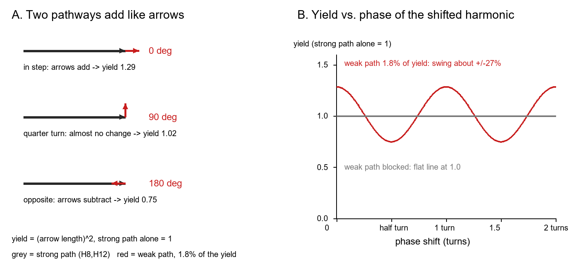
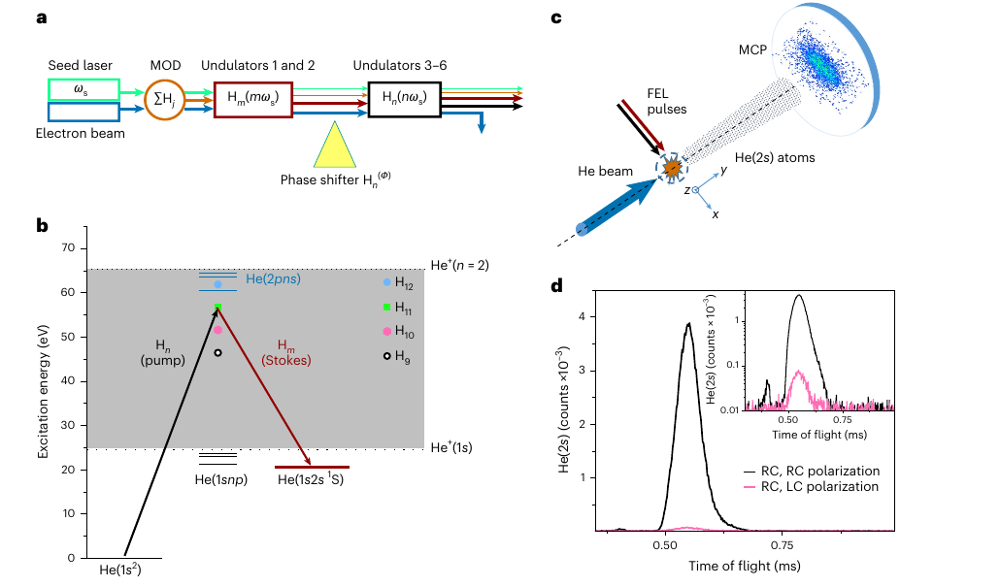
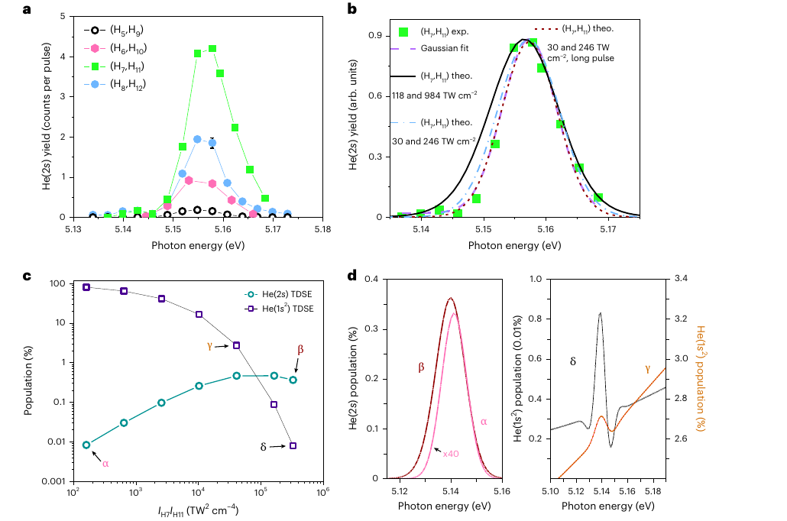
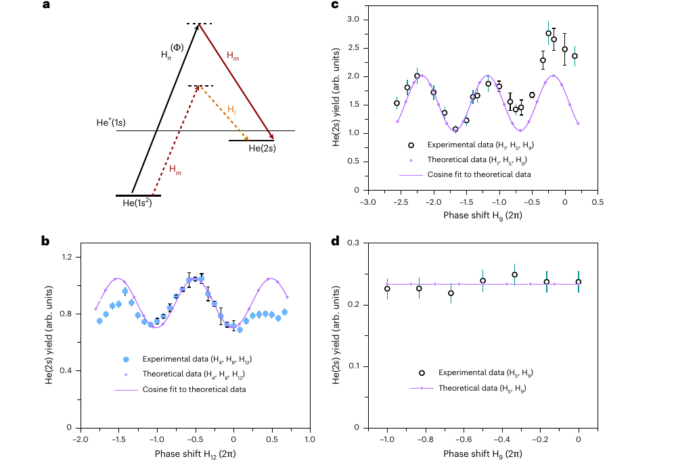

v3.16
Analyzing | Framework v3.16 | supplementary information not available

> **Access Status** — Full paper: read in full from the local 10-page PDF supplied by the pipeline (Eichmann et al., "Phase control of interfering stimulated Raman pathways in the XUV regime", *Nature Photonics*, doi:10.1038/s41566-026-02024-9; received 14 April 2026, accepted 4 September 2026, published online 9 October 2026; open access), cross-checked against the full-text extraction · Abstract: in the PDF · Supplementary material: **not available** — the separate Supplementary Information (Sections 1–5, Supplementary Table 1, Supplementary Fig. 3: pulse characterization, model-potential details, the second-order matrix element, the autoionizing-resonance predictions) was not part of the local copy and was not read; Extended Data Fig. 1 (page 10 of the PDF) was read · Figures: Figs. 1–3 viewed on the PDF pages and cropped from the 150-dpi page renders (no author source files exist; no arXiv version); Extended Data Fig. 1 viewed in the PDF and described in words · Prior-work context: arXiv abs pages and search records, versions listed in Section 2 · Analysis basis: full main text, Methods and Extended Data; no supplement.

## 1. Two Colours, Two Routes, One Dial: Steering Helium With Interfering XUV Raman Paths

A seeded free-electron laser kicks helium from its ground state into a long-lived excited state by going *up through* the ionization continuum and *back down* with two extreme-ultraviolet colours — and when a second, much weaker route to the same state is opened, turning a phase knob on the laser makes the number of excited atoms rise and fall like a fringe pattern, which vanishes the moment the weak route is blocked.

## 2. Big-Picture Context

Coherent control is the idea that you can steer a quantum system not by pushing harder but by arranging for two or more routes to the same outcome to add up or cancel. Chemists and atomic physicists have done this with visible and infrared lasers for nearly four decades. The workhorse is the stimulated Raman process: one photon lifts the system to a high-lying "waypoint", a second photon of a lower colour pulls it back down, and the system lands in a new state whose energy equals the difference of the two colours.

Moving this toolkit to the extreme ultraviolet (XUV, photon energies of tens of electronvolts) and to X-rays is attractive because short wavelengths reach inner-shell electrons, which sit on specific atoms. A Raman step that starts on an inner-shell electron could launch electronic motion at a chosen atom inside a molecule. Two obstacles have blocked the way. First, at these energies every photon can simply ionize the atom, so the gentle two-photon Raman route competes with a brutal one-photon loss channel that is far more likely. Second, coherent control needs two light fields with a stable, adjustable phase relationship, and most X-ray free-electron lasers produce noisy, spiky pulses whose phases wander from shot to shot.

The FERMI facility in Trieste solves the second problem: it "seeds" its electron beam with an ultraviolet laser, so its XUV harmonics inherit that laser's clock and stay phase-locked to each other. The team tunes two harmonics so that their energy difference matches helium's metastable singlet 2s state, shows that Raman transfer happens, and then lets weak, leftover harmonics form a second route. Scanning a phase shifter makes the 2s yield oscillate; blocking the weak route kills the oscillation.

**Paper type and stakes:** this is an experimental atomic-physics demonstration, backed by numerical simulations, of stimulated Raman excitation and two-pathway phase control at XUV wavelengths. The stakes are mostly methodological: it shows that seeded free-electron lasers can carry optical-style coherent control into the XUV, the step needed before anyone tries it on inner-shell electrons in molecules.

**Prior Belief Check:** the physics here is textbook — Raman transfer through a continuum and two-path interference are standard in optical coherent control, and nobody expects helium to behave differently at shorter wavelength. What is new is the technical achievement: getting a measurable, background-free Raman signal while the same light ionizes most of the atoms in the focus, and holding the phase stable enough to see fringes. The result therefore *confirms* rather than surprises, and should be read as an enabling demonstration. One calibration note: the paper says stimulated Raman in the XUV "has not yet been demonstrated experimentally". The authors' own reference 36 (Žitnik et al., *Optica* 2022, FERMI) already interfered a two-photon absorption route with an absorb-high/emit-low route of the fundamental and third harmonic to populate a doubly excited helium state. That earlier route is Raman-like, though it ended on a state that falls apart within femtoseconds rather than a bound, long-lived one. The present paper's claim is best read as "first clean stimulated Raman transfer between two *bound* states using two XUV colours". I could not find an arXiv version of Žitnik et al. and saw only the repository abstract and an institute news summary, so this comparison rests on summaries, not the full text.

**Replication and Convergence Note:** this is a single-collaboration, single-facility result with no independent replication; FERMI is currently the only XUV source with this seeded two-colour mode and phase shifter. Independent confirmation would mean another seeded facility (for example the Shanghai soft-X-ray FEL) or a bright laser-based harmonic source reproducing the helicity selection rule, the phase fringes, and the blocked-path null, ideally with absolutely calibrated intensities so the simulations can be tested without free scaling.

## 3. Necessary Background Crash-Course

### Raman transfer: up through a waypoint, down to the target

A Raman transition moves an atom between two states using two photons of different colours. The first photon (the "pump") lifts the atom up; the second (the "Stokes" photon) is emitted on the way down. The atom lands in a state whose energy equals the pump energy minus the Stokes energy. Crucially, the atom never needs to *stop* at the top: when the colours are far from any real level up there, the waypoint is "virtual", a transient borrowing allowed by the uncertainty principle. Here the waypoint lies inside the ionization continuum — the band of energies where the electron is free — so the atom borrows a continuum state for a moment and returns.

In this experiment the target is helium's metastable singlet 2s state, about 20.6 electronvolts above the ground state. Both XUV colours sit well above the 24.6 eV ionization threshold, so each one alone can rip an electron out.

**Analogy:** a DMA transfer through a bounce buffer high in the address space. Data moves from region A to region B by being staged in a scratch buffer you never treat as a destination; only the net move from A to B matters.

**Breaks when:** you ask what happens if the data stays in the bounce buffer. In a computer that is a harmless leak; here the "buffer" is the ionization continuum, and an atom that stays there has lost its electron for good. The waypoint is simultaneously the route and the main exit door, which is why XUV Raman is hard.

### Stimulated versus spontaneous: forcing the downward step

In ordinary (spontaneous) Raman scattering, the atom emits its downward photon in any direction at a random moment, and the process is weak. In *stimulated* Raman, a second beam already contains photons of the Stokes colour, and they force the downward step to happen into that beam, in step with it. The rate then grows with the product of the two beam intensities, and — the key point for this paper — the phase of the transition is fixed by the phases of the two beams.

**Analogy:** a write that waits for a random interrupt versus a write that is clocked by a bus signal. The clocked write happens when and how the bus says.

**Breaks when:** you look at bookkeeping. A clocked write consumes nothing from the bus, but stimulated emission *adds* a photon to the Stokes beam; energy and photon number flow between the beams and the atom.

### Seeded free-electron laser harmonics: one reference clock, many phase-locked outputs

A free-electron laser sends a relativistic electron beam through a row of alternating magnets (an undulator); the electrons wiggle and emit, and if they bunch into slices one wavelength apart, their emission adds coherently. In a *seeded* machine like FERMI, an ultraviolet laser first imprints an energy ripple on the electrons; a magnetic section turns that ripple into density bunching at the seed frequency and all its integer multiples (harmonics). Here the downstream undulators are split into two sets tuned to two harmonics four orders apart, giving pump and Stokes pulses from the same seed. A small magnetic "phase shifter" between the sets delays the electrons slightly, sliding the phase of the second harmonic relative to the first.

**Analogy:** a CPU's clock generator, where a single reference crystal feeds a phase-locked loop that synthesizes several multiplied clocks. Because every output derives from one reference, their edges stay locked; a programmable delay line on one output shifts its phase without breaking the lock.

**Breaks when:** you push on stability. A PLL actively corrects drift; the FEL does not. Its harmonics stay locked only as well as the electron beam's energy and timing stay steady from shot to shot, and any slow drift in the machine shows up directly as drifting phase — which matters for interpreting the fringe data in Section 4.

### Two-path interference: why phases become visible

Quantum mechanics assigns each route to an outcome an *amplitude* — a number with both a size and a phase. The probability of the outcome is the square of the *sum* of the amplitudes for all routes that end in the same place, provided nothing in the world records which route was taken. With one route, squaring wipes out the phase: you only ever see the size. With two routes, the cross term survives, and the yield rises and falls as their relative phase changes. This is why one Raman route is phase-blind but two Raman routes to the same final state are phase-sensitive.

The surprising practical feature: a very weak second route still produces large fringes, because the cross term scales with the *product* of the two amplitudes, not the product of the two probabilities. The picture below makes this concrete with the paper's own ratio.



*Analyst-built illustration (not from the paper):* left, the strong and weak pathway amplitudes drawn as arrows that add head to tail at three relative phases; right, the resulting yield versus phase when the weak route alone carries 1.8% of the strong route's yield (the paper's simulated ratio for its first interference run), and the flat line when it is blocked. **What to look at:** a route fifty times weaker in yield still swings the total by about a quarter in each direction, because the arrows add before squaring.

**Concept:** two indistinguishable quantum routes to one final state add as complex amplitudes; the measured probability contains each route's own probability plus a cross term proportional to the product of their amplitude sizes times the cosine of their phase difference. If any record of which route was taken exists, the cross term disappears. The phase difference contains a fixed atomic part (from the matrix elements) and a part set by the light fields.

**Vehicle:** two clock-distribution branches driving the same flip-flop input. Each branch carries the same clock with its own skew. When the skews match, the edges reinforce; when one branch is delayed by half a period, they partly cancel. A trimmable delay element on one branch lets an engineer sweep the skew and watch the combined edge strength rise and fall.

**Analogy:** branch ↔ Raman pathway; edge strength on each branch ↔ amplitude size; fixed routing skew ↔ the atomic phase difference; trimmable delay ↔ the FEL phase shifter; combined edge strength at the flip-flop ↔ the 2s yield.

**Breaks when:** you try to probe one branch. On a circuit board you can scope each branch separately and both signals exist independently. A quantum route has no measurable amplitude of its own — only the combined probability is observable — and the moment anything records which route an atom took, the fringe vanishes entirely rather than just weakening one branch.

### Detecting the target state: let the stored energy announce itself

The detection trick matters as much as the laser. Metastable 2s helium carries about 20 eV of stored energy. When it hits a microchannel-plate detector it dumps that energy and releases an electron, which the plate amplifies into a countable pulse. Ground-state helium carries no stored energy and stays invisible. All the ions and photoelectrons made by the XUV beams are swept sideways by a small electric field before they reach the detector. The result is a counter that responds almost only to the Raman product, despite the ionization storm in the focus.

**Analogy:** a packet counter that increments only on packets with a "priority" flag set, on a link otherwise flooded with ordinary traffic that a firewall diverts before it reaches the counter.

**Breaks when:** you ask about false positives. Any other route that leaves helium in a metastable state — for example a cascade from higher excited states, or electrons from ionization exciting neighbouring atoms — would also set the flag. The paper addresses this with the polarization control described in Section 4, not with the detector itself.

### Origins and big picture: how this experiment became possible

The ingredients of this experiment come from three lineages that took decades to converge.

The first is Raman physics itself. C. V. Raman saw light change colour on scattering from molecules in 1928; the laser soon after its invention made *stimulated* Raman scattering possible. Over the following decades, atomic physicists learned to use two-colour Raman transfer as a precision tool: stimulated Raman adiabatic passage (STIRAP) moves an entire population between two states with near-perfect efficiency; Raman sideband cooling brought trapped ions to their motional ground state; Raman pulses act as beam-splitters in atom interferometers. A parallel line of work studied Raman transfer *through the continuum* — "laser-induced continuum structure" — where the waypoint is an ionized state. That line established, in theory and at optical wavelengths, that you can move population through the continuum without losing it all, if the two colours are arranged well.

The second lineage is coherent control. Brumer and Shapiro argued in 1986 that interfering two routes to the same product could steer chemical reactions. Experiments with phase-locked visible and ultraviolet lasers confirmed it in the 1990s. The method needs phase-stable light, which at short wavelengths only arrived much later.

The third lineage is the light source. Early X-ray free-electron lasers (FLASH in Hamburg, then LCLS at Stanford) amplify random noise in the electron beam, so each pulse is a burst of uncorrelated spikes with no repeatable phase. That is fine for imaging but useless for phase control. FERMI was built around external seeding: a conventional ultraviolet laser imprints its clock on the electrons, so the XUV output is close to a clean, single-colour pulse. Its two-colour mode and phase shifter let Prince and colleagues show (Nature Photonics; arXiv:1701.03387 v1, the only version) that the phase between a fundamental and its second harmonic can steer photoelectrons from neon. Žitnik and colleagues later extended this to interfering two-photon routes in helium. Meanwhile, X-ray free-electron lasers showed stimulated Raman on inner-shell electrons, but only by exploiting dense gas cells and intense noisy pulses, with no phase control.

Where does helium's metastable state fit? Helium's 2s singlet state cannot decay to the ground state by emitting a single photon: both states have zero angular momentum, and a single photon must carry one unit away. It decays instead by emitting two photons at once, a slow process that gives it a lifetime of roughly twenty milliseconds — tens of millions of times longer than an ordinary excited state. In astrophysics, that same two-photon decay contributes a faint continuum glow to ionized nebulae. In the laboratory, it means the state survives the half-millisecond flight to the detector, and that a single photon from the ground state cannot reach it directly. Only a two-photon route — such as Raman — gets there, which makes the state a clean flag for "a Raman event happened".

This paper sits at the junction: it takes optical continuum-Raman ideas and Brumer–Shapiro interference, runs them on the one machine whose XUV phase is stable, and uses the forbidden-transition state as a background-free scoreboard. The longer-term goal, which this experiment does not yet reach, is the same trick on inner-shell electrons in molecules, where the Raman step could start electronic motion at a chosen atom.

### Concept diagram

*Analyst-built concept diagram (not from the paper):*

```
seed UV laser (one reference clock)
        |
        v
electron beam bunched at seed + all harmonics
        |
  +-----+--------------------+
  |                          |
undulator set 1           undulator set 2 (after phase shifter)
amplify lower harmonic    amplify harmonic 4 orders higher
(Stokes)                  (pump, phase dial)
  |                          |
  +---- weak leftovers: 4th harmonic or seed itself
  v                          v
helium ground state --pump--> continuum --Stokes--> metastable 2s
     second route: lower pair shares the middle colour
        |
        v
neutral metastables fly to detector; ions swept away
        |
        v
2s count vs phase dial: fringes; block weak route -> flat
```

Read it top to bottom: one seed clock produces all colours, two undulator sets amplify the main pair, unamplified leftovers create a second route, and the detector counts only metastable atoms as the phase dial turns.

> **Central analogy for this paper:** two clock branches with a trimmable delay.

## 4. Core Technical Explanation

### Step 1 — Pick colours that only meet at the target

**The failure it prevents:** a Raman signal drowned by one-photon processes or by direct excitation of nearby levels.

**What the authors do:** they choose the target first — helium's metastable 2s state — and set the seed laser so that harmonics four orders apart differ in energy by exactly that state's excitation energy. Because every harmonic is an integer multiple of the seed, *every* pair four orders apart then satisfies the same condition simultaneously, which they later exploit for the second route. The main pairs use the 5th to 8th harmonics as the Stokes colour and the 9th to 12th as the pump.

**What it buys:** both colours sit far above the target energy and above the ionization threshold, so neither can excite the target directly — and the target's forbidden single-photon decay means nothing else lands there easily. The required seed photon energy, about 5.15 eV, sits in the range FERMI's seed laser can reach.

### Step 2 — Count only atoms that carry stored energy

**The failure it prevents:** the two-photon Raman probability is tiny compared with one-photon ionization, so any detector that sees charged particles is swamped.

**What the authors do:** a supersonic helium beam crosses the two focused XUV pulses. Excited atoms keep flying with the beam for about a metre to a position-sensitive microchannel plate, arriving about half a millisecond later. A weak field across the interaction region pushes all ions and electrons sideways.

**What it buys:** a time-of-flight peak made almost entirely of metastable atoms (Fig. 1d). The arrival-time window also discriminates against prompt light and scattered charges.



*Figure 1 (from the paper): (a) seeded two-colour generation with a phase shifter between the undulator sets; (b) helium level diagram with the pump going up into the grey continuum and the Stokes photon bringing the atom down to the metastable state; (c) atomic beam, focus and detector; (d) metastable-atom arrival times for same-handed (black) and opposite-handed (pink) circular polarization, with a log-scale inset.* **What to look at:** panel d — the black peak near 0.55 ms collapses to the small pink bump when one beam's handedness is flipped, which is the signature that a two-photon Raman process, not some other route, produces the signal.

### Step 3 — Prove it is Raman with a polarization switch

**The failure it prevents:** mistaking metastable atoms from other processes — cascades, electron-impact excitation, scattered light — for Raman transfer.

**What the authors do:** they make both XUV beams circularly polarized. Going from a zero-angular-momentum ground state to a zero-angular-momentum target by absorbing one circularly polarized photon and emitting another is allowed only if both photons have the same handedness; with opposite handedness the angular momentum cannot balance. They flip one beam's handedness and watch the signal.

**What it buys:** the yield drops to a few percent of its allowed value (Fig. 1d), and the authors attribute the residue mostly to imperfect circular polarization. That is a strong, physics-based control: an incoherent background process would not care about the relative handedness of two beams.

### Step 4 — Map the resonance and compare with simulation

**The failure it prevents:** claiming Raman transfer without showing that the yield peaks exactly where the energy difference matches the target.

**What the authors do:** they scan the seed photon energy across the resonance for four harmonic pairs (Fig. 2a). Every pair peaks at the same seed energy with a near-Gaussian profile. They then solve the time-dependent Schrödinger equation for one active electron in a model helium potential (the potential is tuned to reproduce helium's singlet level energies), including every order of light–atom interaction. The calculation reproduces the measured line shape (Fig. 2b) once the intensities are lowered fourfold from the values estimated from pulse energies and the pulses are made ten percent longer. Theory is scaled to the data by eye because absolute yields were not measured.

**What it buys:** a resonance at the right place, a width set by the pulse durations, and no measurable shift with intensity. The simulation also extends to regimes the experiment did not scan (Fig. 2c): the 2s yield grows linearly with the product of the two intensities until the ground state is mostly ionized, then plateaus just below one percent, because transfer happens early in the pulse and the metastable atom resists ionization better than the ground state.



*Figure 2 (from the paper): (a) measured metastable yield versus seed photon energy for four harmonic pairs; (b) one pair against simulations at the estimated intensities (black), a quarter of them (blue), and a quarter with ten-percent-longer pulses (dark red); (c) simulated metastable (green) and remaining ground-state (violet) populations versus the product of the two intensities; (d) simulated line shapes at the marked points.* **What to look at:** panel c — the green curve flattens just under one percent while the violet ground-state curve dives; the estimated experimental intensities sit at the heavily depleted right-hand end, the best-fitting reduced ones where the green curve stops being straight.

### Step 5 — Build a second route out of leftovers

**The failure it prevents:** a single Raman route is phase-blind; you cannot demonstrate phase control without two routes to the same final state.

**What the authors do:** they reuse the arithmetic of Step 1. If the main pump is the 12th harmonic and the main Stokes is the 8th, then the 8th harmonic can also act as a *pump* for a second route whose Stokes photon is the 4th harmonic. The 4th harmonic is not amplified, but it leaks out of the machine at roughly a thousandth of the total pulse energy. In a second configuration, the main pair is the 5th and 9th harmonics and the Stokes photon of the second route is the seed laser itself, which reaches the target with roughly a hundred nanojoules. Lower-energy pairs have far larger Raman cross-sections — Extended Data Fig. 1 shows the simulated transfer falling by several orders of magnitude from the lowest to the highest pairs — so these weak leftovers still make a competitive second route.

**What it buys:** two routes that share one colour and differ only in which other colour completes them. The phase shifter changes the phase of the highest harmonic alone, which changes the phase of only the main route.

The yield then follows the standard two-path formula. The paper's displayed version omits the factor of two on the cross term; the correct form is:

$$Y(P) = A^2 + B^2 + 2AB\cos(P - Q)$$

**Symbol definitions:**
Y : number of metastable atoms produced (arbitrary units)
A : size of the main-route amplitude
B : size of the second-route amplitude
P : phase set by the FEL phase shifter on one harmonic
Q : fixed phase difference built into the atom and the other fields

**What this actually means:** the yield is the two routes' separate yields plus a wobble whose height is twice the product of their amplitude sizes; sweep the phase shifter and the wobble traces a cosine. Like the two clock branches, the routing skew decides where the peaks fall, and only the trimmable delay is under the experimenter's hand.



*Figure 3 (from the paper): (a) the two-route scheme, with the main pair (solid) and the second route using the shared colour as pump and the weak leftover (dashed orange) as Stokes; (b) yield versus phase shift of the 12th harmonic with the 4th-harmonic second route, data (blue) and simulation (violet); (c) yield versus phase shift of the 9th harmonic with the seed laser as the second route's Stokes colour; (d) the same scan with the seed blocked by an aluminium filter.* **What to look at:** panels c and d side by side — the oscillation in c, with a period of one full phase turn, disappears into a flat line in d once the seed is removed. That contrast is the heart of the paper.

### Step 6 — Turn the dial, then block a route

**The failure it prevents:** mistaking a periodic artefact — for instance, the phase shifter changing pulse energy as it moves — for interference.

**What the authors do:** they scan the phase shifter over two to three full turns and record the metastable yield. With the 4th-harmonic route present, the yield oscillates with a period of exactly one phase turn (Fig. 3b), with swings of roughly a fifth around the mean. With the seed-laser route, the swing is larger (Fig. 3c); the paper calls it "about 50%" visibility. Then they insert an aluminium filter that removes only the seed light and repeat the scan: the yield sits flat (Fig. 3d). They also note a null that the arithmetic predicts: with the 7th and 11th harmonics as the main pair, no fringes appear, consistent with the 3rd harmonic being too weak in that configuration to form a second route.

**What it buys:** a modulation that switches on and off with one specific photon colour, and that the phase-dependent simulation reproduces in period and size (Fig. 3c used measured field strengths; Fig. 3b needed the 4th-harmonic strength chosen to match the fringe size). The seed-route simulation shows that the seed-laser route actually dominates over the "main" pair, as expected from its much larger cross-section.

### Claim check

Checks were run in Python (`claimcheck.py` in the work directory) using values quoted in the paper or read off its figures.

**Resonance condition — Reproduced.** A quarter of helium's metastable-state energy gives the quoted seed photon energy, and the 5th harmonic then sits just over one electronvolt above the ionization threshold, as the paper says. The model potential's 53 meV error in the target energy maps to a seed-energy offset that matches the shift between simulated and measured peaks in Fig. 2.

**Resonance width — Reproduced.** For Fourier-limited Gaussian pulses of the quoted durations, the Raman resonance width in seed energy comes out within a few percent of the width read from Figs. 2a–b. The pulses therefore behave as nearly transform-limited, which supports both the coherence claim and the "ten percent longer" simulation fit.

**Pulse intensities — Partly reproduced.** The stated intensity for the 7th harmonic follows exactly from its pulse energy, duration and the quoted ten-micrometre waist, *assuming no beamline losses*. The 11th-harmonic value needs a waist about a third smaller, plausible if the focus shrinks with wavelength but not stated. The best-fitting simulations use a quarter of these values. Absolute intensities are therefore uncertain by a factor of several, which the paper partly acknowledges (the beam overlap "has not been quantitatively characterized").

**Fringe size from the simulated route ratio — Partly reproduced.** A second route carrying 1.8% of the main yield should give a fringe contrast near a quarter; Fig. 3b shows about a fifth. Close, but the 4th-harmonic strength was tuned to match the fringes, so this agreement is partly built in.

**Sensitivity — how much does the regime depend on intensity?** A photon-count estimate with approximate helium ionization cross-sections says that, at the stated pulse energies, the centre of the focus would be stripped of essentially all ground-state atoms; even at a quarter of the intensity, roughly nine in ten are ionized. This matches the paper's own simulation (Fig. 2c). The phase-control conclusion does not depend on this, but the reading "low intensity, no Stark shift" does: it survives only because the simulated shift appears above more than ten times the best-fit intensity product, a margin that would shrink to nothing if the stated rather than best-fit intensities were the true ones.

**Robustness — nulls and controls.**
- *Flip one beam's handedness* → if metastables came from cascades or electron impact, the yield would hardly change → it falls to a few percent. Passed.
- *Block the seed route with a filter* → if the phase shifter modulated pulse energy, a flat line would not appear → flat within the error bars across a full turn. Passed.
- *Configuration with no usable third harmonic* → if fringes were a machine artefact they would appear anyway → none seen. Passed.

**Internal consistency — significant findings.**
1. *Two incompatible contrast scales in Fig. 3c–d (Figs. 3c and 3d, captions and text).* Both panels report yield in arbitrary units, and the single-route simulation in 3d sits at the level the experiment shows. If the two panels share one scale — as that agreement suggests — then removing the seed leaves about a sixth of the two-route yield, and ideal interference between such routes would swing the yield by about seventy percent of its mean, not the roughly thirty percent seen in both data and simulation. Either the panels use different normalizations, which the paper does not state, or something in the simulation and experiment reduces coherence, which the paper does not describe. This does not threaten the existence of the interference, but it affects any reader using the figures to infer route strengths or coherence.
2. *"Visibility about 50%" uses peak-to-trough over peak.* The conventional fringe contrast (peak minus trough over peak plus trough) for Fig. 3c is about 0.3, and about 0.2 for Fig. 3b. Readers comparing with other interferometers should use the lower figure.
3. *Unexplained drift.* In Fig. 3c the last five points rise well above both the fringe pattern and the simulation, and in Fig. 3b the outer fringes are damped relative to the simulation; the text does not discuss either. Both look like slow machine drift, and they show that phase stability holds over minutes but not indefinitely.

Minor: the displayed two-path formula lacks the factor of two on the cross term (corrected above); the simulations themselves are unaffected.

### Assumption Audit

> **Watch:** Reader likely assumes "phase control" means the experimenters set the phase between the two routes to chosen values. The paper actually scans only the *relative* phase from an unknown starting point; the absolute offset is unknown, and the simulations had to be shifted by a few degrees by hand to line up with the data.

> **Watch:** Reader likely assumes a gentle, perturbative regime because the resonance shows no Stark shift. The paper's own simulation (Fig. 2c), and the photon-count estimate above, say that at the stated intensities nearly all ground-state atoms in the focal centre are ionized; the Raman product survives because it forms early in the pulse (the paper's explanation) and, I would add, in the gentler wings of the focus.

> **Watch:** Reader likely assumes the second route is an engineered, calibrated arm. The paper actually builds it from unamplified leftovers whose strength is known only roughly — the 4th-harmonic strength in the simulation was chosen as one-fortieth of its typical level to match the fringe size — so the Fig. 3b agreement is partly a fit, while Fig. 3c is the genuinely predictive comparison.

> **Watch:** Reader likely assumes "simulations reproduce the data" means absolute agreement. The paper scales theoretical yields to the data by eye, shifts the theory in energy to correct the model's target-level error, and lowers intensities fourfold; the agreement is in shape, period and relative size, not in absolute numbers.

## 5. What's Genuinely New or Clever

**A scoreboard that ignores the storm.** The central trick is choosing a final state that one photon cannot reach and that cannot easily decay, then counting it as neutral, energy-carrying atoms far downstream after all charged debris is swept away. That turns a process far weaker than one-photon ionization into a nearly background-free count. The detection hardware is not new — the same group used it for photon-recoil imaging at an X-ray laser — but pairing it with two-colour XUV Raman is what makes the signal visible. New to the field in application, not in hardware.

**Using the machine's own leftovers as a reference arm.** The harmonic arithmetic makes *every* pair four orders apart resonant, so the unamplified 4th harmonic or the seed laser automatically completes a second route sharing one colour with the first. Because fringe size scales with the product of amplitudes, and lower harmonics have much larger Raman cross-sections, these weak beams produce fringes of tens of percent. It is a low-cost route to phase-sensitive interference without new hardware, and it doubles as a diagnostic of unamplified harmonic content at the target. New to the field.

The blocked-route null — removing one colour with a cheap filter — is the experimental move that turns "periodic modulation" into "interference", and it is executed cleanly.

### Predictive Content Check

**Falsifiable handle:** three predictions could come out wrong. (1) The simulations predict that the metastable yield saturates just below one percent of the atoms as the intensity product rises, with the ground state fully depleted — a calibrated intensity scan would confirm or refute the plateau. (2) The selection rule predicts essentially zero yield for opposite handedness, so the few-percent residue should shrink as polarization purity improves. (3) The supplement (not read here) reportedly predicts strong Stark shifts and line-shape distortion near helium's doubly excited resonances, testable once independently tunable colours exist. The fringes themselves are already observed; the paper mostly *demonstrates*, and its forward-looking content sits in these regime predictions.

The formalism-load half does not fire: the paper's math is a standard two-path formula and a standard numerical simulation, both doing visible work.

## 6. Limitations & Open Questions

**No absolute calibration of yields or intensities.** The experiment never measures absolute metastable yields, the overlap of the two foci is uncharacterized, and the simulations need a fourfold intensity cut and a by-eye scaling to match. **(A) Consensus** — the paper states each of these in its Methods and results, and absolute calibration at FEL focal spots is a known, field-wide difficulty. **(paper Methods; Results)**

**One-electron model of a two-electron atom.** The simulations treat helium as one active electron in a fitted potential. That cannot include doubly excited states, whose resonances lie near the highest harmonic used, and it misplaces the target energy by about 53 meV. **(A) Consensus** — the paper acknowledges the model's energy error and justifies the approximation by staying away from autoionizing resonances; the field treats single-active-electron helium as reliable only away from such resonances. **(paper Methods)**

**Fringe contrast and scale questions.** The quoted "50%" contrast uses an unconventional definition, the two-route and blocked-route panels cannot share one scale with ideal interference, and late-scan drift is unexplained. **(C) Speculative** — these come from my recomputation using values read off Figs. 3b–d; the supplement (not read) may resolve the normalization. **(analyst inference)**

**Few repeats, short scans.** Many points in Fig. 3 are single measurements with error bars assigned from the average scatter of the repeated points, and the blocked-route scan covers one phase turn with seven points. **(B) Contested** — the null is clear at the plotted error level, but a referee could reasonably ask for longer, interleaved on/off scans to exclude drift; the captions document the error treatment. **(paper Fig. 3 caption; analyst inference)**

**Pump and Stokes cannot be tuned independently.** Both colours are harmonics of one seed, so the pump cannot be moved onto a resonance while keeping Raman resonance, which the proposed autoionizing-resonance studies need. **(A) Consensus** — the paper's conclusion names independently tunable two-colour pulses as the needed next step. **(paper Conclusion)**

**Pulses assumed Fourier-limited.** The simulations use clean pulses, although FERMI pulses carry some chirp and shot-to-shot jitter; the "ten percent longer pulses" fit partly absorbs this. **(A) Consensus** — the paper states the assumption explicitly. **(paper Results)**

**How "first" is first?** Earlier FERMI work (Žitnik et al. 2022) already interfered an absorb-high/emit-low route in helium, though ending on a short-lived doubly excited state. **(B) Contested** — whether that earlier route counts as stimulated XUV Raman depends on definitions, and the present paper cites it only as coherent control; my reading of it comes from an abstract and a news summary, not the full text. **(broader literature)**

**Distance from the stated goal.** The demonstration modulates a sub-percent population of a closed-shell atom's valence state. Site-selective control of inner-shell excitations in molecules needs X-ray photon energies, resonant enhancement, and much stronger second routes, none of which this experiment tests. **(A) Consensus** — the paper frames this explicitly as an outlook rather than a result. **(paper Introduction; Conclusion)**

**Open questions for the next 12–24 months:** Does the predicted saturation plateau appear in a calibrated intensity scan? Can a deliberately amplified, independently tunable second colour raise fringe contrast toward full modulation, giving real on/off control rather than tens-of-percent steering? Does the phase offset between routes, once measured absolutely, carry extractable information about continuum matrix elements — turning the method into a spectroscopy of continuum phases? Does the scheme transfer to neon or to small molecules, and to the soft-X-ray range where seeded facilities are now being built?

## 7. Detailed Summary & Explanation

The paper reports two connected results from the FERMI seeded free-electron laser. First, the team drives a stimulated Raman transition in the XUV: two harmonics of a single ultraviolet seed laser, four orders apart, lift helium atoms into the ionization continuum and pull them back down into the long-lived 2s singlet state. Because both colours ionize helium far more readily, the authors count only neutral metastable atoms downstream. Three pieces of evidence identify the signal as Raman transfer: it vanishes to a few percent when the two beams have opposite circular handedness, as angular-momentum bookkeeping requires; it peaks at the predicted seed energy for four different harmonic pairs; and its width matches what nearly transform-limited pulses should give. A one-electron simulation reproduces the line shape after reducing the intensities fourfold, and extends the picture to higher intensities, where the metastable yield saturates just under one percent while the ground state is ionized away.

Second, they demonstrate phase control. Because every pair four orders apart is resonant, unamplified leftovers — the 4th harmonic, or the seed light itself — complete a second Raman route that shares a colour with the main one. Shifting the phase of the highest harmonic with a magnetic phase shifter makes the metastable yield oscillate with a period of one full phase turn, and removing the seed light with an aluminium filter flattens the oscillation. Simulations reproduce the period and size of the fringes — predictively for the seed-laser route, partly by tuning for the 4th-harmonic route.

The summary is framed as "an enabling demonstration" rather than "new physics" on purpose: nothing here challenges how atoms respond to light; the achievement is making textbook coherent control work with XUV light that ionizes most of the target. I weighed the polarization and blocked-route nulls above the simulation agreement, since the simulation carries free scalings, and flagged the gap between stated and best-fit intensities, which places the experiment in a heavily ionizing regime even though the resonance looks clean. My recomputation also raised a scale puzzle between the two-route and blocked-route panels and found that the quoted fringe contrast uses an unconventional definition; neither undermines the interference, but both matter to anyone reusing the numbers.

**Where I'm least confident in this analysis:** the scale puzzle between Figs. 3c and 3d — it rests on my reading that the two panels share arbitrary units and on simulated values read off a plot, and the unread Supplementary Information may explain the normalization or include a coherence-reducing effect (for example averaging over the two separated foci) that resolves it; my comparison with the 2022 helium interference experiment also rests on summaries rather than its full text.

**Revision notes:** the referee pass added the drift observation in Fig. 3, separated the predictive (Fig. 3c) from the partly fitted (Fig. 3b) simulation comparison, corrected the two-path formula's factor of two, softened the priority comparison to reflect summary-only access, and moved intensity numbers out of the Section 4 prose into the Claim check.

## 8. Three Crystallized Takeaways

1. A seeded free-electron laser can move helium atoms between two bound states by sending them up through the ionization continuum and back down with two XUV colours — which the authors present as the first XUV stimulated Raman demonstration — even though the same light ionizes most atoms in the focus.

2. Opening a second, much weaker route to the same state turns that transfer into an interferometer: turning a phase dial makes the yield oscillate, and blocking the weak route with a simple filter makes the oscillation vanish.

3. This is a methods milestone, not a control tool yet: the fringes modulate a sub-percent population by tens of percent, the intensities are uncertain by a factor of several, and the step to steering inner-shell electrons in molecules remains future work.

## 9. Shorter Summary

Coherent control steers quantum systems by making two routes to the same outcome interfere. It is routine with visible lasers, but moving it to extreme-ultraviolet light — which can address specific atoms through their inner electrons — has been blocked by two problems: such light ionizes atoms far more readily than it drives gentle two-photon transitions, and most short-wavelength lasers have no stable phase.

This experiment, at the FERMI seeded free-electron laser in Trieste, tackles both. FERMI's ultraviolet seed laser acts as a single reference clock, so its XUV harmonics stay phase-locked. The team tunes two harmonics so that their energy difference equals the energy of helium's long-lived metastable state. The higher colour lifts atoms into the continuum of free-electron states; the lower colour pulls them back down into the metastable state. Because that state cannot be reached or emptied by single photons, and because the team counts only neutral excited atoms far from the focus, the tiny Raman signal stands out. Flipping one beam's circular polarization kills it, exactly as angular-momentum rules require.

For phase control, the authors use leftovers: weak, unamplified harmonics, or the seed light itself, complete a second Raman route to the same state. Scanning a phase shifter in the laser makes the excited-atom count rise and fall periodically; removing the seed light with an aluminium filter flattens it. Simulations reproduce the shape and size of these fringes.

The result is solid but modest in scope. It comes from one group at the only facility that can currently do it; absolute yields and intensities are uncalibrated; the quoted 50 percent fringe visibility corresponds to roughly 30 percent by the usual definition; and the steered population is under one percent of the atoms. It shows that optical-style coherent control now works in the extreme ultraviolet. Steering inner-shell electrons inside molecules — the long-term goal — still lies ahead.

---
*Analysis by Claude (headless pipeline), 2026-10-20 · Framework v3.16 · Posture: explanatory (peer-reviewed, Nature Photonics) · Python checks: `claimcheck.py`; figure crops: `crop.py`; explainer: `explainer.py`.*
