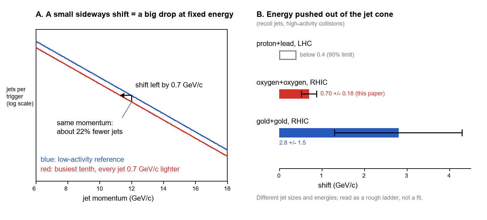
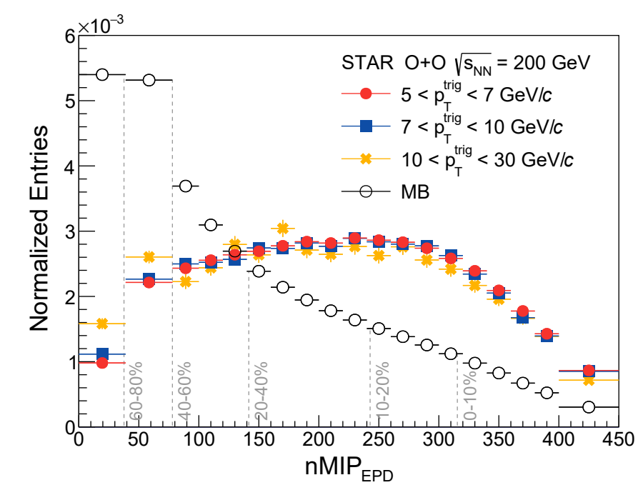
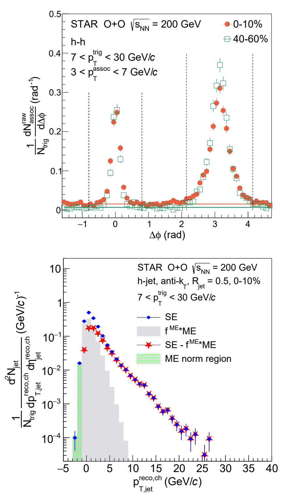
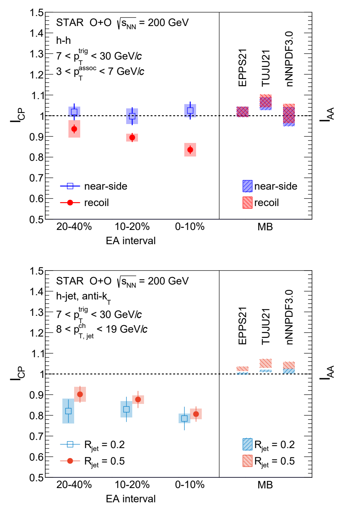
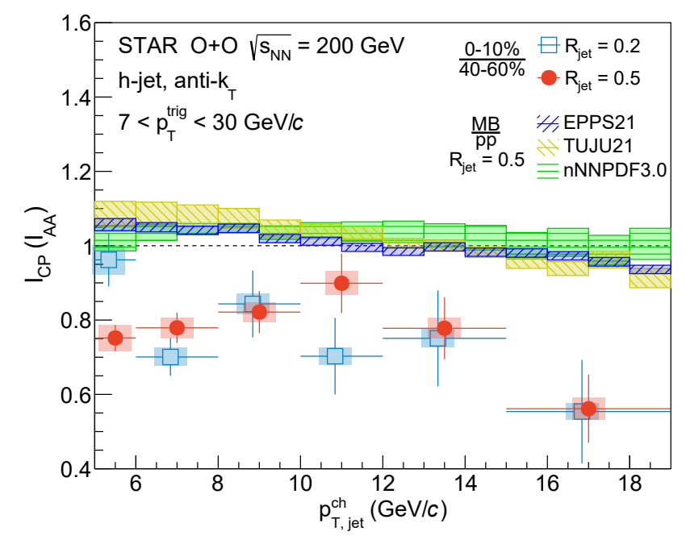

v3.16
Analyzing | Framework v3.16 | preprint (arXiv v1, no journal reference): adversarial posture, tempered by collaboration review

> **Access Status** — Full paper: local PDF (arXiv:2604.13935v1, STAR Collaboration, 10 pages with End Matter), read in full · Abstract: from the PDF; the arXiv abstract page shows v1 (15 April 2026) as the only version, with no journal reference · Figures: all six figures and Tables I–V examined; Figs. 1, 2, 3 and 6 are shown below, cropped from 300 dpi renders of the PDF pages (no arXiv source files were available) · Supplementary material: none beyond the End Matter · Comparison papers: I checked the arXiv abstract pages (version history and current abstract) of CMS 2510.09864 (v2, the published version), ATLAS 2606.20463 (v1), Gebhard–Mazeliauskas–Takacs 2410.22405 (v3), ALICE 1712.05603 (v2), STAR 1702.01108 (v1), Park et al. 2507.03603 (v3) and STAR 2510.19645 (v1). I saw them only through a summarizing fetch tool, so I had the current versions but not verbatim abstracts. I read the first four pages of sPHENIX conference note sPH-CONF-JET-2026-02 directly · Analysis basis: full text.

## 1. Punchy Title & One-Sentence Hook

**Oxygen Is Big Enough to Dent a Jet**

STAR counts how often a fast particle shot out of a collision has a matching partner on the far side. In the busiest oxygen–oxygen collisions at RHIC that partner shows up about a fifth less often. That is the first such evidence at RHIC energy, joining recent LHC results, that colliding nuclei of only sixteen nucleons make enough quark–gluon plasma to sap energy from a jet, after a decade of empty small-system searches.

## 2. Big-Picture Context

When two gold or lead nuclei collide head-on at nearly light speed, they briefly melt into quark–gluon plasma: a droplet of free quarks and gluons a few times the width of a proton that flows like an almost frictionless liquid. Two signatures established that droplet. The first is *collective flow*: the low-energy debris comes out in a coordinated angular pattern that inherits the shape of the collision zone. The second is *jet quenching*: the rare, very energetic quarks and gluons kicked out by a hard collision lose energy as they plough through the droplet, so the sprays of particles they produce, called jets, come out weaker or are missing altogether.

For about fifteen years those two signatures have disagreed in small systems. Proton–proton, proton–lead and deuteron–gold collisions show flow-like patterns that look strikingly like the big-nucleus case. Yet nobody had found jet quenching in them. ALICE, ATLAS and CMS turned their proton–lead searches into ever tighter upper limits. Either small systems make a droplet too thin and short-lived to dent a jet, or the "flow" in them has another origin. Collisions of light nuclei such as oxygen sit in between: bigger than a proton, much smaller than gold. If quenching switches on anywhere in that range, oxygen is the natural place to look.

A practical problem has also dogged the search. The standard test scales proton–proton jet rates by the number of nucleon–nucleon collisions, which in small systems comes from a poorly constrained geometric model. STAR instead uses a self-normalizing count, explained in Section 3, in which that number cancels.

**Paper Type & Stakes:** this is a short experimental Letter from the STAR collaboration. It is the first measurement of jet quenching with correlation observables in oxygen–oxygen collisions at RHIC energy, and it claims "strong evidence" that the effect is present. At stake is the smallest system size at which a quark–gluon plasma becomes thick enough to be opaque to jets. That threshold constrains how fast the droplet thermalizes and whether small-system flow and jet quenching have the same cause.

**Prior Belief Check.** Few experts will be surprised by the direction of the result, and many expected it. Theory calculations have predicted measurable energy loss in oxygen for years. CMS reported suppressed charged-particle production in oxygen–oxygen at the far higher LHC energy (published in *Phys. Rev. Lett.* 136, 162301, arXiv v2, April 2026). ATLAS reported an imbalance between back-to-back jets that grows with centrality in oxygen and neon collisions (arXiv v1, June 2026, submitted to PRL). What this paper adds is the first such evidence at RHIC energy, where the droplet is cooler, and with an observable designed to avoid the geometric-model problem. The size of the effect is the informative part. The energy pushed out of the jet is small, roughly a quarter of what STAR saw in central gold–gold collisions with the same method. But it sits above the upper limit ALICE set for proton–lead at the LHC. The result is confirmatory in direction and incremental in method. Its main interest is where it pins the onset.

**Replication & Convergence Note.** The correlation measurement itself comes from one collaboration on one 2021 dataset, with no independent repeat yet. There is independent convergence on the broader claim that oxygen–oxygen collisions quench jets. CMS and ATLAS see it at LHC energy with different observables, and an sPHENIX preliminary conference note (June 2026) reports inclusive jets at the same RHIC energy whose suppression grows with collision centrality. Real confirmation of *this* result would be a second RHIC detector reproducing the per-trigger recoil suppression, or ALICE applying the same hadron-plus-jet method to its 2025 oxygen data. ALICE pioneered the method, so a near-null or a large result there would test both the energy dependence and STAR's background treatment.

## 3. Necessary Background Crash-Course

### Origins and big picture: how a collision makes a droplet, and why size matters

The story starts at the moment of impact. At RHIC each oxygen nucleus is a flattened disk of sixteen nucleons moving at almost the speed of light. When two disks overlap, most of the nucleons do not hit anything hard. They brush past each other and leave behind a dense tangle of soft gluon fields. In big nuclei that tangle covers a region several femtometers across. Within about a femtometer-per-light-speed of time (a few trillionths of a trillionth of a second) it loses memory of how it was made and starts behaving like a hot fluid: quark–gluon plasma. The droplet then expands and cools. When the local temperature falls through the QCD crossover, about a hundred thousand times hotter than the core of the Sun, it freezes back into ordinary hadrons, and those hadrons are what the detectors record.

Jets come from rarer events inside the same collision. Once in a while two quarks or gluons, one from each nucleus, hit almost head-on and fly apart at high momentum, back to back in the plane transverse to the beam. Each one sprays out a collimated cascade of particles as it slows to hadronic energies; that cascade is the jet. In proton–proton collisions both jets escape into vacuum. In a nucleus–nucleus collision they are born *inside* the droplet and must cross it. Along the way they scatter off the plasma's constituents and radiate extra gluons, and some of their energy ends up spread at wide angles, outside the cone the experiment uses to define "the jet."

This was the headline discovery of RHIC's early years. Around 2003 STAR showed that in central gold–gold collisions the high-momentum particle on the far side of a trigger hadron largely disappeared. The near-side partner was still there; the away-side one was gone. The trigger had come from near the droplet's surface and escaped. Its partner had to cross the whole droplet and was absorbed. A deuteron–gold control run, with no large droplet, showed no such loss. That made the effect a property of the hot medium rather than of the nuclei themselves. The picture held up: jet quenching and flow became the two pillars of the quark–gluon-plasma interpretation.

Then the small systems broke the symmetry. From 2010 on, the LHC and RHIC found flow-like correlations in proton–proton, proton–lead, deuteron–gold and helium-3–gold collisions, and even in some electron–positron archival data. Hydrodynamic models tuned to big systems describe many of them. Yet every search for jet quenching in those systems came back null within growing precision. The cleanest limit came from ALICE using exactly the trigger-plus-recoil-jet method that STAR uses here. In high-activity proton–lead collisions the recoil jets lose less than about half a GeV of momentum. That is more than ten times smaller than in central lead–lead.

Energy-loss theory gives a simple reason the two signatures might part ways. Flow is a collective response to pressure gradients, and it can build up in a tiny droplet. Jet energy loss grows faster than linearly with the path length through the medium, so halving the droplet size cuts the loss by much more than half. A tiny droplet could therefore flow visibly and still be nearly transparent to jets.

Oxygen–oxygen collisions are the test case. They are symmetric, so there is no proton projectile whose internal structure muddies the geometry. The nucleus is small but not tiny, it is well studied in nuclear structure, and both RHIC (2021) and the LHC (2025) ran it. STAR has already reported flow in these same collisions, described by a hydrodynamic model tuned to gold–gold. So by the flow criterion, these droplets look like small quark–gluon plasma. The question this paper asks is whether they are also opaque enough to dent a jet.

**Analogy:** think of the collision zone as a network fabric of a given diameter. Flow is the fabric's collective load-balancing, which shows up even on a small cluster. Jet quenching is the latency a single long-haul packet picks up crossing the fabric. On a small cluster both exist, but the per-packet penalty can shrink below the measurement noise long before the load-balancing pattern disappears.

**Breaks when:** you take "latency" to mean the energy is destroyed. A quenched jet does not lose energy to nowhere. The energy is redistributed: it moves to soft particles at wide angles, outside the cone the experiment draws. The jet looks lighter only because of where the ruler sits.

### Jet quenching: what "losing energy" means in practice

A jet's momentum is measured by gathering all charged particles within a fixed angular radius of its axis. The paper uses two radii, a narrow cone and a wide one. If the medium nudges some of the jet's energy outward beyond the cone, the reconstructed jet comes out lighter than its birth momentum. If the medium only reshuffles energy *within* the cone, a wide cone recovers it. Comparing the two radii is therefore a crude radial profile of where the lost energy went.

Because jet counts fall very steeply with momentum, a small loss per jet turns into a large drop in counts at a fixed momentum. That is the hardest point to grasp intuitively in this paper, so the picture below makes it concrete.



*Analyst-built illustration (not from the paper):* Panel A slides a falling jet spectrum left by the measured amount, using a slope estimated from the paper's Fig. 2. Panel B places the paper's recoil-jet momentum shift between the ALICE proton–lead upper limit and the STAR gold–gold value, both measured with the same trigger-plus-recoil method.
**What to look at:** in panel A, a horizontal arrow under one GeV produces a vertical gap of about a fifth. In panel B, oxygen sits clearly above the proton–lead ceiling and far below gold.

### Per-trigger yields: why normalizing to the trigger cancels the hard-to-know factor

**Concept:** the paper counts, for every event with a high-momentum charged hadron (the trigger), how many associated particles or jets appear opposite it. It then divides by the number of triggers. Both the trigger and the recoil come from the same rare hard scattering, so any factor that scales how many hard scatterings occurred multiplies numerator and denominator alike and cancels. That covers the number of nucleon–nucleon collisions and luminosity. Much of the nuclear modification of the incoming parton densities cancels too, though only partly.

**Vehicle:** a parcel depot does not know how many orders were placed today. It does see every shipping receipt scanned at dispatch and every parcel delivered at the far end. Divide parcels delivered by receipts scanned and you get the delivery rate, with no need to know the order volume.

**Analogy:** receipt = trigger hadron; delivered parcel = recoiling jet or hadron; the unknown order volume = the poorly known number of hard collisions; deliveries per receipt = the per-trigger yield. Jet quenching is parcels arriving damaged and lighter, so some fall below the depot's minimum weight and are not counted.

**Breaks when:** the receipts are not a fair sample. If busy days systematically scan a different kind of receipt, such as triggers made only near the droplet's edge or in collisions where the incoming partons carried less momentum, the per-receipt rate shifts for reasons unrelated to damage in transit. The paper's near-side control (below) is its check on this.

### Event activity: sorting collisions without seeing their geometry

Nobody measures how head-on a collision was. STAR instead sorts events by *event activity*: the number of charged particles hitting a forward detector, the Event Plane Detector, far from the central region where the trigger and jets are measured. The busiest tenth of events serves as the "central" sample, and a middle band (the 40th to 60th percentile) serves as the reference. The paper's main quantity is the per-trigger yield in the busy sample divided by that in the reference. A ratio below one means fewer recoil partners per trigger in busy collisions. The paper labels this ratio ICP.

**Analogy:** it is like inferring how loaded a server rack is from the fan noise in the adjacent aisle. Using the next aisle rather than the rack itself avoids the obvious self-correlation, since a hot job would otherwise make its own measurement look busier.

**Breaks when:** fan noise tracks load only loosely, and in small systems the link between forward activity and true geometry is weak. A loud fan may also select unusual jobs, not just more of them. That bias is the main residual worry and runs through Sections 4 and 6.

### Near side versus away side: the built-in control

In each trigger event there are two clusters of correlated particles: the *near side*, fragments of the same jet that made the trigger, and the *recoil* or *away side*, fragments of the partner jet. Triggers are preferentially produced near the droplet surface heading outward, because those escape with the most energy. So the near side samples a short path through the medium and the recoil samples a long one. The near-side yield therefore acts as a same-event control: anything that biases the event selection should affect it too, while path-length-dependent quenching should hit mainly the recoil.

**Central analogy for this paper:** parcels counted per shipping receipt.

```
Analyst-built concept diagram (not from the paper):

 O+O collisions, 2021 RHIC run (~half a billion events)
            |
            v
 sort by forward activity --> busiest tenth vs middle band
            |
            v
 find trigger hadron (one per event, random if several)
            |
   +--------+-----------------------+
   v                                v
 hadron pairs                     recoil jets (narrow + wide cone)
 subtract flat background         subtract background density,
 count near side + recoil         subtract mixed-event fake jets,
   |                              unfold detector smearing
   v                                v
 recoil ratio ~0.84               recoil ratio ~0.81
 near-side ratio ~1.0                |
   +---------------+-----------------+
                   v
 compare to no-quenching baselines (1, near side, nPDF calcs)
                   v
 suppression 2.7 to 5.2 sigma; recoil jets ~0.7 GeV/c lighter
```

Read it top to bottom: one event sample feeds two parallel counting pipelines, and both end in the same busy-over-reference ratio before the baseline comparison.

## 4. Core Technical Explanation

### Step 1 — Choosing a reference that is not polluted by the triggers themselves

*The failure it prevents:* selecting events by "a high-momentum trigger is present" also pushes them toward higher activity. If that push differs between activity classes, the ratio would carry a selection artefact.

*What the authors do:* they compare the forward-activity distribution of all collisions with that of events containing triggers in three momentum ranges (Fig. 1, with ratios in the End Matter's Fig. 4). Trigger events are shifted toward high activity as expected. Above the lowest trigger momenta the *shape* of that shift no longer depends on trigger momentum, except in the lowest-activity band, probably because recoil jets can land in the forward detector itself there. So the authors drop that band and use the middle band (40–60 percent) as the reference.

*What it buys:* a reference whose bias matches the busy sample, plus a stated reason for believing the activity variable tracks geometry rather than the hard process.



*Figure 1 (from the paper):* normalized distributions of forward-detector hits for all oxygen–oxygen collisions (open circles) and for events with a high-momentum trigger in three momentum ranges (filled symbols); dashed lines mark the activity classes.
**What to look at:** the three filled series lie on top of one another from the 40–60 percent band upward, which is the invariance the reference choice rests on. They split apart only in the lowest band.

### Step 2 — Counting partners in hadron pairs

*The failure it prevents:* in any event, many particles opposite the trigger have nothing to do with its hard scattering. They come from the soft bulk and from flow-like modulations. Counting them would dilute and distort the recoil yield.

*What the authors do:* they histogram the angle between the trigger and each associated particle of intermediate momentum (Fig. 2, top). Two peaks appear: the near side at zero angle and the recoil at half a turn. A flat-plus-flow background is fitted in the valley between them, with the flow strengths fixed to deliberately generous values taken from STAR's oxygen flow measurement, and subtracted. The near and recoil yields are then integrated in fixed windows.

*What it buys:* a recoil count per trigger with the uncorrelated background removed. Its systematic uncertainty is about 4 percent, dominated by vertex and activity-boundary choices rather than the flow assumption.



*Figure 2 (from the paper):* top, raw per-trigger angular correlations for the busiest tenth (orange) and the reference band (green), with background fits and counting windows. Bottom, recoil-jet momentum spectrum for wide-cone jets in the busiest tenth: same-event data (blue), scaled mixed-event fake jets (grey), and their difference (red stars).
**What to look at:** in the top panel, the recoil peak near three radians is visibly lower for the busy events while the near-side peak at zero barely changes; that contrast is the whole result in miniature. In the bottom panel, the grey fake-jet population dies out below about ten GeV, while the red stars continue as a smooth falling spectrum.

### Step 3 — Counting whole recoil jets despite the background

*The failure it prevents:* a jet cone in a busy collision also scoops up soft particles from the bulk. At these modest jet energies that can fake a jet outright or inflate a real one, and the contamination grows with activity, which is exactly the variable being compared.

*What the authors do:* they follow the recipe that ALICE and STAR developed for gold–gold and lead–lead. First they subtract an event-by-event median background density from every jet. Next they build a "mixed event" by taking at most one track from each of many real events, so all correlations are destroyed. They run the same jet finder on it, scale the fake-jet spectrum to match the data where only fakes live, at zero or negative corrected momentum, and subtract it. Finally they unfold the remaining spectrum for detector response and leftover background fluctuations, using a PYTHIA-based prior and four iterations. The End Matter reports the mixed-event scale factors and their variations.

*What it buys:* a fully corrected recoil-jet spectrum per trigger, for narrow and wide cones, between roughly 8 and 19 GeV. Its systematic uncertainty is a few percent, and the largest item is a difference between data taken with the two magnet polarities, not the background subtraction.

### Step 4 — The main result: recoil down, near side unchanged

Fig. 3 carries the paper's conclusion. In the busiest tenth, the recoil hadron yield per trigger is about 16 percent below the reference and the wide-cone recoil jet yield about 19 percent below it. The near-side yield stays consistent with no change at every activity level. The suppression grows mildly from the lower activity bands to the busiest tenth, though the fitted slopes are only one to two standard deviations from flat. The narrow-cone and wide-cone jets agree within uncertainties.



*Figure 3 (from the paper):* left side of each panel, measured busy-over-reference ratios in three activity bands; top for hadron pairs (blue near side, red recoil), bottom for recoil jets (blue narrow cone, red wide cone). Right side, perturbative-QCD calculations without quenching for minimum-bias oxygen relative to proton–proton, using three sets of nuclear parton densities.
**What to look at:** the red recoil points fall away from the dotted line at one while the blue near-side points sit on it. All the no-quenching boxes on the right sit *at or slightly above* one.

The right-hand side of Fig. 3 addresses the obvious alternative. Parton densities inside a bound nucleus differ from those in a free proton, and that could change recoil rates without any plasma. The authors take calculations by Gebhard, Mazeliauskas and Takacs (JHEP 04 (2025) 034; arXiv v3, July 2025) using three different nuclear parton-density sets. All three predict a ratio a few percent *above* one for both near side and recoil. These are standard hard-scattering calculations with the plasma switched off. Nuclear modifications of the incoming partons therefore push the wrong way to explain the deficit. The authors are explicit about a mismatch: the calculations compare minimum-bias oxygen with proton–proton, not busy oxygen with mid-activity oxygen, because no data constrain how nuclear parton densities vary across the nucleus.

Fig. 6 (End Matter) shows the jet ratio across jet momentum. It sits roughly flat around 0.75–0.8 for both cone sizes, with large errors at the highest momenta, and every point lies below the no-quenching bands.



*Figure 6 (from the paper):* busy-over-reference ratio for narrow-cone (blue squares) and wide-cone (red circles) recoil jets versus jet momentum, with the three no-quenching calculations as coloured bands near one.
**What to look at:** the gap between the data cluster and the bands is roughly constant across momentum. A uniform shift of a steep spectrum produces exactly that.

### Step 5 — How significant, against which baseline?

The authors do not pick a single null hypothesis. They test five. The deficit is divided by the combined data-plus-baseline uncertainty for each:

| No-quenching baseline | Hadron recoil | Wide-cone jets | Narrow-cone jets |
|---|---|---|---|
| Exactly one | 4.3σ | 4.3σ | 3.5σ |
| Same-event near side | 3.3σ | — | — |
| Three nuclear-parton-density calculations | 2.7–5.2σ | 4.8–5.0σ | 3.5–3.7σ |

*Table I (from the paper, condensed):* significance of the recoil suppression in the busiest tenth for each baseline choice.
**What to look at:** the weakest entry (2.7σ) is the hadron recoil against one nuclear parton-density set with a wide uncertainty band. The most data-driven baseline, the near side, gives 3.3σ. No entry reaches the field's conventional "observation" level across the board, which is why the paper says "strong evidence."

### Step 6 — Turning a count deficit into an energy loss

A ratio below one is hard to compare across systems with different spectra. Following the ALICE proton–lead method, the authors ask how far the reference jet spectrum must slide toward lower momentum to reproduce the busy-collision spectrum. For a spectrum that falls exponentially, the relation is one line:

$$\Delta p \approx T \,\ln\!\left(\frac{1}{I}\right)$$

**Symbol definitions:**
$\Delta p$ : average momentum the recoil jet loses out of its cone (GeV/c)
$T$ : the spectrum's falloff scale, the momentum over which the jet count drops by a factor of e (GeV/c)
$I$ : busy-over-reference recoil yield ratio (dimensionless)

**What this actually means:** it is the same arithmetic as a cache whose hit rate falls off exponentially with working-set size. Shrink the cache a little and the miss count jumps by a fixed factor; read backwards, a fixed-factor jump in misses tells you how much the cache shrank. Here a fifth fewer jets on a spectrum with a falloff scale of a few GeV means each jet lost under one GeV.

The result is a shift of about 0.7 GeV/c for wide cones and 0.8 GeV/c for narrow ones, equal within errors. The paper reads the cone-size independence as most lost energy going well outside even the wide cone, similar in pattern to gold–gold but smaller in size. Panel B of the explainer above puts that number in context. It is about a quarter of STAR's gold–gold value for wide cones. It is also above ALICE's proton–lead ceiling, but that ceiling was set at a different collision energy, cone size and jet momentum, so the comparison is suggestive rather than direct.

### Claim check

Checks ran in Python (`claim_check.py` in the work directory) from the paper's quoted values plus readings off Figs. 2, 3 and 6.

**Significance against "no change" — Reproduced.** Combining the quoted statistical and systematic errors for the busiest-tenth hadron recoil and wide-cone jet ratios gives 4.3σ for each, matching Table I. The quoted systematic fractions also match the End Matter tables (Tables IV and V), so text, tables and the headline agree.

**Significance against the near-side and nuclear-parton-density baselines — Partly reproduced.** From figure readings, the near-side baseline gives between about 3.1σ and 3.7σ depending on how much of the systematic error is shared, bracketing the paper's 3.3σ. The three nuclear-parton-density baselines come out near 4.5σ, 4.8σ and 2.8σ, against the paper's 4.0σ, 5.2σ and 2.7σ. That is consistent at figure-reading precision; the exact band widths are not tabulated.

**Recoil-jet energy shift — Reproduced within errors.** Fitting the falloff of the background-subtracted jet spectrum in Fig. 2 and applying the relation above gives roughly 0.6 GeV/c, against the paper's 0.70 ± 0.18 GeV/c (errors combined). The paper's value uses the fully corrected reference spectrum, so a ~15 percent difference is expected. Against zero, the shift itself is about 3.9σ for wide cones and 3.1σ for narrow cones.

**Sensitivity — what would erase the signal.** The conclusion rests on there being no *non-quenching* reason for busy-event recoil yields to drop. The check asks how big such a hidden effect would need to be. A recoil-specific, non-plasma suppression of about 5 percent for hadrons, or about 6 percent for wide-cone jets, drops the significance below 3σ. About 9–10 percent drops it below 2σ. The published calculations say nuclear parton densities push the other way, which makes 5 percent from that source implausible. Event-selection biases are less constrained at RHIC energy (next item), so a 5 percent effect from them is not excluded by anything in the paper except the near-side control.

**Robustness test: the near-side null.** *Test:* does the near-side yield, which shares the trigger and event selection but samples a short path, also drop? *What contamination would look like:* if busy-event selection biased the hard process itself, for example by picking collisions where the partons carried less momentum, the near side would typically move too. *Result:* it does not; it sits at one within about 3 percent at every activity level. This is the paper's strongest defence. Its limit is that the near side and recoil probe different momentum fractions of the incoming partons. An activity bias that depends on parton momentum fraction, which Park et al. (Phys. Rev. C 112, 064916; arXiv v3, December 2025) say varies non-trivially at RHIC energy, could in principle act more on the recoil than on the near side. Park et al. also find that per-trigger correlation measurements are much less exposed to such bias than yield measurements, which works in STAR's favour.

**Internal consistency — one minor item, no significant findings.** The paper quotes about half a billion recorded collisions and an integrated luminosity of 0.14 inverse nanobarns. With an oxygen–oxygen cross-section near 1.2 barns (the geometric-model value quoted in the sPHENIX note), that luminosity corresponds to roughly 170 million collisions, a factor of about three fewer. Either number may be a typo or may count events differently. The per-trigger results never use luminosity, so nothing in the conclusions changes. Headline wording: the title says "Measurement of jet quenching" and the closing summary says the effect "has been observed." The paper's own evidence ranges from 2.7σ to 5.2σ depending on baseline. That supports the abstract's "strong evidence," not a five-sigma observation.

### Assumption Audit

> **Watch:** you likely assume the suppression is measured relative to collisions with *no* plasma. The paper actually compares the busiest tenth with a mid-activity band, which may itself quench jets somewhat. The roughly 20 percent deficit is therefore a *difference* in quenching between two oxygen populations, not the absolute effect. A proper absolute comparison would need a proton–proton reference at the same energy, which this paper does not provide. The absolute energy loss in busy oxygen collisions could be larger than 0.7 GeV/c. In this sense the headline number is conservative.

> **Watch:** you likely assume the theory curves on the right of Fig. 3 are an apples-to-apples no-quenching prediction for the measured ratio. The paper actually says they are not. They compare all oxygen collisions with proton–proton, and they have no spatial dependence of the nuclear parton modification, because data do not constrain it. They show that nuclear parton effects are small and of the wrong sign on average. They do not show what those effects do between busy and mid-activity collisions. That gap is why the near-side control carries so much weight.

> **Watch:** you likely read "0.7 GeV/c energy loss" as each jet losing that much energy to the plasma. The paper actually defines it as the sideways shift of a whole spectrum that reproduces the yield deficit. It is an average, it assumes a pure shift (no change in spectrum shape), and it counts only energy moved outside the cone. Energy reshuffled within the cone is invisible to it. The equal shift for narrow and wide cones constrains *where* the energy went more than how much was lost.

> **Watch:** you likely assume "event activity" is a proxy for collision geometry, as centrality is in gold–gold. The paper argues for this from the trigger-invariance in Fig. 1, which is necessary but not sufficient. In small systems the correlation between forward multiplicity and impact parameter is weak, and fluctuations in a proton's or nucleus's own parton content can raise forward activity without making a bigger droplet. The paper shows the bias is *the same* across trigger momenta, not that it is *absent*.

## 5. What's Genuinely New or Clever

The first genuinely new element is the *system*. This is the first positive jet-quenching result from correlation observables in a collision system smaller than copper or xenon. It is also the first at RHIC energy for light ions. The more interesting achievement, though, is precision in the right place. A 20 percent deficit is not large. What makes it convincing is that the measurement sidesteps the geometric-model uncertainty that has swamped inclusive small-system searches, while also carrying a built-in control. The near-side yield shares every event-selection step with the recoil and still comes out flat. Inclusive measurements such as CMS's oxygen result or sPHENIX's preliminary inclusive jets do not have that same-event control, and they must model the number of hard collisions. STAR's two observables, hadron pairs and fully corrected recoil jets, are also independent enough in their systematics (flow background fit versus mixed-event subtraction and unfolding) that their agreement means something.

The second clever element is *reusing the same ruler*. The trigger-plus-recoil-jet method was built for lead–lead and gold–gold, then used by ALICE to bound proton–lead, and STAR applies it unchanged to oxygen. So the momentum shift lands on a common scale: above the proton–lead ceiling, a quarter of gold–gold. For the onset question that ladder matters more than any single significance number. The method is not new to specialists; its result in this system is.

**Predictive Content Check**

1. **Falsifiable handle.** The paper makes a concrete, checkable claim: in high-activity oxygen–oxygen collisions at RHIC energy, recoil jets of roughly 8–19 GeV lose about 0.7 GeV/c out of their cone relative to mid-activity collisions, independent of cone size, while near-side yields stay unchanged. Three things could falsify or sharpen it. First, the same analysis on independent RHIC oxygen data, or on sPHENIX's 2026 run with a correlation observable: a ratio consistent with one at a few percent precision would contradict it. Second, ALICE's hadron-plus-jet measurement in 2025 LHC oxygen data: the denser, hotter LHC droplet should give a *larger* shift than at RHIC if this is plasma quenching. A shift comparable to or below STAR's would point toward an event-selection effect instead. Third, a photon-triggered recoil measurement: a direct photon does not interact with the plasma, so it removes the trigger-side surface bias entirely. The recoil suppression should persist and, if anything, grow.

2. **Formalism load:** skipped. The paper is a measurement; its only model-dependent step, the spectrum-shift conversion, is a short explicit recipe and does not generate the evidence claim.

## 6. Limitations & Open Questions

**The theory baseline does not match the observable.** The no-quenching calculations compare all oxygen collisions with proton–proton, while the measurement compares busy with mid-activity oxygen. No calculation includes the spatial variation of nuclear parton modification that would make the comparison exact. **(A) Consensus** — the authors state this mismatch themselves, and the lack of data constraints on spatially dependent nuclear parton densities is well known. **(paper, discussion of Fig. 3)**

**Event-activity selection bias at RHIC energy is not quantified for this observable.** Selecting on forward multiplicity can preferentially pick collisions where the incoming partons had particular momentum fractions, through energy conservation or fluctuations in nucleon parton content. Park et al. find such biases vary non-trivially with transverse momentum at RHIC energy, unlike at the LHC, though correlations are much less affected than yields. The paper's defences are the trigger-invariance of Fig. 1 and the flat near side. It does not simulate the bias with an event generator. **(B) Contested** — some in the small-systems community regard biases of this kind as the leading alternative explanation for apparent small-system modifications, while others consider the near-side control sufficient; the paper and the literature do not settle it. **(broader literature; analyst inference on the size needed, from recomputation of Table I inputs)**

**Significance is evidence-level and baseline-dependent.** The suppression ranges from 2.7σ to 5.2σ across five baselines, and the most data-driven one gives 3.3σ. A hidden recoil-specific effect of about 5 percent would bring the main channels below 3σ. **(B) Contested** — reasonable physicists will differ on which baseline is fair. The near-side control is clean but statistically weaker, and the theory baselines are not exact matches. **(analyst inference — from recomputation using the paper's quoted ratios and uncertainties)**

**The reference band may itself be quenched, so the result is relative.** The ratio measures a difference in quenching between the busiest tenth and the 40–60 percent band, with no same-energy proton–proton jet reference in this paper. Absolute suppression, and therefore the absolute energy loss, may be larger. **(A) Consensus** — this is inherent to central-to-peripheral ratios and widely understood, though the paper does not spell out its effect on the momentum shift. **(analyst inference)**

**The momentum shift is a model-dependent summary.** Converting the ratio into an energy shift assumes the busy-event spectrum is a pure translation of the reference spectrum, follows the ALICE recipe, and is sensitive to the spectrum's falloff in the measured window. With the steep spectra here, a modest change in falloff moves the shift by a tenth of a GeV or more. **(B) Contested** — the method is standard in this sub-field, but whether a uniform shift is the right model for small systems, where only some jets may interact, is open. **(paper, Ref. 40 method; analyst inference on sensitivity)**

**Trigger surface bias is assumed, not measured.** The near-side ratio of one is read as "the triggering jets lose negligible energy." In a droplet this small, the trigger may not be strongly surface-biased, and some trigger-side loss could hide in the per-trigger normalization. **(C) Speculative** — this is my reading; the paper cites gold–gold precedent, and a photon-triggered measurement would test it. **(analyst inference)**

**Kinematic reach is narrow and low.** Jets span only about 8–19 GeV, where background subtraction is hardest and the highest bins carry large errors. **(A) Consensus** — RHIC energy and the 2021 dataset size set this limit, as Figs. 5–6 show. **(paper, Figs. 5–6)**

**Minor bookkeeping inconsistency.** The quoted event count and luminosity disagree by about a factor of three. **(C) Speculative** — this could be a typo or a different event definition, and it does not affect per-trigger results. **(analyst inference — from recomputation)**

**Open questions for the next 12–24 months:** Does ALICE see a *larger* recoil-jet shift in LHC oxygen? Does a photon-triggered version confirm the trigger-side assumption? Can event generators reproduce a 5 percent recoil-only suppression without a plasma? Does neon fall where path-length scaling predicts?

## 7. Detailed Summary & Explanation

STAR analysed about half a billion oxygen–oxygen collisions recorded at RHIC in 2021. It sorted them by the number of particles striking a forward detector and compared the busiest tenth with a middle band. In each event STAR picked one high-momentum charged hadron as a trigger and counted what came out opposite it. It did this in two ways: intermediate-momentum hadrons in a pair correlation, and whole charged-particle jets reconstructed with narrow and wide cones after removing combinatorial background and correcting for detector effects. Because everything is counted per trigger, the poorly known number of hard collisions cancels.

The busy events show fewer recoil partners per trigger: about 16 percent fewer hadrons and about 19 percent fewer wide-cone jets. Meanwhile the near-side partners, fragments of the trigger's own jet, stay unchanged. Perturbative-QCD calculations with three sets of nuclear parton densities predict no deficit; if anything they predict a slight excess. Against five no-quenching baselines the deficit ranges from 2.7σ to 5.2σ, with 3.3σ against the most data-driven one, the near side. Converted to a sideways shift of the jet spectrum, the deficit means recoil jets lose roughly 0.7 GeV/c out of their cone. This holds for narrow and wide cones alike, about a quarter of the gold–gold value and above the proton–lead upper limit set at the LHC with the same method.

I framed the summary around the near-side control and the baseline question, not the 20 percent figure. The suppression is modest, and its significance depends on what one assumes happens without a plasma. The near-side control is what turns "busy events look different" into "the far-side jet specifically lost energy." And because the reference is itself oxygen, the robust statement is that jet energy loss grows with event activity, not an absolute value. Placed alongside the CMS and ATLAS LHC results and the sPHENIX preliminary, it makes a coherent case that a droplet from colliding sixteen-nucleon nuclei is already opaque enough to dent jets. The open question has shifted from *whether* to *how fast* quenching switches on with size.

**Where I'm least confident in this analysis:** the size of event-activity selection biases on the *recoil specifically* at RHIC energy. My sensitivity check shows that a recoil-only, non-plasma effect of about 5 percent would weaken the result to below 3σ. I relied on Park et al.'s abstract-level statement that correlations are much less exposed to bias than yields, without their numbers for this observable. Whether energy-conservation or nucleon-substructure effects in forward-activity selection can reach that level is something a specialist with generator studies would know and I do not. This paper was a lite-mode candidate (short Letter, one narrow result); the headless pipeline requires the full analysis, so I wrote one.

**Revision notes:** the referee pass made four changes. It corrected the hook's "first evidence" to "first at RHIC energy," because CMS's oxygen result came earlier. It softened the proton–lead comparison to "suggestive," explained the no-plasma calculations in plain words, and trimmed the draft to fit the length and numbers budgets.

## 8. Three Crystallized Takeaways

1. In the busiest oxygen–oxygen collisions at RHIC, the jet on the far side of a fast trigger particle shows up about a fifth less often than in quieter collisions, while the trigger's own jet is unchanged. That is the fingerprint of a jet losing energy crossing a quark–gluon plasma droplet made from nuclei of just sixteen nucleons.

2. The energy lost is small: under one GeV pushed out of the jet, about a quarter of the gold–gold value, but more than the upper limit seen in proton–lead. That puts the onset of jet quenching somewhere between a proton hitting a nucleus and two oxygen nuclei colliding.

3. The evidence is strong but not an observation. Depending on what "no quenching" is assumed to look like, the deficit is 2.7σ to 5.2σ, and its fate rests on whether event-selection biases at RHIC can fake a five-percent drop on the far side only.

## 9. Shorter Summary

When heavy nuclei collide at near light speed they make a tiny droplet of quark–gluon plasma, and energetic quarks or gluons crossing it lose energy. This "jet quenching," together with flow-like particle patterns, is the main evidence that the droplet exists. Small collisions, such as a proton hitting a nucleus, show the flow patterns but have never shown jet quenching, which has left open whether they make a real droplet at all.

The STAR experiment at RHIC looked for quenching in collisions of oxygen nuclei, which are intermediate in size. Instead of comparing jet rates with an uncertain model of how many collisions occurred, STAR picked one fast "trigger" particle per event and counted the partner jets and particles on the opposite side, per trigger. That makes the unknown collision count cancel. It then compared the busiest tenth of collisions with a middle-activity group.

In the busiest collisions the far-side partners appear about a fifth less often, while partners on the trigger's own side are unchanged. Calculations that include known nuclear effects but no plasma predict no such drop. The deficit corresponds to far-side jets losing a bit under one GeV of momentum out of their cone. That is about a quarter of what STAR saw in gold–gold collisions, but more than the upper limit found in proton–lead collisions.

The result is "strong evidence" rather than a discovery-level observation. Depending on the assumed no-quenching baseline, the significance runs from about 2.7 to 5.2 standard deviations. The main residual worry is whether sorting events by activity could fake a small far-side-only drop. The measurement agrees with recent LHC oxygen results and a preliminary sPHENIX result. Together they suggest jet quenching switches on somewhere between proton–nucleus and oxygen–oxygen collisions.

---
*Analysis generated 2026-10-21 by Claude (headless pipeline), Framework v3.16, adversarial posture for an unrefereed arXiv v1 preprint. Checks: `claim_check.py`; figure crops: `render_pages.py`, `crop_figs.py`; explainer: `explainer.py` (all in the run's work directory).*
