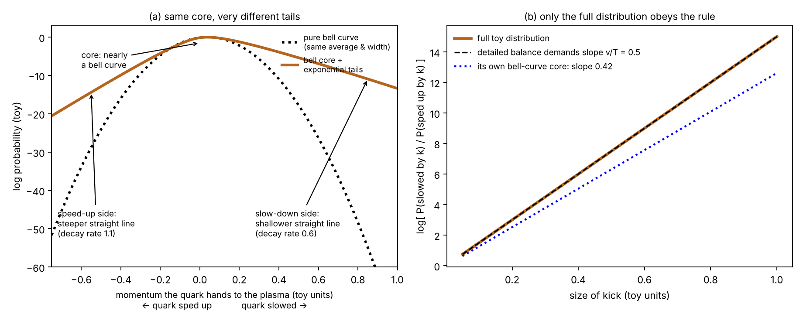
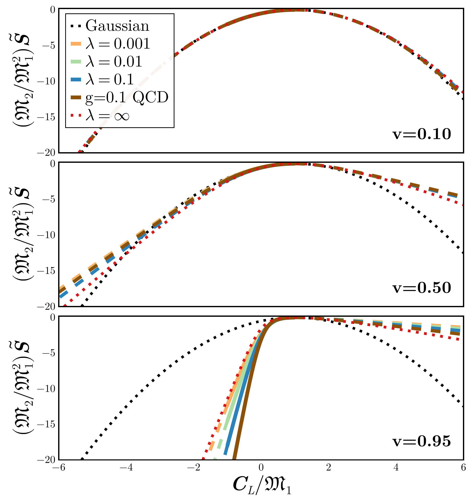

Analyzing | Framework v3.17

# Heavy Quark Transport Is Non-Gaussian beyond Leading Logarithm

**Paper:** Jean F. Du Plessis (MIT Center for Theoretical Physics — A Leinweber Institute; KITP) and Bruno Scheihing-Hitschfeld (KITP, UC Santa Barbara), *Physical Review Letters* (2026), DOI 10.1103/7fd5-1kq5. Public version: arXiv:2604.21895v1 (23 Apr 2026, MIT-CTP/6020, 17 pp. including End Matter and Supplemental Material, 2 figures).

**Prompt material:** the MIT News / phys.org press article "Pinning down the structure of quark-gluon plasma, the universe's first fluid" (Jennifer Chu, 5 Nov 2026).

> **Access Status** — Full paper: retrieved as the authors' LaTeX source from arXiv (arXiv:2604.21895v1) via the built-in browser and read in full: main text, End Matter, and all three Supplemental Material sections. Abstract: verbatim from the same source. Figures: Fig. 1 (the paper's only data figure) rendered from the authors' own vector file; Fig. 2 is a Feynman-diagram sketch and is not used here. Published PRL version: not retrieved (the APS page failed to load), so any changes between arXiv v1 and the journal version were not checked. Supplementary sources: the uploaded press article. Analysis basis: full text (arXiv v1).

---

## 1. Punchy Title & One-Sentence Hook

**The Plasma's Rare Shoves Are Lopsided — and They Have to Be**

A heavy quark crossing the quark-gluon plasma mostly jitters like pollen in water, but now and then it takes a big shove — and the paper shows those rare shoves must lean toward slowing it down, because without that lean the quark could never settle to the plasma's temperature.

---

## 2. Big-Picture Context

When two gold or lead nuclei collide at nearly light speed, they briefly melt into a droplet of quark-gluon plasma (QGP), the state matter was in for the first few microseconds after the Big Bang. The droplet lives for a few times ten to the minus twenty-three seconds, so nobody can put a probe into it. Physicists instead watch particles that travel through it. Heavy quarks (charm and bottom) are among the best of these tracer particles. They are made in the first instant of the collision, before the plasma forms. They are too heavy to be created or destroyed by the plasma afterward, and they are heavy enough that the plasma only nudges them gradually. Their final momenta therefore record how hard the plasma pushed on them.

For twenty years the standard way to model that pushing has been the Brownian-motion picture Einstein built in 1905: a steady drag that slows the particle, plus random kicks drawn from a bell curve. Fit that model to collider data and you extract a "diffusion coefficient" that can be compared with lattice QCD (supercomputer calculations of the theory). This comparison is one of the main ways the field measures what the plasma is like inside.

The trouble is a known crack in the foundation. In Einstein's picture, drag and kick strength must be locked together by a specific ratio (the Einstein relation) or the tracer particle never reaches the plasma's temperature. Moore and Teaney showed in 2005 that, for a heavy quark moving at a good fraction of light speed through weakly interacting plasma, the first-principles drag and kick strength do **not** obey that ratio once you go one step beyond the crudest approximation. The same failure appears in the strongly interacting toy plasma studied with string-theory methods. So either first-principles physics has a bug, or the bell-curve model does. In 2025, Rajagopal, Scheihing-Hitschfeld and Wiedemann pointed at the model: if you keep the full shape of the kick distribution rather than just its average and width, equilibrium is governed by a broader condition that a non-bell-shaped distribution can satisfy even when the Einstein relation fails.

This Letter does the explicit calculation for weakly interacting plasmas, including QCD with three light quark flavors. It computes the full probability distribution of momentum handed from a fast heavy quark to the plasma, correct through the first nontrivial order. The result: a bell-shaped core plus lopsided exponential tails, with the lean of the tails fixed by thermodynamics. The authors then point out that the earlier strong-coupling calculation has the same shape, and argue that this structure is generic.

**Paper Type & Stakes:** This is a theoretical calculation (finite-temperature quantum field theory) in Letter format. It shows that the standard bell-curve (Langevin) description of heavy-quark motion in the QGP is internally inconsistent at relativistic speeds and identifies what replaces it. The stakes are methodological: heavy-quark transport coefficients extracted from collider data with bell-curve models may be biased.

**Prior Belief Check:** The paper **complicates** standard practice without contradicting established theory. That the Einstein relation fails at nonzero speed was known for 20 years. That full non-bell-shaped statistics resolve it was argued in 2025 by the same research program. The new elements are (1) the explicit weak-coupling calculation of the full distribution, (2) the observation that its tails are exponential with a decay rate set by how fast the expansion's terms grow (the authors call this decay rate the "volatility exponent"), and (3) the noticing that the strong-coupling result has the same feature. Specialists in heavy-quark transport will find the result natural rather than shocking. The surprising part is the exponential tails, which the authors themselves call "new and surprising," and the fact that they look alike at weak and strong coupling. The press article's closing claim that the primordial plasma is "more like a liquid and less like a gas" does **not** come from this paper (see Section 4, Claim Check).

**Replication & Convergence Note:** The weak-coupling calculation is a single-group result from one research lineage (Rajagopal, Scheihing-Hitschfeld, Wiedemann, Du Plessis); the strong-coupling comparison it relies on comes from the same lineage, and two key derivations are deferred to papers marked "to appear." The underlying problem (Einstein-relation failure) is independently established (Moore and Teaney 2005; several string-theory groups 2006–2007). Independent confirmation would mean another group recomputing the weak-coupling kernel and its cumulants, and ideally a lattice or phenomenological test that can see the tails.

---

## 3. Necessary Background Crash-Course

### What a heavy quark is, and why it is a good tracer

Quarks come in six types. Up, down and strange are light compared with the plasma's thermal energy. Charm (about 1.3 GeV) and bottom (about 4.2 GeV) are heavy: four to fifteen times the plasma's typical particle energy of roughly 0.3 GeV. That mass gap matters. A single collision with a plasma particle barely changes a heavy quark's velocity, so many small collisions add up. That is exactly the situation where a Brownian, diffusion-style description should work, and also why the paper works in the limit where the quark is infinitely heavy.

**Analogy:** a loaded freight car rolling through a crowd. Each person who bumps it barely changes its speed, but thousands of bumps add up to a measurable slowdown and a measurable wobble.

**Breaks when:** you ask about the car's identity. Unlike a freight car, a heavy quark carries "color" charge that the plasma's gluons rotate continuously; the paper handles this with a quantum object (a Wilson loop, below) that has no counterpart in the crowd picture.

### Brownian motion and the Einstein relation (you know this from chemistry)

The 1905 result you used in physical chemistry, the Stokes–Einstein relation, says a particle's diffusion constant equals thermal energy divided by its friction coefficient. The deeper statement is that drag and random kicks are two sides of the same molecular collisions, so their strengths are locked together. For heavy quarks, the field writes this as: longitudinal kick strength equals two times mass times temperature times the relativistic factor times the drag coefficient. If that ratio fails, a bell-curve model drives the quark to the wrong final temperature.

$$\kappa_L = 2\,M\,T\,\gamma\,\eta_D$$

**Symbol definitions:**
- $\kappa_L$ : longitudinal momentum-diffusion coefficient — how fast the spread of momentum kicks along the direction of motion grows (GeV² per fm)
- $M$ : heavy-quark mass (GeV)
- $T$ : plasma temperature (GeV)
- $\gamma$ : relativistic factor, one over the square root of one minus speed squared (dimensionless)
- $\eta_D$ : drag coefficient — the fractional momentum lost per unit time (per fm)

**What this actually means:** it is a balance sheet between the plasma's brake (drag) and its random shaking (kicks). In a CPU analogy: if the thermal governor's cooling power and the workload's random heat spikes are not matched in exactly the right proportion, the chip never settles at its set-point temperature. Moore and Teaney showed that for a moving heavy quark, beyond the crudest approximation, this sheet does not balance.

### Detailed balance: the fixed odds ratio

The cleanest way to see what must replace the Einstein relation uses another idea you know cold from chemistry: microscopic reversibility, which says the ratio of forward to reverse rates equals a Boltzmann factor of the energy difference.

A quark moving at speed v that hands momentum k to the plasma gives the plasma energy equal to speed times momentum. Equilibrium then requires that "lose momentum k" be more likely than "gain momentum k" by exactly a Boltzmann factor. This is the content of the paper's "generalized equilibration condition" (written in the paper as a symmetry of its kernel; Section 4 shows the equivalence).

$$\frac{P(k)}{P(-k)} = e^{\,v k / T}$$

**Symbol definitions:**
- $P(k)$ : probability that the quark hands momentum $k$ to the plasma along its direction of motion (i.e. is slowed by $k$)
- $P(-k)$ : probability that the plasma hands the same momentum to the quark (it is sped up by $k$)
- $v$ : the quark's speed (fraction of light speed)
- $T$ : plasma temperature (energy units)

**What this actually means:** it is the equilibrium constant for a two-way "reaction," slow by k versus speed up by k, with free energy change equal to speed times momentum. A bell curve can satisfy this rule only if its center and width obey the Einstein relation. When they don't, the rule can still be satisfied, but only by a distribution that is not a bell curve. This one equation is the logical backbone of the whole paper.

**Concrete example:** at half light speed and a kick equal to two units of temperature, the odds ratio is e raised to the power one, about 2.7 to 1 in favor of slowing. For a kick of ten temperature units it is about 150 to 1. Larger kicks are more and more lopsided.

### Cumulants, generating functions, and why tails are exponential

The paper characterizes the kick distribution by its cumulants: the first is the average (drag), the second the variance (diffusion), the third the lopsidedness, the fourth the "tail heaviness," and so on. A bell curve has only the first two; every higher cumulant is zero. All cumulants are packed into one function, the cumulant generating function, as the coefficients of a power series. The paper's "kernel" is this function, up to a sign.

The key trick will feel familiar from analysis of algorithms (generating functions and singularity analysis): **how fast the coefficients of a power series grow tells you where the function blows up, and where it blows up tells you how fast the distribution's tail decays.** The one-line example: an exponential distribution with decay rate R has generating function one divided by one minus x over R. It blows up at x = R, its coefficients grow like factorial times one over R to the n, and its tail falls as e to the minus R k. Read backward: factorial growth of cumulants means a finite radius of convergence, and that radius is the tail's decay rate.

**Analogy:** a hash table's load-factor curve. Everything looks smooth until you approach the critical load, where cost blows up; the location of that blow-up tells you more about worst-case behavior than the smooth region does.

**Breaks when:** the hash-table blow-up is a design artifact you can tune away. Here the blow-up location is set by the plasma's physics (thermal momenta) and cannot be engineered.

### Weak coupling, Debye screening, and "beyond leading log"

At very high temperature the strong force weakens (asymptotic freedom), so the plasma can be treated perturbatively, as a gas of nearly free quarks and gluons. Its coupling constant is written g. Two momentum scales matter. "Hard" exchanges are at the thermal scale (momenta comparable to the temperature). "Soft" exchanges are at a smaller scale, g times temperature, where the plasma screens color charge — exactly like Debye–Hückel screening in an electrolyte, with a Debye mass playing the role of an inverse Debye length. Soft exchanges need a resummed treatment (called hard-thermal-loop, or HTL, resummation) to avoid infinities, while hard exchanges use ordinary diagrams.

Counting both risks double-counting the overlap, so the paper adds the two and subtracts their overlap. "Leading log" means keeping only the piece enhanced by the logarithm of temperature over Debye mass, which is a large number when g is small. "Beyond leading log" means keeping the full answer at the same order without that enhancement. The physics in this paper lives in that remainder.

**Analogy:** a two-level cache model. Hits in L1 (soft) and misses served from DRAM (hard) are modeled separately, and anything counted in both must be subtracted once.

**Breaks when:** in the cache model, the two levels are physically distinct hardware. In the plasma, "soft" and "hard" are just ends of one continuous momentum range, and the split point is arbitrary; the paper checks that its answer does not depend on where the line is drawn.

### Origins & Big Picture: how the "first fluid" came to be, and how heavy quarks fit

For the first microseconds after the Big Bang, the universe was hot enough (above about two trillion kelvin, or roughly 155 MeV) that quarks and gluons were not confined inside protons and neutrons. As the universe expanded and cooled through that temperature, the plasma converted smoothly (a crossover, not a sharp phase transition, according to lattice QCD) into a gas of hadrons, ending the plasma epoch at about ten microseconds. Nothing from that era reaches us directly, so the plasma has to be recreated.

That began in earnest in 2000 at Brookhaven's Relativistic Heavy Ion Collider (RHIC) and continued at CERN's Large Hadron Collider from 2010. The big early surprise, announced in 2005, was that the plasma behaves not like the weakly interacting gas textbooks predicted but like a nearly perfect liquid, with one of the lowest ratios of viscosity to entropy density ever measured. That is where the "universe's first fluid" label comes from. Its low viscosity is one of the strongest pieces of evidence that the real plasma, at accessible temperatures, is strongly coupled.

Heavy quarks enter at the very start of each collision. Two incoming gluons fuse into a charm–anticharm or bottom–antibottom pair within the first tiny fraction of the collision time, before the plasma has formed. From then on, charm and bottom "flavor" is conserved: the plasma can push heavy quarks around but cannot make or destroy them in useful numbers. This makes them like tagged packets injected into a network at a known time: you know how many you started with and roughly what momentum distribution they had (from proton–proton collisions, where no plasma forms), so any change in the final distribution is due to the plasma.

Two measured effects tell the story. First, fast charm hadrons are suppressed in nucleus–nucleus collisions relative to scaled proton collisions, so charm quarks lose energy crossing the plasma. Second, charm hadrons show "elliptic flow," inheriting the plasma's collective sideways push, so slower charm quarks are partially dragged into equilibrium with the flowing liquid. Fitting both effects with a transport model gives the heavy-quark diffusion coefficient, which lattice QCD computes independently at zero speed. The two have been converging, but some tension remains, and phenomenological extractions depend on the assumed kick model.

This paper sits in that pipeline at the model level. If the bell-curve model is wrong at high speed, and the paper argues it must be, then the transport coefficients extracted from data through that model are model-dependent. The paper's proposal is to replace the two-number description (drag and diffusion) with three numbers: drag, diffusion, and the tail decay rate.

### Central analogy

> **Concept:** A heavy quark's per-interval momentum change has a bell-shaped bulk (many small, independent kicks add up, central limit theorem) and exponential tails from rare large kicks. The tails are asymmetric: large slowing kicks are more likely than equally large speeding kicks, with the odds ratio fixed by the Boltzmann factor of the energy exchanged. The bell-shaped core alone violates the equilibrium rule at high speed; only the core plus tails satisfies it. Over long times the core dominates typical events, but rare tail events still occur and individually change the quark's speed.

> **Vehicle:** Request latency through a busy server fleet. Most requests pass through many small queuing delays, so the bulk of the latency histogram is bell-shaped. Rare events (garbage-collection pauses, page faults, cache-line migrations) produce occasional large delays, giving an exponential tail at p99.9. Large delays are far more common than large speedups. Engineers who model only the mean and variance badly mispredict the tail, and a single long stall can shift the request into a different regime for its remaining stages.

> **Analogy:** Each momentum kick ↔ a per-stage delay. Bell-shaped core ↔ the median-region latency histogram. Exponential tail ↔ p99.9 stalls. Slowing kicks more likely than speeding kicks ↔ stalls more common than speedups. Volatility exponent (the tail decay rate) ↔ the tail-latency decay rate on a log plot. A long stall changing the request's later handling ↔ a big kick changing the quark's speed, so later kicks are drawn from a different distribution.

> **Breaks when:** you ask why the asymmetry has the size it has. Tail-latency asymmetry is an empirical accident of the software stack and can take any value; the quark's asymmetry is fixed exactly by thermodynamics (the Boltzmann factor), and violating it would mean the quark never reaches the plasma's temperature. The latency vehicle has no "temperature" that forces a particular slow-to-fast ratio, and it has no counterpart of the quark eventually reaching equilibrium with its surroundings.

### Concept diagram

*Analyst-built concept diagram (not from the paper):*

```
 heavy quark at speed v  +  weakly coupled plasma at temperature T
            |
            v
 kick distribution = Fourier transform of a Wilson loop
            |
   +--------+----------------------------+
   | soft exchanges (~gT): screened,     |  hard exchanges (~T):
   | HTL-resummed -> log-enhanced part   |  ordinary diagrams ->
   | = Gaussian, obeys Einstein relation |  ALL higher cumulants
   +--------+----------------------------+
            | subtract overlap; check split-point independence
            v
 fixed-order kernel (cumulant generating function)
            |
   cumulants grow factorially -> finite radius of convergence R(v)
            |
   Legendre transform -> P(k) = Gaussian core + exponential tails
   slow-down tail ~ e^(-R k), speed-up tail ~ e^(-(R + v/T) k)
            |
 compare shape: weak N=4 SYM, weak QCD, strong N=4 SYM -> same shape
```

How to read it: the soft side produces only the bell-shaped part; everything non-Gaussian, including the tails, comes from the hard side.

**Central analogy for this paper:** tail latency set by rare stalls, not the median.

---

## 4. Core Technical Explanation

### Step 1: write the kick distribution as one quantum object

**Failure it prevents:** treating kicks as independent classical collisions loses quantum interference and color rotation in the plasma.

**What the authors do:** in the infinitely heavy limit, the quark is a fixed color source moving at constant velocity. The probability that it hands momentum to the plasma over a time interval is the Fourier transform of a Wilson loop, a quantum quantity that tracks how the plasma's gluon field rotates the quark's color along two copies of its path. For long times, the logarithm of this object grows linearly in time; the growth rate per unit time is the "momentum transfer kernel," which is minus the cumulant generating function described in Section 3.

**What it buys:** one function contains every cumulant (drag, diffusion, skewness and higher), so the full distribution is in hand, not just its first two moments.

### Step 2: get the weak-coupling kernel right by matching soft and hard physics

**Failure it prevents:** naive perturbation theory diverges for soft exchanges; naive resummation double-counts the overlap with hard exchanges.

**What the authors do:** they add the ordinary hard-scale calculation (two classes of diagrams at this order), the screened soft calculation, and subtract the overlap. The resulting kernel has a striking structure: every term contains the factor "exponential of momentum times displacement, minus one" divided by "one minus a Boltzmann factor." That structure alone guarantees the equilibrium symmetry for any choice of the three pieces, so the equilibrium rule holds order by order.

**What it buys:** the detailed-balance rule is built in by construction, so whatever shape the distribution takes, it is guaranteed to equilibrate the quark correctly. This is the paper's main consistency check.

### Step 3: remove contamination from higher orders

**Failure it prevents:** the screened soft piece secretly contains pieces of higher order in the coupling, and those make all cumulants beyond the second infinite. That is unphysical: a real distribution's skewness cannot be infinite.

**What the authors do:** they split the momentum integral at the temperature scale. Above it they keep only the ordinary hard result; below it they keep the soft result but expand it carefully, doing the momentum integral before expanding in the coupling so the logarithmic term comes out right. They then check that moving the split point anywhere in the neighborhood of the temperature leaves the answer unchanged (shown explicitly in the supplement).

**What it buys:** a clean "fixed-order" kernel, complete at this order, with all cumulants finite. It also cleanly separates two pieces: a log-enhanced part that is purely Gaussian and obeys the Einstein relation, and a remainder that contains all the non-Gaussian structure.

### Step 4: recover what was already known

**Failure it prevents:** a new calculation that does not reproduce old results cannot be trusted.

**What the authors do:** the log-enhanced piece reproduces Moore and Teaney's 2005 drag and diffusion coefficients. At zero speed, the second cumulant reproduces the known leading-order heavy-quark diffusion coefficient, including its non-logarithmic constant (which involves the Euler constant and the derivative of the Riemann zeta function). The supplement carries this out explicitly.

**What it buys:** confidence that the novel parts (higher cumulants and tails) sit on a validated foundation.

### Step 5: the cumulants grow factorially, so the tails are exponential

**Failure it prevents:** knowing a few cumulants does not tell you the tail shape; you need the whole series.

**What the authors do:** at zero speed they obtain a closed-form expression for every even cumulant from the fourth upward (odd ones vanish by symmetry). They grow like factorial of n, times two times temperature to the n, divided by n squared. By the generating-function argument from Section 3, that means the series has a finite radius of convergence of one over twice the temperature. They state (with details deferred to a forthcoming paper) that at ultra-relativistic speed the radius shrinks like one over four times the relativistic factor squared times temperature, and that in the strong-coupling toy theory it shrinks like one over about 1.8 times the relativistic factor to the three-halves power times temperature. All cumulants are positive in every case considered, so the generating function blows up at both edges of its domain, which maps into exponential tails on both sides of the distribution:

$$P(k) \propto e^{-R(v)\,k}\ \ (k \to +\infty), \qquad P(k) \propto e^{+[R(v)+v/T]\,k}\ \ (k \to -\infty)$$

**Symbol definitions:**
- $k$ : momentum handed from the quark to the plasma along its direction of motion (positive means the quark is slowed)
- $R(v)$ : the "volatility exponent," the decay rate of the slowing tail (per unit momentum); it equals the radius of convergence of the cumulant series
- $v/T$ : speed over temperature, the extra decay rate of the speeding tail, fixed by detailed balance

**What this actually means:** on a log plot, both tails are straight lines; the slowing tail is the shallower one. The difference between the two slopes is exactly speed over temperature, the same Boltzmann factor as the odds-ratio rule. In tail-latency language, R is the slope of the stall tail on a log histogram, and the "speed-up" tail is forced to be steeper by a fixed, known amount.

**What it buys:** a third, physically meaningful parameter. In the paper's words, a more realistic description "may be organized in terms of" drag, diffusion, and the volatility exponent. The leading value of that exponent does not depend on the coupling in either the weak or strong expansion.

*Analyst-built illustration (not from the paper):*



*Analyst-built illustration (not from the paper): a toy cumulant generating function built to obey the paper's equilibrium symmetry, with tail decay rates of 0.6 (slowing) and 1.1 (speeding) in toy units, temperature 1, speed one half.* **What to look at:** in (a), the brown curve's core hugs the bell curve, but both tails become straight lines (exponentials), the slowing side shallower than the speeding side. In (b), the log of the odds ratio "slowed by k" versus "sped up by k" for the full distribution sits exactly on the thermodynamically required line, while the bell curve built from the same distribution's own average and width falls short (slope 0.42 instead of 0.5). That shortfall is the toy version of the Einstein-relation violation: the core alone cannot equilibrate the quark; the tails make up the difference. (In this toy, both tails eventually beat the bell curve; in the paper's high-speed panel the speeding side stays below the bell curve over the plotted range.)

### Step 6: turn the kernel into the actual distribution, and compare theories

**Failure it prevents:** a power series with finite radius cannot be summed directly far from its center, yet the tails live exactly there.

**What the authors do:** they evaluate the kernel from its integral formula inside its natural domain and extend it outside with Taylor series around both ends, checking that the pieces agree where they overlap. A Legendre transform (the large-deviation step that turns a cumulant generating function into a log-probability) then gives the long-time distribution. They rescale by the first two cumulants, so any bell curve falls on one universal parabola, and plot three speeds for weakly coupled supersymmetric theory at three coupling strengths, weakly coupled QCD, and strongly coupled supersymmetric theory.



*Figure 1 (from the paper, arXiv:2604.21895): normalized log-probability of longitudinal momentum handed to the plasma, against momentum-transfer rate divided by the average drag, at speeds 0.10, 0.50 and 0.95 of light speed. Black dots: the universal bell-curve parabola. Colored: weak-coupling results (supersymmetric theory at three couplings; QCD, labeled "g = 0.1"). Red dots: strong-coupling supersymmetric theory. Solid segments come from the integral formula, dashed ones from the series extension.* **What to look at:** the parabola peaks at 1 on the horizontal axis (the average drag). Right of the peak means more slowing than average. At 0.10 every curve sits on the parabola. At 0.50 the right side bends upward away from it, so large slowing kicks are much more likely than a bell curve allows. At 0.95 the right side is nearly flat (a long exponential ramp), while the left side drops like a wall, far steeper than the parabola. Weak and strong coupling (colored versus red) have the same shape.

**What it buys:** the visual case for "universality." The authors stress that this plot exaggerates non-Gaussianity: at long times, the bulk of the distribution is a bell curve by the central limit theorem, and the tails describe rare events. But a real charm quark crosses the plasma in a finite time, and one large kick changes its speed, so later kicks come from a different distribution. That is why the tails matter dynamically.

### Claim check

All checks were done in Python (mpmath, scipy), by hand where noted, and against the full LaTeX source.

**Equilibrium symmetry equals detailed balance — Reproduced.** Substituting the paper's kernel symmetry into its definition of the distribution gives, in two lines, exactly the odds-ratio rule in Section 3. A bell curve meets that rule only if twice its average divided by its variance equals speed over temperature, which is the Einstein relation. So the paper's logic holds: if the Einstein relation fails, the true distribution cannot be a bell curve. The paper's sign convention (momentum transferred to the medium, so positive means slowing) matches the press article's statement that slowing kicks are favored.

**Tail asymmetry follows from the symmetry — Reproduced (toy).** A toy generating function built with the same symmetry gave tail slopes approaching 0.6 and 1.1 (designed values) and an odds ratio exactly on the detailed-balance line, while its own bell-curve core fell 16% short of the required slope. This reproduces the mechanism, not the paper's numbers.

**Cumulant growth and radius of convergence at zero speed — Reproduced.** Evaluating the paper's closed-form cumulants for three-flavor QCD out to the 160th order, the ratio to the claimed growth law settles at a constant, and the implied radius falls steadily toward one over twice the temperature (0.55 at order 160, approaching 0.5 slowly because of the n-squared factor). The strong-coupling constant 1.7972 is reproduced from its closed form.

**Normalized Gaussian benchmark in Fig. 1 — Reproduced.** In the paper's rescaled axes a bell curve must peak at 1 and reach minus 12.5 at 6 and about minus 20 near minus 5.3; the plotted dotted parabola does exactly this.

**Zero-speed diffusion coefficient — Partly reproduced.** The constant (one half minus Euler's constant plus the zeta-function ratio, about minus 0.65) is correct, and converting the paper's single-component result to the summed convention gives the standard leading-order formula as I recall it from the 2005 and 2010 papers; I did not retrieve those papers to confirm line by line.

**Sensitivity — the coupling strength.** The QCD curve in Fig. 1 is labeled g = 0.1, meaning a strong-force coupling about 400 times weaker than in a real collision (realistic g is about 2). The conclusion "the real plasma has exponential asymmetric tails" survives only if the tail decay rate stays set by thermal-scale physics up to realistic coupling. The paper offers two supports: the leading decay rate is coupling-independent in both the weak and the strong expansions, and the strong-coupling curve looks alike. That is a reasonable bracketing argument, not a calculation at realistic coupling.

**Robustness — limiting cases.** As speed goes to zero, the odds ratio becomes one, so the tails must become symmetric and the Einstein relation must hold; the 0.10 panel is indeed nearly Gaussian, and the zero-speed cumulants are symmetric (odd ones vanish). The theory passes its own limiting cases.

**Significant finding 1 — the press article's "liquid, not gas" conclusion is not in the paper and runs against its main argument.** The paper's central claim is that the tail *shape* is the same at weak coupling (gas-like) and strong coupling (liquid-like). If so, the existence of lopsided tails cannot tell a liquid from a gas. What does differ is how the tail decay rate scales with the quark's relativistic factor: as its square at weak coupling, as its 1.5 power at strong coupling. At a relativistic factor of 10 the two predictions for the decay rate differ by a factor of about 7. That velocity dependence, not the presence of tails, is the potential discriminator, and the paper does not compute it for realistic conditions. The quoted liquid-like characterization is a well-established conclusion from other measurements (flow, viscosity), not a result of this calculation.

**Significant finding 2 — the "rare kicks are more common than the bell curve predicts" headline holds only on the slowing side.** In Fig. 1 at 0.95 light speed, large speeding kicks are *less* likely than the bell curve over the whole plotted range. Exponential tails eventually exceed any bell curve, but not within the plotted window. The precise statement is that the distribution is lopsided: fatter than a bell on the slowing side, thinner on the speeding side.

**Minor:** Fig. 1's vertical axis is labeled as the rate function, but the plotted values are its negative (log-probability); harmless. The text says the weak-coupling supersymmetric curves "have little spread," which holds at 0.10 and 0.50 but not on the speeding side at 0.95, where the curves fan out visibly and the QCD curve is steepest.

### Assumption Audit

> **Watch:** Reader likely assumes the paper computed the momentum distribution for the real QGP. The paper actually computes it in the weak-coupling limit (the QCD curve uses a coupling about 400 times weaker than realistic) and infers the real-QGP behavior from its similarity to a strongly coupled supersymmetric toy theory.

> **Watch:** Reader likely assumes "non-Gaussian transport" means a typical quark's kicks follow a lopsided distribution. The paper actually says the bulk is Gaussian at long times (central limit theorem); the non-Gaussian structure is in the rare tails, which matter because they are what restores equilibrium and because single large kicks change the quark's speed.

> **Watch:** Reader likely assumes, from the press article, that the paper shows the primordial plasma is "more like a liquid." The paper makes no such claim; its argument is that the tail structure is the same at weak and strong coupling.

> **Watch:** Reader likely assumes "heavy quark" means charm, the workhorse of experiments. The paper actually works with an infinitely heavy quark. Charm is only about four times heavier than typical plasma momenta, so corrections that scale with one over the mass may be sizable for charm; the result is cleaner for bottom.

---

## 5. What's Genuinely New or Clever

**New to the field:** the first explicit, complete fixed-order weak-coupling calculation of the full longitudinal kick distribution of a relativistic heavy quark, including all higher cumulants, with the non-Gaussian structure isolated from the log-enhanced Gaussian part. The clean split, where the log-enhanced piece is Gaussian and obeys the Einstein relation while everything non-Gaussian comes from thermal-scale ("hard") exchanges, is a satisfying structural result. It explains why twenty years of leading-log work never saw the problem.

**The clever step:** using the growth rate of the cumulants (the radius of convergence of the generating function) as a physical observable. This turns an abstract property of a power series into the slope of a tail on a log plot, and defines a third transport parameter, the volatility exponent, alongside drag and diffusion. The authors also note that the same tail structure was sitting unremarked in the earlier strong-coupling calculation.

**New to the reader, not the field:** the idea that Brownian motion needs a generalized fluctuation–dissipation relation beyond the bell-curve approximation is well established in stochastic thermodynamics (fluctuation theorems). The paper's equilibrium condition is a member of that family applied to the QGP.

### Predictive Content Check

**Falsifiable handle:** the volatility exponent and its velocity dependence. At zero speed the paper predicts a tail decay rate of one over twice the temperature at weak coupling. At high speed it predicts scaling with the square of the relativistic factor at weak coupling versus the 1.5 power at strong coupling, a factor of about 7 apart at a relativistic factor of 10. In principle these could be confronted with lattice calculations of higher force correlators or with transport-model fits to precise heavy-flavor data (the authors point to the Large Hadron Collider's Run 3, the proposed ALICE 3 upgrade, and new oxygen and neon collision data). In practice the paper gives no observable-level prediction: no number for a measured suppression or flow that a Gaussian model gets wrong. As it stands, the paper predicts a structure and its scaling, and states that existing extractions may be biased, without quantifying by how much.

---

## 6. Limitations & Open Questions

**Weak coupling is far from the real plasma.** The QCD result is computed at a coupling about 400 times weaker than realistic. Perturbative heavy-quark diffusion is known to converge poorly at realistic coupling: the next-order correction to the diffusion coefficient is large. **(A) Consensus** — the field broadly agrees perturbative heavy-quark transport is unreliable at realistic coupling, and the paper itself relies on the strong-coupling comparison to bridge the gap. **(broader literature)**

**Infinite-mass limit.** All effects that scale as one over the quark mass are dropped, yet charm is only four times heavier than typical plasma momenta. **(B) Contested** — the large-mass limit is standard and justified for bottom, but how much it shifts charm's tails is not settled and is not estimated here. **(paper, Setup section; analyst inference for the charm-specific concern)**

**"Universality" rests on three cases, two of them the same toy theory.** Weakly coupled QCD, weakly coupled supersymmetric theory, and strongly coupled supersymmetric theory share the shape; no non-conformal strongly coupled calculation is included. **(B) Contested** — the authors hedge ("likely to be a robust feature"), and reasonable physicists may weigh the supersymmetric strong-coupling theory's relevance to real QCD differently. **(paper, Figure 1 discussion and Outlook)**

**Key derivations are deferred.** The ultra-relativistic weak-coupling decay rate and the strong-coupling radius are summarized in the End Matter but their derivations are cited to papers marked "to appear." **(A) Consensus** — this is a factual gap in what can be checked now; the paper says so. **(paper, End Matter)**

**No observable-level consequence is computed.** The paper argues Gaussian transport fits are "not microscopically justified by default" but does not show how much any extracted coefficient or measured observable would change. **(A) Consensus** — the paper frames this as future work. **(paper, Outlook)**

**Fixed order only.** Higher-order corrections are expected to change the decay rate only at subleading order, and the authors argue the tails remain controlled by thermal-scale physics at any order, but this is not proven. **(B) Contested** — plausible from the structure of the calculation, not demonstrated. **(paper, discussion of tails)**

**Series extension near the edges.** The tails come from extending the kernel with Taylor series up to their radius of convergence, where convergence is slowest; the authors report agreement in the overlap region but do not quantify accuracy near the edges. **(C) Speculative** — my concern from how such series behave near singularities; the paper's overlap check may already address it adequately. **(analyst inference)**

**Press framing.** The "liquid, not gas" conclusion in the press article is not supported by this calculation and runs against its universality argument. **(C) Speculative** — based on my reading of the paper versus the article; the quote may reflect informal context the reporter compressed. **(analyst inference)**

**Open questions for the next 12–24 months:** a transport-model study showing how much extracted heavy-quark diffusion coefficients shift when tails are included; the forthcoming papers on the high-speed decay rate; finite-mass corrections for charm; and any lattice route to higher-order force correlators.

---

## 7. Detailed Summary & Explanation

**Summary.** The authors compute the probability distribution of momentum that a fast, infinitely heavy quark hands to a weakly coupled hot gauge-theory plasma, correct through the first nontrivial order in the coupling. They write the distribution as the Fourier transform of a Wilson loop, whose long-time growth rate is a cumulant generating function (the "kernel"). They build the kernel by adding thermal-scale ("hard") exchanges to screened soft exchanges and subtracting the overlap. The kernel's structure guarantees an equilibrium symmetry equivalent to detailed balance: slowing by some momentum is more likely than speeding up by the same momentum by a Boltzmann factor. After removing higher-order contamination by splitting the momentum integral at the temperature, they get a fixed-order kernel with all cumulants finite. It splits into a log-enhanced, purely Gaussian piece that obeys the old Einstein relation, and a remainder that carries all non-Gaussian structure.

The kernel reproduces known drag, diffusion, and zero-speed diffusion results, and is independent of where the soft/hard split is drawn. At zero speed, closed-form higher cumulants grow factorially, giving a finite radius of convergence that becomes the decay rate of exponential tails. At nonzero speed the tails are asymmetric: the slowing tail decays more slowly than the speeding tail by exactly speed over temperature. Plotting the normalized distribution at three speeds, weak-coupling QCD, weak-coupling supersymmetric theory, and earlier strong-coupling supersymmetric results share the same lopsided shape. The authors conclude that a bell-curve (Langevin) description of heavy-quark transport is not consistent with first principles at relativistic speeds and propose a three-parameter description: drag, diffusion, and the tail decay rate ("volatility exponent").

**Why it's framed this way.** The central interpretive choice was to lead with detailed balance rather than with the Feynman-diagram machinery. Once the equilibrium rule is written as an odds ratio, the paper's logic is short: the Gaussian part fails the rule at high speed, so something non-Gaussian must exist, and the calculation shows what it is. The second choice was to separate what the paper shows (the structure at weak coupling, and its resemblance to a strong-coupling toy) from what the press article says (that the real plasma is liquid-like). The third was to stress that the non-Gaussian part lives in rare tails, which is easy to miss from Fig. 1's exaggerated presentation.

**What to take away.** For practitioners, the "use a bell curve and fit two numbers" model has a known, now-explained flaw at high speed, and a three-number replacement is on the table. For the physics, the striking point is that the same tail structure appears at weak and strong coupling. Whether its velocity dependence can distinguish the two is the open question.

**Where I'm least confident in this analysis:** the zero-speed diffusion-coefficient comparison rests on my recollection of the 2005 and 2010 literature rather than a line-by-line check, and the ultra-relativistic and strong-coupling decay rates are taken from the paper's summary of forthcoming work; my reading of how much the high-speed scaling difference could discriminate weak from strong coupling is my extrapolation, not the paper's claim.

**Revision notes:** the referee pass added the sign-convention check (positive momentum transfer means slowing, consistent with the press article), the side-specific correction to "rare kicks are more common," the deferred-derivation limitation, and the charm-mass Assumption Audit item.

---

## 8. Three Crystallized Takeaways

1. **A fast heavy quark in the plasma is mostly jostled like pollen in water, but its rare big shoves are lopsided: being slowed a lot is much likelier than being sped up a lot, by an exact thermodynamic odds ratio.**

2. **The textbook bell-curve model cannot satisfy that odds ratio at high speed; the lopsided exponential tails are what let the quark reach the plasma's temperature, so they are required, not optional.**

3. **The same tail shape shows up whether the plasma is weakly or strongly interacting, so the tails' existence can't tell a gas from a liquid; how fast they shrink with the quark's speed might.**

---

## 9. Shorter Summary

Collisions of heavy nuclei briefly recreate the quark-gluon plasma that filled the universe for its first microseconds. Physicists study it by tracking heavy quarks (charm and bottom), which are made at the start of a collision and then pushed around by the plasma. The standard model of that pushing is Einstein's Brownian motion: a steady drag plus random kicks drawn from a bell curve, with drag and kick strength locked by a fixed ratio so the quark ends up at the plasma's temperature.

For two decades it has been known that, for fast quarks, the first-principles drag and kick strength break that ratio. This paper computes the full distribution of kicks in a weakly interacting plasma, including real QCD in that limit. The answer is a bell-shaped core with exponential tails. The tails are lopsided: a large kick that slows the quark is more likely than an equally large kick that speeds it up, by a precise thermodynamic factor that grows with the quark's speed. That lopsidedness is exactly what is needed for the quark to reach equilibrium, which the bell curve alone cannot provide.

The authors find the same shape in an earlier calculation for a strongly interacting toy plasma and argue that it is a general feature. They propose describing heavy-quark transport with three numbers instead of two: drag, kick strength, and the rate at which the tails fall off.

The core mathematics checks out: the equilibrium condition is equivalent to detailed balance, the claimed growth of the higher statistics and the resulting tail rate reproduce numerically, and known results are recovered. The limits are real: the QCD calculation is at a coupling far weaker than in actual collisions, the quark is treated as infinitely heavy, and no measurable consequence is computed yet. The press article's conclusion that the early plasma is "more like a liquid" is not something this paper shows; if anything, the paper argues the tails look the same for gas-like and liquid-like plasmas.

---

*Analyst checks: Python (mpmath, scipy, matplotlib) scripts for the cumulant-growth, constant, and toy-tail checks; hand derivation of the symmetry-to-detailed-balance equivalence.*
