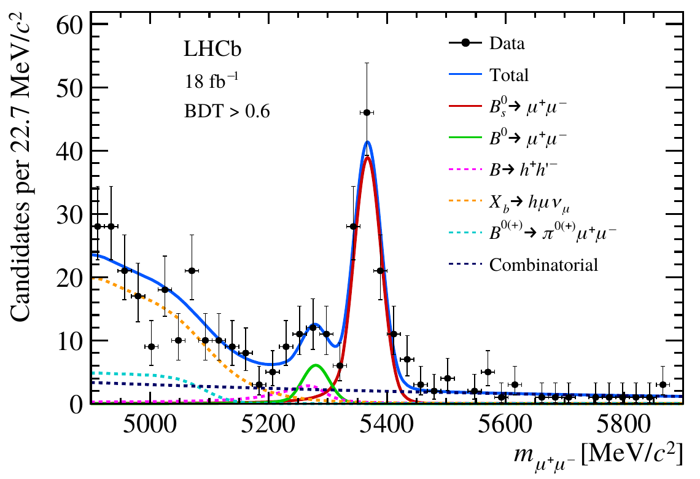
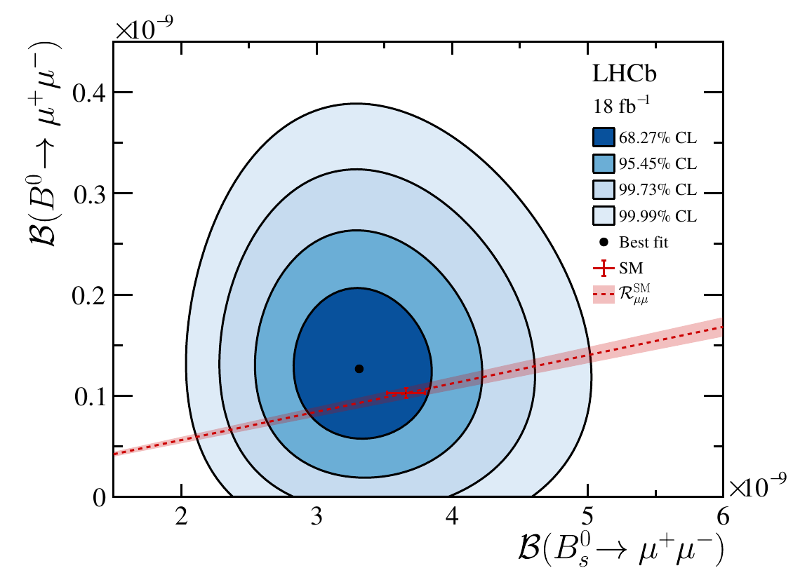
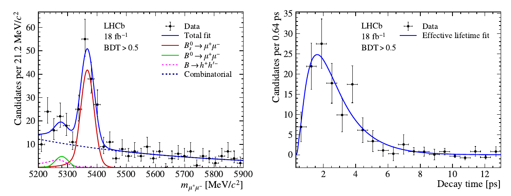

Analyzing | Framework v3.17

# Evidence for the decay B0 → μ+μ− and improved measurements of Bs → μ+μ− (LHCb, Run 3)

**Paper:** LHCb collaboration, "Evidence for the decay $B^0\to\mu^+\mu^-$ and improved measurements of the decay $B^0_s\to\mu^+\mu^-$," arXiv:2611.00230v1 [hep-ex], 30 Oct 2026; CERN-EP-2026-287 / LHCb-PAPER-2026-053; submitted to *Physical Review X* (no journal reference yet). CC BY 4.0.

**Source and posture:** clean 30-page PDF uploaded and read in full (main text, Appendices A–B, references; figures viewed as page renders). No retrieval was needed, so there is no Access Status block. Because the paper is a preprint with no journal reference, the framework's **adversarial posture** applies: assume nothing, make each claim earn its place. In practice LHCb papers pass a long internal collaboration review, so the posture here mostly means checking the numbers, not doubting the competence.

**Naming used throughout:** "Bs" is the meson made of a bottom antiquark and a strange quark; "B0" is the one made of a bottom antiquark and a down quark. "Muon pair" means one positive and one negative muon. The two decays studied are "Bs to a muon pair" and "B0 to a muon pair."

---

## 1. Punchy Title & One-Sentence Hook

### The rarest B decay finally steps out of the noise — and the Standard Model shrugs

LHCb's rebuilt detector catches a few dozen of the rarest two-muon decays of the B0 meson — a decay that happens roughly once in ten billion tries — reaching the 3σ "evidence" bar for the first time in a single experiment, while its sister decay is measured to about 10% precision, and every number lands where the Standard Model says it should.

---

## 2. Big-Picture Context

**Paper type and stakes.** This is an experimental precision measurement from a large collaboration: the first analysis of these two decays with the upgraded LHCb detector, using 2024–2025 data. What is at stake is not a discovery claim but a tightening of one of particle physics' cleanest "indirect search" probes — a place where heavy new particles too massive to produce directly would still leave a fingerprint in a decay rate.

Particle physicists have two ways to look for new physics. The direct way is to smash protons hard enough to create a new particle and see it. The indirect way is to measure a process the Standard Model predicts very precisely, and look for a deviation caused by a heavy new particle acting "virtually," in a quantum loop. The indirect route has a strong track record: the charm quark and the heavy top quark were both inferred from rare-decay and mixing measurements years before they were seen directly. The B-meson decays to a muon pair are textbook indirect probes, because the Standard Model suppresses them three ways at once — they need a loop, they are spin-suppressed, and (for B0) they need a disfavoured quark transition. The result is tiny rates: about 3.7 per billion for Bs, and about 1 per ten billion for B0.

The landscape before this paper: the Bs decay was first observed in a joint LHCb–CMS analysis in 2015 and by LHCb alone in 2017, and has since been measured by ATLAS, CMS and LHCb. The B0 decay is the harder target. The 2015 joint analysis claimed about 3σ evidence for it, but later, larger datasets did not confirm that, and the best limit had settled at below 1.6 per ten billion. Meanwhile a cluster of related decays — the "b to s plus two leptons" family — has shown persistent tensions with Standard Model predictions over the past decade, though those are clouded by hard-to-compute strong-force effects. The muon-pair decays are the clean counterpart: almost all the strong-force uncertainty is packed into one number (a "decay constant") that lattice QCD now computes well.

**Prior Belief Check.** The results **align with** the Standard Model and with mainstream expectations. Nothing here is surprising to experts. The Bs rate comes in about 1σ below the prediction (a mild, long-running pattern in some measurements, not a tension). The B0 rate, the ratio of the two, and the effective lifetime all agree with predictions within about 1σ. The genuinely new item is the B0 signal crossing the 3σ "evidence" threshold in a single experiment — a milestone of sensitivity, not a surprise of physics. This is an **incremental, confirmatory** paper, and its importance is that it shows the upgraded detector works for the hardest rare-decay analyses at high collision rates.

**Replication & Convergence Note.** The Bs measurements are independently replicated (ATLAS, CMS and earlier LHCb all agree to within their uncertainties). The B0 "evidence" is single-experiment and, notably, the one previous 3σ hint (2015) later faded — so independent confirmation matters here more than usual. Confirmation would look like CMS's Run 3 analysis seeing a B0 excess of similar size, or LHCb's own continuing Run 3 data pushing the significance toward 5σ at a rate consistent with the Standard Model's predicted yield.

---

## 3. Necessary Background Crash-Course

### What is a B meson, and why can't it just turn into two muons?

A meson is a quark bound to an antiquark by the strong force. The B mesons here contain a heavy bottom antiquark plus a lighter partner: a strange quark (Bs) or a down quark (B0). To decay into two muons, the bottom quark must change into the partner quark's "flavour" while the pair annihilates — and the Standard Model has no direct, single-step coupling that changes a bottom into a strange or down quark without also changing electric charge. Physicists call this kind of process a **flavour-changing neutral current**. It can only happen through a two-step quantum loop involving W bosons and, mostly, the heavy top quark.

> **Analogy:** a multi-socket server where two cores have no direct link. A message from one to the other must go out through a far-away memory controller and back. The detour makes such messages rare and slow. If someone secretly installs a short private wire between the cores, the message rate jumps — and because the legitimate rate is so low, even a weak secret wire shows up as a large relative change.
>
> **Breaks when:** you treat the detour as a single path. In the quantum version, several detour routes (different loop diagrams) add as waves and partly cancel — a cancellation (the GIM mechanism) that makes the rate even smaller than "one detour" suggests, and a new particle can interfere destructively as well as constructively, so a secret wire can *lower* the rate too.

This is why the decay is a new-physics probe: proposed heavy particles — extra Higgs bosons, new force carriers, leptoquarks — could provide that "secret wire," and the rate would shift.

### Why is it spin-suppressed?

The B meson has zero spin. The two muons fly apart back-to-back, and conservation of angular momentum forces their spins into a combination the weak force barely allows: the weak force strongly prefers particles spinning one way relative to their motion, and this decay needs one muon spinning "the wrong way." The penalty is proportional to the muon's mass squared, which is small compared with the B mass. This is called **helicity suppression**.

> **Analogy:** a bus protocol that only acknowledges one signal polarity. A message that requires the opposite polarity on one line only gets through via a tiny leakage current proportional to a device parameter (the muon mass). Heavier "devices" leak more.
>
> **Breaks when:** you push it to new physics — a new scalar particle (for example an extra Higgs) doesn't care about polarity at all, so it bypasses the suppression entirely. That is exactly why these decays are so sensitive to scalar-type new physics: the Standard Model path is handicapped, and a scalar path isn't.

### How do you measure a "one in a billion" rate without counting every B?

LHCb never knows exactly how many Bs mesons it made. Instead it measures the rare decay **relative to a common, well-known decay** recorded in the same data — here B0 to a kaon and a pion, and a charged B to a J/psi and a kaon (where the J/psi itself decays to two muons). The rate is then: (rare count ÷ reference count) × (reference rate) × (efficiency ratio) × (production ratio). The last factor matters for Bs: the LHC produces fewer Bs than B0 mesons, and the production ratio — called **f_s over f_d** — has to be measured separately. It is about 0.25: roughly one Bs for every four B0.

> **Analogy:** measuring a rare cache-miss type not in absolute counts but as a ratio to a well-calibrated event (say, total retired loads) recorded by the same counter infrastructure in the same run. Most of the counter's unknown biases cancel in the ratio.
>
> **Breaks when:** the two events come from different "sources." The Bs reference has to be corrected by the production ratio — like normalizing an event on one core type against an event on another core type, where you need an independent measurement of how much work each core type did. That correction is now this paper's largest systematic uncertainty.

### The Bs meson has two lifetimes — and that becomes a measurement

**Concept:** A Bs meson continually oscillates into its own antiparticle and back. The states with a definite lifetime are therefore two mixtures of the meson and antimeson: a "light" one that decays faster (about 1.43 trillionths of a second) and a "heavy" one that lives longer (about 1.62 trillionths of a second). A Bs produced in a collision is a superposition of both. The muon-pair decay can come from either; in the Standard Model essentially only the long-lived heavy state contributes, so the decay-time distribution of the muon pairs should show the longer lifetime. A parameter the paper calls the **mixing asymmetry** (A, ranging from −1 to +1) encodes which state contributes: +1 means only heavy (Standard Model), −1 means only light, 0 means equal. New physics could change A without changing the overall rate, so the **effective lifetime** is a second, independent handle.

**Vehicle:** A request router feeds two worker queues. One queue drains fast (short average dwell time), the other slow. You can't see which queue served a particular request, but you can log every request's dwell time. If the average dwell time equals the slow queue's, all the traffic went slow; if it equals the fast queue's, all went fast; something in between means a mix.

**Analogy:** light state ↔ fast queue; heavy state ↔ slow queue; measured effective lifetime ↔ logged average dwell time; mixing asymmetry ↔ the routing fraction inferred from the average. The Standard Model's prediction (A = +1) ↔ "all traffic routed to the slow queue."

**Breaks when:** the vehicle's queues are classical — a request is in one queue or the other. The Bs states are quantum superpositions, and interference between the two decay paths can make the decay-time distribution differ from a simple weighted blend in ways a router has no way to represent (this is why A can be measured "outside the physical range," as the paper reports). The vehicle also lacks any slot for the CP-violating phase that would accompany real new physics.

A concrete picture of what the measurement is up against:

```
Analyst-built illustration (not from the paper)

effective lifetime (trillionths of a second)
 1.30   1.40   1.50   1.60   1.70   1.80
  |------|------|------|------|------|
         L                 H          L = light state only (A = -1)  ~1.43
                                      H = heavy state only (A = +1)  ~1.62  <- Standard Model
         [=====*=====]                Run 3 alone:   1.42 +/- 0.18
                 [====*====]          Run 1+2+3:     1.60 +/- 0.16
```

*What to look at:* the two candidate answers sit only about 0.19 apart, roughly one error bar. The current data cannot yet tell the two states apart; the lifetime is a measurement-in-waiting.

### Origins & Big Picture: where these B mesons come from, and where this decay sits

When two LHC protons collide at 13.6 TeV, the actual collision is between their constituents — mostly gluons. Gluon–gluon fusion produces bottom–antibottom quark pairs copiously: at LHC energies, roughly one collision in a couple of hundred makes one. Each bottom quark then "hadronizes": as it flies away from its partner, the strong-force field between them stretches and snaps, pulling quark–antiquark pairs out of the vacuum, and the bottom quark ends up bound to whichever light antiquark is nearby. It most often picks up an up or down antiquark (making a charged B or a B0); about a quarter as often it picks up a strange antiquark, making a Bs; occasionally it forms a baryon. That fragmentation lottery is exactly the production ratio the measurement must take as input. It is not computed from theory; it is measured, and LHCb's newest value at the Run 3 energy comes from a companion paper still in preparation.

The bottom quarks are produced mostly at small angles to the beam, which is why LHCb is a single-arm forward spectrometer rather than a barrel around the collision point: it is built where the B mesons go. A B meson lives about 1.5 trillionths of a second, but because it moves near the speed of light, time dilation stretches its flight to about a centimetre in the lab. That displacement — two muon tracks meeting at a point clearly separated from the collision point — is the single most useful signature in the analysis: ordinary muons from the collision itself come from the collision point.

Within the bigger picture, the B-to-muon-pair decays sit in a family of rare "bottom to strange (or down) plus two leptons" processes. The broader family includes decays where the B leaves behind a kaon or a phi meson alongside the muon pair. Those richer decays give angular distributions and rates as a function of the muon-pair energy, and some have shown persistent deviations from the Standard Model — but their predictions depend on strong-force effects (form factors, loops of charm quarks) that theorists still argue about. The two-muon decays are the clean anchor of the family: with no hadron in the final state, the strong-force physics collapses into one decay constant, computed on the lattice to about 1% or better. That makes them the place where an anomaly, if it were real and of the right type, would be hardest to explain away. So far they have mostly constrained, rather than supported, new-physics explanations of the wider anomalies.

The search history is long. In 1984 the CLEO experiment put the first upper limit on the B0 decay, about a million times above the eventual Standard Model rate. It took three decades and two LHC runs to observe the Bs decay, and B0 has remained just out of reach. The Upgrade I detector, installed for Run 3, replaced the tracking system and the particle-identification detectors and — crucially — removed the hardware trigger in favour of an all-software one, letting the experiment run at five times the previous collision rate. The signal yield per unit of data is similar to before; the gain is simply that Run 3 has already delivered about twice the data of Runs 1 and 2 combined.

> **Analogy:** a fab ramp. Replacing the inspection tooling and moving from sampled hardware triggers to full software inspection let the line run five times faster without losing defect sensitivity; the rare-defect statistics improve because throughput went up, not because the defect got easier to see.
>
> **Breaks when:** you assume the "defect rate" is fixed. In the physics, the production ratio of Bs to B0 depends on collision energy and must be re-measured for the new conditions — the analogy's inspection line doesn't have to re-learn its input mix every time the line speed changes.

**Central analogy for this paper:** finding a rare event against a calibrated reference counter.

---

## 4. Core Technical Explanation

```
Analyst-built concept diagram (not from the paper)

 pp collisions, 13.6 TeV, 18 /fb (2024-25)
        |
        v
 software trigger: two good tracks, displaced vertex (no muon ID yet)
        |
        v
 offline selection + strict muon ID  -> two-muon candidates
        |
        v
 BDT classifier (isolation, vertex, geometry) -> 5 bins, 0.25 .. 1.0
        |
   +----+--------------------------------+
   v                                     v
 mass fit, 4900-5900 MeV,              mass fit (BDT>0.5) -> sPlot
 5 BDT bins at once                     -> decay-time fit with
 + normalisation channels                  acceptance from B0->K pi
   |                                     |
   v                                     v
 Bs rate 3.3e-9, B0 rate 1.3e-10      effective lifetime 1.42 ps
 B0 excess 3.0 sigma, ratio 0.038           |
   |                                     v
   +-----> combine with Run 1+2 <--------+
           Bs 3.25e-9, B0 3.2 sigma, lifetime 1.60 ps
```

*How to read it:* the left column is the rate measurement, the right column the lifetime; both feed a final combination with the older data.

### Step 1 — Trigger without muon identification

**The failure it prevents:** if the trigger demanded "this track is a muon," any inefficiency or bias in that decision would differ between the signal (two muons) and the hadronic reference decays, and the ratio would no longer cancel cleanly.

**What they do:** in Run 3 the trigger is entirely software. Its second stage builds two-track B candidates from any pair of high-momentum, well-displaced, oppositely charged tracks — with no particle-identification requirement at all. The same algorithm therefore collects both the muon-pair signal and the two-hadron reference decays.

**What it buys:** the signal and the main reference channel share one trigger path, so trigger efficiencies largely cancel in the ratio. This is a direct payoff of the all-software design.

### Step 2 — Selecting candidates and fighting the main background

**The failure it prevents:** after selection, the sample is still dominated by *combinatorial* background — two unrelated muons from two different bottom-quark decays in the same event that happen to form a fake vertex.

**What they do:** a boosted decision tree (a machine-learning classifier, trained on simulated signal versus simulated bottom-pair background) scores each candidate. Its most powerful inputs are two isolation scores: a real B-to-muon-pair decay is "lonely," with few extra tracks nearby, while random pairings sit in busy surroundings. The classifier output is rescaled so that true signal is spread evenly between 0 and 1, then the data are split into five bins of score above 0.25; everything below 0.25 is dropped.

**What it buys:** instead of one hard cut, the fit uses all five bins at once, letting the clean high-score bins carry most of the weight while the lower bins still contribute. Because signal is flat in score by construction, 75% of all signal lands in the fitted range — a fact the Claim Check uses.

### Step 3 — The mass fit: counting the signal

**The failure it prevents:** you cannot count signal events directly; they sit on top of several backgrounds, some of which peak near the B0 mass.

**What they do:** they fit the two-muon invariant mass between 4,900 and 5,900 MeV simultaneously in all five bins. The model includes the two signals (Bs near 5,367 MeV, B0 near 5,280 MeV, separated by only about four mass resolutions), combinatorial background (a falling exponential, free in each bin), two-hadron B decays where both hadrons are misidentified as muons, and several "semileptonic" decays where a neutrino escapes and the mass lands too low. The sizes of the backgrounds are fixed within uncertainties from independent calibrations; for example, the chance of a pion or kaon faking a muon comes from a large calibration sample of charmed-baryon decays.



*Figure 3 (from the paper): dimuon invariant-mass distribution in the BDT > 0.6 region.* **What to look at:** the tall red peak near 5,370 MeV is the Bs signal, clearly observed. The small green bump near 5,280 MeV is the B0 signal — about six events per bin at its top, sitting on a shoulder of misidentified two-hadron decays (pink dashes) and the falling semileptonic background (orange). The B0 "evidence" is the claim that the green bump is needed by the data, not just the background shapes.

**What it buys:** a signal count for each decay, with the B0 count only possible because the misidentification background is pinned down independently. The paper notes that the B0 systematic uncertainty is dominated by exactly that background knowledge (about 4%).

### Step 4 — From count to rate

**The failure it prevents:** a count means nothing without knowing how many B mesons were produced and how efficiently each kind of decay was recorded.

**What they do:** each count is multiplied by a "single-event sensitivity" — the rate one detected event corresponds to — built from the reference channels:

$$
\mathcal{B}_{\rm sig} \;=\; N_{\rm sig}\times\frac{\mathcal{B}_{\rm norm}}{N_{\rm norm}}\times\frac{\varepsilon_{\rm norm}}{\varepsilon_{\rm sig}}\times\frac{f_{\rm norm}}{f_{\rm sig}}
$$

**Symbol definitions:**
- $\mathcal{B}_{\rm sig}$ : the branching fraction being measured (fraction of mesons that decay this way)
- $N_{\rm sig}$ : fitted number of signal events
- $\mathcal{B}_{\rm norm}$, $N_{\rm norm}$ : known branching fraction and fitted count of the reference decay
- $\varepsilon_{\rm norm}/\varepsilon_{\rm sig}$ : ratio of total detection efficiencies (reference ÷ signal)
- $f_{\rm norm}/f_{\rm sig}$ : ratio of production fractions (inverse of the Bs-to-B0 production ratio when the signal is Bs; 1 for B0)

**What this actually means:** it is the calibrated-reference-counter idea in one line — rare events per reference event, times how common the reference is, corrected for unequal efficiency and unequal production. Like converting a raw hardware event count into a per-instruction rate using a well-calibrated reference counter on the same chip, with a correction if the two events come from different core types.

They compute this for 14 separate data-taking periods (detector conditions changed through Run 3) and average. Each detected Bs event corresponds to about one part in a hundred billion of branching fraction; each B0 event to about three parts in a trillion.

**What it buys:** a rate that is largely immune to the absolute luminosity and production cross-section, which are both poorly known at the needed precision.

### Step 5 — Results: rates, the B0 excess, and the ratio

The fit gives a Bs rate of about 3.3 per billion (about 10% uncertainty) and a B0 rate of about 1.3 per ten billion (about 40% uncertainty). The B0 excess over background has a significance of **3.0σ** including systematics, from a likelihood-ratio test validated with simulated pseudo-experiments. The ratio of B0 to Bs rates — theoretically clean because the troublesome strong-force and quark-mixing factors are well known — comes out at 0.038, against a Standard Model 0.028, consistent within its large uncertainty.



*Figure 5 (from the paper): two-dimensional profile likelihood.* **What to look at:** the red cross (Standard Model) sits just inside the innermost (68%) contour. Look at where each contour meets the bottom axis (B0 rate = 0): the 99.73% contour clearly crosses it, while the inner two contours stay above or barely touch it. That is the picture of a roughly 3σ B0 signal. The red diagonal band is the Standard Model's fixed ratio of the two rates; the data straddle it.

Why the ratio is "clean" deserves one equation:

$$
\mathcal{R}_{\mu\mu}=\frac{\mathcal{B}(B^0\to\mu\mu)}{\mathcal{B}(B_s\to\mu\mu)}\;\approx\;\frac{\tau_{B^0}}{\tau_{H}}\left(\frac{f_{B^0}}{f_{B_s}}\right)^{2}\left|\frac{V_{td}}{V_{ts}}\right|^{2}
$$

**Symbol definitions:**
- $\mathcal{R}_{\mu\mu}$ : ratio of the two branching fractions
- $\tau_{B^0}$, $\tau_H$ : lifetimes of the B0 and of the heavy Bs state
- $f_{B^0}/f_{B_s}$ : ratio of decay constants (the probability the quark and antiquark meet at a point), from lattice QCD
- $V_{td}/V_{ts}$ : ratio of quark-mixing (CKM) matrix elements — how strongly a top quark couples to down versus strange (small mass-ratio corrections omitted here)

**What this actually means:** most theory uncertainty is in each rate's decay constant; in the ratio, the two decay constants nearly cancel because the B0 and Bs differ only by a light quark. It is like comparing two benchmark runs on the same chip — fixed overheads cancel and what remains is the one thing you changed. The ratio tests whether the bottom-to-down and bottom-to-strange transitions are governed by the same "flavour structure" (the standard quark-mixing pattern). Any theory where new physics follows that same pattern ("minimal flavour violation") predicts the same 0.028.

### Step 6 — The effective lifetime

**The failure it prevents:** the detector and selection don't record all decay times equally — very short-lived candidates are lost because the trigger demands displacement. Fitting raw decay times would bias the lifetime.

**What they do:** first, they use a statistical weighting technique (sPlot) on a mass fit to statistically subtract background, leaving a background-free decay-time histogram. Second, they measure the time-dependent efficiency ("acceptance") in data using the abundant B0-to-kaon-pion decay, whose lifetime is known precisely, then correct it with simulation for small signal-versus-reference differences. Third, they fit the muon-pair decay times with that acceptance multiplied by a single falling exponential. The method is validated on two other decays with known lifetimes; the 0.012 ps disagreement there becomes the largest systematic.



*Figure 6 (from the paper): mass fit for the lifetime measurement and the resulting decay-time distribution.* **What to look at:** the right panel. The rise at short times is the acceptance (short-lived decays are lost); the fall at long times is the lifetime. The curve has to choose a slope from roughly 200 background-subtracted events with sizable error bars — which is why the result carries a 13% statistical uncertainty.

**What it buys:** an effective lifetime of 1.42 ± 0.18 ps. Translated into the mixing asymmetry, that is −1.1 ± 1.8: wider than the whole allowed range from −1 to +1. In words, the Run 3 lifetime alone can't distinguish light from heavy contributions (see the sketch in Section 3). The paper reports it unconstrained to the physical range, which is the honest choice.

A useful cross-dependence: the selection efficiency depends on the lifetime (long-lived decays are kept more often). The rate fit assumes the Standard Model's +1; if the true value were −1, the Bs rate would be about 9% higher. That is roughly one full statistical error, so this is an important caveat for anyone using the rate to constrain new physics.

### Step 7 — Combining with Runs 1 and 2

They refit Run 1, 2 and 3 data together, sharing the branching fractions and common nuisance parameters. Combined: Bs rate 3.25 per billion (about 9% uncertainty), B0 rate 1.14 per ten billion, ratio 0.035, B0 significance **3.2σ**. The lifetime is combined by a simple inverse-variance average of the Run 3 value and LHCb's previous result, giving 1.60 ± 0.16 ps (mixing asymmetry about 0.9 ± 1.9).

### Claim check

Done with a short Python script (`checks.py`) on the paper's own quoted inputs; one literature input (LHCb's previous lifetime value) is from memory.

1. **Ratio of the two rates — Reproduced.** Dividing the quoted B0 rate by the Bs rate gives 0.038 (Run 3) and 0.035 (combined), matching the paper. The ratio sits about 0.7σ above the Standard Model's 0.028, so "consistent" is fair.

2. **Expected signal counts — Partly reproduced.** Dividing the Standard Model rates by the quoted single-event sensitivities, and keeping the 75% of signal above the classifier cut, gives about 243 Bs and 28 B0 expected events; the paper says 235 and 26. The 3–7% shortfall is small and plausibly reflects details (lifetime-dependent efficiency, imperfect flatness of the score) not spelled out. It does not touch any conclusion.

3. **The B0 evidence — Partly reproduced.** A naive "rate ÷ lower error" reading gives about 2.7σ against the quoted 3.0σ. The gap is expected: the likelihood is asymmetric, and the likelihood-ratio test the paper uses is the correct tool. Figure 5 is consistent with it (the outer contours cross zero, the 68% one does not). One point the paper does not state: the observed B0 rate is about 20% above the Standard Model, so the significance is helped by an upward fluctuation. If the true rate equals the Standard Model, a rough scaling gives an expected significance near 2.5σ. That doesn't weaken the observation, but it means "evidence" was reached somewhat earlier than the Standard Model alone would predict — exactly the situation in which the 2015 hint later faded.

4. **Lifetime → mixing asymmetry — Reproduced.** Using standard world-average values for the Bs width and width difference, 1.42 ps converts to about −1.1 (paper −1.14) and 1.60 ps to 0.7–0.9 (paper 0.91), depending on which world-average width difference is used. The error conversion (0.18 ps → about 1.8 units) matches.

5. **Lifetime combination — Reproduced.** Averaging 1.42 ± 0.18 ps with LHCb's previous Run 1+2 value (2.07 ± 0.29 ps, recalled from LHCb's 2022 paper) gives 1.60 ± 0.15 ps, matching the quoted 1.60 ± 0.16.

**Sensitivity check.** The most influential single input to the Bs rate is the Bs-to-B0 production ratio (3% uncertainty, the largest systematic). The headline "agrees with the Standard Model" survives unless that ratio is off by about 10% (enough to move the rate by one full Standard Model error) — implausible for a quantity LHCb measures repeatedly. The larger hidden dependence is the lifetime assumption: shifting the mixing asymmetry from +1 to −1 raises the rate by 9%, bringing it from 1σ below the Standard Model to essentially on it. Either way the conclusion holds; the point is that the Bs rate is "the rate assuming the Standard Model lifetime."

**Robustness test (experimental: controls and error interpretation).** The paper's controls are sound: the two-hadron reference decays share the trigger path, the misidentification probabilities are cross-checked on a sample where one hadron is misidentified as a muon, and the lifetime method is tested on two decays with known lifetimes. Errors are reported as statistical then systematic, with asymmetric statistical errors from the likelihood; the significance includes systematics. No ambiguity about error type was found.

**Internal consistency (significant findings only).** Two points worth a reader's attention, neither changing a conclusion:
- *The two LHCb lifetime measurements disagree at about 1.9σ.* Run 3 gives 1.42 ps, the previous LHCb result 2.07 ps. The paper combines them with an inverse-variance average without commenting on the spread. A 1.9σ difference is unremarkable on its own, but the combined 1.60 ps sits between two values that individually favour opposite ends of the physical range, so it should not be read as "favouring the heavy state." (analyst inference)
- *The dominant systematic rests on unpublished inputs.* The production ratio at 13.6 TeV comes from an LHCb paper "in preparation," and the detector-performance reference is also "in preparation." Readers cannot yet check the input that sets the 3% systematic. (analyst inference)

Minor: the effective-lifetime and rate fits give Bs yields compatible "within 1.7σ" — the paper reports it; fine. No typos affecting numbers were found.

### Assumption Audit

> **Watch:** Reader likely assumes "evidence for B0" means the decay is now established. The paper actually says 3.0σ (3.2σ combined) — the field's "evidence" threshold, not "observation" (5σ) — and an earlier 3σ hint for this same decay in 2015 did not survive more data.

> **Watch:** Reader likely assumes the Bs rate is a model-independent measurement. The paper actually computes it assuming the Standard Model's mixing asymmetry of +1; if that assumption were wrong the rate would rise by up to 9%.

> **Watch:** Reader likely assumes the measured lifetime tests the Standard Model's +1 prediction. The paper actually reports an asymmetry of −1.1 ± 1.8 — an uncertainty wider than the entire allowed range — so the lifetime does not yet distinguish the two Bs states at all.

> **Watch:** Reader likely assumes "agreement with the Standard Model" rules out new physics in these decays. The paper actually constrains it: new-physics shifts of roughly the size of the uncertainties (around 10% in the Bs rate, around 40% in the B0 rate and the ratio) remain fully allowed.

---

## 5. What's Genuinely New or Clever

**New to the field:** the first single-experiment B0 evidence, and the world's most precise Bs rate and effective lifetime from one experiment. Methodologically, the novelty is the Upgrade I software trigger used without any particle-identification requirement at the B-candidate stage. That design choice, impossible with the old hardware trigger's muon requirement, puts the signal and its two-hadron reference through the same path and is what allows the precision. It also makes this paper a working proof that the upgraded detector can deliver the hardest rare-decay analyses at five times the previous collision rate — a prerequisite for the whole Run 3 and Upgrade II flavour programme.

**New to the reader (likely):** the use of the effective lifetime as a second new-physics observable, independent of the rate. A new-physics contribution can leave the rate exactly at the Standard Model value while flipping which Bs state does the decaying. The lifetime is how you'd catch that — and this paper shows how far the field still is from catching it.

**Clever detail:** making the classifier output flat for signal. It turns "which bin a signal event lands in" into a known 20%-per-bin distribution, so the simultaneous five-bin fit has one fewer thing to model and the fraction of signal in the fit (75%) is fixed by construction.

### Predictive Content Check

**Falsifiable handle:** this is a measurement, not a theory, so the handle is the comparison it enables. The Standard Model predicts a Bs rate of 3.66 per billion, a B0 rate of 1.03 per ten billion, a ratio of 0.028, and an effective lifetime equal to the heavy-state lifetime (about 1.62 ps). Every one of these could have come out wrong; all came out consistent within about 1.3σ. The forward handle is the B0 significance: if the Standard Model is right and the excess is real, continued Run 3 data (LHCb expects several times more) should push it toward 5σ at a rate set by the predicted 26 events per 18 inverse femtobarns. A stalled or shrinking significance would repeat the 2015 pattern.

The formalism-load half is not triggered: the fitting machinery generates every number reported.

---

## 6. Limitations & Open Questions

1. **The B0 signal is at evidence level, not observation, and partly helped by an upward fluctuation.** The observed rate is about 20% above the Standard Model; at the predicted rate the expected significance would be closer to 2.5σ. **(B) Contested** — how much to read into an above-expectation evidence-level excess is a matter of judgment; the paper reports the observed value without an expected significance. **(analyst inference)**

2. **The effective lifetime has no discriminating power yet.** The allowed range of the mixing asymmetry is −1 to +1, and the measurement's uncertainty is about 1.8 on its own (1.9 combined). **(A) Consensus** — the paper states the uncertainty and the field knows the lifetime is statistics-limited. **(paper, Results)**

3. **The Bs rate depends on the assumed lifetime composition.** Changing the assumed asymmetry from +1 to −1 raises the rate by 9%. **(A) Consensus** — reported explicitly by the paper. **(paper, Results)**

4. **The dominant systematic rests on an unpublished input.** The Bs-to-B0 production ratio at the new collision energy comes from an LHCb paper in preparation. **(A) Consensus** — the paper's own reference list marks it in preparation; checking it must wait. **(paper, refs. 50 and 64)**

5. **The two LHCb lifetime measurements differ by about 1.9σ and are combined without discussion.** The combined value is a statistically valid average of two measurements that each lean toward opposite ends of the physical range. **(C) Speculative** — the difference is within normal fluctuation; I flag it only because the combined central value is easy to misread as support for the heavy state. **(analyst inference)**

6. **The misidentification background under the B0 peak sets the B0 systematic.** The two-hadron decays faking muons peak right where B0 sits, so the B0 result is only as good as the misidentification calibration. **(A) Consensus** — the paper names this as the leading B0 systematic (about 4%). **(paper, Results)**

7. **The ratio is far less precise than the theory.** The ratio's measured uncertainty (around 40%) is about seven times the Standard Model's (about 6%). Real tests of minimal flavour violation need much more data. **(A) Consensus** — standard in the field; the paper reports both numbers. **(paper + broader literature)**

8. **No independent cross-experiment check of the B0 excess yet.** **(A) Consensus** — CMS and ATLAS Run 3 results on this channel are not yet available; the field's history with the 2015 hint makes this the key open item. **(broader literature)**

**Twelve to twenty-four months out:** more Run 3 data should push B0 toward 5σ if the Standard Model is right; CMS Run 3 results should give an independent B0 check; the published production-ratio paper will let outsiders verify the dominant systematic; and a real lifetime test will likely need the much larger datasets of the late 2020s and LHCb Upgrade II.

---

## 7. Detailed Summary & Explanation

**What the paper does.** LHCb uses 2024–2025 proton collision data recorded with its rebuilt detector (18 inverse femtobarns, twice the data of all previous runs combined) to measure two extremely rare decays: a Bs meson or a B0 meson turning into a pair of muons. These decays are suppressed by three separate Standard Model mechanisms, which makes them sensitive to heavy new particles. The analysis selects two-muon candidates with a software trigger that does not identify muons yet, so that signal and reference decays travel the same path; a machine-learning classifier then separates lonely, displaced signal-like pairs from random pairings, and a fit to the two-muon mass in five classifier bins counts the signal. The counts are turned into rates relative to well-known reference decays, correcting for unequal efficiency and, for Bs, for the fact that the LHC makes about one Bs for every four B0.

**Key findings.** The Bs decay rate is about 3.3 per billion (about 10% precision), the world's most precise single measurement, about 1σ below the Standard Model. The B0 rate is about 1.3 per ten billion, and its excess over background reaches 3.0σ — the first single-experiment evidence for this decay. The ratio of the two rates, a theoretically clean test of the standard quark-mixing pattern, agrees with the prediction. The effective lifetime of the Bs decay is 1.42 trillionths of a second, consistent with the Standard Model but not yet precise enough to tell the two possible Bs lifetimes apart. Combining with LHCb's older data strengthens everything modestly: B0 at 3.2σ, Bs at 9% precision, lifetime 1.60 trillionths of a second.

**Why the summary is framed this way.** I framed the paper as a sensitivity milestone rather than a physics surprise because that is what the numbers support: nothing deviates. Three interpretive choices shaped it. First, I treat the B0 "evidence" cautiously, because the field has been here before (the 2015 hint faded) and because the observed rate is above the prediction, which helps the significance. Second, I emphasise that the effective lifetime is still a measurement-in-waiting: its uncertainty is larger than the entire allowed range, so it currently tests nothing. Third, I highlight that the Bs rate carries a quiet assumption about that same lifetime. The reader should take away that the Standard Model passed another clean test, that new-physics effects of roughly 10% in the Bs rate remain allowed, and that the upgraded LHCb detector delivers.

**Where I'm least confident in this analysis:** the claim that the expected B0 significance at the Standard Model rate would be about 2.5σ is a rough linear scaling of my own, not a likelihood calculation; with a background-dominated peak and asymmetric errors, the true expected value could differ by a few tenths of a sigma. Secondarily, LHCb's previous lifetime value used in the combination check was recalled from memory rather than read from the cited paper (though it reproduces the quoted combination exactly).

**Revision notes:** the referee pass added the lifetime-assumption dependence of the Bs rate to the Assumption Audit and Section 6, the observed-versus-expected significance point, and the 1.9σ lifetime-tension note; it trimmed numbers from the Section 4 result paragraphs.

---

## 8. Three Crystallized Takeaways

1. **The rarest B decay is finally showing up.** LHCb's rebuilt detector sees a B0 meson turning into two muons — about once in ten billion decays — at 3σ, "evidence" but not yet a discovery, and this same decay faded once before.

2. **The Standard Model passes another clean exam.** Both rates, their ratio, and the lifetime all match predictions within about one standard deviation, leaving room only for new-physics effects smaller than about 10% in the Bs rate.

3. **The second test is still waiting.** The Bs effective lifetime could catch new physics that leaves the decay rate untouched — but today's measurement can't even tell the meson's two possible lifetimes apart; that needs several times more data.

---

## 9. Shorter Summary

Some particle decays are so rare that they act as magnifying glasses for undiscovered heavy particles. The decays of B mesons into a pair of muons are prime examples: the Standard Model suppresses them three different ways, so even a faint contribution from a new particle could change their rates noticeably.

The LHCb experiment at CERN used its newly upgraded detector, running at five times its earlier collision rate with an all-software trigger, to record two years of data — twice as much as all its earlier runs combined. A machine-learning classifier picked out isolated muon pairs coming from a displaced decay point, and a fit to their combined mass counted the rare signals, measured relative to common reference decays recorded in the same way.

The Bs version of the decay was measured to about 10% precision, the best by any single experiment, landing slightly below but consistent with the Standard Model. The even rarer B0 version, which happens roughly once in ten billion decays, showed up with a statistical significance of three standard deviations — the first time one experiment has reached the "evidence" threshold. The ratio of the two rates, which cancels most theoretical uncertainty, also matched predictions.

The team also measured how long the Bs meson lives before decaying this way. That lifetime is a second, independent window on new physics, but it is not yet precise enough to tell apart the two possible answers.

Combined with older LHCb data, the results tighten further but tell the same story: no deviation from the Standard Model. The excitement is about capability: the upgraded detector works for the hardest measurements, and with several times more data coming, the B0 signal should either grow into a discovery or — as an earlier hint did — fade away.

---

*Analysis generated 2026-11-08 with the Academic Paper Analysis Framework v3.17. Figures 3, 5 and 6 reproduced from the paper (CC BY 4.0). Claim-check script: `checks.py` (Python/numpy).*
