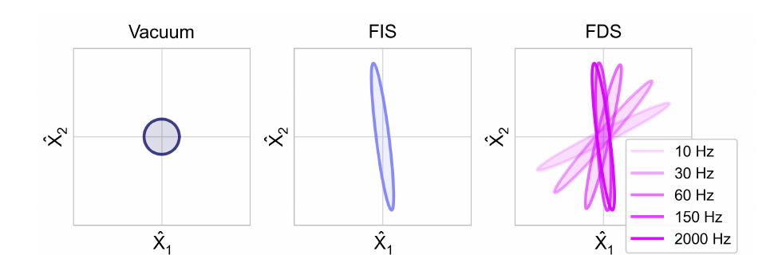
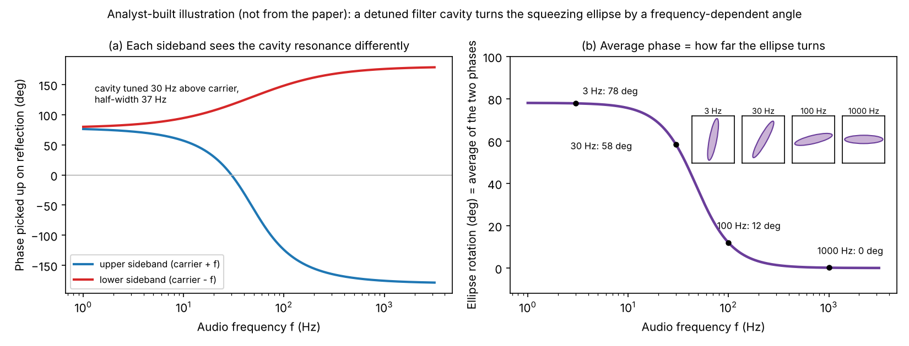
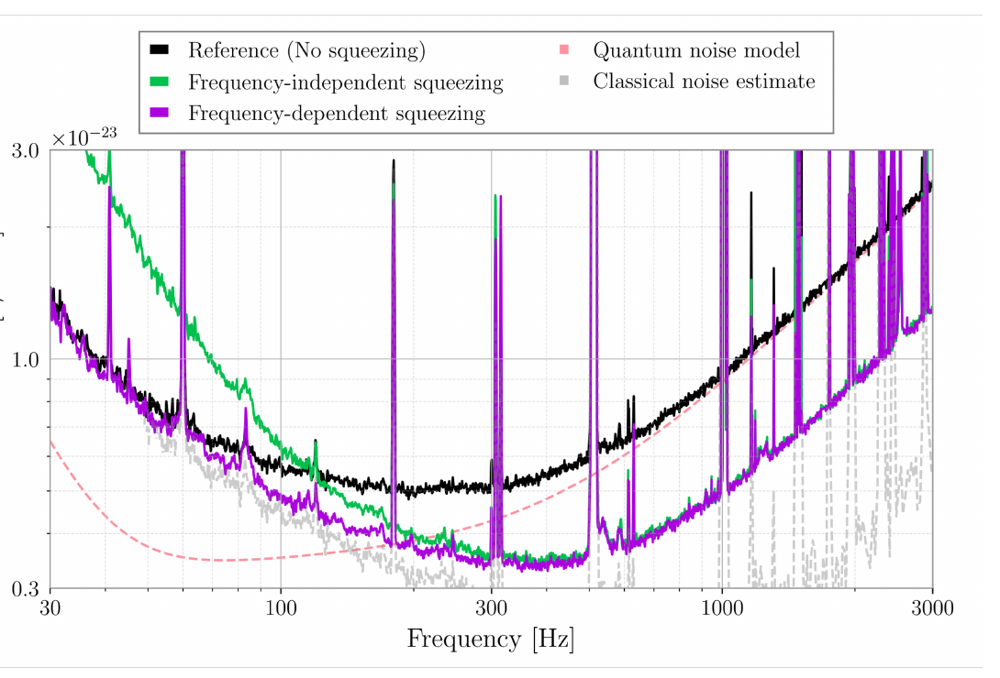
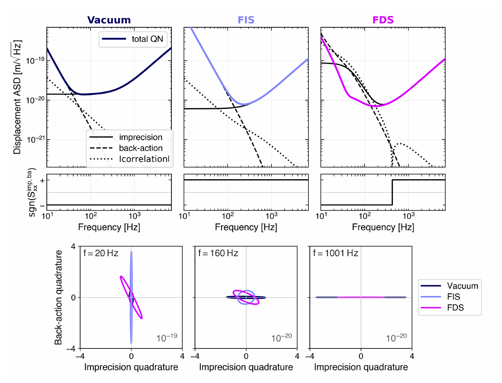

Analyzing | Framework v3.17 | adversarial posture (unrefereed review preprint)

# Quantum Noise Engineering in Advanced LIGO — Kabagöz (MIT LIGO Lab), arXiv:2611.07074v1, review article, 4 Nov 2026

*Analysis basis: full 25-page PDF uploaded and read in full (main text, all figures, acknowledgements, data statement, references). No retrieval needed. No journal reference; posture set to adversarial for the review's own claims (the experimental results it summarizes are peer-reviewed).*

---

## 1. Shaping the Nothing: How LIGO Sculpts Empty Space to Hear Black Holes

**Hook:** The noise that limits the world's most sensitive ruler doesn't come from the laser or the mirrors — it leaks in from *empty space* through the detector's output port, and LIGO now beats it by injecting a carefully shaped "empty space" whose noise has been rotated, frequency by frequency, so the two halves of the quantum trade-off partly cancel each other.

---

## 2. Big-Picture Context

LIGO measures how far two 40-kilogram mirrors, 4 kilometres apart, move relative to each other when a gravitational wave passes. The motions are absurdly small — a strain of a few parts in ten thousand billion billion, i.e. a fraction of a proton's width over the arm. At that level the light itself becomes a noise source in two distinct ways. First, the photons arrive at the detector with random timing, so the readout of the mirror position is noisy ("shot noise" — the measurement is *imprecise*). Second, the same photons bounce off the mirrors and push them, and because the photon count fluctuates, the push fluctuates, jiggling the very thing being measured ("radiation-pressure noise" — the measurement *disturbs*). Turn up laser power and the first gets better while the second gets worse. The balance point is the **standard quantum limit (SQL)**.

Since 1981 (Carlton Caves) the field has known where this noise comes from: not from the laser, but from the vacuum fluctuations that enter through the detector's dark output port. That insight has a practical corollary — if you can replace that "ordinary" vacuum with an engineered quantum state, you can reshape the noise. Over two decades this became an operational technology: *squeezed vacuum* in LIGO since 2019, and since 2023 *frequency-dependent* squeezing, which uses a 300-metre "filter cavity" to rotate the squeezed state differently at different audio frequencies, giving a broadband improvement and, in 2024, quantum noise below the SQL over part of the band.

This paper is a single-author pedagogical review from inside that effort (MIT LIGO Lab). It follows the squeezed vacuum from its creation in a nonlinear crystal, through the phase-locking system, the filter cavity, the interferometer, and the readout, using one consistent picture: noise as an ellipse in a two-axis "quadrature" plane. Its distinctive contribution is to show, with model plots from the author's own open-source tools, how the *correlation* between imprecision and back-action — not just their sizes — is what lets frequency-dependent squeezing dip below the SQL.

**Paper Type & Stakes:** This is a review/tutorial article synthesizing published LIGO quantum-noise results into a single field-based picture; the stakes are conceptual clarity (and positioning LIGO as a quantum-measurement platform), not a new measurement.

**Prior Belief Check:** Fully aligned with consensus. Every experimental claim summarized here — squeezing in observing runs, frequency-dependent squeezing in the fourth observing run, sub-SQL quantum noise — is already published in Physical Review Letters, Physical Review X and Science by the LIGO collaboration. Nothing in it would surprise a specialist; the value is the unified pedagogy and the explicit three-term (imprecision / back-action / correlation) decomposition. Under the adversarial posture this framework applies to unrefereed material, the question is not "is the physics right?" (it is textbook-plus-published) but "does the review represent it accurately and does the explanatory machinery actually work?" — the Claim Check below addresses that.

**Replication & Convergence Note:** The underlying results are well-replicated where it counts: squeezing has been used at GEO 600, both LIGO sites and Virgo; frequency-dependent squeezing operates at both LIGO sites. The sub-SQL result is a single-site (Livingston), single-paper demonstration and relies on subtracting an estimate of classical noise; independent confirmation would be the same inferred crossing at Hanford or Virgo. The review itself is a single author's synthesis, and its decomposition plots rest partly on the author's own not-yet-refereed preprint.

---

## 3. Necessary Background Crash-Course

### 3.1 Light as two numbers, not one: quadratures

A laser beam's electric field oscillates at an optical frequency of about 300 terahertz. Any such oscillation can be written as a mix of two standard waves a quarter-cycle apart — call them the "amplitude-like" and "phase-like" components. These two components are the **quadratures**. A change in how *bright* the beam is shows up mostly in the amplitude-like one; a change in *timing* (which is what a mirror displacement produces) shows up in the phase-like one.

Quantum mechanically, the two quadratures behave like position and momentum of an oscillator: they cannot both be known perfectly. Their uncertainties obey a product limit — shrink one and the other must grow. The paper draws the fluctuations of a state as a cloud in a plane with the two quadratures as axes (shown below in the figure).

> **Analogy:** Think of a fixed-area error budget for two measured quantities, like a profiling setup with a fixed overhead allowance split between timing resolution and event-count resolution — you can squeeze one finer only by coarsening the other.
>
> **Breaks when:** you treat the limit as a fixed *sum* you can shuffle. The quantum limit is on the *product* of the two uncertainties, so shrinking one by a factor of ten forces the other up by ten — and the "budget" is not overhead you chose; it is set by nature and present even when there is no light at all.

### 3.2 Vacuum is not empty: the noise that comes in through the dark port

Even with zero light, the quantum field has these fluctuations — equal in every direction of the quadrature plane, so the vacuum is drawn as a circle centred on zero. The circle is not a trajectory and not a fixed amplitude; it is the spread you would get from repeated measurements.

LIGO is tuned so its output ("dark") port sees almost no laser light — the two arms cancel. But an open port is not quiet: vacuum fluctuations flow *in* through it, ride through the interferometer, and come back out to the photodetector alongside the gravitational-wave signal. The dark port is therefore both the signal output and the noise input. This is why replacing the vacuum entering there with an engineered state is such a powerful lever.

> **Analogy:** The dark port is like a debug interface that is both where you read the trace *and* an input pin left floating — the floating pin injects random bits into exactly the path you are reading. Squeezing is tying that pin to a carefully prepared pattern rather than leaving it floating.
>
> **Breaks when:** you imagine the "random bits" as an external nuisance that a better shield could block. Vacuum fluctuations cannot be shielded; you can only *replace* them with another quantum state, which carries its own (reshaped) fluctuations.

### 3.3 Squeezed light: reshaping the circle into an ellipse

A **squeezed** state redistributes the vacuum's fluctuations: quieter than vacuum along one axis, noisier along the perpendicular one, still obeying the product limit. The circle becomes an ellipse. The **squeezing angle** is the ellipse's orientation. If the narrow axis lines up with the quadrature the detector reads, the readout gets quieter.

*Figure 1 (from the paper):* ordinary vacuum (circle), frequency-independent squeezing (one fixed ellipse), and frequency-dependent squeezing (ellipses at different orientations for different audio frequencies).



*Figure 1 (from the paper): quadrature pictures of the three input states — vacuum (left), frequency-independent squeezed vacuum (centre), frequency-dependent squeezed vacuum at 10, 30, 60, 150 and 2000 Hz (right).*
**What to look at:** the right panel. The same squeezed ellipse is tilted by different amounts at different audio frequencies — tipped over at 10 Hz, standing upright by 150–2000 Hz. That fan of orientations *is* frequency-dependent squeezing.

Squeezing is quoted in **decibels**: 3 dB means the noise power along the quiet axis is halved (the amplitude drops by about 30%); 10 dB means a tenfold power reduction.

### 3.4 How squeezed vacuum is made

You need a process that creates photons in correlated pairs. LIGO uses an **optical parametric oscillator (OPO)**: a small bow-tie cavity containing a special crystal (periodically poled potassium titanyl phosphate) whose response is nonlinear. Pump it with green 532-nm light and each green photon can split into two infrared 1064-nm photons — the same colour as LIGO's main laser. Energy is conserved (two halves make the whole), and the two photons' phases are locked together relative to the pump. Running the OPO *below* its lasing threshold means it doesn't produce a bright beam — it produces vacuum whose fluctuations are amplified along one axis and de-amplified along the other. That is the ellipse.

For a chemist, the closest familiar picture is a reaction with strict stoichiometry and a conserved quantity: one pump photon in, exactly two daughter photons out, with a fixed phase relation between them. "Phase matching" — tuning crystal temperature so the momenta also balance — is the analogue of running a reaction at the temperature where it is fastest.

> **Analogy:** Pairs that are always created together, like a two-phase commit where every write produces matched log entries on two nodes: neither entry alone is predictable, but their relationship is fixed.
>
> **Breaks when:** you lose one member of a pair. In a distributed log the surviving entry is still a valid record; in squeezing, losing a photon destroys the correlation and the lost half is replaced by fresh, uncorrelated vacuum — which is why optical loss is so damaging (Section 4.6).

### 3.5 Signals as sideband pairs

A mirror wiggling at an audio frequency (say 100 Hz) imprints that wiggle on the 300-terahertz carrier as two new optical frequencies just above and below the carrier — an **upper and a lower sideband**. Quantum noise "at 100 Hz" likewise lives in the pair of sidebands 100 Hz above and below. The quadratures at a given audio frequency are combinations of that sideband pair. This matters because an optical cavity can treat the upper and lower sideband *differently*, and that difference is what rotates the ellipse (Section 4.4).

### 3.6 The trade-off: imprecision, back-action and the SQL

Shot-noise imprecision falls as laser power rises; radiation-pressure back-action grows with power. At each frequency there is a best power, and the envelope of those per-frequency optima is the SQL. Because the suspended mirrors respond much more strongly to slow forces than fast ones, back-action dominates below roughly 50–100 Hz and shot noise dominates above.

The crucial point for this paper: the SQL assumes the imprecision and back-action noises are **uncorrelated**. If they are correlated — if the random push and the random readout error are partly linked — part of one can cancel part of the other. The uncertainty principle still holds, but it no longer forces the sum to stay above the SQL.

### 3.7 Origins & Big Picture

How did a 4-kilometre gravitational-wave detector end up as a quantum-optics experiment?

**The problem was recognized before the detectors existed.** In the 1970s Vladimir Braginsky worked out that continuously measuring a test mass's position carries an unavoidable quantum cost: the measurement disturbs the mass. That gave the SQL. In 1981 Caves made the decisive move for interferometers: he showed the quantum noise in a Michelson interferometer comes from vacuum fluctuations entering the *unused* (dark) port, and proposed injecting squeezed vacuum there. At the time squeezed light had not even been made in a laboratory; it was first demonstrated in 1985 (Slusher and colleagues at Bell Labs) at megahertz frequencies.

**The hard part was getting squeezing into the audio band.** Gravitational-wave signals live from about 10 Hz to a few kilohertz, where lasers and electronics are noisiest. Squeezing in that band took until 2004 (a tabletop demonstration in Australia), and stable control of the squeezing angle needed a coherent "locking field" trick developed in 2006. Then came the tests on real detectors: GEO 600 in Germany ran with squeezing from 2011, LIGO Hanford demonstrated it in 2013, and in the third observing run (2019–2020) both LIGO sites and Virgo used squeezed light in actual astrophysical observations, improving high-frequency sensitivity by up to about 3 dB.

**Then the back-action problem returned.** As laser power rose, radiation-pressure noise at low frequencies began to matter, and fixed-angle squeezing made it worse (the anti-squeezed axis drives the mirrors harder). The fix had been proposed in 2001 by Kimble and colleagues: reflect the squeezed light off a detuned "filter cavity" that rotates the ellipse as a function of frequency. Prototype demonstrations followed in 2016 and 2020; the 300-metre LIGO filter cavities were installed for the fourth observing run in 2023, giving broadband improvement. In 2024 LIGO Livingston reported quantum noise inferred to sit below the SQL between roughly 35 and 75 Hz.

**Where it fits in the bigger picture.** LIGO is now the largest "optomechanical" system — light coupled to moving masses — in existence, with kilogram-scale mirrors whose motion is influenced by quantum fluctuations. The same physics appears in tabletop optomechanics (nanobeams, membranes, levitated beads) and in quantum-limited microwave amplifiers. The upgrade path continues: the A+ upgrade aims at higher arm power and lower loss; **balanced homodyne detection** will let LIGO choose *which* quadrature it reads; and the next-generation detectors (Cosmic Explorer, Einstein Telescope) set targets of 10 dB of observed squeezing. The lesson the review hammers home — that making more squeezing is no longer the bottleneck, preserving it through the whole optical chain is — is the defining engineering problem of that next decade.

> **Analogy:** The history reads like a performance-engineering arc: first you discover the fundamental bottleneck (the vacuum entering the dark port, like discovering memory latency rather than compute is your limit), then you add a fix that helps the common case (fixed squeezing ≈ a prefetcher tuned for streaming), find it hurts another workload (low-frequency back-action ≈ prefetch pollution on random access), and finally make the fix workload-aware (filter cavity ≈ an adaptive prefetcher).
>
> **Breaks when:** you expect a software-style fix to be free. Every stage of the quantum fix is physical hardware that adds loss, and loss irreversibly degrades the quantum state — there is no "undo".

### 3.8 The central concept, stated carefully

> **Concept:** A measurement's quantum noise has three parts: imprecision (readout noise, always non-negative), back-action (disturbance noise, always non-negative), and a correlation term between them that can be positive or negative. The uncertainty principle bounds the product of imprecision and back-action *minus* a contribution from their correlation. With zero correlation the best achievable total is the SQL; with negative correlation the total can drop below the SQL while the uncertainty principle remains satisfied. The correlation is created by preparing an input state whose two quadratures are correlated (a tilted ellipse) and by the interferometer's own optomechanical mixing.
>
> **Vehicle:** A sampling profiler measuring a program's runtime. Sampling more often gives finer readings (lower "imprecision") but each sample interrupts the program and slows it (higher "perturbation"). If the profiler's reading errors and the slowdowns it causes are independent, there is a best sampling rate and you cannot beat it. But if each sample's measurement error is systematically linked to the perturbation that same sample causes — e.g. the profiler's clock is read slightly late exactly when it has just stolen cycles — the two errors partly cancel in the reported runtime, and the reported total error can drop below the "best independent" figure.
>
> **Analogy:** Imprecision ↔ the profiler's reading error. Back-action ↔ the perturbation (stolen cycles) the sampling causes. Laser power ↔ sampling rate. SQL ↔ the best total error achievable at the optimal sampling rate when the two errors are independent. Correlation term ↔ the linkage between each sample's reading error and its own perturbation. Frequency-dependent squeezing ↔ choosing, per code phase, how to shape that linkage so it cancels rather than adds.
>
> **Breaks when:** you ask the vehicle *where* the cancellation stops. In the profiler, a perfectly known linkage could be subtracted entirely — classical errors have no floor. In the quantum case the correlation is itself bounded by the uncertainty relation (the displayed bound in Section 4.5): you can trade and cancel, but the product of the two noises minus their correlation can never fall below a fixed quantum floor. The vehicle has no slot for a floor that constrains the correlation itself.

**Central analogy for this paper:** a profiler whose overhead correlates with its readings.

---

## 4. Core Technical Explanation

```
Analyst-built concept diagram (not from the paper):

 green pump ->[ OPO crystal ]-> squeezed vacuum (fixed ellipse, ~18 dB)
                    |
           [ phase lock via locking field ]  keeps ellipse angle steady
                    v
           [ 300 m filter cavity ]  rotates ellipse vs frequency
              (~78 deg below ~20 Hz -> ~0 deg above ~300 Hz)
                    v
           [ Faraday isolator -> dark port ]
                    v
   [ interferometer: arms + mirrors ]  shears ellipse at low freq,
              creates imprecision/back-action correlation
                    v
   [ readout (fixed quadrature) ] <- loss + phase noise along the way
                    v
   result: ~4-6 dB less shot noise above 1 kHz, 1-2 dB less noise
           at 60-100 Hz, quantum noise below SQL at ~35-75 Hz (L1)
```
*Read it top to bottom: each box either shapes the ellipse (wanted) or degrades it (loss, jitter); the result is what survives at the readout.*

### 4.1 How the vacuum gets into the readout

**Failure it prevents:** treating detector noise as something that "comes from the laser" and trying to fix it there.

**What the author does:** writes the field at the dark port as the sum of a strong, controlled interferometer field plus a tiny quantum field from the vacuum. The photodetector measures power, and the only part of the power that carries the quantum field to first order is the "beat" between the strong field and the tiny one. That beat picks out just one direction of the vacuum's fluctuation — the direction set by the strong field's phase. The strong field acts as the reference that selects which quadrature is read.

**What it buys:** a clean geometric statement — the detector reads the projection of the noise ellipse onto one fixed direction. With ordinary vacuum (a circle) every direction is equally noisy, so no choice of readout helps. Referring the beat to mirror displacement shows why more power helps shot noise: a stronger arm field makes the signal beat larger while the vacuum stays the same size.

### 4.2 The two faces of quantum noise

**Failure it prevents:** assuming more laser power always improves sensitivity.

**What the author does:** shows that phase-like vacuum fluctuations produce imprecision, while amplitude-like ones modulate the circulating power and thus the radiation-pressure force on the mirrors. Each reflected photon delivers a tiny kick; a fluctuating photon count gives a fluctuating force. The mirrors' response is large at low frequencies (they behave like free masses swinging on pendulums), so this back-action dominates the low end. The total quantum noise is written as three terms:

$$
S^{\mathrm{QN}}_{xx} \;=\; S^{\mathrm{imp}}_{xx} \;+\; S^{\mathrm{ba}}_{xx} \;+\; S^{\mathrm{imp,ba}}_{xx}
$$

**Symbol definitions:**
- $S^{\mathrm{QN}}_{xx}$ : total quantum displacement noise power at a given frequency (m²/Hz)
- $S^{\mathrm{imp}}_{xx}$ : imprecision (shot-noise) contribution, never negative
- $S^{\mathrm{ba}}_{xx}$ : back-action (radiation-pressure) contribution, never negative
- $S^{\mathrm{imp,ba}}_{xx}$ : correlation between the two; can be positive *or negative*

**What this actually means:** total noise is "read error + disturbance + how the two are linked". In the profiler picture, the third term is the linkage between a sample's reading error and its own slowdown. When it's negative, it subtracts.

**What it buys:** the SQL falls out — with no correlation and power as the only knob, there's a best power at each frequency, and the envelope of those optima is the SQL. The review correctly stresses that no single configuration actually sits *on* the SQL across the band; it is an envelope.

### 4.3 Fixed-angle squeezing: better high end, worse low end

**Failure it prevents:** the naive expectation that squeezing simply removes noise.

**What the author does:** walks through the hardware chain (OPO, a coherent locking field that co-propagates with the squeezed vacuum and acts as its phase proxy, a feedback loop on the squeezer laser) and then the observed effect. Aligning the quiet axis with the phase-like readout cuts shot noise — about 3 dB in LIGO's third observing run, above about 50 Hz. But the perpendicular, amplitude-like axis is then *anti-squeezed*, so the force on the mirrors fluctuates more and low-frequency noise rises. Rotating the ellipse the other way does the opposite. No single angle wins everywhere.

**What it buys:** the motivation for frequency dependence. The interferometer itself acts on the ellipse differently at different frequencies, so the *best* squeezing angle is a function of frequency — phase-like at high frequency, amplitude-like at low frequency.

### 4.4 The filter cavity: turning the ellipse frequency by frequency

**Failure it prevents:** having to choose one squeezing angle for the whole band.

**What the author does:** reflects the squeezed vacuum off a 300-metre optical cavity tuned slightly away from the carrier frequency. The upper and lower sidebands that make up the noise at a given audio frequency sit at different distances from the cavity's resonance, so they pick up different phase shifts on reflection. Their *average* phase shift is a rotation of the ellipse. Far from resonance (high audio frequency) both sidebands see the same thing and nothing rotates; near the carrier (low audio frequency) the rotation is large. The cavity's width and offset are chosen so this rotation approximately mirrors the rotation the interferometer will apply.

This is the hardest unfamiliar concept in the paper, so here it is as a picture built from the paper's own stated cavity parameters (a 74 Hz linewidth and 30 Hz offset):



*Analyst-built illustration (not from the paper):* left, the phase each sideband picks up on reflection from the detuned cavity; right, half their sum, which is how far the ellipse turns, with small ellipses drawn at 3, 30, 100 and 1000 Hz.
**What to look at:** at low frequency both sidebands carry the same large phase, so the ellipse is turned by about 78°; by a few hundred hertz the two phases become opposite and cancel, and the ellipse is back to 0°. The transition is centred around a few tens of hertz — exactly where back-action hands over to shot noise.

**What it buys:** broadband squeezing. In measurements before the fourth observing run, frequency-dependent squeezing cut the shot-noise amplitude near 1 kHz by about 4 dB at Hanford and nearly 6 dB at Livingston, while also lowering total noise by 1–2 dB between 60 and 100 Hz, instead of raising it.



*Figure 10 (from the paper, reproduced from the LIGO frequency-dependent-squeezing paper): measured Livingston strain noise with no squeezing (black), frequency-independent squeezing (green), frequency-dependent squeezing (purple), plus modelled quantum noise (pink dashed) and estimated classical noise (grey).*
**What to look at:** below about 150 Hz, green rises *above* black — fixed squeezing makes the low end worse — while purple stays at or below black everywhere. Above a few hundred hertz green and purple coincide, both well below black. The gap between purple and grey at 50–150 Hz shows how little room is left before classical noise takes over.

### 4.5 Following the ellipse through the interferometer: where the correlations come from

**Failure it prevents:** thinking of frequency-dependent squeezing as merely "phase squeezing at high frequency, amplitude squeezing at low frequency, smooth blend in between".

**What the author does:** Section 5 of the paper follows ordinary vacuum through the optomechanics. An amplitude fluctuation changes the radiation-pressure force, the mirror moves, and that motion shows up as a phase fluctuation in the outgoing light. So amplitude noise reappears in the phase quadrature: the circle is sheared into a tilted ellipse even with no squeezer at all ("ponderomotive squeezing"), strongest at low frequency. Other cavities rotate ellipses; every lossy surface mixes in fresh vacuum. The author packages all of this as a single linear input–output map (each input field — squeezed or vacuum — multiplied by its own frequency-dependent transfer matrix) and then decomposes the predicted readout noise into the three terms above, using the uncertainty relation for continuous measurement:

$$
S^{\mathrm{imp}}_{xx}\,S^{\mathrm{ba}}_{xx} \;-\; \frac{\big|S^{\mathrm{imp,ba}}_{xx}\big|^{2}}{4} \;\ge\; \hbar^{2}\,|\chi_m|^{2}
$$

**Symbol definitions:**
- $S^{\mathrm{imp}}_{xx}, S^{\mathrm{ba}}_{xx}$ : imprecision and back-action noise powers (m²/Hz)
- $S^{\mathrm{imp,ba}}_{xx}$ : their correlation term (m²/Hz, either sign)
- $\hbar$ : reduced Planck constant (J·s)
- $\chi_m$ : the mirror's mechanical response — how far it moves per unit force at that frequency (m/N); for free masses it falls as one over frequency squared

**What this actually means:** the product of read error and disturbance, *minus a quarter of the correlation squared*, can't go below a quantum floor. With no correlation, this is the familiar SQL trade-off. Allow correlation and both individual noises can grow while the total shrinks. In the profiler picture: you're allowed to make the readings noisier and the perturbation bigger, provided you link them so they cancel — but the bound still caps how far the linkage can take you.



*Figure 13 (from the paper): modelled quantum noise decomposed into imprecision (solid black), back-action (dashed), and the magnitude of the correlation (dotted), for vacuum, frequency-independent and frequency-dependent squeezing; the strip below each shows the correlation's sign; the bottom row shows the corresponding noise ellipses at 20, 160 and 1001 Hz.*
**What to look at:** the right column. With frequency-dependent squeezing, both imprecision and back-action are *large* below 100 Hz — larger than for vacuum — yet the total (magenta) sits below both, because the correlation sign is negative there (the sign strip reads "−" up to about 400 Hz). In the middle column the sign is "+" everywhere: fixed squeezing's correlation adds noise. That contrast is the paper's central explanatory point.

**What it buys:** the mechanism for going below the SQL. The 2024 Livingston result inferred quantum noise up to about 3 dB below the SQL (a factor of about 0.7 in amplitude) near 50 Hz, in a band of roughly 35–75 Hz. The decomposition shows *why*: the filter cavity's intermediate angles prepare a correlated input, the interferometer transforms it, and the resulting correlation at the readout is negative where it matters.

### 4.6 What eats the squeezing: loss and phase jitter

**Failure it prevents:** assuming that generating more squeezing gives proportionally more benefit.

**What the author does:** identifies two degradations. **Loss** at every surface, isolator, cavity and mode mismatch removes part of the squeezed field and replaces it with fresh vacuum, rounding the ellipse back toward a circle. **Phase noise** makes the ellipse jitter in angle, so the readout samples a little of the hugely noisy anti-squeezed axis; this matters more the stronger the squeezing. The review gives a budget: with about 18 dB generated and about 20 milliradians of phase jitter, reaching 10 dB at the readout needs total loss of about 6%; today LIGO observes about 6 dB with roughly 23% loss.

**What it buys:** the forward-looking thesis — the next gains come from *preserving* the state (lower loss, better mode matching, keeping the filter cavity matched to a changing interferometer), not from a stronger squeezer. The Claim Check confirms these numbers and shows the point is even sharper than stated.

### 4.7 The next knob: choosing what to read

**Failure it prevents:** being stuck with whatever quadrature the interferometer's own residual light happens to select.

**What the author does:** describes balanced homodyne detection, planned for LIGO: instead of using the interferometer's leftover carrier light as the reference, mix the output with a separate, independently phase-controlled local beam. That makes the readout quadrature a free choice.

**What it buys:** a second control dimension. Squeezing controls the input; homodyne detection controls the output. Together they turn LIGO into a tunable quantum-measurement apparatus. The review gives no quantitative forecast for the gain.

### Claim check

Computation done in Python (scripts `check.py`, `toy.py` in the session scratch folder).

**Filter-cavity rotation curve — Reproduced.** Using a simple lossless detuned-cavity model with the paper's stated 30 Hz offset and treating "74 Hz linewidth" as the *full* width, the predicted rotation is 78° at low frequency, 58° at 30 Hz and 12° at 100 Hz, matching the paper's rotation plot point for point. Reading 74 Hz as a half-width instead gives only 44°, which does not match — so the plotted curve confirms the full-width reading.

**Loss and phase-noise budget — Reproduced.** Mixing vacuum in through loss and adding 20 milliradians of angle jitter to an 18 dB squeezed state gives 10.1 dB observed at 6% loss and 5.8 dB at 23% loss, matching both numbers in the text. The required loss for exactly 10 dB is 6.1%.

**Standard-quantum-limit line — Reproduced.** For free 40-kg mirrors and 4-km arms, the SQL in strain is about 9 × 10⁻²⁴ per root hertz at 20 Hz and 3.7 × 10⁻²⁴ at 50 Hz, consistent with the plotted SQL line in the sub-SQL result the review reproduces. The "nearly 3 dB below the SQL near 50 Hz" claim is **Partly reproduced**: it can only be read off the plot of *inferred* quantum noise, and is consistent within reading error.

**Uncertainty relation with correlations — Reproduced.** The displayed bound follows algebraically from the standard continuous-measurement inequality once back-action and correlation are referred to displacement, because the real part of a complex number can never exceed its magnitude. It is internally consistent with the three-term decomposition.

**Sensitivity check — the "preserve, don't generate" thesis.** Its key assumption is that loss and phase jitter, not source strength, set the ceiling. Testing it: at 23% loss and 20 milliradians, the best achievable observed squeezing over *any* generated level is 5.84 dB — LIGO's 18 dB source already gets 5.82 dB, so more generation buys essentially nothing. Even at zero loss, 20 milliradians alone caps observation near 14 dB at 18 dB generated. The thesis survives across any plausible loss range; it would only fail if phase jitter fell well below 10 milliradians *and* loss dropped below a few percent simultaneously.

**Robustness (review type): spot-check of summary claims against primary sources.** The four headline experimental summaries — about 3 dB in the third observing run, about 4 and 6 dB at 1 kHz with frequency-dependent squeezing, 1–2 dB lower total noise at 60–100 Hz, and below-SQL quantum noise at 35–75 Hz — match my recollection of the cited Physical Review Letters, Physical Review X and Science abstracts. Web search confirmed the cited papers and titles but abstracts were not re-read in this session, so this is consistency with memory, not a verbatim check.

**Internal consistency:** no significant inconsistency found. One unexplained detail: in the paper's decomposition, the *ordinary-vacuum* model already carries a small negative correlation term at all frequencies, while the text frames vacuum as the uncorrelated SQL case; the paper does not explain the source (plausibly readout-angle offset or the signal-recycling cavity's response). Cosmetic: the vacuum noise is normalized to a quarter in the uncertainty relation but to one in the decibel definition.

### Assumption Audit

> **Watch:** Reader likely assumes squeezing *removes* quantum noise. The paper actually says it *redistributes* noise between the two quadratures; the injected state is noisier than vacuum along one axis, and whether this helps depends entirely on how the ellipse is oriented when it reaches the readout.

> **Watch:** Reader likely assumes "below the SQL" means a measured detector curve dipped under a fundamental floor. The paper actually says the SQL is *not* fundamental once correlations are allowed, and the sub-SQL result is for *inferred quantum noise* — the total measured noise, which includes classical sources, stays above. The inference depends on subtracting a classical-noise estimate.

> **Watch:** Reader likely assumes the filter cavity exactly undoes the interferometer's rotation. The paper actually says it *approximately* compensates, with a linewidth fixed by construction; the optimal rotation depends on arm power, so changes in power or alignment leave the rotation imperfectly matched.

> **Watch:** Reader likely assumes the ellipse picture is a literal picture of the field. The paper itself notes that assigning a classical phase to vacuum is not strictly correct; the phasors and ellipses are statistical summaries of repeated measurements, not trajectories, and a single ellipse per frequency hides the multi-mode spatial structure that drives mode-mismatch loss.

---

## 5. What's Genuinely New or Clever

**New to the field (modestly): the three-term decomposition as the explanatory spine.** Most accounts explain frequency-dependent squeezing as "rotate the ellipse to match the optimum angle at each frequency". This review insists that's incomplete: at intermediate frequencies, the filter cavity deliberately prepares a *correlated* input, and the measured improvement comes from the correlation term turning negative after propagation. Plotting imprecision, back-action and correlation (with its sign) side by side for vacuum, fixed and frequency-dependent squeezing makes that visible in a way the primary experimental papers do not foreground. The quantitative machinery behind it is drawn from the author's own companion preprint and open-source tools.

**New to the reader: one picture from crystal to photodiode.** The review threads a single geometric language — ellipses being made, locked, rotated, sheared, rounded by loss and jittered by phase noise — through every stage of the hardware. The clear statement that the observed squeezing is "a property of the full detector configuration", not of the source, is the most practically useful takeaway, and the Claim Check shows it is, if anything, understated.

**Predictive Content Check**

1. **Falsifiable handle:** This review explains rather than predicts. Its nearest checkable forward statements are the loss budget (10 dB at the readout requires roughly 6% total loss at present phase-noise levels) and the claim that the A+ upgrade's higher arm power will improve performance below 100 Hz because the filter cavity was designed for it. Both can be checked against A+ commissioning results, but neither is a new prediction — both follow from standard models. The decomposition is a reframing of already-observed results.

---

## 6. Limitations & Open Questions

**Limitation 1 — No new results; the decomposition rests on the author's own model.** The review's distinctive plots are model outputs, built with the author's open-source tools and a companion paper (the "observing and evading quantum back-action" preprint) that is not yet refereed. Data are "available upon reasonable request". **(A) Consensus** — this is what a review is, and the paper says so. **(paper §5.2, Data Availability)**

**Limitation 2 — The sub-SQL claim is an inference, and the review doesn't stress it.** The below-SQL curve is quantum noise *inferred* by subtracting an estimate of classical noise from the measured total, and depends on that estimate's accuracy at 35–75 Hz, where classical noise is comparable. The review presents it as a direct demonstration. **(B) Contested** — the primary paper handles the subtraction carefully, but how much weight an inferred-component crossing carries is a fair point of debate. **(broader literature)**

**Limitation 3 — LIGO-only coverage.** Virgo's parallel squeezing programme, including its use of squeezing in the third observing run, is not discussed; GEO 600 appears only historically. A reader could leave thinking this is a LIGO-specific technology. **(B) Contested** — reasonable for a review titled "in Advanced LIGO", but a review positioning the technique for next-generation detectors would normally cover it. **(analyst inference)**

**Limitation 4 — The ellipse picture hides multi-mode effects that now dominate.** The author names mode mismatch and alignment-dependent beam shape as key limits, but the single-ellipse-per-frequency formalism cannot represent them; they enter only as an effective loss. **(A) Consensus** — mode-matching is widely recognized as a leading squeezing-loss source, and the paper acknowledges it. **(paper §4.1, §6.1)**

**Limitation 5 — Filter cavity matched to a design power, not the running detector.** The cavity linewidth is fixed in hardware; as arm power changes, the optimal rotation shifts and the broadband benefit degrades. The review notes the cavity was designed for 750 kW arm power while LIGO runs near 285 kW, but doesn't quantify the current mismatch cost. **(A) Consensus** — stated in the paper. **(paper §6.1, §6.2)**

**Limitation 6 — Budget inputs given without provenance or uncertainty.** The roughly 18 dB generated, 20 milliradian phase noise, and 23% loss figures are stated without error bars and partly cited to a conference abstract. The arithmetic checks out, but the conclusions are only as good as these inputs. **(C) Speculative** — my judgement; the numbers are plausible and consistent with the literature I know, but not traceable within the paper. **(analyst inference — from recomputation using the paper's own stated inputs)**

**Limitation 7 — Balanced homodyne detection discussed qualitatively only.** No forecast of the benefit, and no discussion of its own new loss and noise sources (the separate local beam must be stable and matched). **(A) Consensus** — the paper frames it as a future direction. **(paper §6.3)**

Open questions for the next 12–24 months: how much observed squeezing A+ actually achieves at higher power; whether variable-linewidth or multi-cavity filter designs are needed; and whether balanced homodyne detection plus frequency-dependent squeezing yields a measurable further dip below the SQL at both sites.

---

## 7. Detailed Summary & Explanation

**Summary.** The review rebuilds LIGO's quantum noise from the electric field at the dark port. A strong interferometer field acts as a reference that selects one quadrature of the vacuum fluctuations entering through that port; this produces shot-noise imprecision, which shrinks as arm power grows. The other quadrature modulates the circulating power and hence the radiation-pressure force on the 40-kg mirrors, producing back-action noise that grows with power and dominates at low frequency. Treated as uncorrelated, the two set the standard quantum limit.

Squeezed vacuum, made by pair-producing photons in a crystal inside a small cavity, reshapes the vacuum's circle into an ellipse. A co-propagating locking beam keeps its orientation stable. With the quiet axis set to read phase, LIGO gained about 3 dB above 50 Hz in its third observing run, at the cost of more low-frequency radiation-pressure noise. A 300-metre detuned filter cavity fixes this by rotating the ellipse frequency by frequency — about 78° at low frequency, nothing above a few hundred hertz. That produced broadband improvement in the fourth observing run: roughly 4–6 dB less shot noise at high frequency and 1–2 dB less total noise at 60–100 Hz.

The paper's core explanatory move follows the state through the interferometer. Radiation pressure couples amplitude into phase, shearing even ordinary vacuum into a tilted ellipse; cavities rotate it; loss rounds it; phase jitter smears it. Decomposing the resulting readout noise into imprecision, back-action and their correlation shows that, at intermediate frequencies, frequency-dependent squeezing makes the correlation negative, so the total falls below both components individually — and, at Livingston, inferred quantum noise fell below the SQL by up to about 3 dB between roughly 35 and 75 Hz without violating the uncertainty principle.

The forward look: improvements now depend on preserving the prepared state through the entire optical system. At today's phase jitter, 10 dB at the readout needs about 6% total loss; LIGO currently gets about 6 dB at about 23% loss. Balanced homodyne detection would add free choice of the readout quadrature, making LIGO a tunable kilometre-scale quantum-measurement system.

**Why it's framed this way.** Because this is an unrefereed review, I framed the analysis around two questions: does it represent the published physics accurately, and does its explanatory picture actually work? The answer to both is yes. The numbers I could check reproduce, and the three-term decomposition is a real explanatory improvement over the "just rotate to the best angle" story. The main interpretive choice was to treat the correlation term — not the squeezing level — as the conceptual heart, which is also why the central analogy is a profiler whose errors and overheads can be linked to cancel. The main caution is that the most eye-catching result (below the SQL) concerns *inferred* quantum noise, which the review presents more flatly than the primary paper does. The thesis that loss, not source strength, is the bottleneck holds up more strongly than stated: at current loss, a stronger squeezer would add essentially nothing.

**Where I'm least confident in this analysis:** the spot-check of the review's summary numbers against the primary experimental papers is against my memory of their abstracts, not a fresh read; and my explanation of why the model's *ordinary-vacuum* case already carries a negative correlation term (readout-angle offset or signal-recycling response) is a plausible guess that the paper does not confirm.

**Revision notes:** referee pass tightened the sub-SQL language to "inferred quantum noise" throughout, added the zero-loss phase-noise ceiling to the sensitivity check, and removed references to figures not shown.

---

## 8. Three Crystallized Takeaways

1. **LIGO's quantum noise comes from the vacuum leaking into its output port, not from its laser** — so the fix is to replace that vacuum with an engineered "squeezed" vacuum, quieter in one direction and noisier in the other.

2. **Squeezing works at all frequencies only if you rotate it differently at each frequency** — a 300-metre filter cavity does this, and the gain below the "standard quantum limit" comes from arranging the readout noise and the mirror-kicking noise to partly cancel, not from making either one smaller.

3. **The bottleneck is no longer making squeezed light but keeping it** — at today's losses, a stronger squeezer would add almost nothing; every percent of loss through the optics now matters more than the source.

---

## 9. Shorter Summary

LIGO measures mirror motions far smaller than a proton, and at that level the light itself becomes the problem. Randomly arriving photons blur the position readout, while fluctuating photon pressure jostles the mirrors. Both effects trace to vacuum fluctuations entering through the detector's dark output port. Turning up laser power improves the first and worsens the second, and their balance is the "standard quantum limit".

This single-author review from MIT explains how LIGO engineers around that limit. A crystal inside a small optical cavity produces "squeezed" vacuum — quieter than ordinary vacuum along one direction, noisier along the perpendicular one — and LIGO injects it into the dark port. Fixed-direction squeezing improved high-frequency sensitivity by about 3 dB in 2019 but worsened the low end. Since 2023, a 300-metre filter cavity rotates the squeezing differently at each audio frequency, improving sensitivity across the band.

The review's distinctive point is that the payoff in the middle of the band comes from correlation. The filter cavity prepares a state in which readout noise and mirror-kicking noise are linked so they partly cancel. That is how quantum noise at LIGO Livingston was inferred to fall below the standard quantum limit near 50 Hz without violating the uncertainty principle.

My checks reproduced the review's filter-cavity rotation curve, its loss budget and the standard-quantum-limit line, and found no significant errors. Two cautions: the sub-limit result concerns quantum noise inferred after subtracting classical noise, not the total measured noise; and the review breaks no new experimental ground.

The forward-looking message holds up strongly. At current losses (about 23%), generating more squeezing would add almost nothing. Future gains depend on keeping the prepared state intact through every mirror, isolator and cavity, and on a planned readout upgrade that will let LIGO choose which quantum direction it measures.
