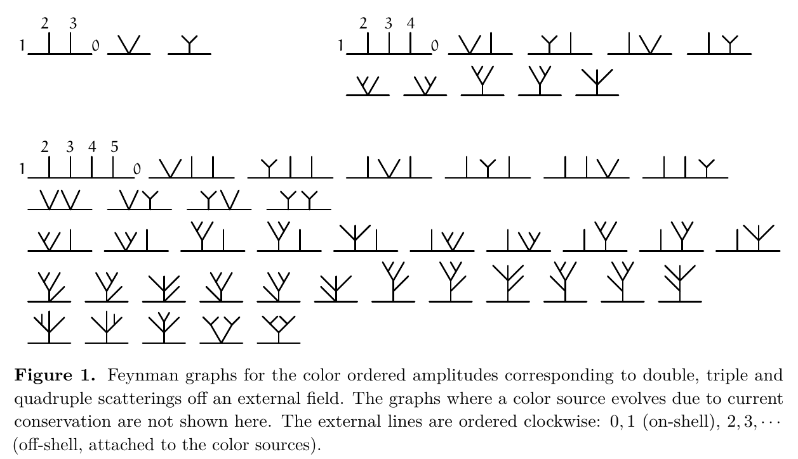
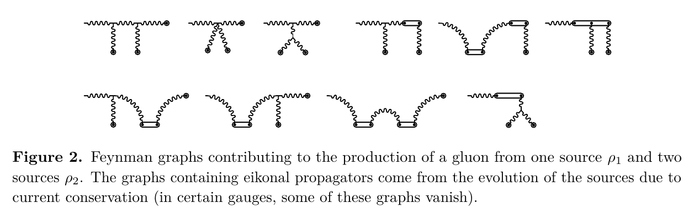

Analyzing | Framework v3.17

# Gluon production in the color glass condensate from BCFW recursion

**François Gelis** (Institut de Physique Théorique, Université Paris-Saclay, CEA-CNRS) · *JHEP* 08 (2026) 106 · DOI 10.1007/JHEP08(2026)106 · arXiv:2605.02299 · received 18 May 2026, accepted 12 June 2026, published 13 August 2026 · Open Access (SCOAP³)

*Clean full-text upload (61 pages including Appendices A–J and references), read in full: main text and appendices as extracted text, with the figure pages and the shift-rule summary page viewed as rendered images. No retrieval was needed. One targeted web search was run to place the method against prior off-shell recursion work. Posture: explanatory (peer-reviewed JHEP).*

---

## 1. Same Answer, No Gauge: Building a Collision Amplitude Without Ever Picking a Coordinate System

**Hook:** A twenty-year-old result in high-energy nuclear physics, the rate at which a fast proton knocks gluons out of a dense nucleus, is re-derived here without ever doing the step every earlier derivation spent most of its effort on: choosing a gauge and computing the bookkeeping that later cancels.

---

## 2. Big-Picture Context

When two nuclei or a proton and a nucleus collide at RHIC or the LHC, most of what comes out is gluons, the carriers of the strong force. At these energies the incoming nucleus is not a bag of a few quarks. It is a Lorentz-flattened sheet packed so densely with low-momentum gluons that they overlap and start recombining as fast as they split. The standard framework for this regime is the **color glass condensate (CGC)**: treat the fast-moving nucleus as a classical sheet of color charge, solve the classical field equations of the strong force (the Yang–Mills equations) with that charge as a source, and read off how many gluons fly out.

The catch is a familiar one in gauge theories. The classical color field you solve for is not a physical object. Its value depends on a choice of gauge, a kind of coordinate convention for the internal color space that can be made differently at every point and every moment. The final gluon count does not depend on that choice, but the intermediate field does, sometimes wildly. Three different gauges have been used for the classic "dilute–dense" case (a thin proton on a thick nucleus), producing solutions that look nothing alike and that each took real effort to obtain. They all give the same gluon spectrum in the end. A large fraction of each derivation is spent computing pieces that are then thrown away.

Particle physics ran into the same problem with scattering amplitudes in the 1980s and 2000s. Feynman diagrams are gauge-dependent piece by piece; only their sum is physical, and that sum is often absurdly simpler than its parts. That observation led to **on-shell methods**, especially the **BCFW recursion** (Britto–Cachazo–Feng–Witten, 2005), which builds a big physical amplitude directly from smaller physical amplitudes and never touches the gauge-dependent pieces. The obstacle to using BCFW in the CGC is that the gluons attached to the nuclei are not physical, freely propagating gluons. They are "off-shell," because they carry the field of a source rather than flying freely, and BCFW was built for on-shell particles. Extensions to off-shell legs exist (Andreas van Hameren and collaborators, around 2012–2015, plus related work the paper cites), and this paper adapts them to the CGC's one extra complication: the sources themselves rotate in color space as they cross the field, a requirement of color-charge conservation.

**Paper Type & Stakes:** This is a theoretical methods paper. It re-derives a known result, the leading-order gluon production amplitude in the dilute–dense limit of the CGC, using a gauge-free recursive technique imported from amplitude theory. What is at stake is not the answer but whether the new route is shorter, cleaner, and extendable to the next order, where the old route becomes impractical.

**Prior Belief Check:** The paper agrees with mainstream consensus by construction. Its final answer is the established dilute–dense result: production through the **Lipatov vertex** (the standard effective vertex for making a gluon from two exchanged gluons) dressed by a **Wilson line** (the color rotation a parton picks up crossing the nucleus). Specialists will not be surprised by the answer. What may interest them is that the eikonal "source-precession" graphs, which in diagrammatic calculations are essential to restore gauge invariance, never have to be drawn explicitly in the recursion; they appear only as one well-defined class of poles. The result is confirmatory and incremental in physics content. The method's claim to be leaner is plausible but is demonstrated only at the lowest order in the dilute source.

**Replication & Convergence Note:** The physical result has been independently reproduced several times over two decades, in Landau, light-cone, and Fock–Schwinger gauges, by different groups. The new derivation is single-author and has no independent re-derivation yet. The meaningful confirmation would be someone using the same recursion to reach a result that is *not* already known, most obviously the next order in the dilute projectile's charge, and checking it against a lattice or numerical classical-field solution.

---

## 3. Necessary Background Crash-Course

### Gauge freedom: why the field is not the physics

Think of the strong-force field as a set of arrows living in an internal three-color space attached to every point of spacetime. Gauge freedom says you may rotate the reference frame of that internal space independently at each point, provided you also adjust the field in a compensating way. Physical quantities, such as how many gluons hit a detector, cannot depend on these rotations. The field values themselves do.

In practice that means a calculation must either fix a convention (choose a gauge) and carry along terms that later cancel, or work only with quantities that are invariant from the start. The paper also makes a subtler point. Even in an empty initial state the field need not be zero; it can be any "pure gauge," a configuration that is all convention and no physics. The paper chooses the one initial convention in which the field starts at exactly zero. That is the only gauge choice the whole calculation needs.

> **Analogy:** The color field is like a program's internal microarchitectural state: register renaming tables, cache contents, branch-predictor history. Two correct CPUs implementing the same instruction set can hold completely different internal state at every cycle and still produce identical architectural results. A gauge is one particular microarchitecture.
>
> **Breaks when:** you ask where the invariance comes from. An instruction set is a written specification, so architectural equivalence is guaranteed by design. Gauge invariance is a local symmetry of the theory's equations, and whether a given calculated quantity is invariant has to be proven, not assumed. The paper spends its whole Section 3 showing that even the standard recipe for extracting gluon counts from a field has to be modified (using a covariant time derivative) before it is fully invariant.

### On-shell and off-shell: free particles versus field lines

A free gluon flying to a detector obeys a strict relation between its energy and momentum: massless, so energy equals momentum. That is being **on-shell**. A gluon emitted by the moving color charge of a nucleus does not obey it; it is a piece of the nucleus's field, more like the electric field around a passing charge than a photon. That is **off-shell**. In the CGC, every gluon tied to a nucleus is off-shell, specifically "space-like," carrying more momentum than energy.

A one-line example helps. For a source moving at the speed of light along a fixed direction, the field it produces carries no momentum along a certain light-cone combination, so the gluon's virtuality equals minus the square of its sideways (transverse) momentum. A gluon kicked sideways by one unit of momentum is off-shell by exactly one unit squared. The paper exploits this heavily: off-shell legs are labeled by their transverse momentum, written as one complex number plus its partner, and their propagators become simply one over the squared transverse momentum.

### Scattering amplitudes and why they are simpler than their diagrams

An **amplitude** is the complex number whose squared magnitude gives the probability of a given process. The traditional recipe sums Feynman diagrams, and the number of diagrams grows explosively. For gluons scattering off an external field with two, three, and four kicks, the paper's own Figure 1 shows 3, 10, and 38 color-ordered diagrams (I recounted these; see the Claim Check). Each diagram is gauge-dependent. The sum is not, and is often compact.

The classic example is the **Parke–Taylor formula** (1986): for any number of gluons with two of one helicity (spin direction along the motion) and the rest of the other, the full sum of thousands of diagrams collapses to a single one-line fraction. That simplicity signals that diagrams are an inefficient basis for these objects.

> **Analogy:** Diagrams are like an unoptimized expression tree emitted by a naive compiler front end: correct but bloated, with subexpressions that cancel. The amplitude is what remains after constant folding and dead-code elimination.
>
> **Breaks when:** you expect a mechanical optimizer to find the simplification. No local rewriting rule turns diagrams into Parke–Taylor; the simplicity comes from global structure (symmetry and analytic properties), which is exactly what on-shell methods use directly.

### Spinor-helicity: factoring a momentum into two halves

For on-shell massless momenta, amplitude theorists write each four-momentum as a two-by-two complex matrix. Its determinant equals the particle's mass squared, so for a massless particle the matrix has determinant zero, rank one, and factors into an outer product of two two-component vectors (spinors). You know this move from linear algebra: a rank-one matrix is a column times a row, the extreme case of low-rank compression. Every amplitude can then be written in terms of simple antisymmetric products of these spinors ("angle" and "square" brackets).

Off-shell momenta do not factor. The paper's key bookkeeping trick (Section 4.2) is to write an off-shell source momentum as "a piece along the source's own light-like direction, which does factor, plus two transverse coordinates." Those two transverse numbers turn out to be independent of the arbitrary reference vector used to define them, and their product is minus the gluon's virtuality. The shift rules in the recursion then reduce to "shift one transverse coordinate and one spinor."

### BCFW recursion: reconstructing a function from its poles

This is the engine of the paper, so it deserves the most care.

> **Concept:** A tree-level amplitude is a rational function of the external momenta, with only simple poles, each at a place where some internal particle goes on-shell. BCFW deforms two external momenta by a complex parameter in a way that preserves momentum conservation (and, for on-shell legs, keeps them on-shell). The amplitude becomes a rational function of that single complex variable. If it falls to zero as the variable goes to infinity, Cauchy's theorem says the original amplitude equals minus the sum of the residues at the other poles. At each pole, an internal line is on-shell, so the residue factorizes into a product of two smaller physical amplitudes. That is a recursion on the number of legs, and it never needs a gauge choice because every object in it is a physical amplitude.
>
> **Vehicle:** Divide-and-conquer with memoization. To compute the answer for a large input, you identify every place where the problem splits cleanly into two independent subproblems, look up the stored answers for each half, multiply them, and sum over all split points. A base-case table seeds the recursion. Correctness requires that the decomposition be complete: no contribution may exist that is not a clean split.
>
> **Analogy:** Each pole is a split point. The two factorized sub-amplitudes are the two halves. The three-gluon amplitudes, fixed by symmetry alone, are the base-case table. The requirement that the deformed amplitude vanish at large deformation is the completeness condition, with no leftover "boundary" term outside the splits.
>
> **Breaks when:** the large-deformation falloff fails. A divide-and-conquer recurrence either is complete by construction or visibly is not. Here the falloff has to be proven for each choice of which legs to deform, and a wrong choice silently leaves a missing term with no error message. The paper proves the falloff for its key case (two off-shell legs from sources moving the same way) in Appendix C using a background-field power-counting argument, and justifies the other shifts by how polarization vectors scale.

The paper's version of Cauchy's step is the one equation the whole method rests on:

$$\mathcal{A}(0) \;=\; -\sum_{\text{poles } z_*,\; z_* \neq 0} \operatorname{Res}_{z=z_*}\frac{\mathcal{A}(z)}{z}$$

**Symbol definitions:**
- $\mathcal{A}(0)$ : the amplitude we want, at zero deformation
- $\mathcal{A}(z)$ : the same amplitude with two legs deformed by the complex amount $z$
- $z_*$ : a value of $z$ where some internal propagator vanishes (a pole)
- $\operatorname{Res}$ : the residue, the coefficient of the simple pole

**What this actually means:** If you know exactly where a well-behaved function blows up and how strongly, you know the function everywhere, the same way a partial-fraction decomposition (familiar from integrating rational functions in physical chemistry kinetics) reconstructs a rational expression from its poles. Each pole's residue is itself a product of two smaller amplitudes, so the formula is a recursion.

**New pole types in the CGC.** With off-shell legs from sources there are two new kinds of pole beyond the standard internal-gluon one. First, a pole where the gluon attached directly to a source carries all its momentum: the residue turns that off-shell leg into an on-shell gluon of definite helicity, times a simple prefactor. This is how the paper bootstraps off-shell amplitudes from on-shell ones. Second, a pole in an **eikonal propagator**, the propagator describing a fast source whose color charge precesses as it crosses the field. Its residue is simply the unshifted eikonal propagator times two smaller amplitudes. The paper shows how to choose shifts that avoid or exploit these.

### Color ordering: separating the color table from the kinematics

Every gluon carries one of eight color labels, and amplitudes are tangled products of color factors and momentum dependence. The standard trick writes the full amplitude as a sum over orderings of the external legs, each term being a fixed color factor (a trace of color matrices) times a **color-ordered amplitude** that carries all the momentum dependence and no color. The CGC trees share this structure because the eikonal vertex carries the same color factor as an ordinary three-gluon vertex. Linear relations among orderings (the **Kleiss–Kuijf relations**) mean only a subset of orderings must be computed.

> **Analogy:** It is like separating a fixed lookup table of color coefficients, computed once, from the kinematic kernel you evaluate per configuration, then exploiting symmetries so you compute only one kernel per equivalence class.
>
> **Breaks when:** you assume the equivalence classes are simple. The Kleiss–Kuijf relations are linear identities among kernels with signs and reversed orderings, not plain duplicates, and in the paper's production case they are taken for granted rather than re-checked for a leg from a differently-moving source.

### Origins & Big Picture: how the color glass condensate came to be

The CGC grew out of a puzzle in deep inelastic scattering data from the HERA electron–proton collider in the 1990s. As experiments probed smaller and smaller fractions of the proton's momentum (the variable called x), the number of gluons kept climbing steeply, because each gluon can radiate more gluons with ever smaller momentum fractions. Taken literally, the growth would eventually violate unitarity: the proton would contain more gluons than could fit. Gribov, Levin and Ryskin had argued in the early 1980s that the growth must saturate, with gluons recombining as fast as they split once their density per unit transverse area reaches roughly one over the coupling. The momentum scale at which this happens, the **saturation scale**, grows with energy and with nuclear size. A large nucleus reaches saturation at lower energy than a proton, because its gluons are spread over a disk only moderately larger while numbering about a hundred times more for lead.

In 1994 Larry McLerran and Raju Venugopalan turned this into a calculable model. At very high energy the nucleus is Lorentz-contracted into a thin sheet, and its fast partons are time-dilated so they barely change during a collision. They can therefore be treated as a frozen, random sheet of classical color charge, the "glass" in the name. The slow gluons are the field this charge produces, so densely occupied that they behave classically, a "condensate." The randomness of the color charge is described by a probability distribution over charge configurations. Its evolution with energy is governed by the JIMWLK equation (and its large-color mean-field limit, the Balitsky–Kovchegov equation), the CGC's counterpart of the parton-distribution evolution equations of ordinary QCD.

Collisions came next. For two dense nuclei, the classical field equations with two sources were solved numerically on a lattice, giving the "glasma," the strong, nearly boost-invariant color fields that form in the first instant of a heavy-ion collision and seed the quark–gluon plasma. No analytic solution exists for that case. The asymmetric case, a dilute proton (or deuteron) on a dense nucleus, is analytically solvable to first order in the dilute charge and all orders in the dense one. That is the case relevant to proton–lead runs at the LHC and deuteron–gold at RHIC. Kovchegov and Mueller (1998), Kovchegov and Tuchin (2002), Dumitru and McLerran (2002), and Blaizot, Gelis and Venugopalan (2004) obtained the single-gluon production formula, in different gauges. The physics is a two-step picture: a gluon from the proton passes through the nucleus, its color rotated by a Wilson line (the nucleus acting as a color "filter" with a phase), and a new gluon is emitted through the Lipatov vertex, which also accounts for the color precession of the proton's own charge.

The on-shell amplitude story runs in parallel. Parke and Taylor's 1986 formula, Berends and Giele's 1988 recursion of off-shell currents, and the 2004–2005 twistor-inspired work of Witten and of Britto, Cachazo, Feng and Witten produced a toolbox for building gauge-theory amplitudes without diagrams. It has since become standard for multi-jet predictions at the LHC. High-energy factorization, the momentum-space cousin of the CGC used for forward jets, needs off-shell initial gluons; van Hameren, Kotko and Kutak made those amplitudes gauge invariant with auxiliary eikonal lines and then extended BCFW to them. This paper sits exactly at the junction: CGC sources are off-shell, light-like and eikonal, much like those high-energy-factorization legs, but with the added twist that the source's color charge itself evolves. The paper's acknowledgments thank van Hameren and Kutak, which marks the lineage.

What the paper measures, in that bigger picture, is not a new observable. It tests whether the dilute–dense CGC can be written entirely in the language the amplitude community uses, which, if it scales, opens the door to the next-order dilute–dense corrections and to non-eikonal (finite-energy) corrections that current gauge-based methods find painful.

```
Analyst-built concept diagram (not from the paper)

 3-gluon amplitudes            spinor + transverse-coordinate
 (fixed by symmetry) ------+   description of off-shell legs
                           |            |
                           v            v
               +---------------------------------+
               |  BCFW shift on two legs         |
               |  poles: internal gluon,         |
               |         source leg -> on-shell, |
               |         eikonal (precession)    |
               +---------------------------------+
                   |                    |
                   v                    v
   Sec 5: 3-pt with 1-2       Sec 6: gluon scattering off
   off-shell legs             nucleus, all orders (n kicks)
                   \                    /
                    v                  v
          Sec 7: production, 1 kick from proton,
                 n kicks from nucleus
                           |
                           v
      Lipatov vertex x propagators  ->  Wilson line after
      (known result, no bulk gauge)     longitudinal integrals
```

*Read it top to bottom: the base cases and the off-shell bookkeeping feed the recursion, which first handles the simpler scattering problem and then the production amplitude, ending at the known Lipatov-vertex-plus-Wilson-line form.*

**Central analogy for this paper:** architectural-state simulator versus cycle-accurate microarchitecture model.

---

## 4. Core Technical Explanation

### Step 1: Rewrite the classical field as a sum of trees

**Failure it prevents:** without a diagrammatic picture, there is no amplitude for BCFW to act on; you only have a field configuration.

**What the author does:** in the gauge where the field starts at zero, the classical solution is a sum of tree diagrams whose leaves are the color sources and whose root is the point where the field is evaluated. Propagators are retarded (causal), and each source is "dressed" by its own conservation equation, which adds a new eikonal line every time the source's color charge precesses in the field. Applying the standard extraction recipe for particle counts turns this into a sum of tree amplitudes with one on-shell produced gluon and any number of off-shell gluons attached to sources.

**What it buys:** a clean dictionary from "classical field problem" to "tree amplitudes with off-shell legs," exactly the input BCFW-type methods accept.

### Step 2: Fix the particle-counting recipe so it is truly gauge invariant

**Failure it prevents:** the textbook way to read gluon numbers from a field (projecting onto plane waves) silently assumes the field is small at late times and gives gauge-dependent answers if the gauge varies in time.

**What the author does:** he shows that the large "pure-gauge" piece a gauge rotation adds has no particle pole and so drops out, and replaces the ordinary time derivative in the projection with a covariant one, which makes the projection invariant under every time-dependent gauge rotation the equations allow.

**What it buys:** a definition of the production amplitude that is gauge invariant at the level of the definition, not just the final sum. This is the formal justification for working with amplitudes throughout.

### Step 3: Bootstrap three-point amplitudes with off-shell legs

**Failure it prevents:** BCFW needs base cases, and the on-shell three-gluon amplitudes alone do not include off-shell source legs.

**What the author does:** starting only from the two on-shell three-gluon amplitudes (themselves fixed by symmetry up to a prefactor), he applies a shift on one on-shell and one off-shell leg. The only pole is the one where the off-shell source leg goes on-shell, so each off-shell amplitude equals a prefactor times an on-shell one. Repeating with two off-shell legs gives the amplitude for producing one gluon from two sources moving in opposite light-cone directions.

**What it buys:** in diagrammatic perturbation theory this last amplitude needs four contributions, including source-precession graphs, to be gauge invariant. Here it is one term. It equals the **Lipatov vertex** contracted with the produced gluon's polarization, divided by the two incoming gluons' squared transverse momenta, which is the known lowest-order production amplitude (the paper shows the equivalence in Appendices D and G).

### Step 4: A warm-up — a gluon scattering off the nucleus to all orders

**Failure it prevents:** jumping straight to production would mix two new difficulties at once (many kicks and a second source direction).

**What the author does:** he computes the amplitude for an incoming gluon to scatter off a nucleus's field with any number of kicks, all from sources moving along the same light-cone direction. Shifting two adjacent off-shell legs along that common direction has a special property: it changes neither the off-shell propagators nor the eikonal propagators, so only internal-gluon poles appear. Two results follow. Helicity cannot flip (amplitudes with equal helicities vanish). And every non-flipping amplitude has one universal form: a fixed prefactor times one over the product of all the kicks' squared transverse momenta, times a "kinematic factor" made of nested propagator denominators, which the recursion builds up order by order. The paper proves the form by induction.

**What it buys:** for the color-ordered case where the two on-shell gluons are adjacent, the kinematic factor is simply a product of the propagators between successive kicks. Using a different color basis (products of structure constants, related to traces by the Kleiss–Kuijf relations) only that ordering is needed. The 3, 10 and 38 diagrams of Figure 1 are replaced by a closed formula.



*Figure 1 (from the paper): color-ordered Feynman diagrams for double, triple and quadruple scattering off an external field.*
**What to look at:** count the diagrams per row block (3, then 10, then 38). That growth, before even adding the source-precession graphs, is what the recursion replaces with a single closed formula for each ordering.

### Step 5: Turn nested propagators into a Wilson line

**Failure it prevents:** the all-orders result is an expanded series in kicks with nested denominators, not obviously the familiar Wilson-line form, so a reader cannot see that it matches the standard eikonal answer.

**What the author does:** in Appendix I he integrates over the sources' longitudinal momenta. Because the nucleus is a shockwave (its sources do not depend on one light-cone momentum component), each kick's longitudinal momentum appears only in the nested propagators. He symmetrizes over the order of the kicks, after which each integral is done by residues. The key algebraic step is that summing nested denominators over all orderings collapses into a simple product. The *n*-th term then carries the factor one over *n*-factorial times a product of independent kicks, precisely the *n*-th term of a path-ordered exponential.

$$\sum_{\text{orderings }\sigma}\;\frac{1}{k_{\sigma_1}\,(k_{\sigma_1}+k_{\sigma_2})\cdots(k_{\sigma_1}+\cdots+k_{\sigma_n})} \;=\; \frac{1}{k_1 k_2\cdots k_n}$$

**Symbol definitions:**
- $k_i$ : the light-cone momentum variable associated with the *i*-th kick (after the paper's change of variables)
- $\sigma$ : a permutation, i.e. an ordering of the *n* kicks

**What this actually means:** nested denominators are what you get when kicks happen one after another along a path (time-ordered). Averaging over all possible orders turns "a chain of dependent steps" into "independent steps," and independent steps multiply. That is the same reason the exponential series has a one-over-*n*-factorial: it is the time-ordered product of *n* identical steps, divided by the number of orderings. I verified this identity exactly for up to five kicks (Claim Check).

**What it buys:** the gauge-free amplitude becomes recognizably the standard eikonal scattering amplitude, a Wilson line in the nucleus's field, with no gauge fixed in the bulk.

### Step 6: Production — one kick from the proton, many from the nucleus

**Failure it prevents:** production involves sources moving in two opposite directions, so the clean "only internal-gluon poles" property of Step 4 is lost; eikonal poles can appear.

**What the author does:** he shifts two adjacent nucleus legs along the nucleus's direction. Off-shell propagators again do not move, nucleus-type eikonal propagators do not move, but proton-type eikonal propagators (the proton's charge precessing in the nucleus's field) now have a pole. The recursion produces exactly two terms per step: an internal-gluon pole and a proton-eikonal pole. For two nucleus kicks, neither term alone is simple. Their sum, after dropping a piece that integrates to zero over the nucleus's longitudinal momentum (valid for a shockwave), collapses to a compact expression. That expression has the same Lipatov vertex as the one-kick case, with the nucleus's single transverse momentum replaced by the *total* transverse momentum delivered by all kicks, times one extra propagator.



*Figure 2 (from the paper): the ten diagrams that a traditional calculation must sum for the order "one proton kick, two nucleus kicks."*
**What to look at:** the six diagrams with doubled lines are source-precession graphs. In the recursion these appear only implicitly, as the single eikonal pole. The paper's point is that all ten collapse to one short formula.

He then guesses the all-orders form and proves it by induction. Schematically:

$$\mathcal{A}_{n+2} \;\propto\; \frac{g^{n}\,\kappa_1\,(\kappa_2+\cdots+\kappa_{n+1})}{|\kappa_1|^2\,|\kappa_2|^2\cdots|\kappa_{n+1}|^2}\;\times\;\big[\text{Lipatov-vertex spinor factor}\big]\;\times\;\prod_{j}\frac{\big[\text{vertex factor}\big]}{\big(p_0+p_{n+1}+\cdots+p_j\big)^2}$$

**Symbol definitions:**
- $\mathcal{A}_{n+2}$ : color-ordered amplitude to produce one gluon from one proton kick and *n* nucleus kicks
- $g$ : the strong coupling
- $\kappa_1$ : the (complex) transverse momentum delivered by the proton
- $\kappa_2,\ldots,\kappa_{n+1}$ : transverse momenta delivered by each nucleus kick
- $p_0$ : momentum of the produced gluon; $p_j$ : momentum of the *j*-th nucleus kick
- the brackets stand for fixed spinor-product factors from the paper's equation (7.30), which I do not reproduce

**What this actually means:** the amplitude factorizes into three readable parts: the propagators of the incoming field gluons (one over their squared transverse momenta), a single production vertex that only cares about the total sideways push from the nucleus, and a chain of propagators that, after the longitudinal integrals, becomes the Wilson line. In systems terms, the production vertex is a function of an aggregate (the sum of all target kicks), not of the individual kick history, and the history collapses into one accumulated color rotation.

**What it buys:** the full dilute–dense amplitude to all orders in the nucleus, in a form directly comparable to the Landau-gauge solution, derived without fixing a gauge anywhere except the initial time slice. Appendix J adds a bonus: the same machinery gives a compact formula for a gluon splitting into two gluons in an external field (the strong-force analog of the Primakoff effect).

### Claim Check

All computations were done in Python with exact rational arithmetic (script `claimcheck.py`, run in the analysis workspace). Spinor-level reproductions of the paper's amplitudes were not attempted, because they depend on sign and phase conventions spread across Sections 4–5.

**Wilson-line collapse — Reproduced.** The step from the expanded all-orders series to the Wilson-line form rests on the identity that summing nested denominators over all orderings gives a plain product. I checked it with random rational inputs for two through five kicks, exactly. This is the load-bearing algebra behind the claim that the recursion reproduces eikonal scattering, so that conclusion holds.

**Color-basis consistency — Reproduced.** The paper's mixed-ordering kinematic factor for two kicks (one on each side of the on-shell pair), obtained by direct recursion, should equal the signed sum over merged orderings of the adjacent-ordering formula, per the Kleiss–Kuijf relation. Using the paper's own adjacent-ordering result, the two agree exactly. This supports using only the adjacent ordering plus a change of color basis.

**Diagram counts in Figure 1 — Reproduced, with a labeling slip.** Counting planar trees with three- and four-gluon vertices gives 3, 10 and 38 diagrams for two, three and four kicks, matching the figure. The text says "3 for n = 2, 10 for n = 4, 38 for n = 5," which mislabels the last two (they are three and four kicks). Harmless, but it inflates the apparent counts by one order.

**Lipatov-vertex equivalence at lowest order — Could not check independently.** The equivalence between the recursion's lowest-order production amplitude and the Landau-gauge Lipatov vertex is shown in the paper's Appendix G. Re-deriving it requires fixing the paper's spinor conventions end to end, which I did not do. The form of the answer (Lipatov vertex over two squared transverse momenta) matches the literature.

**Sensitivity check.** The most influential assumption is the shockwave limit: nucleus sources independent of one light-cone momentum component. It enters twice. The production result at two and more nucleus kicks drops a term "whose integral over the longitudinal momenta is zero," and the Wilson-line collapse uses the same independence. The conclusion survives exactly as long as the nucleus is infinitely thin and infinitely fast. With a finite thickness the dropped terms no longer vanish, and they become the "non-eikonal corrections" the author lists as future work. Physically that assumption is good at LHC energies and becomes a real limitation at lower RHIC energies or for forward kinematics. It is a property of the whole dilute–dense framework, not a weakness specific to this method.

**Robustness test (theoretical: limiting cases and recovery of known results).** The method passes the natural limiting checks: it reproduces the three on-shell base cases by construction, the lowest-order Lipatov vertex (paper's Appendix G), and the expanded Wilson line (Appendix I, verified above). The weakest link is the validity of each deformation choice. The required large-deformation falloff is proven in Appendix C only for shifts on two off-shell legs from sources moving the same way; other shifts are justified by how polarization vectors scale. In the production case, the shift lies along the nucleus direction and the proton-type eikonal propagators fall off with the deformation, so the condition plausibly holds, but it is argued rather than proven for the mixed two-direction amplitudes.

**Internal consistency (significant findings only).** No inconsistency changes a number or a conclusion. Two explicitness gaps are worth naming. First, Section 7.3 says the longitudinal integrals are done in Appendix I, but Appendix I starts from the *scattering* amplitude (Section 6), not the production amplitude; the reader must assume the same steps carry over. Second, the Kleiss–Kuijf relations are "taken for granted" for production even though one off-shell leg now comes from a source in a different direction; they hold in general for any amplitude built only from structure-constant vertices, which the eikonal vertex is, so this is very likely fine. Minor slips in one line: the summary table of shift rules in Section 4.3.3 has an unfinished caption ("??") and a column label using a different letter for momenta; one equation in Section 7.2 writes the second kick's virtuality where the third's is meant; the diagram-count labels above.

### Assumption Audit

> **Watch:** Reader likely assumes "gauge agnostic" means the calculation proves gauge invariance from scratch. The paper actually fixes the gauge at the initial time (field exactly zero in the far past) and uses the non-Abelian Ward identities to say the internal-propagator residues do not depend on the propagator's gauge. The recursion shows that the CGC amplitude can be *assembled* from gauge-invariant pieces; the invariance of those pieces is an input. The author's "in a sense a proof of gauge invariance" is the right level of hedge.

> **Watch:** Reader likely assumes the paper computes the gluon spectrum that is compared with data. The paper actually stops at the production *amplitude*, color-ordered and, for production, in expanded form. Squaring it, summing colors, and averaging over the nucleus's random charge distribution (the step that produces the familiar transverse-momentum-factorized formula and connects to evolution equations) is not redone; it is standard once the amplitude matches.

> **Watch:** Reader likely assumes "competes favorably" and "at a fraction of the calculational cost" are measured claims. The paper actually offers no operation count or side-by-side comparison; the support is the qualitative contrast between ten diagrams and one formula at a given order. It is persuasive at lowest order in the proton's charge, which is exactly where the old methods are already tractable. The claim that matters, that the method reaches the next order, is stated as a hope.

---

## 5. What's Genuinely New or Clever

**New to the field: the CGC's dynamical sources handled entirely by poles.** Off-shell BCFW had been developed for high-energy factorization with fixed eikonal lines. What this paper adds is the CGC's covariant current conservation: the requirement that the source's color charge precess as it moves through the field. In diagrams, that generates a whole family of extra graphs (six of the ten in Figure 2), essential for gauge invariance. In the recursion they are absorbed into one class of eikonal-propagator poles whose residue is the unshifted eikonal propagator times two smaller amplitudes. Choosing the shift along the nucleus's light-like direction makes all nucleus-side precession invisible to the deformation, so only the proton-side precession contributes, once per recursion step. That is a structural insight into why the dilute–dense answer is so simple: it is the statement that only one kind of pole survives.

**Clever: the transverse-coordinate parameterization of off-shell legs.** Writing each source momentum as "a piece along the source direction plus two transverse coordinates that do not depend on the reference vector" turns every shift into a rule of the form "this coordinate moves, that one does not." The off-shell propagators of same-direction sources then never move under a same-direction shift, which is what makes the all-orders induction tractable. For a reader with an architecture background, it is like choosing a coordinate system in which the invariant parts of the state are physically separate fields, so that an update touches only one field.

**New to the reader, not to the field:** the Parke–Taylor simplicity, the BCFW construction itself, color ordering and Kleiss–Kuijf relations, and the final Lipatov-plus-Wilson-line answer are all established.

### Predictive Content Check

**Falsifiable handle:** none against data, by design. The paper re-derives a known amplitude and makes no new physical prediction; "re-derives rather than predicts" is the finding. The nearest checkable claim is internal and forward-looking: that the same recursion can be pushed to the next order in the proton's charge (or to finite-thickness sources), where the result is not yet known analytically and could be checked against numerical classical-field solutions. The paper asserts this possibility but does not attempt it.

**Formalism load:** this half fires, because the paper is heavy on mathematical structure and claims novelty without an empirical handle. Verdict: the formalism is load-bearing, not decorative. It actually generates the result (the induction on nested denominators, the two-pole structure, the Wilson-line collapse), and removing it would leave nothing. But its *advantage* is shown only where the competition is already easy. The machinery is real; the payoff it promises is still prospective.

---

## 6. Limitations & Open Questions

**Reproduces rather than extends.** All physics results are known; the method's value rests on future use at next order or with non-eikonal corrections. **(A) Consensus** — the author states plainly that "the final results will obviously not be new" and lists both extensions as future directions. **(paper §1, §8)**

**Shockwave and light-like sources assumed throughout.** Every formula requires light-like source directions, and the production result drops terms that vanish only when the nucleus has no longitudinal structure. **(A) Consensus** — the paper states the restriction explicitly, and it is shared by the whole analytic dilute–dense literature. **(paper §7.2 footnote 18, §8)**

**Leading order in the dilute projectile only.** The proton's charge enters once. Proton–nucleus phenomenology at forward rapidity and high multiplicity is known to need higher orders, and the dense–dense case remains numerical. **(A) Consensus** — this is the standard limit of analytic CGC calculations; the paper names the next order as a goal. **(paper §7, §8; broader literature)**

**Efficiency claim unquantified.** No timing, operation count, or term-count comparison is given beyond illustrative diagram counts; the paper itself runs to 61 pages, mostly method exposition. Whether the method beats a well-chosen gauge (light-cone gauge is already simple) at next order is open. **(C) Speculative** — my assessment of what is and is not demonstrated; a practitioner might judge the lowest-order compression already decisive. **(analyst inference)**

**Gauge invariance is assembled, not derived.** The recursion relies on gauge-invariant sub-amplitudes and the Ward identities, and on one initial-time gauge choice. "Proof of gauge invariance" is therefore a reorganization, not an independent demonstration. **(B) Contested** — reasonable people may view a derivation that never references a bulk gauge as the stronger statement of invariance; the paper's own wording is hedged. **(paper §1; analyst inference)**

**Explicitness gaps in the final steps.** The longitudinal integration for the production amplitude and the color-basis relations for mixed-direction legs are asserted by analogy with the scattering case rather than shown. Very likely correct, but a reader cannot verify the last step from the text alone. **(C) Speculative** — from my reading; the steps look routine, and I found no reason to think they fail. **(analyst inference)**

**Large-deformation validity argued case by case.** The key falloff condition is proven for one shift class, not for the mixed-direction production amplitudes, where it is argued from scaling. At higher orders in the proton's charge, new shift choices will need new proofs. **(B) Contested** — falloff conditions in off-shell BCFW are a known subtlety in this literature; how much to worry depends on the case. **(paper §4.3, App. C; broader literature)**

**Over the next 12–24 months**, the obvious tests are a next-order (two proton kicks) dilute–dense amplitude from this recursion compared with a classical lattice solution, and a finite-thickness (non-eikonal) version.

---

## 7. Detailed Summary & Explanation

**Summary.** In the color glass condensate, colliding nuclei are sheets of classical color charge, and gluon production at leading order comes from solving the classical Yang–Mills equations with those sheets as sources. The field obtained depends on the gauge, though the gluon count does not, so standard derivations spend much of their effort computing pieces that cancel. Gelis rewrites the problem as tree amplitudes with one physical produced gluon and many off-shell gluons tied to the sources, and then computes those amplitudes with an off-shell extension of BCFW recursion, which builds amplitudes only from smaller physical amplitudes.

The key moves: a gauge-invariant definition of the production amplitude using a covariant time derivative; a parameterization of off-shell source momenta by their light-like direction plus two reference-independent transverse coordinates; identification of three types of poles (internal gluon, source leg going on-shell, and eikonal precession of the source charge); and shift choices that keep most of the off-shell and eikonal propagators fixed. With these, the three-point amplitudes with off-shell legs follow from on-shell ones in one line each; the gluon-scattering amplitude off a nucleus follows to all orders, with no helicity flip and a universal nested-propagator form; and the production amplitude at one proton kick and any number of nucleus kicks follows by induction. Its form is the Lipatov vertex evaluated with the total transverse momentum from the nucleus, the incoming field propagators, and a chain of propagators that becomes a Wilson line once the shockwave's longitudinal momenta are integrated out. Everything matches the known result obtained in three gauges, but here only the initial-time gauge is fixed.

**Why the summary is framed this way.** The paper's contribution is a method, not a number, so the summary emphasizes what each step removes from the calculation (gauge bookkeeping, precession graphs, diagram proliferation) and where the known answer reappears. I treated the source-precession story as the heart of the novelty because that is where this paper goes beyond earlier off-shell BCFW work. The checks I could run test the algebra that converts the recursion's output into the standard Wilson-line form and the color-basis reduction; both hold. The main interpretive choice is to read the efficiency claim as demonstrated at lowest order and promised beyond it, since the paper's own evidence is a contrast in diagram counts rather than a benchmark. The takeaway: this is a clean, credible translation of a core CGC result into on-shell language. Its significance depends on whether someone uses it to compute something new.

**Where I'm least confident in this analysis:** the spinor-level equivalence between the recursion's amplitudes and the Landau-gauge Lipatov vertex, and the large-deformation validity for the mixed-direction production shifts. I relied on the paper's own appendices for both rather than re-deriving them, and the text extraction of the spinor-bracket formulas was degraded (brackets lost), so I worked from the rendered pages and the logical structure rather than from every intermediate formula.

**Revision notes:** the referee pass replaced an early "proof of gauge invariance" framing with the assembled-not-derived distinction, added the explicitness-gap finding for Appendix I, cut the diagram-count discrepancy down to a labeling slip, and moved the spinor-helicity explanation ahead of its first use.

---

## 8. Three Crystallized Takeaways

1. **The physics answer is old; the route is new.** A dense nucleus producing gluons from a fast proton gives the same Lipatov-vertex-plus-Wilson-line amplitude it always did, now derived without choosing a gauge anywhere except the starting instant.

2. **The CGC's hardest bookkeeping becomes one kind of pole.** The color precession of the fast sources, which in diagram calculations needs a whole family of extra graphs to keep the answer gauge invariant, shows up in the recursion as a single, simple residue.

3. **The real test hasn't happened yet.** The method is shown to compress a calculation that was already tractable; its value will be decided when someone uses it to reach the next order, where the old methods struggle and no analytic answer exists.

---

## 9. Shorter Summary

When a proton slams into a heavy nucleus at LHC energies, the nucleus behaves like a flattened sheet of densely packed color charge, a picture called the color glass condensate. Physicists compute how many gluons come out by solving the classical equations of the strong force with that sheet as a source. The trouble is that the field they solve for depends on an arbitrary convention, the gauge, even though the final gluon count does not. Every known derivation spends much of its effort computing convention-dependent pieces that later cancel.

François Gelis borrows a tool from particle-physics amplitude theory to avoid that waste. The BCFW recursion builds a complicated physical amplitude from simpler physical amplitudes by locating the points where the amplitude splits into two smaller ones and adding up those splits. It never needs a gauge. The obstacle is that gluons tied to the nucleus are not free particles, and their color charge rotates as they cross the field. Gelis adapts earlier off-shell extensions of the method and shows that the charge rotation, which normally needs many extra diagrams, enters the recursion as a single simple type of term.

The result, for one kick from the proton and any number from the nucleus, is the known answer: a production vertex that depends only on the total sideways push from the nucleus, times a color rotation (a Wilson line) accumulated while crossing it. Only the starting convention is fixed. My checks confirmed the algebra that turns the recursion's output into the standard Wilson-line form and the color-bookkeeping shortcut.

The paper reproduces rather than predicts. It assumes an infinitely thin nucleus and works only to lowest order in the proton's charge, and its efficiency claims are illustrated rather than measured. Its real promise, reaching the next order where no analytic result exists, is still to be shown.

---

*Sources consulted beyond the paper:* [van Hameren, "BCFW recursion for off-shell gluons," arXiv:1404.7818](https://arxiv.org/abs/1404.7818).
