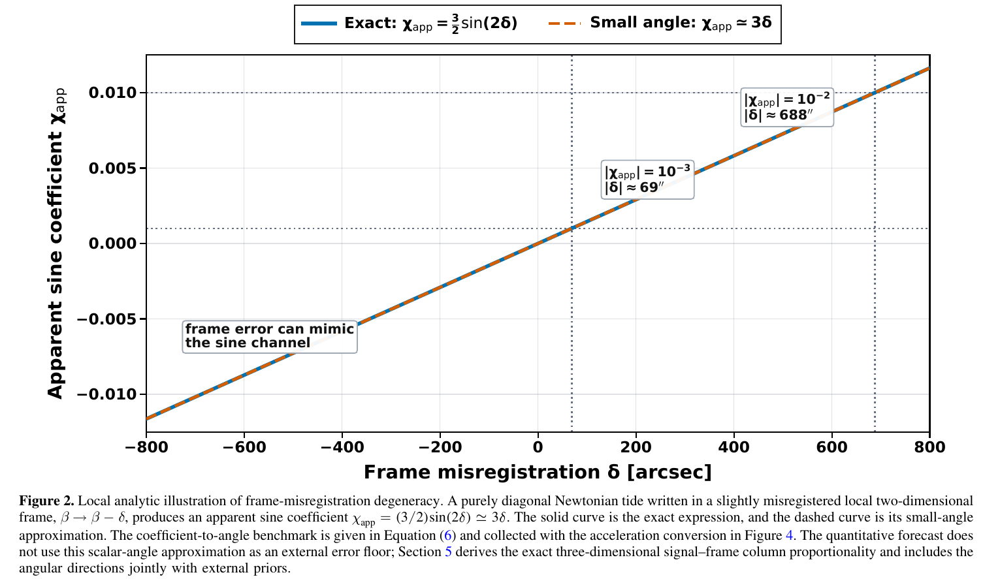
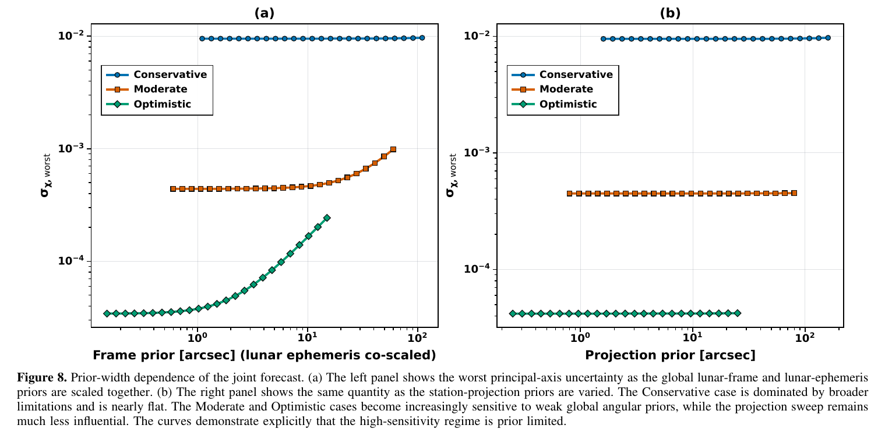
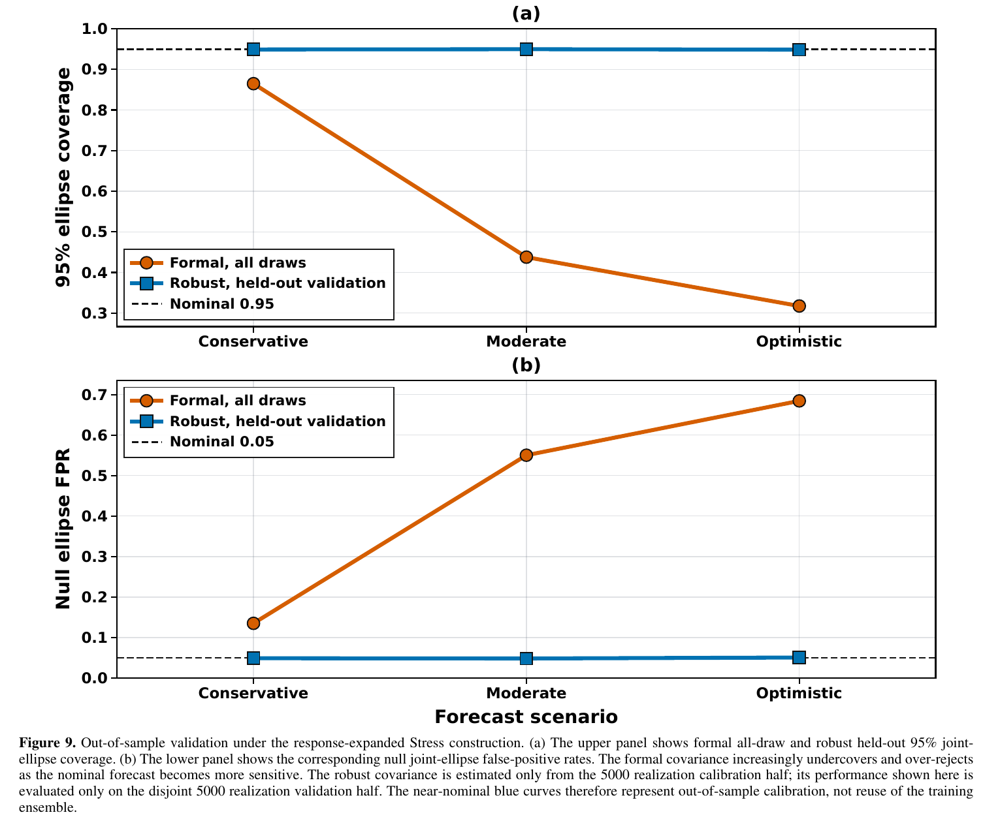
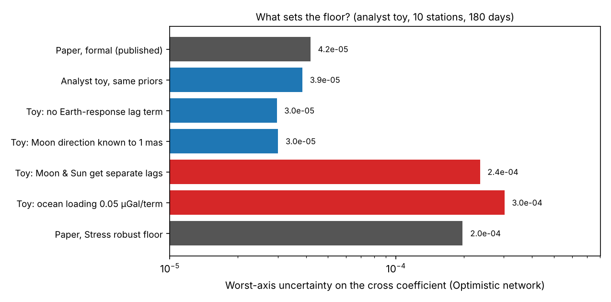

v3.17

Analyzing | Framework v3.17

# Frame Degeneracy and Sine-quadrature Residuals in Lunar Tidal Modeling — Analysis

**Paper:** Muhittin Cenk Eser, "Frame Degeneracy and Sine-quadrature Residuals in Lunar Tidal Modeling," *The Astrophysical Journal* 1011:226 (127 pp), 10 Nov 2026. DOI 10.3847/1538-4357/aeacd5. Open access (CC BY 4.0). arXiv companion 2605.21074. Code: Zenodo doi:10.5281/zenodo.22896632 and GitHub (muhittineser-lang/halilsoy-lunar-residual-forecast).

> **Access Status** — Full paper: uploaded PDF, read directly · Main text, Appendix A (tables, figures) read in full; figures viewed as page renders · Appendix B (about 100 of the 127 pages) is the complete Julia source listing: the parts that build the design matrix, geometry, priors and the Stress budgets were read; the plotting, CSV and reporting code was skimmed, not read line by line · Supplementary material: none beyond the code · Analysis basis: full text. Analyst checks used a Python re-implementation of the paper's design matrix (described in the Claim Check), not the author's Julia code, which was not run.

---

## 1. When the Moon Looks a Little Off-Center

**Hook:** The paper sets out to hunt a new "45-degree" component of the lunar tide and proves, rigorously, that such a component is mathematically the same thing as the ordinary tide pointing slightly the wrong way, so any search can only be as good as our knowledge of where the tide *should* point.

---

## 2. Big-Picture Context

The tide the Moon raises is one of the best-modeled signals in geophysics. A superconducting gravimeter (a superconducting sphere floating in a magnetic field, which senses changes in local gravity to about a billionth of g) sees the Moon's pull rise and fall twice a day by roughly 100 microgal. Standard Earth-tide codes reproduce that signal to a fraction of a percent once the solid Earth's elastic response, ocean loading, air pressure and groundwater are included. What remains after all that subtraction, the "residual," is where anyone hunting new physics in the tide has to look.

This paper starts from an idea suggested to the author by Mustafa Halilsoy (a relativist known for exact cylindrical gravitational-wave solutions): gravitational waves have two polarizations, "plus" and "cross," with the cross pattern rotated by 45 degrees. The ordinary Newtonian tide is plus-shaped: it stretches along the Earth–Moon line and squeezes across it. Could there be a small cross-shaped piece hiding in the lunar tide, with its peaks along the 45-degree directions?

The paper turns that idea into a carefully defined statistical question and then spends most of its length showing how hard the question is. It defines the cross piece as an extra off-diagonal entry in the tidal tensor, shows that a tiny error in the assumed Moon direction produces exactly the same signal, builds a full three-dimensional forecast for synthetic networks of 1, 3 and 10 gravimeters, and runs 10,000-draw Monte Carlo tests to see whether the error bars hold up when the model is deliberately wrong. No real gravimeter data are analyzed, and the Halilsoy spacetime is used only as a picture of what a cross-shaped tide looks like, not as a prediction of its size.

**Paper Type & Stakes:** This is a methods and forecasting paper in precision geodesy with a general-relativity motivation. It introduces a residual-search framework and an identifiability theorem; the stakes are whether a "cross-type lunar tide" can ever be measured as something distinct from ordinary modeling errors.

**Prior Belief Check:** The paper does not challenge mainstream tidal physics; it is careful to say the Newtonian tide is correct at leading order and that no anomaly is claimed. Its central theorem would not surprise a geodesist: everyone who fits tides knows that phase and direction errors leak into the out-of-phase (quadrature) component. What is new is stating that leakage as an exact identity in three dimensions and building the forecast around it. The motivating physics (a cross-polarized lunar tide) has no theoretical prediction behind it in the paper, so expert reaction to the physics side would be skeptical-neutral rather than surprised. Overall: incremental and methodological.

**Replication & Convergence Note:** Single-author, synthetic-data result; there is nothing to replicate yet in the observational sense. The forecast itself is reproducible from the archived code, and this analysis independently rebuilt the core of it (Claim Check). Real confirmation would mean applying the estimator to actual superconducting-gravimeter residuals with documented loading and response products, which nobody has done.

---

## 3. Necessary Background Crash-Course

### What a tide is, as a stretch-and-squeeze

The Moon pulls harder on the near side of Earth than on the center, and harder on the center than on the far side. Subtract the average pull (which just keeps Earth in orbit around the shared center of mass) and what is left is a *difference* field: outward along the Earth–Moon line on both sides, inward around the waist. That stretch-and-squeeze is the tidal field. At Earth's surface its vertical part is about 55 microgal at full strength, roughly five millionths of everyday gravity.

The paper writes this field as a 3×3 table of numbers, the tidal tensor. Line one axis up with the Moon and the table is diagonal: +2 along the Moon line, −1 along each of the two perpendicular directions (all times a common scale). The three entries add to zero, which is just the statement that stretching in one direction is paid for by squeezing in the other two.

**Analogy:** A load balancer that has decided one backend gets twice the normal traffic and the other two get correspondingly less: the allocation is described completely by which backend is favored and by how much.

**Breaks when:** you ask why the allocation sums to zero. A load balancer's shares sum to the total load by bookkeeping choice; the tidal field's zero trace is forced by gravity itself (empty space has no net source of tidal stretch), so it can never be "re-provisioned."

### Plus and cross: what the 45-degree idea means

A gravimeter measures only one direction: local vertical. As Earth spins, the vertical sweeps around relative to the Moon. If you plot the vertical tide against the angle between "vertical" and "Moon direction," the Newtonian tide follows a cosine of twice that angle (peaks at 0 and 180 degrees, troughs at 90 and 270). A hypothetical cross-shaped piece would follow a sine of twice the angle instead: zero along the Moon line, peaks at 45 degrees. These two shapes are the "plus channel" and the "sine-quadrature channel" of the title.

The paper stresses one point the original intuition can blur: the ordinary tide *does* have a value at 45 degrees (half the full strength). That is not a cross tide; it is just the plus pattern read off at an angle. The cross piece is defined only as an *extra*, independent sine-shaped term.

### Why "off by a hair" looks exactly like "something new"

This is the paper's core idea, and it is simple once seen.

Take the plus-shaped tide and rotate it by a tiny angle. The +2 and −1 entries stay almost the same, but a new off-diagonal entry appears, equal to three times the rotation angle (three is the gap between +2 and −1). An off-diagonal entry is exactly what the paper calls a cross residual. So, at first order, *a cross residual of size* χ *is the same mathematical object as the ordinary tide pointing χ/3 radians away from where you thought the Moon was.*

```
 Analyst-built illustration (not from the paper):
 a tiny rotation of the plus tide creates an off-diagonal entry

   ordinary tide, aligned        same tide, rotated by angle d
   [ +2   0 ]                    [ +2     3d ]
   [  0  -1 ]          --->      [ 3d     -1 ]
   plus only                     plus + "cross" of size 3d

   d = 1 arcsec  (4.8e-6 rad)  ->  cross size 1.5e-5
   d = 69 arcsec (3.3e-4 rad)  ->  cross size 1e-3
```
*What to look at:* the "new" entry and the "rotation" are the same number; nothing in the data can tell them apart unless you already know the true direction.

The paper's own numbers make the scale concrete: a cross coefficient of 1e-3 (a 0.055-microgal signal) is what a 69-arcsecond direction error produces; 1e-2 corresponds to about 690 arcseconds.

**Concept:** A symmetric, trace-free off-diagonal term added to the tidal tensor in the Moon-plus-transverse plane is, to first order, identical to an infinitesimal rotation of the Newtonian tidal tensor by one third of that term. No gravimeter time series can separate the two, at any station or time, unless some independent information fixes the true Moon direction.

**Vehicle:** A server's timestamp counter that might have a small unexplained skew. You check it against a reference clock, but the reference clock's own phase is known only to within some tolerance. A fixed offset in the server's counter and a fixed error in the reference clock's phase produce identical comparison logs; the smallest skew you can claim is set by how well you know the reference clock, not by how many comparisons you log.

**Analogy:** Server skew ↔ cross residual. Reference-clock phase error ↔ error in the assumed Moon direction. Identical comparison logs ↔ identical signal columns in the fit. Reference-clock tolerance ↔ the external prior on the Moon direction. "Log more comparisons" ↔ add more stations or longer records, which shrinks noise but not the shared ambiguity.

**Breaks when:** you ask what "the true direction" means physically. A reference clock has a definite phase someone could, in principle, measure better. For the tide, "where the tidal field points" and "where the Moon is" are two different physical quantities; the paper's χ is really a test of whether the tidal field points at the Moon's catalogued position. The clock picture has no slot for the possibility that both are measured perfectly and still disagree because gravity itself does something unusual.

### Least squares with priors, and what "formal" error bars mean

The forecast is a weighted least-squares fit (generalized least squares, which weights each residual by its noise correlations) of a model with the two cross coefficients plus a few hundred "nuisance" parameters: station offsets and drifts, ocean-loading terms, Earth-response gain and timing, and so on. Some nuisances are free; others carry a *prior*, an external statement such as "this angle is known to within 1.5 arcseconds." The error bar that comes out of the inverted information matrix (the Fisher matrix) is the *formal* uncertainty: correct only if the model contains every effect present in the data.

This is tier-1 territory in disguise: it is a linear solver over a design matrix, and the Fisher matrix is the normal-equations matrix. The subtlety is not the algebra; it is that formal error bars are only as honest as the column list.

### Coverage and false positives

To test honesty, the paper simulates data thousands of times with a known injected signal, fits each, and counts how often the true value lands inside the 95% error ellipse ("coverage") and, with zero injected signal, how often the fit falsely flags a detection ("false-positive rate"). Honest error bars give about 95% and 5%.

**Analogy:** Regression-testing a performance-prediction model by replaying many recorded workloads and checking how often its predicted confidence band contains the measured runtime.

**Breaks when:** the test workloads are generated by the same team that wrote the model; passing tells you the model handles the failure modes you thought of, not the ones you didn't. The paper is explicit about this limit.

### How the solid Earth responds, and why timing matters

Earth is not rigid: it bulges a few tens of centimeters under the tide, and oceans add a loading tide on top. A gravimeter sees the direct pull plus this response, with a slight delay (phase lag) and a gain different from one. The paper carries a gain and a lag per station.

A time lag has a simple geometric meaning that matters later. Earth turns about 15 arcseconds per second of time. Delaying the whole tidal record by 5 seconds is the same as rotating Earth by about 75 arcseconds, which, seen from the station, is the same as the Moon (and the Sun) sitting 75 arcseconds farther east or west. So an Earth-response timing error is itself a direction error, specifically along the east–west axis.

### Origins & Big Picture

**Where the idea came from.** In Newtonian gravity the tidal field is a clean, symmetric stretch along the line to the Moon. In general relativity the same physics is carried by the "electric part" of spacetime curvature, which for a static source reduces to the Newtonian tide but for gravitational waves takes two independent shapes, plus and cross. Cylindrical wave solutions of Einstein's equations, starting with Einstein and Rosen in 1937 and extended by Halilsoy in 1988 to include a second, cross-polarized sector, give exact examples where the tidal axes rotate. The question Halilsoy put to the author was whether something similar might leave a 45-degree fingerprint in the lunar tide. The paper keeps that only as a shape template; it deliberately does not claim the Halilsoy spacetime describes the Earth–Moon system, because a cylindrical wave is a very different object from a nearly static moon 384,000 km away.

**How tidal analysis actually works.** The modern Earth-tide pipeline descends from Doodson's 1921 harmonic expansion, which split the tide-generating potential into hundreds of sinusoidal "constituents" (the big ones are M2, the principal lunar semidiurnal, about 12.42 hours; O1 and K1, diurnal; S2, solar semidiurnal). Catalogues by Cartwright–Edden, Tamura and Hartmann–Wenzel refined that expansion. A gravimeter analysis fits an amplitude factor and phase for each constituent group, then corrects for ocean loading from global ocean-tide models, for air pressure using a measured admittance, for groundwater, polar motion and instrument drift. Superconducting gravimeters, operated in a global network since the 1990s, reach residual noise of a fraction of a microgal at tidal periods. The residual left after this chain is what the paper proposes to search.

**Why direction knowledge is the crux.** The geometric side of the problem (where the Moon and Sun are, how Earth is oriented) comes from planetary ephemerides fitted to lunar laser ranging and from VLBI Earth-orientation products. These are superb: the Moon's position is known to roughly meter level or better from laser ranging, which is a direction accuracy of order a milliarcsecond. The physical side (how Earth responds) is far less certain: ocean-loading models disagree at the level of a few percent of the loading signal, and the effective phase of the response varies from one constituent to another. That split, excellent geometry and imperfect response, turns out to be the key to reading this paper's numbers (Section 4).

**Where the paper sits.** It is not a test of gravity's speed and does not model the full relativistic two-body problem. It is closest in spirit to residual searches that try to bound anomalous terms in the tide or in lunar ranging, but it stops at a synthetic forecast. Its lasting contribution is the bookkeeping: a clean statement that a cross-shaped tide and a misaligned ordinary tide are the same column, plus a template for checking whether error bars survive realistic model mismatch.

```
 Analyst-built concept diagram (not from the paper):

  Halilsoy cross-wave idea --(shape only, no amplitude)--+
                                                          v
  Newtonian tide (plus) + cross term chi1, chi2 --> project on
                                                    each station's
                                                    vertical
                                                          |
         nuisances: Moon/Sun direction (prior),           v
         projection, gain, LAG, loading, air,     joint least-squares
         water, polar, drift, network noise  ---> + Fisher (formal err)
                                                          |
             exact identity: direction column = 3 x signal column
                                                          v
                        formal floor  4e-5 ... 1e-2  (3 networks)
                                                          |
             Monte Carlo, 10,000 draws, model deliberately wrong
                                                          v
                Stress: coverage 0.32, false alarms 0.69 (10 stations)
                recalibrated floor 2e-4, coverage 0.95 restored
```
*How to read it:* the top half is the model; the identity in the middle is why external priors set the floor; the bottom half is the robustness test.

**Central analogy for this paper:** detecting clock skew against an imperfect reference clock.

---

## 4. Core Technical Explanation

### Step 1 — Defining the cross channel in a plane

**The failure it prevents:** confusing the ordinary tide's 45-degree value with a new effect.

**What the author does:** writes the tide in a two-dimensional plane containing the Moon, adds one off-diagonal coefficient, and shows that the projected signal splits cleanly into a constant, a cosine-of-twice-the-angle part (ordinary tide) and a sine-of-twice-the-angle part (the new coefficient). The new term rotates the tide's principal axes by about one third of the coefficient, while changing the tide's strength only at second order.

**What it buys:** a precise target. "45-degree tide" now means "an independent sine-quadrature coefficient," not "the tide seen at 45 degrees."

### Step 2 — The degeneracy, first in the plane

**The failure it prevents:** mistaking a direction error for a physical signal.

**What the author does:** assumes the true Moon direction differs from the modeled one by a small angle and expands. The ordinary tide in the slightly wrong frame acquires a sine term exactly three times the angle. Figure 2 shows that conversion.


*Figure 2 (from the paper): apparent cross coefficient produced by a pure frame error, exact curve and small-angle line.*
**What to look at:** the straight line through zero. Every arcsecond of misalignment produces the same apparent coefficient whether or not any new physics exists; the two dotted markers show that 69 and 688 arcseconds map to coefficients of 1e-3 and 1e-2.

**What it buys:** a scale. Any claimed coefficient has to be compared with how well the frame is known in arcseconds.

### Step 3 — The exact three-dimensional identity

**The failure it prevents:** hoping that a real 3D network with many stations at different latitudes will break the degeneracy that the 2D picture shows.

**What the author does:** builds the cross term as a global 3D tensor with two coefficients, one for each direction perpendicular to the Moon line (the code picks the first as "toward the celestial north pole, projected" and the second as the direction perpendicular to that, roughly east–west). The gravimeter sees each through its own vertical. Then he differentiates the ordinary vertical tide with respect to a tilt of the Moon direction and finds Proposition 1:

$$\frac{\partial g_N}{\partial \delta_A} \;=\; 3\,\frac{\partial g_{\rm cross}}{\partial \chi_A}$$

**Symbol definitions:**
- $g_N$ : the ordinary (Newtonian) vertical lunar tide at a station (microgal)
- $g_{\rm cross}$ : the vertical signal from the cross term (microgal)
- $\delta_A$ : a small tilt of the assumed Moon direction along transverse axis A (radians)
- $\chi_A$ : the cross coefficient along the same axis (dimensionless)
- $A$ : 1 or 2, the two directions perpendicular to the Moon line

**What this actually means:** in the fit's design matrix, the "Moon direction" column and the "cross signal" column are the same vector scaled by three, at every station and every hour. Linear algebra calls that a rank deficiency: the data can only measure the sum (cross coefficient plus three times the tilt). Like two registers that are always written together, you can read their sum but never their individual values.

It holds exactly, not approximately, because (as Section 3 showed) the cross tensor *is* the generator of small rotations of the ordinary tide. The paper reports the corresponding overlap diagnostic as exactly 1 in every scenario.

**What it buys:** a theorem with teeth. Any finite bound on the cross coefficient comes entirely from outside information about the direction, never from the gravity data.

### Step 4 — The joint fit with everything else

**The failure it prevents:** quoting an error bar that ignores the mundane effects that also look like a tidal quadrature.

**What the author does:** puts the two cross coefficients into one big least-squares problem alongside: Moon-direction tilts (two kinds, "frame" and "ephemeris," which are the same column with separate priors), Sun-direction tilts, each station's local vertical (north and east tilts), each station's Earth-response gain and timing lag, station-by-constituent ocean loading for six constituents, separate air-pressure and groundwater terms, polar motion, offsets and drifts, free daily and twice-daily sinusoids, and fortnightly and monthly terms. Noise is correlated in time within a station and shares a low-rank component across stations. Three synthetic networks are defined.

| Scenario | Stations | Days | Noise (microgal) | Moon-direction priors (arcsec) | Lag prior (s) |
|---|---|---|---|---|---|
| Conservative | 1 | 30 | 1.0 | 11 frame, 5 ephemeris | 60 |
| Moderate | 3 | 90 | 0.30 | 6 frame, 1 ephemeris | 20 |
| Optimistic | 10 | 180 | 0.10 | 1.5 frame, 0.7 ephemeris | 5 |

*Trimmed from the paper's Tables 1 and A2: the inputs that matter most below.*

**What it buys:** the headline formal forecast, the worst-direction uncertainty on the cross coefficient:

| Scenario | First coefficient | Second coefficient (worst) |
|---|---|---|
| Conservative | 1.6e-3 | 9.5e-3 |
| Moderate | 1.7e-4 | 4.5e-4 |
| Optimistic | 2.7e-5 | 4.2e-5 |

*From the paper's Table 2.* In acceleration terms, the Optimistic worst-axis value corresponds to about 2 nanogal, roughly a 1.5-arcsecond direction equivalent.

### Step 5 — How much the priors matter

**The failure it prevents:** forgetting that the floor is borrowed from outside knowledge.

**What the author does:** scales the Moon-direction priors up and down together (left panel) and the station-vertical priors separately (right panel).


*Figure 8 (from the paper): worst-axis uncertainty versus Moon-direction prior width (a) and station-vertical prior width (b).*
**What to look at:** in panel (a) the green Optimistic curve sits on a flat floor near 3.5e-5 for priors below about an arcsecond, then climbs steeply. The blue Conservative curve never moves: something other than Moon direction limits it. Panel (b) is flat everywhere, so station-vertical uncertainty hardly matters.

**What it buys:** the paper's phrase "the high-sensitivity regime is prior limited." Read carefully, the figure says something slightly different: at the declared 1.5-arcsecond prior the Optimistic case is only partly prior-limited (4.2e-5 versus a floor of 3.5e-5), and below about an arcsecond the direction prior stops mattering. What then sets the floor is the subject of the Claim Check.

### Step 6 — Testing the error bars by breaking the model on purpose

**The failure it prevents:** trusting a formal error bar that assumes the model is complete.

**What the author does:** runs 10,000 simulated datasets per scenario in two regimes. "Matched": the truth contains only what the model fits. "Stress": the truth adds effects the model does *not* fit: per-constituent errors in the lunar and solar tides, per-constituent ocean-loading errors, mismatched air and groundwater periods, a stronger and shorter-range network noise, calibration errors, slow nonlinear drifts and, importantly, separate gain, lag and drift errors for each of the six tidal constituents at each station. Half the draws estimate an empirical ("robust") covariance; the other half test it.


*Figure 9 (from the paper): Stress-regime 95% coverage (a) and null false-positive rate (b), formal versus recalibrated robust covariance.*
**What to look at:** the orange formal curves fall apart as the network gets more sensitive: in the 10-station case the true value is inside the 95% ellipse only 32% of the time, and a zero signal is flagged as a detection 69% of the time. The blue recalibrated curves sit on the nominal lines.

**What it buys:** the paper's most practically useful result. Under its declared mismatch budget, the formal Optimistic floor of 4.2e-5 has to be inflated by a factor of 4.7, to 2.0e-4, to be honest. The recovered values stay unbiased; the error bars are simply too small. The paper's isolated response test shows that the constituent-dependent *lag* is the single largest culprit.

### Claim Check

Computation: Python (numpy), script `toy_fisher.py`, a re-implementation of the paper's design matrix using its published geometry functions (synthetic Moon and Sun directions, rotating station verticals, 3D cross templates, direction, projection, gain, lag, offset, drift and periodic columns, same priors). It omits the AR(1) and network noise, loading, air, groundwater and polar terms, which the paper's own ablation shows change the formal result by under 3%.

**Benchmark conversions — Reproduced.** The full lunar tidal scale is 55.0 microgal; a coefficient of 1e-3 equals 0.055 microgal and a 68.8-arcsecond direction error. Rotating the plus tide by a small angle gives an off-diagonal entry of exactly three times the angle, confirming that Proposition 1 is a rotation identity.

**Formal forecast — Partly reproduced.** The toy gives worst-axis values of 8.5e-3, 3.9e-4 and 3.9e-5 against the paper's 9.5e-3, 4.5e-4 and 4.2e-5: within 8% for Optimistic and about 10–15% otherwise, with the omitted noise and loading terms the likely difference. The geometry and the identity behave as the paper says.

**Which axis is worst, and why — Analyst finding.** In every scenario the worst axis is the second coefficient, which for a Moon near the equator points roughly east–west. Removing the per-station lag column from the toy drops it toward the first coefficient (Optimistic 3.9e-5 to 3.0e-5; Conservative 8.5e-3 to 1.8e-3). The reason is the geometry described in Section 3: a timing lag rotates the apparent Moon direction about Earth's spin axis, which is exactly the second transverse direction. A 5-second lag is a 75-arcsecond east–west shift, equivalent to a coefficient of about 1e-3. The only thing keeping the second coefficient near 4e-5 is that the fit assumes the Sun's tide shares the same lag, so the solar tide pins the clock.

**Sensitivity — the prior that actually matters.** Setting the Moon-direction prior to 1 milliarcsecond, roughly what laser-ranging ephemerides deliver, moves the Optimistic worst axis only from 3.9e-5 to 3.0e-5 (the first coefficient falls from 2.7e-5 to 1.2e-5). Letting the Moon and Sun tides have *separate* lags at each station, with the same 5-second prior, pushes it to 2.4e-4. The conclusion survives realistic direction priors but not loss of the shared-lag assumption, which fails by a factor of about six.

**Robustness (alternative explanation of the Stress result) — Analyst finding.** Freeing the Moon–Sun lag alone gives worst-axis values of 1.15e-2, 2.0e-3 and 2.4e-4 for the three networks, against the paper's Stress-calibrated 1.14e-2, 1.4e-3 and 2.0e-4. The paper's whole Stress inflation is largely reproduced by one physical fact: the Earth's response timing differs between tidal constituents, and the east–west cross coefficient is a disguised timing parameter.

**Significant finding 1 — the headline points at the wrong prior.** The abstract and conclusion stress that the constraint is "intrinsically prior limited" by lunar-frame and ephemeris knowledge, and the declared direction priors (0.7 to 11 arcseconds) are roughly a thousand times looser than modern lunar ephemerides. With realistic direction priors that limitation essentially disappears; the binding limitation is the Earth-response phase, which no ephemeris can fix. The paper models the lag and reports it as the largest response term, but never connects it to the degeneracy it puts at the center. This does not change the paper's numbers; it changes what a reader should conclude a real search must control.

**Significant finding 2 — the loading priors do a lot of unacknowledged work.** The total ocean-loading prior in the Optimistic network is 0.0017 microgal per station. Ocean-loading model uncertainty at real stations is plausibly tens of times larger (an analyst estimate from general knowledge; the paper gives no source). With a 0.05-microgal prior per loading term, the toy's Optimistic worst axis rises from 3.9e-5 to 3.0e-4, about eight times worse, and Moderate rises about fourfold. The paper's ablation (a 2.5% effect) measures the loading term only at its own tight prior.

**Internal consistency:** no significant inconsistencies; tables in the main text and Appendix A agree, and the binomial sampling scale of 0.003 quoted for the coverage estimates checks out.

### Assumption Audit

> **Watch:** Reader likely assumes the paper looked for, or found, a 45-degree lunar tide. The paper actually analyzes only simulated data and explicitly claims no detection and no bound on the Halilsoy coupling.

> **Watch:** Reader likely assumes the "cross residual" is a distinct physical pattern that happens to be confused with frame errors. The paper's own construction makes it, at first order, *identical* to a rotation of the ordinary tide by one third of the coefficient. What χ actually tests is whether the tidal field points where the ephemeris says the Moon is.

> **Watch:** Reader likely assumes the forecast floors (down to 4e-5) describe what a real ten-gravimeter network could reach. They rest on synthetic priors, notably ocean-loading and lag priors that are tighter than current models support, and the paper itself shows they must grow about fivefold under its own mismatch budget.

> **Watch:** Reader likely assumes Monte Carlo recalibration "fixes" the error bars. It fixes them only for the mismatch families the author chose to inject; both the training and test halves are drawn from the same declared budget.

---

## 5. What's Genuinely New or Clever

**The exact identity, stated cleanly.** Geodesists know that frame and phase errors leak into quadrature terms, but writing the cross residual as a global 3D tensor and proving that its design columns are exactly one third of the Moon-tilt columns, at every station and epoch, turns a folk caution into a rank statement about the fit. That is new to this framing and useful: it tells any future search that no amount of data can substitute for external direction and timing knowledge.

**Honest error-bar testing.** Building a Stress generator that deliberately exceeds the fitted model (per-constituent response errors, mismatched noise structure) and then validating a recalibrated covariance on a held-out half is better practice than most forecast papers follow. The result, coverage collapsing from 95% to 32% as precision improves, is a clear demonstration that formal error bars become less trustworthy exactly when they look most impressive. That lesson travels well beyond tides; it is new to the reader as a worked example, not new to statistics.

### Predictive Content Check

**Falsifiable handle:** The paper makes no prediction about nature: there is no expected size for the cross coefficient, and the Halilsoy sector supplies a shape only. The nearest testable statement is methodological: applied to real superconducting-gravimeter residuals, the formal error bars should under-cover unless the per-constituent response is modeled, and a real network should reach a worst-axis floor in the range of about 1e-4 to 1e-3. Physically, a nonzero χ would mean the tidal field is misaligned with the Moon's catalogued direction; as context (analyst inference, not in the paper), a gravity field pointing at the Moon's position one light-travel-time ago would give an along-track misalignment of about 0.7 arcseconds, a coefficient near 1e-5, below even the Optimistic floor, and general relativity predicts that this offset largely cancels. So the framework, as forecast, could not yet reach the most natural physical target. **Verdict: relabels and organizes rather than predicts.**

**Formalism load:** fires, because the paper leans on the Halilsoy cylindrical-wave spacetime and its Bessel-function tidal block. That entire sector is decorative for the results: the paper itself states it is not used in the forecast, supplies no amplitude, and is not continued past its own singular points. Deleting the Halilsoy section would change no number in the paper. The tensor-projection and Fisher machinery, by contrast, is load-bearing.

---

## 6. Limitations & Open Questions

**No real data.** Every number is a forecast for synthetic stations with declared noise and priors. **(A) Consensus** — the paper says this repeatedly, and a forecast without data cannot be evaluated against nature. **(paper §7, §7.9)**

**No physical model for the signal.** Nothing predicts a nonzero cross coefficient or its size; the Halilsoy sector gives a shape but, as the paper admits, normalizing it to the Earth–Moon system would require an unsolved matching calculation. **(A) Consensus** — explicitly acknowledged as open, and without it the search has no target. **(paper §4, §7.4, §7.8)**

**The declared direction priors are far looser than real ephemerides, which mislocates the bottleneck.** With milliarcsecond lunar directions the prior floor vanishes and Earth-response timing becomes the limit. **(C) Speculative** — from my re-implementation and general knowledge of laser-ranging accuracy; the paper may intend "frame" to include effects I have not modeled. **(analyst inference)**

**The east–west coefficient relies on the Sun and Moon sharing one response lag.** Freeing that assumption inflates the worst axis about sixfold, matching the paper's own Stress result. **(C) Speculative** — derived by recomputation with the paper's geometry and priors; the paper reports the lag as the largest response term but does not make this connection. **(analyst inference)**

**Loading priors appear unrealistically tight.** At a plausibly realistic loading uncertainty the Optimistic floor worsens about eightfold. **(B) Contested** — the right prior depends on the station and model and a geodesist could argue for tighter values at well-studied inland sites; the paper gives no source for its values. **(analyst inference; broader literature on loading-model differences)**

**The Stress test only checks the failures the author imagined.** Both calibration and validation halves come from one declared mismatch family. **(A) Consensus** — the paper says so plainly. **(paper §7.9)**

**Simplified geometry.** Moon and Sun directions are crude surrogates (fixed 28-degree declination swing, no nodal cycle, no real Earth orientation). **(A) Consensus** — stated in the paper; probably harmless for a forecast but untested. **(paper Table A1 note, App. A.1)**

**Scenario ordering mixes many variables.** Station count, duration, noise and priors all change together, so the gain from "more stations" cannot be isolated. **(A) Consensus** — the paper says so. **(paper §5.6)**

**Open questions for the next 12–24 months:** apply the estimator to real superconducting-gravimeter residuals (for example from the IGETS archive) with constituent-specific response modeling; replace the synthetic priors with documented loading and Earth-orientation products; state what physical effect a nonzero χ would represent (tidal misalignment, retardation-type effects, or response anisotropy) and what size it should have.

---

## 7. Detailed Summary & Explanation

The paper asks whether the Moon's tide could contain a small extra component shaped like the "cross" polarization of a gravitational wave, with peaks at 45 degrees to the Earth–Moon line rather than along it. It begins by being precise: the ordinary tide has a perfectly normal value at 45 degrees, so the target is an *independent* sine-shaped term, represented as an off-diagonal entry in the tidal tensor.

It then shows the central obstacle. A tiny error in the assumed Moon direction produces exactly that sine term, three times as large as the angle. In three dimensions this becomes an exact identity: the design-matrix column for "cross residual" is one third of the column for "Moon tilted slightly," at every station and every hour. The gravity data can measure only their sum, so any limit on the cross term comes entirely from outside knowledge of where the tide should point.

On that foundation the author builds a full synthetic forecast with hundreds of nuisance parameters (direction tilts, station verticals, Earth-response gain and timing, ocean loading by constituent, air, groundwater, polar motion, correlated network noise) for 1-, 3- and 10-station networks. The formal worst-direction uncertainties come out at about 1e-2, 5e-4 and 4e-5. Monte Carlo tests then show that when the simulated truth includes effects the model leaves out, especially constituent-dependent Earth-response timing, the formal error bars become badly overconfident: in the best network the true value is inside the 95% ellipse only a third of the time. An empirical covariance calibrated on half the simulations restores honest behavior at about five times the formal error.

The way I have framed this summary reflects two interpretive choices. First, I read the cross coefficient as what it mathematically is: a measure of whether the tidal field points where we think the Moon is. That makes the "exact degeneracy" less a discovery than a definition, and it clarifies what physics χ could test. Second, my re-implementation of the forecast suggests the real bottleneck is not the Moon's catalogued direction (known far better than the paper assumes) but Earth's response timing, which is geometrically an east–west direction error. That one effect reproduces most of the paper's Stress inflation. Take away from this paper a sound methodological warning and a usable template for honest error bars, not a forecast of what real gravimeters could achieve and not evidence for any new tidal physics.

**Where I'm least confident in this analysis:** the two significant findings rest on my Python re-implementation (which matches the paper's formal numbers to within 8–15% but omits several nuisance blocks and was not checked against the author's Julia run) and on realistic-prior values for ocean loading and lunar ephemerides taken from general knowledge, not from cited sources; the author's "frame" prior may deliberately bundle effects I have not modeled.

**Revision notes:** the referee pass added the shared-lag explanation of the worst axis, reworded the Figure 8 reading from "prior limited" to "partly prior limited," cut a second display equation, and moved the light-travel-time context from Section 4 to the Predictive Content Check, flagged as analyst inference.

---

## 8. Three Crystallized Takeaways

1. **A "new" 45-degree lunar tide is mathematically the ordinary tide aimed slightly wrong**: a cross coefficient of 0.001 is indistinguishable from a 69-arcsecond error in where you think the Moon is, so the gravity data alone can never tell them apart.

2. **The real lever is timing, not the Moon's position**: a few seconds of error in how Earth responds to the tide looks like the Moon shifted east or west by tens of arcseconds, and that, not the lunar ephemeris, is what limits such a search.

3. **The sharper the forecast, the more it lies**: in the paper's best simulated network, honest error bars are about five times the formal ones, and the formal version would cry "detection" two times in three when nothing is there.

---

## 9. Shorter Summary

This paper asks whether the Moon's tide might contain a small extra piece shaped like a gravitational wave's "cross" polarization, peaking at 45 degrees to the Earth–Moon line instead of along it. The idea came from relativist Mustafa Halilsoy's work on cylindrical gravitational waves, but the author uses that only as a picture of the shape, not as a prediction of size.

The key result is a clean, exact statement of why such a search is hard. Adding a cross piece to the tide is mathematically identical to rotating the ordinary tide by a third of that amount. So a gravimeter cannot distinguish "new tidal physics" from "the Moon is slightly off from where we modeled it." Any limit has to come from outside information about directions and timing, not from more gravity data.

The author then simulates networks of 1, 3 and 10 superconducting gravimeters, fitting the cross term alongside hundreds of ordinary effects such as ocean loading, air pressure, groundwater and Earth's own elastic response. On paper, the best network could detect a cross piece as small as about four parts in a hundred thousand of the tide. But when the simulations include realistic errors the model does not fit, especially Earth responding to different tidal rhythms with slightly different timing, those error bars become badly overconfident: they flag false detections about two times in three. Recalibrated error bars are about five times larger.

An independent re-implementation for this analysis suggests the real bottleneck is that timing. A few seconds of timing error looks just like the Moon displaced east or west, while the Moon's actual position is known far better than the paper assumes. Ocean-loading uncertainties are also set tighter than current models support.

The paper analyzes no real data and claims no detection. Its value is methodological: a clear identifiability theorem and a careful template for testing whether error bars survive model mismatch.

---

*Figures: Figures 2, 8 and 9 reproduced from Eser (2026), ApJ 1011:226, CC BY 4.0. Analyst re-implementation: `toy_fisher.py`, results summarized in `figures/eser-aeacd5_analyst-floor.png`.*


*Analyst-built illustration (not from the paper): worst-axis uncertainty for the 10-station network under the paper's priors and under single changes in the analyst's re-implementation.* **What to look at:** tightening the Moon direction (blue) barely helps, while giving Moon and Sun separate lags, or realistic loading priors (red), lands at the paper's own Stress floor (grey, bottom).
